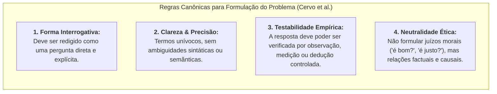
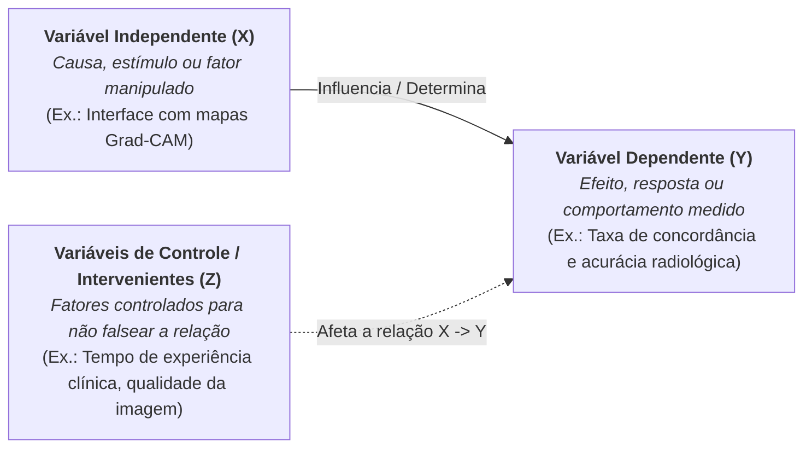
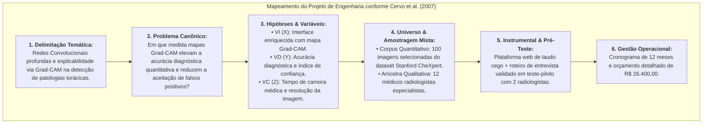
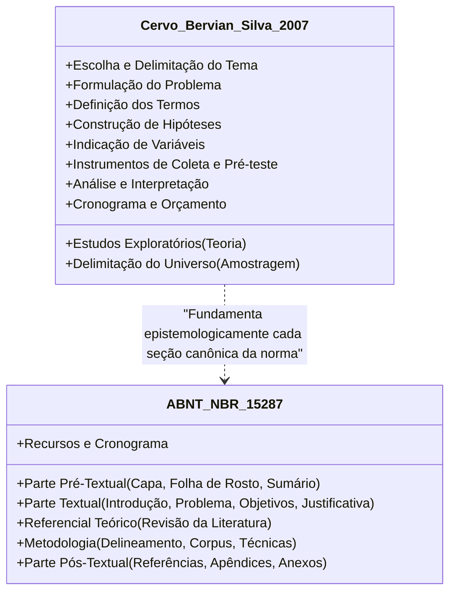

# 📖 Texto-base — Metodologia Científica: O Planejamento da Pesquisa

> **Disciplina:** Projetos e Métodos para a Produção do Conhecimento (`INT100-EC-2026S2B2-T001`)  
> **Tema da Semana 6:** Desenvolvimento e Planejamento do Projeto de Pesquisa  
> **Referência:** CERVO, Amado Luiz; BERVIAN, Pedro Alcino; SILVA, Roberto da. **Metodologia Científica**. 6. ed. São Paulo: Pearson Prentice Hall, 2007. (Capítulo 6: *O planejamento da pesquisa / Fases da elaboração da pesquisa*, p. 73-89).  
> **Link na Biblioteca Virtual (Pearson / Univesp):** [Acessar Capítulo 6 no Leitor Digital (PDF p. 84 / Livro p. 73-89)](https://plataforma.bvirtual.com.br/Leitor/Publicacao/341/pdf/84?code=GYkNtEf5YNPR2dW3Cx08nuMBD22j77b36gN3tf2dLLa8QcB41T0MBhnAdM30klvFATwreoIb7tK6+9fU1rPnzg==)  
> **Status:** 🟢 **Síntese Teórica, Epistemológica e Metodológica Completa**  

---

## 🗺️ Visão Panorâmica: Por que Planejar a Pesquisa?

No Capítulo 6 de *Metodologia Científica*, **Cervo, Bervian e Silva (2007)** dedicam-se ao núcleo operacional que converte a curiosidade intelectual em rigor científico: o **planejamento sistemático da pesquisa**.

Os autores sustentam que a ciência não admite o improviso nem o acaso ingênuo. Toda investigação genuinamente científica nasce de um processo reflexivo prévio no qual se antecipam os obstáculos, ordenam-se logicamente as fases de trabalho e dimensionam-se os recursos humanos, materiais e temporais.

> *"O projeto de pesquisa faz a previsão dos recursos necessários para atingir o objetivo proposto de solucionar um problema e estabelece a ordem e a natureza das diversas tarefas a serem executadas dentro de um cronograma a ser observado. [...] Planejar significa prever e metodizar as fases de um trabalho antes de executá-lo."*  
> — **CERVO, BERVIAN e SILVA (2007, p. 73)**

```mermaid
flowchart TD
    subgraph Planejamento["🔬 O Ciclo Sistemático do Planejamento da Pesquisa (Cervo, Bervian & Silva, 2007)"]
        F1["<b>1. Escolha & Delimitação do Tema</b><br>Recorte temático, espacial e temporal viável"]
        F2["<b>2. Formulação do Problema</b><br>Pergunta clara, objetiva e testável empiricamente"]
        F3["<b>3. Definição Conceitual dos Termos</b><br>Eliminação de ambiguidades e polissemia semântica"]
        F4["<b>4. Hipóteses & Indicação de Variáveis</b><br>Conjecturas provisórias, variáveis X (indep.) e Y (depend.)"]
        F5["<b>5. Estudos Exploratórios & Revisão Teórica</b><br>Estado da arte e fundamentação bibliográfica"]
        F6["<b>6. Delimitação do Universo & Amostragem</b><br>Definição da população e técnicas amostrais"]
        F7["<b>7. Instrumental de Coleta & Pré-Teste</b><br>Elaboração e validação prévia de questionários/protocolos"]
        F8["<b>8. Análise & Interpretação dos Dados</b><br>Tabulação quantitativa e categorização qualitativa"]
        F9["<b>9. Planejamento Operacional</b><br>Cronograma calendarizado e orçamento de recursos"]
    end

    F1 --> F2 --> F3 --> F4 --> F5 --> F6 --> F7 --> F8 --> F9
```

---

## 📌 1. As Fases da Elaboração da Pesquisa em Detalhe

Cervo, Bervian e Silva decompõem o planejamento da pesquisa em etapas lógicas e interconectadas. Cada fase condiciona a subsequente, de modo que uma falha na etapa inicial contamina a consistência de todo o edifício metodológico.

---

### 🔹 1.1 Escolha e Delimitação do Tema

A escolha do tema é o marco inaugural do projeto e decorre de uma tensão dialética entre dois conjuntos de fatores:

| Critérios Internos (Subjetivos do Pesquisador) | Critérios Externos (Objetivos da Ciência e da Sociedade) |
| :--- | :--- |
| **Afinidade e vocação pessoal:** O pesquisador deve ter interesse genuíno pelo assunto para sustentar a dedicação prolongada. | **Relevância científica e social:** O tema deve responder a uma lacuna teórica ou demanda concreta da sociedade. |
| **Capacitação técnica prévia:** Domínio dos conceitos matemáticos, teóricos e laboratoriais exigidos. | **Disponibilidade bibliográfica:** Existência de fontes acessíveis, bases indexadas e literatura consolidada. |
| **Tempo disponível:** Compatibilidade do fôlego do estudo com os prazos institucionais (Graduação, Mestrado, Doutorado). | **Viabilidade ética e institucional:** Acesso a laboratórios, comitês de ética e autorizações legais. |

#### A Urgência da Delimitação Temática
Os autores alertam que a tendência mais comum do pesquisador iniciante é selecionar temas excessivamente amplos, vagos ou universais (*ex.: "A inteligência artificial na medicina moderna"*). 

> **Regra de Cervo et al.:** Delimitar significa fixar fronteiras nítidas. Deve-se recortar:
> 1. **O prisma teórico/analítico:** Qual dimensão exata será investigada? (*A explicabilidade algorítmica via mapas de calor*);
> 2. **O universo empírico:** Qual público ou base de dados? (*Médicos radiologistas e radiografias de tórax*);
> 3. **O recorte espacial e temporal:** Em qual contexto geográfico e histórico? (*Hospitais universitários de São Paulo no biênio 2026-2027*).

---

### 🔹 1.2 Formulação do Problema de Pesquisa

Uma vez escolhido e delimitado o tema, formula-se o **problema**. Para Cervo, Bervian e Silva, toda pesquisa científica nasce de uma dúvida, uma incerteza, uma contradição ou uma lacuna observada no conhecimento humano.

Citando preceitos clássicos da epistemologia, os autores advertem:
> *"Formular um problema consiste em dizer de maneira explícita, compreensível e operacional qual dificuldade se pretende resolver. Formular o problema de forma adequada é, não raro, mais importante do que encontrar a resposta, pois uma pergunta mal colocada conduz invariavelmente a investigações inúteis ou respostas equivocadas."* (CERVO et al., 2007, p. 77).

---

### 🔹 1.3 Definição dos Termos

A ciência exige rigor semântico. Em muitos campos do saber, termos comuns da linguagem cotidiana adquirem significados técnicos altamente específicos, ou sofrem de polissemia conceitual.

Cervo et al. prescrevem que o projeto contenha a **definição operacional dos termos**:
* **Definição Teórica (Conceitual):** O sentido conferido ao conceito com base na literatura de referência (*ex.: o que se entende por "explicabilidade algorítmica"*);
* **Definição Operacional (Mensurável):** A tradução do conceito abstrato em indicadores concretos e mensuráveis (*ex.: explicabilidade operacionalizada como a sobreposição espacial entre o mapa Grad-CAM e a anotação manual de referência [Intersection over Union - IoU]*).

---

### 🔹 1.4 Construção de Hipóteses e Indicação de Variáveis

A **hipótese** é a alma do raciocínio dedutivo e hipotético-dedutivo na pesquisa experimental e descritiva. Trata-se de uma **resposta provisória, uma conjectura plausível e racional** antecipada pelo pesquisador para responder à questão formulada no problema.

#### As Variáveis de Pesquisa
Uma hipótese articula logicamente duas ou mais **variáveis** — isto é, propriedades, magnitudes ou atributos suscetíveis de assumir diferentes valores e que podem ser observados ou medidos:

#### Critérios de Validade da Hipótese Científica (Cervo et al., 2007):
1. **Consistência Lógica:** Não conter contradições internas nem colidir com conhecimentos científicos já amplamente demonstrados;
2. **Plausibilidade:** Ter fundamentação em teorias consagradas e no estado da arte;
3. **Poder Explicativo:** Possuir generalidade suficiente para esclarecer o problema levantado;
4. **Falseabilidade e Verificabilidade:** Poder ser submetida a provas empíricas capazes de refutá-la se for falsa (Karl Popper).

---

### 🔹 1.5 Estudos Exploratórios e Revisão Bibliográfica

Nenhum pesquisador parte do ponto zero. O estudo exploratório tem a função de proporcionar **familiaridade aprofundada com o fenômeno** e com o que a comunidade científica internacional já publicou a respeito.

Cervo, Bervian e Silva estruturam a revisão bibliográfica como uma técnica documental indireta que cumpre quatro funções indispensáveis:
1. **Evitar duplicações inúteis:** Garante que o pesquisador não invista tempo "reinventando a roda";
2. **Identificar lacunas reais:** Revela controvérsias não resolvidas ou métodos pouco explorados;
3. **Fornecer instrumental conceitual:** Oferece os modelos teóricos consolidados para interpretação dos achados;
4. **Orientar a escolha de instrumentos:** Mostra quais questionários, métricas ou protocolos laboratoriais obtiveram melhor validação pregressa.

---

### 🔹 1.6 Delimitação do Universo e Amostragem

A pesquisa deve definir com precisão matemática ou sociológica a quem ou a que se aplicam as conclusões:
* **População ou Universo ($N$):** O conjunto total de elementos (indivíduos, radiografias, documentos, amostras de código) que partilham das características investigadas.
* **Amostra ($n$):** A fração representativa extraída da população, sobre a qual incidirá a coleta de dados.

| Tipo de Amostragem | Procedimento Metodológico | Aplicação Predominante |
| :--- | :--- | :--- |
| **Probabilística (Aleatória)** | Todo elemento do universo possui probabilidade matemática conhecida e não nula de integrar a amostra (Aleatória Simples, Estratificada, Por Conglomerados). | Pesquisas quantitativas, epidemiológicas e testes de validação estatística com inferência populacional. |
| **Não-Probabilística (Intencional / Por Conveniência)** | A seleção dos elementos decorre do julgamento intencional do pesquisador ou de critérios de acessibilidade (Por Quotas, Por Tipicidade, Bola de Neve). | Pesquisas qualitativas, estudos exploratórios iniciais e entrevistas com especialistas altamente qualificados. |

---

### 🔹 1.7 Organização do Instrumental de Coleta e o Papel do Pré-Teste

Para colher os dados da realidade, o pesquisador necessita de instrumentos padronizados: formulários, questionários, roteiros de entrevista semiestruturada ou *pipelines* de telemetria de software.

Cervo et al. enfatizam uma regra metodológica que previne desastres em projetos científicos: **a obrigatoriedade do pré-teste (estudo piloto)**.
> O instrumento de coleta deve ser aplicado preliminarmente a uma pequena amostra de características idênticas às da amostra final. O pré-teste visa detectar:
> * Ambiguidades ou perguntas mal formuladas que gerem respostas contraditórias;
> * Complexidade excessiva ou fadiga do respondente / sobrecarga do sistema;
> * Dificuldades de tabulação e codificação dos dados;
> * Inadequação dos intervalos temporais estipulados.

---

### 🔹 1.8 Análise e Interpretação dos Dados

Coletar dados não encerra a pesquisa; o dado bruto não possui voz própria. O pesquisador precisa tratá-los através de duas operações intelectuais complementares:

1. **Análise dos Dados:** Organização, decomposição, tabulação, codificação e cálculo estatístico das medidas de tendência central, dispersão, correlação ou categorização temática.
2. **Interpretação dos Resultados:** O ato de atribuir significado aos padrões observados, confrontando as evidências empíricas com o quadro teórico de referência e respondendo diretamente às hipóteses formuladas.

---

### 🔹 1.9 Planejamento Operacional: Cronograma e Orçamento

O projeto de pesquisa é também um instrumento de gestão de projetos. Sem controle temporal e financeiro, o estudo fracassa por inexequibilidade.

* **Cronograma:** Distribuição temporal das etapas em meses ou semanas. Permite ao orientador e às agências de fomento monitorar o avanço dos marcos críticos (*milestones*).
* **Orçamento:** Discriminação transparente dos custos:
  * **Material Permanente:** Equipamentos de processamento (GPUs), licenças vitalícias, mobiliário de laboratório;
  * **Material de Consumo:** Reagentes, papel, mídias óticas, insumos gráficos;
  * **Serviços de Terceiros:** Nuvem de processamento distribuído (AWS/GCP), transcrição de áudios, traduções juramentadas, taxas de publicação em periódicos de alto impacto (*APCs*).

---

## 💻 2. Transposição Aplicada ao Projeto de Engenharia de Computação

Para demonstrar a apreensão e a aplicação concreta das diretrizes do Capítulo 6 de Cervo, Bervian e Silva (2007), mapeamos o projeto integrador de **Henrique Freire** na Univesp:

> **Título do Projeto:**  
> *Sistemas Inteligentes de Visão Computacional e Aprendizado Profundo Aplicados ao Auxílio Diagnóstico em Radiologia Pulmonar: Investigação da Explicabilidade Algorítmica (Grad-CAM), Confiabilidade Clínica e Governança Bioética.*

### Quadro Síntese: As Categorias de Cervo et al. no Projeto de IA em Saúde

| Categoria Epistêmica (Cervo et al.) | Operacionalização Concreta no Projeto de Computação |
| :--- | :--- |
| **Tema Delimitado** | Explicabilidade visual (Grad-CAM) em redes neurais convolucionais para detecção de opacidades pulmonares em hospitais do SUS. |
| **Problema de Pesquisa** | A disponibilização de mapas de ativação Grad-CAM em tempo real reduz a vulnerabilidade de médicos radiologistas a atalhos espúrios e falsos positivos de IA? |
| **Hipótese de Trabalho ($H_1$)** | A visualização do mapa Grad-CAM reduz em no mínimo 15% a aceitação inadvertida de falsos positivos decorrentes de artefatos do chassi radiográfico. |
| **Hipótese Nula ($H_0$)** | A exibição dos mapas Grad-CAM não altera significativamente a taxa de erro ou induz ancoragem cega do radiologista no diagnóstico automatizado. |
| **Variável Independente ($X$)** | Disponibilidade e transparência da interface explicável (Grad-CAM ativado vs. IA caixa-preta). |
| **Variável Dependente ($Y$)** | Frequência de acertos diagnósticos (Sensibilidade/Especificidade) e pontuação na escala de confiança psicométrica (Likert 1-5). |
| **Variáveis de Controle ($Z$)** | Nível de experiência clínica (anos de residência médica), iluminação da estação de trabalho e presença de ruído eletrônico nas imagens DICOM. |
| **População e Amostra** | Universo de médicos radiologistas atuantes no Estado de São Paulo; Amostra intencional por tipicidade ($n = 12$) com estratificação por tempo de atuação. |
| **Validação / Pré-teste** | Execução de rodada piloto com 2 médicos residentes para calibração da latência da API, contraste dos mapas térmicos e clareza do roteiro semiestruturado. |

---

## 📝 3. Síntese Comparativa: Estrutura do Projeto segundo Cervo et al. vs. ABNT NBR 15287

---

## 🎯 Conclusão e Lições Fundamentais para a Semana 6

1. **A Função da Hipótese e a Inexistência de Fracasso Científico:** A confirmação ou rejeição empírica de uma hipótese possui idêntico valor epistemológico para o avanço da ciência. O único fracasso reside na falta de método ou na adulteração de dados.
2. **A Primazia do Problema:** Sem uma pergunta formulada com clareza e precisão matemática/lógica, qualquer dado coletado torna-se estéril.
3. **O Pré-Teste como Blindagem Metodológica:** Jamais ir a campo sem submeter os instrumentos a uma bateria de validação piloto prévia.
4. **O Projeto como Garantia de Viabilidade:** O cronograma e o orçamento não são meras formalidades burocráticas, mas o atestado ético de que o pesquisador é capaz de concluir com êxito o compromisso assumido com a sociedade.
