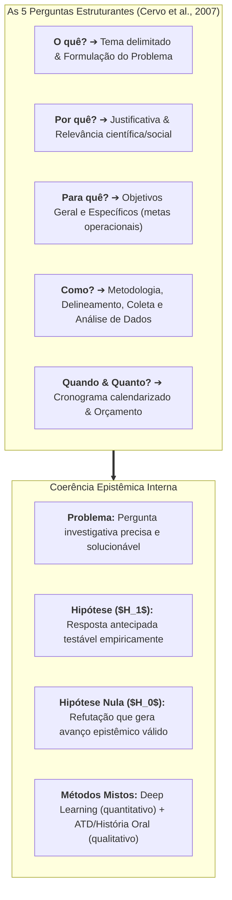

# 💬 Fórum Temático — Semana 6: Concretização da Escrita do Projeto de Pesquisa
### O Roteiro Científico, as Perguntas Estruturantes e a Articulação Metodológica

> **Disciplina:** Projetos e Métodos para a Produção do Conhecimento (`INT100-EC-2026S2B2-T001`)  
> **Tema da Semana 6:** Desenvolvimento e Planejamento do Projeto de Pesquisa  
> **Docente Responsável:** Profª Dra. Graziella Ribeiro Soares Moura / Profª Darlene Ferreira  
> **Período de Interação:** 02/11/2026 a 15/11/2026  
> **Status:** 🟢 **Modelos Prontos para Postagem Principal e Réplicas no AVA**  

---

## 📌 Enunciado Oficial do Fórum

> *Prosseguindo com o desafio de escrever um projeto de pesquisa, nesta semana chegamos à sua concretização.*  
> *O projeto de pesquisa é o roteiro, o plano antecipado e o guia base que orienta a produção do conhecimento científico.*  
> 
> *A partir dos estudos da semana (videoaula da Profª Darlene Ferreira e texto-base de Cervo, Bervian e Silva), compartilhe no fórum a estrutura consolidada do seu projeto de pesquisa ou reflexões sobre os desafios na articulação entre:*  
> 1. *A formulação do problema e das hipóteses (inclusive a desmistificação da hipótese nula);*  
> 2. *A delimitação dos objetivos (geral e específicos);*  
> 3. *A justificativa e o delineamento metodológico coerente para a sua área de formação.*  
> 
> *Comente também sobre as perguntas fundamentais que orientam o planejamento (O quê? Por quê? Para quê? Como? Quando e Quanto?) e interaja com as postagens dos colegas.*

---

## 💡 Roteiro de Fundamentação Epistemológica e Metodológica

Para responder ao fórum com excelência acadêmica na Engenharia de Computação, estruturamos nossa intervenção articulando os preceitos canônicos da **ABNT NBR 15287** e os ensinamentos de **Cervo, Bervian e Silva (2007)**:

---

## 📝 Modelo de Postagem Principal (Pronto para Copiar e Colar no AVA)

**Título da Mensagem:** *A Concretização do Projeto de Pesquisa: Da Formulação do Problema à Governança Bioética na Engenharia de Computação*

---

### 📄 Texto para Envio ao Fórum:

> Olá, professora Graziella, professora Darlene e caros colegas!
> 
> A concretização da escrita do projeto de pesquisa representa o momento decisivo em que a inquietação intelectual abandona a abstração e ganha contornos de método, rigor e viabilidade operacional. Como bem enfatizou a Profª Darlene Ferreira na Videoaula 7, e corroboram Cervo, Bervian e Silva (2007), **projetar significa antever e metodizar**. Não se ingressa no laboratório ou no campo empírico sem antes planejar o todo, pois o projeto científico não é mera formalidade burocrática, mas um mapa de navegação e um verdadeiro contrato epistêmico entre o pesquisador, a comunidade científica e as agências de fomento.
> 
> Ao estruturar o planejamento segundo as cinco perguntas fundamentais (*O quê? Por quê? Para quê? Como? Quando e Quanto?*), percebemos que o maior desafio reside na **coerência lógica interna** entre o problema formulado, as hipóteses, os objetivos e a metodologia. No âmbito da Engenharia de Computação, aplicamos essa matriz ao desenvolvimento de sistemas inteligentes em saúde:
> 
> 1. **O quê? (Problema e Delimitação):** As redes neurais convolucionais (CNNs) atingem alta acurácia na detecção de patologias em radiografias torácicas, porém operam como "caixas-pretas" (*black-box models*). Diante disso, nosso problema indaga: *em que medida a incorporação de mapas visuais de explicabilidade (Grad-CAM) eleva a acurácia diagnóstica quantitativa e, simultaneamente, assegura a confiança subjetiva e a adesão ética de médicos radiologistas?*
> 
> 2. **A Desmistificação da Hipótese Nula ($H_0$):** Um dos pontos mais brilhantes destacados nas aulas foi o resgate do valor da refutação. A nossa hipótese de trabalho ($H_1$) sustenta que os mapas Grad-CAM reduzem em ao menos 15% a aceitação de falsos positivos provocados por artefatos técnicos do chassi radiográfico. Todavia, caso os ensaios empíricos demonstrem a hipótese nula ($H_0$) — evidenciando que os mapas visuais não alteram a percepção de segurança ou até introduzem sobrecarga cognitiva —, a pesquisa não perde seu mérito. Na epistemologia científica, provar que uma técnica em voga não produz os efeitos clínicos esperados é um resultado tão nobre e valioso quanto a confirmação, poupando a comunidade médica de adotar tecnologias inócuas ou enganosas.
> 
> 3. **Para quê? (Objetivos Claros e Escaláveis):** O objetivo geral define o propósito maior (conceber, implementar e avaliar o protótipo de auxílio diagnóstico com explicabilidade), enquanto os objetivos específicos traçam as etapas operacionais em verbos no infinitivo: desde o treinamento matemático em bases abertas (*Stanford CheXpert* e *NIH ChestX-ray14*), passando pelo desenvolvimento do módulo Grad-CAM, até a condução de testes de usabilidade com especialistas humanos.
> 
> 4. **Por quê e Como? (Justificativa e Métodos Mistos):** A justificativa ancora-se no Marco Regulatório da OMS para Inteligência Artificial em Saúde (2021), que exige a preservação irrestrita da autonomia médica e a explicabilidade algorítmica. Para responder a essa complexidade, adotamos uma abordagem de Métodos Mistos (*Mixed Methods*): o polo quantitativo mensura sensibilidade, especificidade e ROC-AUC; o polo qualitativo aplica a História Oral Temática e a Análise Textual Discursiva (ATD) sobre os relatos dos radiologistas, avaliando sentimentos de confiança, hesitação e responsabilidade ética.
> 
> Em suma, a redação no tempo verbal futuro exigida pela ABNT NBR 15287 lembra-nos constantemente de que o projeto é uma promessa metodológica pautada na viabilidade temporal (cronograma) e orçamentária. Planejar com precisão é a única salvaguarda contra o desperdício de tempo e recursos na produção do conhecimento científico.
> 
> Um abraço a todos e excelentes pesquisas!
> 
> **Referências Bibliográficas:**  
> • ASSOCIAÇÃO BRASILEIRA DE NORMAS TÉCNICAS (ABNT). **NBR 15287**: Informação e documentação — Projeto de pesquisa — Apresentação. Rio de Janeiro: ABNT, 2011.  
> • CERVO, Amado Luiz; BERVIAN, Pedro Alcino; SILVA, Roberto da. **Metodologia científica**. 6. ed. São Paulo: Pearson Prentice Hall, 2007. (Capítulo 6: O planejamento da pesquisa).  
> • LITJENS, Geert et al. A survey on deep learning in medical image analysis. **Medical Image Analysis**, Amsterdam, v. 42, p. 60-88, Dec. 2017. DOI: 10.1016/j.media.2017.07.005.  
> • MORAES, Roque; GALIAZZI, Maria do Carmo. Análise textual discursiva: processo reconstrutivo de múltiplas faces. **Ciência & Educação**, Bauru, v. 12, n. 1, p. 117-128, 2006.  
> • SELVARAJU, Ramprasaath R. et al. Grad-CAM: visual explanations from deep networks via gradient-based localization. In: IEEE INTERNATIONAL CONFERENCE ON COMPUTER VISION (ICCV), 2017, Venice. **Proceedings [...]** Piscataway: IEEE, 2017. p. 618-626. DOI: 10.1109/ICCV.2017.74.  
> • WORLD HEALTH ORGANIZATION (WHO). **Ethics and governance of artificial intelligence for health**: WHO guidance. Geneva: WHO, 2021. 150 p.  

---

## 👥 Modelos de Réplicas aos Colegas no Fórum

Para enriquecer a participação e garantir pontuação máxima de engajamento no AVA, utilize os modelos abaixo para interagir criticamente com colegas de turma:

### 💬 Opção 1 — Foco na Importância da Hipótese Nula ($H_0$) e Rigor Epistêmico
> *"Olá, [Nome do Colega]! Excelente sua reflexão sobre o planejamento do projeto de pesquisa. Concordo plenamente com o que você colocou a respeito da formulação das hipóteses. Gostaria de destacar um aspecto que a Profª Darlene enfatizou na videoaula e que considero libertador para quem está começando na pesquisa: a perda do 'medo de errar a hipótese'. Na graduação, muitas vezes acreditamos que um projeto só tem sucesso se a hipótese principal for confirmada. No entanto, demonstrar rigorosamente que a hipótese nula é verdadeira — ou seja, que a variável estudada não causa o efeito presumido — impede que outros pesquisadores e a indústria insistam em caminhos infrutíferos, gerando uma contribuição científica de imenso valor. Parabéns pela clareza na exposição do seu tema!"*

---

### 💬 Opção 2 — Foco no Alinhamento entre Objetivos Específicos e Cronograma
> *"Olá, [Nome do Colega]! Achei muito enriquecedora a estrutura que você apresentou para o seu projeto. Um ponto que me chamou especial atenção foi a definição dos seus objetivos. Como destacam Cervo, Bervian e Silva, os objetivos específicos nada mais são do que o desdobramento operacional e sequencial do objetivo geral. Quando os objetivos específicos são bem delimitados com verbos de ação mensuráveis no infinitivo (como mapear, treinar, validar, comparar), a construção do cronograma e a escolha dos instrumentos de coleta tornam-se quase naturais, evitando que o pesquisador se perca em prazos irreais ou colete dados além do necessário. Sucesso na continuidade da sua pesquisa!"*
