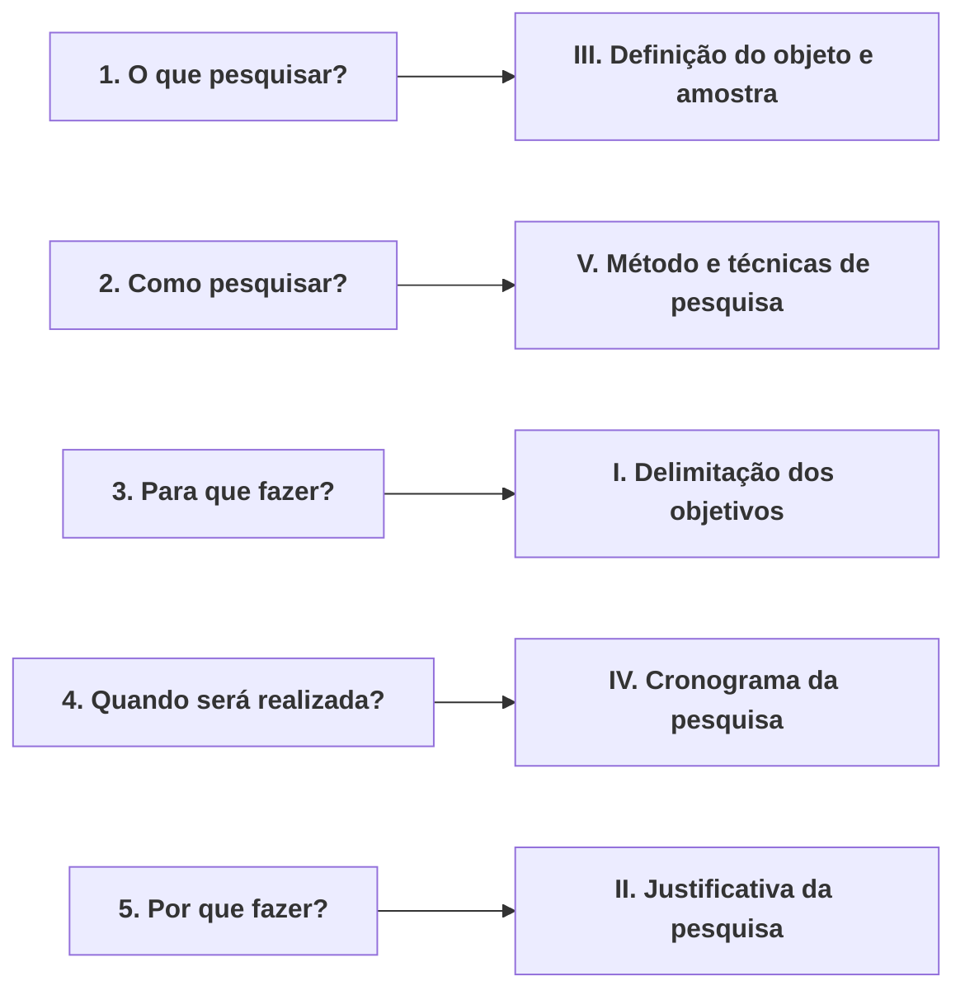

# 📝 Atividade Avaliativa — Semana 6 (INT100)
### Desenvolvimento do Projeto de Pesquisa: Da Concepção ao Planejamento

> **Disciplina:** Projetos e Métodos para a Produção do Conhecimento (`INT100-EC-2026S2B2-T001`)  
> **Tema da Semana 6:** Desenvolvimento e Planejamento do Projeto de Pesquisa  
> **Docente Responsável:** Profª Dra. Graziella Ribeiro Soares Moura / Profª Darlene Ferreira  
> **Pontuação Máxima:** 10,00 pontos (4 questões de 2,50 pontos cada)  
> **Período de Realização:** 02/11/2026 a 15/11/2026  
> **Status:** 🟢 **Gabarito Oficial Fundamentado (Nota Prevista: 10,0 / 10,0)**  

---

## 🎯 Gabarito Rápido para Preenchimento no AVA

| Questão | Enunciado Resumido | Alternativa Correta |
| :---: | :--- | :---: |
| **1** | Associação de perguntas estruturantes aos elementos constitutivos do projeto de pesquisa | **d** (`1-III; 2-V; 3-I; 4-IV; 5-II`) |
| **2** | Elementos obrigatórios e fundamentais do projeto de pesquisa (Justificativa e Objetivos) | **a** (`II e III, apenas`) |
| **3** | Relação de asserções (I e II) sobre objetivos, metas e a dinâmica do objetivo geral | **e** (`A asserção I é verdadeira, e a II é falsa`) |
| **4** | Análise das fases do projeto científico (tema vs. delimitação, objetivos e formulação do problema) | **a** (`II e III, apenas`) |

---

## 🔍 Resolução Analítica Questão por Questão

---

### 📌 Questão 1 — Associação de Perguntas aos Elementos do Projeto

**Texto da Questão:**  
*Para muitas pessoas, a elaboração de um projeto de pesquisa é um desafio. No entanto, entendendo-se as partes que o compõem e as perguntas que embasam a definição desses elementos, fica bem mais fácil e assertivo.*

*Avalie a seguir as perguntas que são feitas para a elaboração de um projeto de pesquisa e as relacione adequadamente aos elementos do projeto a que correspondem.*

**Coluna 1 — As Perguntas Estruturantes:**  
1. *O que pesquisar?*  
2. *Como pesquisar?*  
3. *Para que fazer essa pesquisa?*  
4. *Quando a pesquisa será realizada?*  
5. *Por que se deseja fazer essa pesquisa?*  

**Coluna 2 — Os Elementos do Projeto:**  
* **I.** *Delimitação dos objetivos do estudo.*  
* **II.** *Apresentação da justificativa da pesquisa.*  
* **III.** *Definição do objeto de pesquisa e amostra.*  
* **IV.** *Apresentação do cronograma da pesquisa.*  
* **V.** *Definição do método e das técnicas de pesquisa.*  

**Opções de Resposta:**  
* a. 1-III; 2-V; 3-II; 4-IV; 5-I.  
* b. 1-V; 2-IV; 3-II; 4-III; 5-I.  
* c. 1-III; 2-II; 3-I; 4-IV; 5-V.  
* **d. 1-III; 2-V; 3-I; 4-IV; 5-II.**  
* e. 1-V; 2-III; 3-I; 4-IV; 5-II.  

#### 💡 Justificativa Teórica:
Conforme detalhado pela **Profª Darlene Ferreira (Videoaula 7)** e por **Cervo, Bervian e Silva (2007, Cap. 6)**:
* **(1 $\to$ III) O quê?:** Refere-se à matéria, ao tema delimitado, ao objeto empírico/teórico e à amostra a ser investigada.
* **(2 $\to$ V) Como?:** Refere-se aos procedimentos metodológicos, caminhos lógicos (método) e instrumentos operacionais de coleta e análise (técnicas).
* **(3 $\to$ I) Para quê?:** Designa a finalidade, as metas e os pontos de chegada pretendidos pelo cientista (Objetivos Geral e Específicos).
* **(4 $\to$ IV) Quando?:** Trata-se da dimensão temporal de planejamento, expressa na distribuição calendarizada das tarefas ao longo do tempo (Cronograma).
* **(5 $\to$ II) Por quê?:** É a fundamentação lógica da relevância teórica, metodológica, prática e social que legitima a execução do estudo (Justificativa).

Portanto, a sequência correta é: **1-III; 2-V; 3-I; 4-IV; 5-II**.

* **Alternativa Correta:** **d**

---

### 📌 Questão 2 — Elementos Constitutivos do Projeto de Pesquisa

**Texto da Questão:**  
*A pesquisa científica desenvolvida terá visibilidade e reconhecimento no momento em que tornar público e acessível os resultados, permitindo que todos tenham ciência do conhecimento sistematicamente elaborado. Porém, para que a pesquisa atinja os objetivos com sucesso, é necessário o desenvolvimento de atos coesos e a presença de informações e de elementos primordiais.*

*Sobre os elementos que compõem o projeto de pesquisa, observe as afirmativas a seguir:*  
* **I.** *O referencial teórico de um projeto de pesquisa é a fundamentação do trabalho, permitindo a delimitação detalhada da temática abordada ao longo do trabalho.*  
* **II.** *A justificativa é o fundamento lógico que explica o motivo para o desenvolvimento da pesquisa científica.*  
* **III.** *O objetivo são as metas que se deseja alcançar com a pesquisa e é subdividido em: objetivo geral e objetivos específicos.*  
* **IV.** *O glossário é parte fundamental do projeto de pesquisa, visto que permite a explicação de terminologias complexas.*  

*Está correto o que se afirma em:*  
* **a. II e III, apenas.**  
* b. II e IV, apenas.  
* c. I e II, apenas.  
* d. I e IV, apenas.  
* e. III e IV, apenas.  

#### 💡 Justificativa Teórica:
* **Afirmativa I (Incorreta no contexto da questão):** Embora o referencial teórico fundamente a pesquisa apresentando o estado da arte e as teorias consagradas, a *delimitação temática* é uma etapa/seção própria da Introdução e Formulação do Problema, não a definição canônica da função do referencial teórico.
* **Afirmativa II (Correta):** A justificativa é exatamente a exposição dos motivos de ordem teórica, prática, tecnológica ou social que tornam imperiosa e relevante a realização da investigação científica.
* **Afirmativa III (Correta):** Os objetivos explicitam o "para quê" da pesquisa (as metas a atingir) e organizam-se formalmente em **Objetivo Geral** (o propósito central e abrangente) e **Objetivos Específicos** (o detalhamento operacional das etapas intermediárias necessárias para atingir o objetivo geral).
* **Afirmativa IV (Incorreta):** O glossário **não é parte fundamental** nem elemento obrigatório de um projeto de pesquisa. Pela norma ABNT NBR 15287 (Projetos de pesquisa), o glossário é um elemento **pós-textual puramente opcional**, utilizado apenas em casos excepcionais de terminologias muito restritas.

Logo, apenas as afirmativas **II e III** são plenamente verdadeiras.

* **Alternativa Correta:** **a**

---

### 📌 Questão 3 — Avaliação de Asserções sobre Objetivos do Projeto

**Texto da Questão:**  
*O projeto científico é um processo sistêmico, dinâmico e objetivo que estabelece metas e objetivos que são almejados, assim como os dados e as informações que possuem relevância científica para aquele estudo. Assim o projeto de pesquisa deve resultar na clara definição dos objetivos almejados.*

*Com base no apresentado, observe as asserções a seguir e a relação proposta entre elas:*

* **I.** *O objetivo de um projeto de pesquisa é estabelecer as metas a serem alcançadas pelo estudo e os resultados desejados, solucionando, de forma objetiva, todos os problemas e questões levantadas no início da pesquisa.*  
**PORQUE**  
* **II.** *O objetivo geral do projeto apresenta, de forma pormenorizada, a síntese do problema e das indagações objeto de estudo, delimitando todas as ações que deverão ser executadas sem nenhuma modificação.*

*A respeito dessas asserções, assinale a alternativa correta:*  
* a. A asserção I é uma proposição falsa, e a II é uma proposição verdadeira.  
* b. As asserções I e II são proposições falsas.  
* c. As asserções I e II são proposições verdadeiras, e a II é uma justificativa correta da I.  
* d. As asserções I e II são proposições verdadeiras, mas a II não é uma justificativa correta da I.  
* **e. A asserção I é uma proposição verdadeira, e a II é uma proposição falsa.**  

#### 💡 Justificativa Teórica:
1. **Asserção I (Verdadeira):** Define adequadamente a função dos objetivos no projeto científico: orientar as metas e resultados visados pelo pesquisador para solucionar a pergunta central (problema) e dúvidas correlatas.
2. **Asserção II (Falsa):** Apresenta dois erros metodológicos crueis:
   * **Erro 1 (Pormenorizado vs. Geral):** O objetivo geral é amplo, unificador e sintético. Quem apresenta as metas de forma *pormenorizada* e operacional são os **objetivos específicos** e o plano metodológico;
   * **Erro 2 (Rigidez e imutabilidade):** O projeto de pesquisa é dinâmico e flexível. Não existe em ciência a premissa de executar ações "sem nenhuma modificação", pois a confrontação empírica de campo pode exigir recalibrações instrumentais legítimas ao longo do processo.

Portanto, a asserção I é verdadeira e a asserção II é falsa.

* **Alternativa Correta:** **e**

---

### 📌 Questão 4 — Fases do Projeto Científico e Delimitação do Tema

**Texto da Questão:**  
*Por meio desse conjunto de atos científicos, a pesquisa científica tem como finalidade responder a indagações delimitadas, como problemas, e que motivaram o desenvolvimento do estudo, procurando a compreensão de circunstâncias que estão presentes na realidade social. Para chegar ao fim almejado, a pesquisa científica é alicerçada e direcionada por meio de um projeto científico.*

*Sobre as fases do projeto científico, analise as afirmativas a seguir:*  
* **I.** *O primeiro momento de uma pesquisa científica é consubstanciado pela escolha do tema, sendo essa fase sinônimo de delimitação do tema.*  
* **II.** *A delimitação do tema consiste na enumeração de elementos, que podem ser constitutivos ou explicativos que envolvem a temática.*  
* **III.** *A pesquisa científica possui objetivos, os quais podem ser definidos como objetivos gerais e objetivos específicos, sendo ambos importantes.*  
* **IV.** *O desenvolvimento de uma pesquisa não necessita da formulação de um problema, sendo esse momento dispensável para a realização do estudo.*  

*Está correto o que se afirma em:*  
* **a. II e III, apenas.**  
* b. II e IV, apenas.  
* c. III e IV, apenas.  
* d. I e III, apenas.  
* e. I e II, apenas.  

#### 💡 Justificativa Teórica:
* **Afirmativa I (Incorreta):** A escolha do tema e a delimitação do tema **não são sinônimos**. A escolha do tema define a área ampla de interesse do pesquisador (*ex.: Visão Computacional na Medicina*); já a delimitação é a operação subsequente de recorte de escopo espacial, temporal e teórico que torna a pesquisa viável (*ex.: Redes CNN e Grad-CAM em radiografias de tórax em São Paulo*).
* **Afirmativa II (Correta):** A delimitação do tema consiste exatamente em discriminar e enumerar os elementos conceituais, constitutivos e explicativos que farão parte do escopo restrito da investigação.
* **Afirmativa III (Correta):** Os objetivos estruturam-se obrigatoriamente em geral e específicos, ambos fundamentais para a condução lógica e operacional do estudo.
* **Afirmativa IV (Incorreta):** O problema de pesquisa é o núcleo motriz de todo o método científico. Nenhuma investigação séria se desenvolve sem um problema claro, explícito e formulado interrogativamente; este momento é absolutamente **indispensável** (e não dispensável).

Logo, estão corretas apenas as afirmativas **II e III**.

* **Alternativa Correta:** **a**
