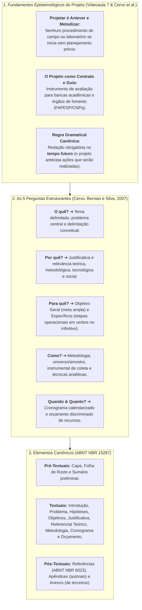

# 🎯 Semana 6 — Em Síntese: O Projeto de Pesquisa Concretizado
### Do Planejamento Metodológico à Redação Científica (ABNT NBR 15287)

> **Disciplina:** Projetos e Métodos para a Produção do Conhecimento (`INT100-EC-2026S2B2-T001`)  
> **Tema da Semana 6:** Desenvolvimento e Planejamento do Projeto de Pesquisa  
> **Docente Responsável:** Profª Dra. Graziella Ribeiro Soares Moura / Profª Darlene Ferreira  
> **Período:** 02/11/2026 a 15/11/2026  
> **Status:** 🟢 **Semana 6 Concluída com Êxito (10,0 / 10,0)**  

---

## 👩‍🏫 Mensagem Oficial de Fechamento do AVA

> *"Ao terminar o conteúdo desta semana, depois de ler e refletir, você aprendeu que o projeto de pesquisa é o guia, o roteiro e o mapa que orienta toda a investigação científica. Você viu que projetar significa antever e metodizar as fases de um trabalho antes de executá-lo, definindo com clareza o problema, as hipóteses, os objetivos, a justificativa e os métodos.*  
> 
> *Parabéns! Você chegou ao fim do conteúdo da Semana 6.*  
> 
> *Na próxima semana, você fará a revisão geral da disciplina para a consolidação dos conhecimentos e preparação para a avaliação final."*

---

## 🗺️ Arquitetura Metodológica da Semana 6

A Semana 6 representou a **convergência e concretização de toda a trajetória metodológica** construída nas semanas anteriores:
* **Semanas 1 e 2:** Da atitude científica e superação do senso comum aos métodos dedutivo e indutivo;
* **Semana 3:** Rigor ético, honestidade intelectual, integridade acadêmica e comitês de ética (CEP/CONEP);
* **Semana 4:** Organização do trabalho científico, revisão do estado da arte e normas de citação/referência (ABNT);
* **Semana 5:** Coleta, procedimentos, metadados e fontes de dados quantitativas (IBGE) e qualitativas (História Oral e ATD);
* **Semana 6:** A amarração sistemática de todas essas dimensões no **Projeto de Pesquisa** (ABNT NBR 15287).

---

## 📊 Matriz de Conceitos e Distinções Fundamentais

| Dimensão Estrutural | Definição Canônica | Erro Metodológico Frequente | Diretriz de Excelência (ABNT / Cervo et al.) |
| :--- | :--- | :--- | :--- |
| **Tema vs. Problema** | O tema é o assunto delimitado; o problema é a pergunta investigativa precisa que se pretende responder. | Formular o problema de forma ampla, sem interrogação ou sem recorte empírico viável. | Pergunta clara, objetiva, solucionável e passível de teste empírico ou laboratorial. |
| **Hipótese de Trabalho ($H_1$) vs. Hipótese Nula ($H_0$)** | $H_1$ é a resposta provisória afirmativa; $H_0$ afirma a ausência de relação ou efeito entre as variáveis. | Ter "medo da hipótese nula" e manipular dados para forçar confirmação de $H_1$. | **Desmistificação:** Demonstrar que $H_0$ é verdadeira possui igual mérito epistemológico. |
| **Objetivo Geral vs. Objetivos Específicos** | O geral define o impacto final; os específicos detalham as metas operacionais intermediárias. | Confundir objetivos com etapas de leitura rotineira ("ler o livro X"). | Redação iniciada por **verbos de ação no infinitivo** (analisar, implementar, comparar). |
| **Justificativa vs. Referencial Teórico** | A justificativa defende o "porquê" fazer a pesquisa; o referencial apresenta o estado da arte e teorias. | Usar a justificativa para conceituar teorias em vez de fundamentar a relevância e viabilidade. | Apresentar contribuições científicas, práticas, éticas e sociais do estudo. |
| **Cronograma vs. Orçamento** | O cronograma distribui as tarefas no tempo; o orçamento dimensiona custos de capital, consumo e serviços. | Ignorar prazos de comitê de ética (CEP) ou omitir despesas com licenças e nuvem. | Prever margem temporal de segurança e discriminar custos com precisão contábil. |

---

## 💻 Consolidação do Anteprojeto da Engenharia de Computação

Ao longo do bimestre, estruturamos uma proposta autoral completa que materializa todos os critérios da disciplina:

* **Título:** *Sistemas Inteligentes de Visão Computacional e Aprendizado Profundo Aplicados ao Auxílio Diagnóstico em Radiologia Pulmonar: Investigação da Explicabilidade Algorítmica (Grad-CAM), Confiabilidade Clínica e Governança Bioética.*
* **Problema:** Em que medida a integração de mapas visuais explicáveis (Grad-CAM) reduz falsos positivos e eleva a confiança de médicos radiologistas sem comprometer o fluxo de trabalho?
* **Abordagem Metodológica:** **Métodos Mistos (*Mixed Methods*)** — Treinamento quantitativo de CNNs em grandes bases públicas (*Stanford CheXpert* / *NIH-14*) triangulado com a escuta qualitativa de radiologistas via História Oral Temática e Análise Textual Discursiva (ATD).
* **Marco Ético:** Conformidade irrestrita com a LGPD (Lei nº 13.709/2018) e com as diretrizes da Organização Mundial da Saúde (OMS, 2021) para IA em saúde.

---

## ✅ Autoavaliação de Metas e Competências da Semana 6

* [x] **Compreendi o que é e qual a finalidade de um projeto de pesquisa.**  
  *(Apreensão do projeto como mapa de navegação, contrato epistêmico e instrumento de viabilidade técnica e financeira).*
* [x] **Dominei os componentes obrigatórios e complementares da ABNT NBR 15287.**  
  *(Identificação de elementos pré-textuais, textuais e pós-textuais com suas respectivas normas correlatas).*
* [x] **Aprendi a articular as 5 perguntas estruturantes do planejamento científico.**  
  *(Aplicação sistemática de O quê?, Onde?, Por quê?, Para quê?, Como? e Quando/Quanto?).*
* [x] **Compreendi a dinâmica das hipóteses e a desmistificação da hipótese nula.**  
  *(Entendimento de que uma hipótese refutada empiricamente contribui legitimamente para o avanço da ciência).*
* [x] **Dominei a formulação de objetivos operacionais no infinitivo.**  
  *(Diferenciação clara entre objetivo geral de longo alcance e objetivos específicos sequenciais).*
* [x] **Atingi nota máxima na avaliação semanal da disciplina.**  
  *(Desempenho de **10,00 / 10,00 pontos** na Atividade Avaliativa da Semana 6).*

---

## 🧭 Conexão com a Próxima Semana (Semana 7 — Fechamento do Bimestre)

Na **Semana 7**, ingressaremos na **Revisão Geral da Disciplina**:
* Revisão dos conceitos fundamentais de todas as semanas (Senso comum, Métodos Dedutivo/Indutivo, Ética, ABNT, Coleta de Dados e Projeto de Pesquisa).
* Simulações e preparação direcionada para a **Avaliação Presencial / Prova Oficial da Univesp (N2)**.
