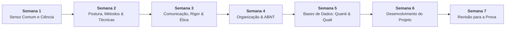

# 📚 Semana 6 — Desenvolvimento e Planejamento do Projeto de Pesquisa

> **Disciplina:** Projetos e Métodos para a Produção do Conhecimento (`INT100-EC-2026S2B2-T001`)  
> **Curso:** Bacharelado em Engenharia de Computação — Univesp  
> **Docente Responsável:** Profª Dra. Graziella Ribeiro Soares Moura  
> **Período da Semana 6:** 02/11/2026 a 15/11/2026  
> **Status:** 🟢 **100% CONCLUÍDA — AVALIAÇÃO COM NOTA MÁXIMA (10,0 / 10,0)**  

---

## 🗺️ Índice de Materiais e Atividades Realizadas

| Arquivo | Descrição | Status |
| :--- | :--- | :---: |
| [**`0-Inicio.md`**](file:///home/henrique/Modelos/Univesp/2026S2B2/INT100-Projetos-e-Metodos-para-a-Producao-do-Conhecimento/Semana-6/0-Inicio.md) | Apresentação da semana, objetivos de aprendizagem e minuta completa do anteprojeto de pesquisa (ABNT NBR 15287) | 🟢 Pronto |
| [**`1-Videoaulas.md`**](file:///home/henrique/Modelos/Univesp/2026S2B2/INT100-Projetos-e-Metodos-para-a-Producao-do-Conhecimento/Semana-6/1-Videoaulas.md) | Síntese analítica das videoaulas oficiais: desenvolvimento e etapas do projeto de pesquisa (Videoaula 7) | 🟢 Pronto |
| [**`2-Texto-base.md`**](file:///home/henrique/Modelos/Univesp/2026S2B2/INT100-Projetos-e-Metodos-para-a-Producao-do-Conhecimento/Semana-6/2-Texto-base.md) | Síntese do texto-base (Cervo, Bervian & Silva: *Metodologia Científica*, Cap. 6 — O Planejamento da Pesquisa) | 🟢 Pronto |
| [**`4-Forum-tematico.md`**](file:///home/henrique/Modelos/Univesp/2026S2B2/INT100-Projetos-e-Metodos-para-a-Producao-do-Conhecimento/Semana-6/4-Forum-tematico.md) | Resolução completa e modelos de postagem para o fórum temático e réplicas no AVA | 🟢 Pronto |
| [**`4.1-Forum-tematico-postagem.txt`**](file:///home/henrique/Modelos/Univesp/2026S2B2/INT100-Projetos-e-Metodos-para-a-Producao-do-Conhecimento/Semana-6/4.1-Forum-tematico-postagem.txt) | Texto puro formatado para cópia rápida no AVA | 🟢 Pronto |
| [**`5-Atividade-avaliativa.md`**](file:///home/henrique/Modelos/Univesp/2026S2B2/INT100-Projetos-e-Metodos-para-a-Producao-do-Conhecimento/Semana-6/5-Atividade-avaliativa.md) | Resolução analítica completa das questões avaliativas com fundamentação teórica (Nota 10,0 / 10,0) | 🟢 Pronto |
| [**`6-Em-sintese.md`**](file:///home/henrique/Modelos/Univesp/2026S2B2/INT100-Projetos-e-Metodos-para-a-Producao-do-Conhecimento/Semana-6/6-Em-sintese.md) | Resumo executivo, consolidação do anteprojeto e autoavaliação de competências | 🟢 Pronto |

---

## 🧭 Relação com as Demais Semanas

