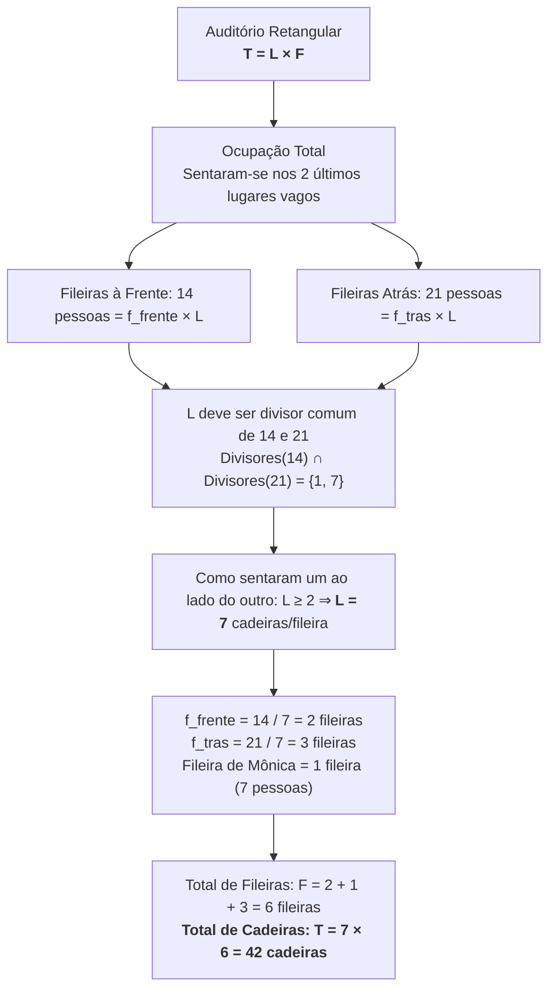

# 📌 Semana 1 — Início & Apresentação da Semana

> **Disciplina:** Matemática Básica (`MMB002-EC-2026S2B2-T001`)  
> **Tema da Semana 1:** Números: significado numérico, operações e propriedades aritméticas  
> **Docente Responsável:** Profª Dra. Rúbia Barcelos Amaral  
> **Período:** 28/09/2026 a 11/10/2026  

---

## 🎯 Contextualização

Boas-vindas à Semana 1 da disciplina **Matemática Básica**!

Nesta disciplina, estudaremos conceitos basilares da matemática que darão sustentação para o desenvolvimento de todas as disciplinas quantitativas, científicas e tecnológicas do curso de Engenharia de Computação (como Cálculo, Álgebra Linear, Algoritmos, Estatística e Circuitos Lógicos), além de aplicações diretas em situações cotidianas e modelagem de problemas reais.

Ao pensarmos em matemática, uma das primeiras noções que nos vem à mente são os **números**. Eles são peças centrais para contar, medir, ordenar, codificar e calcular. Compreender o significado dos números como abstrações matemáticas, bem como dominar o funcionamento e as propriedades fundamentais das operações aritméticas e a teoria elementar dos conjuntos, é o primeiro grande alicerce da nossa jornada acadêmica.

---

## 🎯 Objetivos de Aprendizagem

Ao final desta semana, você deverá ser capaz de:
1. **Conhecer** a perspectiva histórica da construção dos números e dos sistemas de numeração nas diferentes civilizações.
2. **Recordar** a definição formal de números, sistemas posicionais e conjuntos numéricos.
3. **Recordar e aplicar** com rigor as propriedades das operações aritméticas básicas (comutatividade, associatividade, distributividade, elementos neutro e inverso).
4. **Dominar e resolver** problemas envolvendo operações fundamentais e teoria elementar dos conjuntos (pertinência, união, interseção, diferença, complementar e Diagramas de Venn).

---

## 💡 Desafio da Semana (OBMEP 2017)

### 📌 Enunciado
*(OBMEP 2017 — Adaptado)*  
> *Mônica e seu namorado foram assistir a uma peça de teatro. O auditório era organizado em fileiras paralelas ao palco, todas com o mesmo número de cadeiras dispostas lado a lado. Eles se sentaram um ao lado do outro nos dois últimos lugares vagos. Mônica percebeu que havia, no total, 14 pessoas nas fileiras a sua frente e 21 pessoas nas fileiras atrás da sua.*  
> 
> **Quantas cadeiras havia no auditório?**

---

### 🧮 Resolução Matemática Passo a Passo

#### 1. Modelação do Problema:
* Seja $L$ o número de cadeiras por fileira (largura da matriz retangular do auditório).
* Seja $F$ o número total de fileiras no auditório.
* A capacidade total de cadeiras do auditório é dada pelo produto cartesiano/arranjo retangular:
  $$T = L \times F$$
* O enunciado informa que Mônica e o namorado se sentaram nos **dois últimos lugares vagos**. Isso significa que, com a chegada deles, **todas as cadeiras do teatro ficaram preenchidas** (lotação esgotada, total de pessoas = total de cadeiras).

#### 2. Determinação do número de cadeiras por fileira ($L$):
* Nas fileiras à frente da fileira de Mônica, há $f_{\text{frente}}$ fileiras completas, contendo 14 pessoas:
  $$f_{\text{frente}} \times L = 14$$
* Nas fileiras atrás da fileira de Mônica, há $f_{\text{trás}}$ fileiras completas, contendo 21 pessoas:
  $$f_{\text{trás}} \times L = 21$$
* Como $L$, $f_{\text{frente}}$ e $f_{\text{trás}}$ são números inteiros positivos, $L$ deve ser um **divisor comum** de 14 e 21:
  $$\text{Divisores de } 14 = \{1, 2, 7, 14\}$$
  $$\text{Divisores de } 21 = \{1, 3, 7, 21\}$$
  $$\text{Divisores Comuns}(14, 21) = \{1, 7\}$$
* Como Mônica e o namorado "se sentaram **um ao lado do outro**", a fileira precisa comportar pelo menos 2 cadeiras ($L \ge 2$). Logo, descarta-se $L = 1$.
* Conclui-se que:
  $$L = \text{mdc}(14, 21) = 7 \text{ cadeiras por fileira}$$

#### 3. Cálculo do número de fileiras e capacidade total:
* Número de fileiras à frente:
  $$f_{\text{frente}} = \frac{14}{7} = 2 \text{ fileiras}$$
* Número de fileiras atrás:
  $$f_{\text{trás}} = \frac{21}{7} = 3 \text{ fileiras}$$
* Número total de fileiras no teatro:
  $$F = f_{\text{frente}} + 1 \text{ (a fileira onde estão Mônica e o namorado)} + f_{\text{trás}} = 2 + 1 + 3 = 6 \text{ fileiras}$$
* Capacidade total de cadeiras do auditório:
  $$T = L \times F = 7 \times 6 = \mathbf{42 \text{ cadeiras}}$$

*(Verificação de consistência: $14 \text{ (frente)} + 7 \text{ (na fileira deles)} + 21 \text{ (atrás)} = 42 \text{ pessoas/cadeiras}$.)*

---

### 💬 Sugestão de Postagem para o Fórum Temático

> **Título da Postagem:** Resolução do Desafio da Semana 1 (OBMEP 2017) — Aritmética e Divisibilidade
>
> Olá, professora Rúbia, mediadores e colegas!
>
> Compartilho minha resolução para o desafio da OBMEP 2017 proposto para esta Semana 1:
>
> **Resposta:** O auditório possuía **42 cadeiras**.
>
> **Raciocínio Matemático e Relação com os Conteúdos:**
> 1. **Modelagem Retangular e Multiplicação:** O auditório forma uma matriz regular de $F$ fileiras por $L$ cadeiras ($T = L \times F$). Como eles ocuparam os dois últimos lugares vagos, todas as cadeiras do auditório estavam ocupadas.
> 2. **Aritmética e Divisibilidade:** O número de pessoas à frente ($14$) e atrás ($21$) decorre de fileiras completas. Logo, o número de cadeiras por fileira ($L$) deve ser um divisor comum de $14$ e $21$.
> 3. Como os divisores comuns são $\{1, 7\}$ e o casal sentou-se lado a lado na mesma fileira ($L \ge 2$), temos obrigatoriamente $L = 7$ cadeiras/fileira (aplicação direta de MDC).
> 4. Disso resulta que há 2 fileiras à frente ($14/7 = 2$), 3 fileiras atrás ($21/7 = 3$) e a fileira do casal (1 fileira com 7 pessoas), totalizando $2 + 1 + 3 = 6$ fileiras.
> 5. A capacidade total é $7 \times 6 = 42$ cadeiras.
>
> Esse problema ilustra com clareza as propriedades aritméticas fundamentais que estudamos nesta semana: a multiplicação como disposição retangular, a divisibilidade e a identificação de invariantes na contagem discreta.

---

## 🗺️ Roteiro e Orientação de Estudos da Semana

1. 🎬 **Videoaula 1:** Perspectiva histórica da construção dos números e conjuntos (sistemas de numeração babilônico, egípcio, romano, indo-arábico e operações primitivas).
2. 📖 **Textos-Base:**
   * Cap. 1 do *Manual Compacto de Matemática* (Bosquilha et al., 2010).
   * Cap. 2 de *Teoria dos Números para Professores do Ensino Fundamental* (Wall, 2014) — contagem, registros e sistemas de base.
   * *Fundamentos de Matemática* (Araujo et al., 2018) — revisão rigorosa das operações básicas e propriedades.
3. 🎬 **Vídeo-Base:** *Propriedades das Operações* (fechamento, comutatividade, associatividade, elemento neutro, elemento inverso e distributividade).
4. 🎬 **Videoaulas 2 e 3:** Teoria elementar dos conjuntos (elemento, pertinência $\in/\notin$, subconjuntos $\subset/\subseteq$, conjunto vazio $\emptyset$, unitário, universo, partes $\mathcal{P}(A)$, união $\cup$, interseção $\cap$, diferença $A \setminus B$, conjuntos disjuntos e complementar $A^c$).
5. 📊 **Material-Base:** *Trabalhando com Conjuntos* (Diagramas de Venn e resolução de problemas de contagem de múltiplos conjuntos).

---
