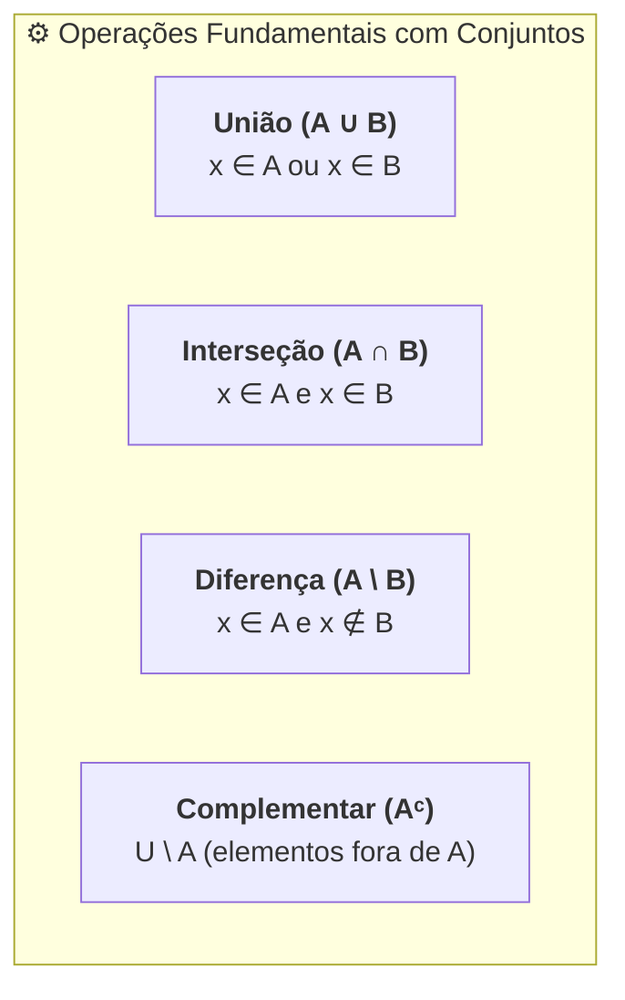

# 🎥 Videoaulas — Semana 1 (MMB002)

> **Disciplina:** Matemática Básica (`MMB002-EC-2026S2B2-T001`)  
> **Tema da Semana 1:** Números: significado numérico, operações e propriedades aritméticas  
> **Docente Responsável:** Profª Dra. Rúbia Barcelos Amaral  

---

## 📑 Sumário das Videoaulas

1. [**Videoaula 1:** Perspectiva Histórica da Construção dos Números e da Teoria dos Conjuntos](#-videoaula-1--perspectiva-histórica-da-construção-dos-números-e-da-teoria-dos-conjuntos)
2. [**Videoaula 2:** Noções Iniciais de Conjuntos — Parte 1](#-videoaula-2--noções-iniciais-de-conjuntos--parte-1)
3. [**Videoaula 3:** Noções Iniciais de Conjuntos — Parte 2 (Operações e Propriedades)](#-videoaula-3--noções-iniciais-de-conjuntos--parte-2-operações-e-propriedades)

---

## 🎬 Videoaula 1 — Perspectiva Histórica da Construção dos Números e da Teoria dos Conjuntos

> **Docentes:** Profª Dra. Rúbia Barcelos Amaral e Prof. Douglas Leite  
> **Link da Aula:** [Assistir no YouTube](https://www.youtube.com/watch?v=2oTRIPxK2PE)  
> **Sinopse:** Entrevista com o professor Douglas Leite tratando dos aspectos históricos e culturais da invenção dos números, evolução das contagens e a posterior emergência da teoria dos conjuntos na fundamentação da matemática moderna.

### 1. A Gênese da Contagem e o Sentido Numérico
* **Senso Numérico vs. Contagem Formal:** O ser humano primitivo possuía senso de magnitude/quantidade (distinguir entre "pouco" e "muito"), mas não o conceito abstrato de número.
* **Correspondência Biunívoca (1 para 1):** Antes da existência dos numerais, a contagem era feita associando cada objeto a um elemento de controle (ossos entalhados como o *Osso de Ishango*, nós em cordas, seixos/pedras). A palavra *cálculo* deriva do latim *calculus* (pequena pedra).

### 2. Evolução dos Sistemas de Numeração
* **Sistemas Não Posicionais / Aditivos (Ex.: Egípcio e Romano):**
  * O valor de cada símbolo independe da sua posição relativa no número.
  * O número total é a soma (ou subtração) dos valores dos símbolos individuais.
  * *Limitação:* Operações aritméticas complexas (multiplicação e divisão) eram extremamente difíceis e demandavam instrumentos auxiliares (ábacos).
* **Sistemas Posicionais (Ex.: Babilônico e Indo-Arábico):**
  * O valor do algarismo é determinado pela sua **posição** (ordens e classes: unidades, dezenas, centenas...).
  * **Sistema Babilônico:** Base sexagesimal (base 60), responsável pela divisão moderna do tempo (60 minutos, 60 segundos) e do círculo (360 graus).
  * **Sistema Indo-Arábico:** Base decimal (base 10), dotado de:
    1. Apenas 10 símbolos fundamentais ($0, 1, 2, 3, 4, 5, 6, 7, 8, 9$).
    2. **O Conceito e o Símbolo do Zero ($0$):** Elemento revolucionário que representa tanto a ausência de quantidade quanto o marcador de posição de uma ordem vazia.
    3. Notável facilidade para execução de algoritmos aritméticos escritos.

### 3. A Emergência da Teoria dos Conjuntos
* **Contexto Histórico:** No final do século XIX, matemáticos como **Georg Cantor** (1845–1918) desenvolveram a teoria dos conjuntos para formalizar o conceito de infinito e servir de linguagem unificadora para toda a matemática.
* **Linguagem Universal:** A teoria dos conjuntos tornou-se a base sobre a qual se definem números naturais (via conjuntos de Peano/Von Neumann), funções, relações, topologia e álgebra computacional.

---

## 🎬 Videoaula 2 — Noções Iniciais de Conjuntos — Parte 1

> **Docente:** Profª Dra. Rúbia Barcelos Amaral  
> **Link da Aula:** [Assistir no YouTube](https://www.youtube.com/watch?v=r2oXE6wnv3c&t=1s)  
> **Sinopse:** Apresentação dos conceitos primitivos e estruturas elementares da teoria dos conjuntos: elemento, pertinência, representações, conjuntos vazio, unitário, universo, das partes e conjuntos disjuntos.

### 1. Conceitos Primitivos e Relação de Pertinência
Na teoria axiomática, **conjunto**, **elemento** e **pertinência** são noções primitivas (aceitas sem definição formal a partir de termos mais simples):
* Se um objeto $x$ pertence ao conjunto $A$, escrevemos:
  $$x \in A$$
* Se $x$ não pertence a $A$, escrevemos:
  $$x \notin A$$

> [!IMPORTANT]
> **Atenção à Notação:** A relação de **pertinência ($\in, \notin$)** é aplicada **estritamente entre um elemento e um conjunto**. Para relacionar dois conjuntos, utiliza-se a relação de **inclusão ($\subset, \subseteq$)**.

### 2. Formas de Representação de um Conjunto
1. **Por Enumeração / Extensão (Listagem dos Elementos):**
   $$A = \{2, 3, 5, 7, 11\}$$
2. **Por Compreensão / Propriedade Característica:**
   $$A = \{x \in \mathbb{N} \mid x \text{ é um número primo menor que } 12\}$$
3. **Por Diagrama de Venn:** Curvas fechadas simples no plano que delimitam visualmente os elementos pertencentes e não pertencentes.

### 3. Tipos Fundamentais de Conjuntos

| Tipo de Conjunto | Notação / Definição | Exemplo | Propriedade Notável |
| :--- | :--- | :--- | :--- |
| **Conjunto Vazio** | $\emptyset$ ou $\{\}$ | $A = \{x \in \mathbb{R} \mid x^2 + 1 = 0\}$ | Possui $0$ elementos ($|\emptyset| = 0$). É subconjunto de qualquer conjunto: $\emptyset \subseteq A, \forall A$. |
| **Conjunto Unitário** | $\{a\}$ | $B = \{x \in \mathbb{N} \mid 2x = 6\} = \{3\}$ | Possui exatamente $1$ elemento ($|B| = 1$). |
| **Conjunto Universo** | $U$ | Contextual (ex.: $\mathbb{R}, \mathbb{N}$) | Contém todos os elementos admitidos no contexto do estudo. |
| **Conjuntos Disjuntos** | $A \cap B = \emptyset$ | $A = \{1, 3, 5\}, B = \{2, 4, 6\}$ | Não compartilham nenhum elemento comum. |

### 4. Conjunto das Partes ($\mathcal{P}(A)$ ou $\mathcal{P}(S)$)
* O **conjunto das partes** de um conjunto $A$ é a coleção de **todos os possíveis subconjuntos** de $A$:
  $$\mathcal{P}(A) = \{X \mid X \subseteq A\}$$
* **Exemplo Prático:** Seja $A = \{1, 2\}$. Seus subconjuntos são:
  $$\mathcal{P}(A) = \{\emptyset, \{1\}, \{2\}, \{1, 2\}\}$$
* **Teorema da Cardinalidade do Conjunto das Partes:**  
  Se um conjunto $A$ possui $n$ elementos ($|A| = n$), então o número de elementos de $\mathcal{P}(A)$ é:
  $$|\mathcal{P}(A)| = 2^n$$

---

## 🎬 Videoaula 3 — Noções Iniciais de Conjuntos — Parte 2 (Operações e Propriedades)

> **Docente:** Profª Dra. Rúbia Barcelos Amaral  
> **Link da Aula:** [Assistir no YouTube](https://www.youtube.com/watch?v=2WjQIfth1iw)  
> **Sinopse:** Apresentação rigorosa das relações de inclusão (subconjuntos) e das operações fundamentais entre conjuntos: união, interseção, diferença, complementar e suas propriedades algébricas.

### 1. Relação de Inclusão e Subconjuntos
* Diz-se que $A$ é subconjunto de $B$ ($A$ está contido em $B$, notado $A \subseteq B$) se todo elemento de $A$ também pertence a $B$:
  $$A \subseteq B \iff (\forall x)(x \in A \implies x \in B)$$
* **Igualdade de Conjuntos:** Dois conjuntos são iguais se e somente se cada um estiver contido no outro:
  $$A = B \iff A \subseteq B \text{ e } B \subseteq A$$

### 2. Operações Fundamentais

#### A) União ou Reunião ($A \cup B$)
* Reúne todos os elementos que pertencem a $A$, a $B$, ou a ambos:
  $$A \cup B = \{x \mid x \in A \lor x \in B\}$$

#### B) Interseção ($A \cap B$)
* Reúne apenas os elementos comuns que pertencem simultaneamente a $A$ e a $B$:
  $$A \cap B = \{x \mid x \in A \land x \in B\}$$

#### C) Diferença de Conjuntos ($A \setminus B$ ou $A - B$)
* Conjunto dos elementos que pertencem a $A$ mas **não** pertencem a $B$:
  $$A \setminus B = \{x \mid x \in A \land x \notin B\}$$

#### D) Complementar de um Conjunto ($A^c$, $\complement_U A$ ou $\bar{A}$)
* Sendo $A \subseteq U$, o complementar de $A$ em relação ao universo $U$ é o conjunto de elementos de $U$ que não estão em $A$:
  $$A^c = U \setminus A = \{x \in U \mid x \notin A\}$$

---

## 📊 Propriedades Algébricas das Operações de Conjuntos

| Propriedade | União ($\cup$) | Interseção ($\cap$) |
| :--- | :--- | :--- |
| **Comutativa** | $A \cup B = B \cup A$ | $A \cap B = B \cap A$ |
| **Associativa** | $(A \cup B) \cup C = A \cup (B \cup C)$ | $(A \cap B) \cap C = A \cap (B \cap C)$ |
| **Idempotência** | $A \cup A = A$ | $A \cap A = A$ |
| **Elemento Neutro / Absorvente** | $A \cup \emptyset = A$ (Neutro: $\emptyset$) | $A \cap U = A$ (Neutro: $U$)   $A \cap \emptyset = \emptyset$ (Absorvente: $\emptyset$) |
| **Distributividade** | $A \cup (B \cap C) = (A \cup B) \cap (A \cup C)$ | $A \cap (B \cup C) = (A \cap B) \cup (A \cap C)$ |
| **Leis de De Morgan** | $(A \cup B)^c = A^c \cap B^c$ | $(A \cap B)^c = A^c \cup B^c$ |

---

## 🧮 Princípio da Inclusão-Exclusão (Contagem de Elementos)

Para conjuntos finitos $A$ e $B$, o número de elementos da união é dado por:
$$|A \cup B| = |A| + |B| - |A \cap B|$$

Para três conjuntos $A$, $B$ e $C$:
$$|A \cup B \cup C| = |A| + |B| + |C| - (|A \cap B| + |A \cap C| + |B \cap C|) + |A \cap B \cap C|$$

---
