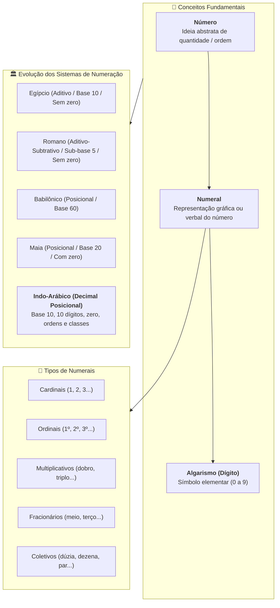
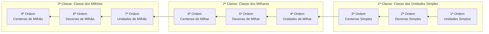

# 📖 Texto-base — Manual Compacto de Matemática: O que são números? E numerais?

> **Referência:** BOSQUILHA, Alessandra; AMARAL, João Tomás do; MIRANDA, Mônica. **Manual compacto de matemática: ensino fundamental**. 3. ed. São Paulo: Rideel, 2010. (Capítulo 1: *"O que são números? E numerais?"*, p. 11–20).  
> **Link na Biblioteca Virtual da Univesp:** [Plataforma Biblioteca Virtual / Rideel](https://leitor.bvirtual.com.br/reader/182305/pdf/11)  
> **Disciplina:** Matemática Básica (`MMB002-EC-2026S2B2-T001`) — Semana 1  

---

## 🗺️ Mapa Conceitual do Capítulo 1

---

## 📌 1. A Tríade Fundamental: Número, Numeral e Algarismo

No estudo formal da matemática, é indispensável estabelecer a distinção entre a entidade abstrata e os instrumentos de sua representação:

| Conceito | Definição Rigorosa | Exemplo / Ilustração |
| :--- | :--- | :--- |
| **Número** | É a **ideia, conceito abstrato** ou ente mental que expressa uma quantidade, uma medida, um código identificador ou uma posição em uma sequência ordenada. Existe na mente humana independentemente da forma como é registrado. | A ideia de *"três unidades"* ao olhar para três maçãs. |
| **Numeral** | É toda e qualquer **representação simbólica, gráfica ou falada** de um número. | `3`, `III`, `three`, `três`, `0011₂` representam o mesmo número. |
| **Algarismo (ou Dígito)** | É o **símbolo gráfico elementar** utilizado como caractere básico para compor os numerais em um determinado sistema posicional. No sistema decimal indo-arábico, existem exatamente 10 algarismos. | $0, 1, 2, 3, 4, 5, 6, 7, 8, 9$. |

> [!NOTE]
> **Analogia Linguística:**  
> O **número** equivale ao *conceito/ideia*, o **numeral** equivale à *palavra escrita*, e o **algarismo** equivale à *letra do alfabeto*. Com 10 algarismos (letras), podemos escrever infinitos numerais (palavras).

---

## 📌 2. Classificação Funcional dos Numerais

Os numerais desempenham diferentes papéis conforme o contexto em que são empregados:

1. **Cardinais:** Expressam a quantidade exata de elementos em uma coleção finita (cardinalidade).  
   * *Exemplos:* $1, 2, 3, 15, 100, 2026$.
2. **Ordinais:** Indicam a posição relativa de um elemento em uma sequência ordenada ou série.  
   * *Exemplos:* $1^\circ$ (primeiro), $2^\circ$ (segundo), $10^\circ$ (décimo), $100^\circ$ (centésimo).
3. **Multiplicativos:** Indicam acréscimos proporcionais ou fatores de multiplicação de uma quantidade.  
   * *Exemplos:* dobro ($\times 2$), triplo ($\times 3$), quádruplo ($\times 4$), décuplo ($\times 10$), cêntuplo ($\times 100$).
4. **Fracionários:** Expressam divisões, frações ou partes de um todo.  
   * *Exemplos:* metade/meio ($\frac{1}{2}$), terço ($\frac{1}{3}$), quarto ($\frac{1}{4}$), décimo ($\frac{1}{10}$).
5. **Coletivos:** Substantivos que designam conjuntos com uma quantidade fixa e predeterminada de unidades.  
   * *Exemplos:* par ($2$), trio ($3$), dezena ($10$), dúzia ($12$), centena ($100$), grosa ($144 = 12 \times 12$), milhar ($1.000$).

---

## 🏛️ 3. Sistemas de Numeração Históricos

Ao longo da história, diferentes civilizações criaram métodos para registrar contagens e transações comerciais. O texto-base destaca quatro sistemas representativos:

### 3.1. Sistema de Numeração Egípcio (aprox. 3000 a.C.)
* **Características:** Sistema de **base 10**, puramente **aditivo** e **não posicional**.
* **Símbolos Elementares:**
  * Bastão vertical / Traço ($।$) = $1$
  * Calcanhar / Ferradura ($\cap$) = $10$
  * Rolo de corda ($\text{espiral}$) = $100$
  * Flor de lótus = $1.000$
  * Dedo apontado = $10.000$
  * Girino / Peixe = $100.000$
  * Homem ajoelhado com braços erguidos = $1.000.000$
* **Regra Operatória:** Cada símbolo podia ser repetido até $9$ vezes. O valor do número era a soma dos valores de todos os símbolos presentes. A ordem dos desenhos não alterava o valor final. Não possuía símbolo para o zero.

---

### 3.2. Sistema de Numeração Romano
* **Características:** Sistema **aditivo-subtrativo**, de **base 10** com apoios intermediários quinários (base 5), **não estritamente posicional** e **sem símbolo para o zero**.
* **Tabela de Símbolos Fundamentais:**

| Símbolo | I | V | X | L | C | D | M |
| :---: | :---: | :---: | :---: | :---: | :---: | :---: | :---: |
| **Valor Decimal** | $1$ | $5$ | $10$ | $50$ | $100$ | $500$ | $1.000$ |

* **Regras Algébricas do Sistema Romano:**
  1. **Repetição:** Apenas os símbolos fundamentais de potência de 10 ($I, X, C, M$) podem ser repetidos até no máximo **três vezes consecutivas** ($III = 3, XXX = 30, CCC = 300, MMM = 3.000$). Os símbolos $V, L, D$ **nunca** se repetem.
  2. **Princípio Aditivo:** Quando um símbolo de menor valor é colocado à **direita** de um de maior ou igual valor, seus valores são somados:
     $$\text{VII} = 5 + 1 + 1 = 7, \quad \text{CXV} = 100 + 10 + 5 = 115, \quad \text{MDCLXVI} = 1.000 + 500 + 100 + 50 + 10 + 5 + 1 = 1.666$$
  3. **Princípio Subtrativo:** Quando um símbolo de menor valor vem à **esquerda** imediata de um de maior valor, subtrai-se o menor do maior. Essa regra aplica-se exclusivamente aos seguintes pares:
     * $I$ antecede $V$ ou $X$: $\text{IV} = 4$, $\text{IX} = 9$
     * $X$ antecede $L$ ou $C$: $\text{XL} = 40$, $\text{XC} = 90$
     * $C$ antecede $D$ ou $M$: $\text{CD} = 400$, $\text{CM} = 900$
  4. **Multiplicação por Milhares (Vínculo Superior):** Um traço horizontal sobre o numeral multiplica seu valor por $1.000$. Dois traços multiplicam por $1.000.000$:
     $$\overline{\text{V}} = 5 \times 1.000 = 5.000, \quad \overline{\text{XIV}} = 14 \times 1.000 = 14.000, \quad \overline{\overline{\text{X}}} = 10 \times 1.000.000 = 10.000.000$$

---

### 3.3. Sistema de Numeração Babilônico (Mesopotâmia)
* **Características:** Sistema **posicional** de **base sexagesimal (base 60)**.
* **Símbolos:** Usavam estiletes sobre tabuletas de argila formando caracteres cuneiformes:
  * Cravo / Cunha vertical ($\boldsymbol{\curlyvee}$) = $1$
  * Asna / Cunha horizontal ($\boldsymbol{\prec}$) = $10$
* **Estrutura Posicional:** Os valores de $1$ a $59$ eram escritos agrupando cravos e asnas aditivamente. Para valores superiores a $59$, utilizava-se a posição relativa (potências de $60$: $60^0, 60^1, 60^2\dots$).
* **Herança Atual:** A base 60 babilônica é a raiz da contagem do tempo ($1\text{ hora} = 60\text{ min}$, $1\text{ min} = 60\text{ s}$) e da divisão da circunferência em $360^\circ$ ($6 \times 60^\circ$).

---

### 3.4. Sistema de Numeração Maia
* **Características:** Sistema **posicional** de **base vigesimal (base 20)**, com representação vertical e uso pioneiro de um símbolo para o **zero** (em formato de concha ou caracol).
* **Símbolos Elementares:** Ponto ($\bullet = 1$), Barra (— $= 5$) e Concha ($\text{zero}$).

---

## 🌐 4. O Sistema de Numeração Decimal (Indo-Arábico)

Criado pelos matemáticos hindus no norte da Índia (século V d.C.) e difundido pelo mundo islâmico e ocidental por matemáticos como **al-Khwarizmi** e **Leonardo Fibonacci** (através da obra *Liber Abaci*, 1202), o sistema decimal é a base do cálculo contemporâneo.

### 4.1. Pilares Estruturais do Sistema Decimal
1. **Base Dez:** As quantidades são agrupadas em conjuntos de $10$ em $10$:
   * $10\text{ unidades} = 1\text{ dezena}$ ($10^1$)
   * $10\text{ dezenas} = 1\text{ centena}$ ($10^2 = 100$)
   * $10\text{ centenas} = 1\text{ unidade de milhar}$ ($10^3 = 1.000$)
2. **Princípio Posicional:** O peso/valor de cada algarismo depende exclusivamente da casa/ordem que ele ocupa no número.
3. **Existência do Zero ($0$):** Elemento neutro que atua como marcador de posição para sinalizar a ausência de quantidade em uma determinada ordem.
4. **Conjunto Finito de 10 Algarismos:** Com apenas os dígitos $\{0, 1, 2, 3, 4, 5, 6, 7, 8, 9\}$, é possível registrar qualquer quantidade finita.

---

### 4.2. Classes e Ordens

A contagem das ordens é feita rigorosamente da **direita para a esquerda** (do menor peso para o maior peso). Cada conjunto de **três ordens** constitui uma **classe**:

#### Tabela Detalhada de Ordens e Classes

| Classe | Ordem | Denominação | Potência de 10 | Valor Unitário |
| :--- | :---: | :--- | :---: | :--- |
| **1ª Classe** (Unidades Simples) | 1ª | Unidade | $10^0$ | $1$ |
| | 2ª | Dezena | $10^1$ | $10$ |
| | 3ª | Centena | $10^2$ | $100$ |
| **2ª Classe** (Milhares) | 4ª | Unidade de Milhar | $10^3$ | $1.000$ |
| | 5ª | Dezena de Milhar | $10^4$ | $10.000$ |
| | 6ª | Centena de Milhar | $10^5$ | $100.000$ |
| **3ª Classe** (Milhões) | 7ª | Unidade de Milhão | $10^6$ | $1.000.000$ |
| | 8ª | Dezena de Milhão | $10^7$ | $10.000.000$ |
| | 9ª | Centena de Milhão | $10^8$ | $100.000.000$ |
| **4ª Classe** (Bilhões) | 10ª | Unidade de Bilhão | $10^9$ | $1.000.000.000$ |

---

### 4.3. Valor Absoluto (VA) vs. Valor Relativo ou Posicional (VR)

Todo algarismo em um número decimal possui duas naturezas de valor:

* **Valor Absoluto (VA):** É o valor intrínseco do algarismo considerado isoladamente, independentemente da sua posição no numeral.
* **Valor Relativo / Posicional (VR):** É o valor efetivo que o algarismo assume em decorrência da ordem (posição) que ocupa no número. É calculado por:
  $$\text{VR} = \text{VA} \times 10^{\text{ordem} - 1}$$

#### Exemplo Prático de Decomposição: Número $58.732$
* O número possui **5 ordens** e **2 classes** (classe das unidades simples e classe dos milhares).

| Algarismo | Ordem Ocupada | Valor Absoluto (VA) | Cálculo do Valor Relativo | Valor Relativo (VR) |
| :---: | :--- | :---: | :---: | :---: |
| **2** | 1ª Ordem (Unidades simples) | $2$ | $2 \times 10^0 = 2 \times 1$ | $2$ |
| **3** | 2ª Ordem (Dezenas simples) | $3$ | $3 \times 10^1 = 3 \times 10$ | $30$ |
| **7** | 3ª Ordem (Centenas simples) | $7$ | $7 \times 10^2 = 7 \times 100$ | $700$ |
| **8** | 4ª Ordem (Unidades de milhar) | $8$ | $8 \times 10^3 = 8 \times 1.000$ | $8.000$ |
| **5** | 5ª Ordem (Dezenas de milhar) | $5$ | $5 \times 10^4 = 5 \times 10.000$ | $50.000$ |

#### Forma Polinomial / Decomposição Decimal Canônica:
$$58.732 = 50.000 + 8.000 + 700 + 30 + 2 = (5 \times 10^4) + (8 \times 10^3) + (7 \times 10^2) + (3 \times 10^1) + (2 \times 10^0)$$

---

## 📊 5. Quadro Comparativo dos Sistemas de Numeração

| Sistema | Base | Posicional? | Possui Zero? | Princípio Operatório | Facilidade de Algoritmos de Cálculo |
| :--- | :---: | :---: | :---: | :--- | :---: |
| **Egípcio** | 10 | ❌ Não | ❌ Não | Puramente Aditivo | Muito baixa (exige repetição e contagem física) |
| **Romano** | 10 (e 5) | ❌ Não | ❌ Não | Aditivo e Subtrativo | Baixa (multiplicações e divisões complexas) |
| **Babilônico** | 60 | ✅ Sim | ⚠️ Espaço / Tardio | Posicional Sexagesimal | Média |
| **Maia** | 20 | ✅ Sim | ✅ Sim | Posicional Vigesimal Vertical | Média/Alta |
| **Indo-Arábico** | **10** | **✅ Sim** | **✅ Sim** | **Posicional Polinomial Decimal** | **Máxima (algoritmos padronizados universais)** |

---

## 💡 6. Conexões com a Engenharia e a Computação

Na ciência da computação e na engenharia, a compreensão dos fundamentos posicionais do sistema decimal é diretamente transferível para outros sistemas de base $b$:

* **Sistema Binário (Base 2):** Utiliza apenas os dígitos $\{0, 1\}$. Posições representam potências de $2$ ($2^0, 2^1, 2^2, 2^3\dots$). É a base física do hardware digital (circuitos lógicos e transistores).
* **Sistema Octal (Base 8):** Utiliza dígitos de $0$ a $7$. Cada dígito octal resume exatamente $3$ bits binários.
* **Sistema Hexadecimal (Base 16):** Utiliza dígitos de $0$ a $9$ e letras de $A$ a $F$ ($A=10, B=11, C=12, D=13, E=14, F=15$). Cada dígito hexadecimal resume exatamente $4$ bits ($1\text{ nibble}$), sendo largamente empregado em endereçamento de memória RAM e cores RGB (`#FF5733`).

$$N = \sum_{k=0}^{n-1} d_k \cdot b^k = d_{n-1} b^{n-1} + d_{n-2} b^{n-2} + \dots + d_1 b^1 + d_0 b^0$$

O princípio matemático formulado historicamente para a base 10 é exatamente o mesmo algoritmo algébrico que rege o funcionamento de toda a arquitetura de computadores moderna.
