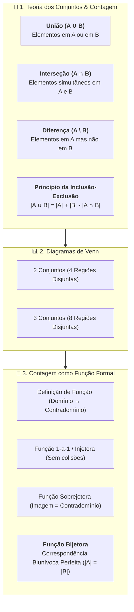
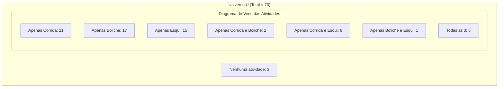
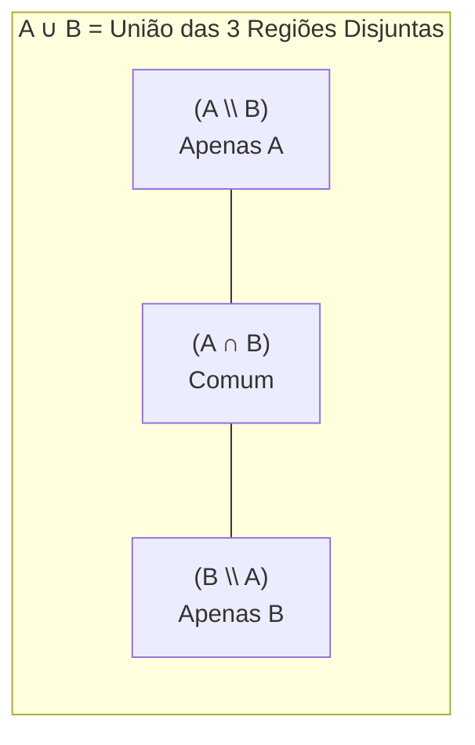

# 📖 Texto-base — Teoria dos Números para Professores: Contagem e Registro de Números

> **Referência:** WALL, Edward S. **Teoria dos números para professores do ensino fundamental**. Porto Alegre: Grupo A / Bookman, 2014. (Capítulo 2: *"Contagem e registro de números"*, p. 25–38).  
> **Link na Biblioteca Virtual / Minha Biblioteca:** [Plataforma Minha Biblioteca](https://app.minhabiblioteca.com.br/reader/books/9788580553536/pageid/25)  
> **Disciplina:** Matemática Básica (`MMB002-EC-2026S2B2-T001`) — Semana 1  

---

## 🗺️ Mapa Conceitual do Capítulo 2



---

## 📌 1. Fundamentos de Conjuntos Aplicados à Contagem

O ato elementar de contar objetos fundamenta-se nas estruturas da teoria dos conjuntos. Quando manipulamos coleções de itens, utilizamos três operações essenciais:

### 1.1. Operações Fundamentais
* **União ($A \cup B$):** Reúne todos os elementos pertencentes a $A$, a $B$ ou a ambos.
  $$A \cup B = \{x \mid x \in A \lor x \in B\}$$
* **Interseção ($A \cap B$):** Reúne apenas os elementos comuns a ambos os conjuntos.
  $$A \cap B = \{x \mid x \in A \land x \in B\}$$
* **Diferença ($A \setminus B$ ou $A - B$):** Conjunto formado pelos elementos que pertencem exclusivamente a $A$ e não pertencem a $B$.
  $$A \setminus B = \{x \mid x \in A \land x \notin B\}$$

---

## 🧩 2. Exemplo Introdutório: Alunos da Sala de Aula

Considere duas listas de estudantes em uma sala de 2º ano:
* **Lista $M$ (Meninos):** $M = \{\text{Derrick, Steve, John}\}$ $\implies |M| = 3$
* **Lista $S$ (Crianças de 7 anos):** $S = \{\text{Samantha, Steve, Jelisa, Tiffany, Lai Ling}\}$ $\implies |S| = 5$

### Análise Operatória:
1. **Total de crianças distintas (União $M \cup S$):**
   $$M \cup S = \{\text{Derrick, Steve, John, Samantha, Jelisa, Tiffany, Lai Ling}\}$$
   $$|M \cup S| = 7$$
2. **Meninos que têm 7 anos (Interseção $M \cap S$):**
   $$M \cap S = \{\text{Steve}\} \implies |M \cap S| = 1$$
3. **Meninos que não têm 7 anos (Diferença $M \setminus S$):**
   $$M \setminus S = \{\text{Derrick, John}\} \implies |M \setminus S| = 2$$
4. **Crianças de 7 anos que não são meninos (Diferença $S \setminus M$):**
   $$S \setminus M = \{\text{Samantha, Jelisa, Tiffany, Lai Ling}\} \implies |S \setminus M| = 4$$

> [!IMPORTANT]
> **Verificação pelo Princípio da Inclusão-Exclusão:**  
> $$|M \cup S| = |M| + |S| - |M \cap S| = 3 + 5 - 1 = 7$$  
> Ao somar as contagens isoladas ($3 + 5 = 8$), o aluno *Steve* é computado duas vezes. A subtração da interseção corrige a contagem dupla.

---

## 📝 3. Problemas Resolvidos do Texto-base

---

### 🔹 PROBLEMA 2.2 (Pesquisa de Práticas Esportivas)
> **Enunciado:**  
> De um grupo de $70$ pessoas:
> * $34$ praticam corrida ($C$);
> * $25$ praticam boliche ($B$);
> * $27$ praticam esqui ($E$);
> * $7$ praticam corrida e boliche ($C \cap B$);
> * $11$ praticam corrida e esqui ($C \cap E$);
> * $6$ praticam esqui e boliche ($E \cap B$);
> * $5$ praticam todas as três atividades ($C \cap B \cap E$).
> 
> **Pede-se:**  
> **a)** Construa e preencha um diagrama de Venn com as respectivas quantidades em cada região disjunta.  
> **b)** Quantos não praticam qualquer das três atividades?  
> **c)** Quantos praticam boliche, mas não esqui?

---

#### 📐 Resolução Passo a Passo:

#### 1. Construção das 8 Regiões Disjuntas do Diagrama de Venn (de dentro para fora):
1. **Região Central (Todas as 3 atividades):**
   $$n(C \cap B \cap E) = 5$$
2. **Interseções Duplas Exclusivas (apenas 2 atividades):**
   * Apenas Corrida e Boliche: $n(C \cap B) - 5 = 7 - 5 = 2$
   * Apenas Corrida e Esqui: $n(C \cap E) - 5 = 11 - 5 = 6$
   * Apenas Boliche e Esqui: $n(B \cap E) - 5 = 6 - 5 = 1$
3. **Regiões Exclusivas Simples (apenas 1 atividade):**
   * Apenas Corrida: $34 - (2 + 6 + 5) = 34 - 13 = 21$
   * Apenas Boliche: $25 - (2 + 1 + 5) = 25 - 8 = 17$
   * Apenas Esqui: $27 - (6 + 1 + 5) = 27 - 12 = 15$



#### 2. Cálculo do Total de Praticantes (União $|C \cup B \cup E|$):
Pela soma das 7 regiões internas disjuntas:
$$|C \cup B \cup E| = 21 + 17 + 15 + 2 + 6 + 1 + 5 = 67$$

*Ou aplicando a fórmula geral do Princípio da Inclusão-Exclusão:*
$$|C \cup B \cup E| = (|C| + |B| + |E|) - (|C \cap B| + |C \cap E| + |B \cap E|) + |C \cap B \cap E|$$
$$|C \cup B \cup E| = (34 + 25 + 27) - (7 + 11 + 6) + 5 = 86 - 24 + 5 = 67$$

---

#### 🎯 Respostas Finais do Problema 2.2:
* **a)** O diagrama é particionado nas regiões: Centro $= 5$; Interseções exclusivas $= \{2, 6, 1\}$; Exclusivos $= \{21, 17, 15\}$; Externo $= 3$.
* **b) Quantos não praticam qualquer atividade:**
  $$|U| - |C \cup B \cup E| = 70 - 67 = 3 \text{ pessoas}$$
* **c) Quantos praticam boliche, mas não esqui ($B \setminus E$):**
  $$|B \setminus E| = |B| - |B \cap E| = 25 - 6 = 19 \text{ pessoas}$$
  *(Composto por 17 que jogam apenas boliche + 2 que praticam boliche e corrida sem esqui).*

---

### 🔹 PROBLEMA 2.3 (Operações Algébricas de Conjuntos)
> **Enunciado:**  
> Sejam os conjuntos $T = \{1, 2, 3, 4\}$ e $S = \{-1, 3, 4\}$. Calcule:  
> **a)** $T \cap S$  
> **b)** $T \cup S$  
> **c)** $T \setminus S$

#### 📐 Resolução:
* **a) Interseção ($T \cap S$):** Elementos presentes em ambos os conjuntos:
  $$T \cap S = \{3, 4\}$$
* **b) União ($T \cup S$):** Todos os elementos de $T$ e $S$ sem repetição:
  $$T \cup S = \{-1, 1, 2, 3, 4\}$$
* **c) Diferença ($T \setminus S$):** Elementos que estão em $T$ e não estão em $S$:
  $$T \setminus S = \{1, 2\}$$

---

## 🎯 4. A Contagem como Função Formal

O autor Edward S. Wall formaliza o ato de contagem sob a ótica da **Teoria das Funções**:

```mermaid
flowchart LR
    subgraph D["Domínio A"]
        a1["x₁"]
        a2["x₂"]
        a3["x₃"]
    end
    subgraph CD["Contradomínio B"]
        b1["y₁"]
        b2["y₂"]
        b3["y₃"]
        b4["y₄"]
    end
    a1 -->|f(x₁)| b1
    a2 -->|f(x₂)| b2
    a3 -->|f(x₃)| b3
```

### 4.1. Definições Estruturais de uma Função $f: A \to B$
1. **Função:** Uma relação que associa a **todo** elemento $x \in A$ (Domínio) um **único** elemento $y \in B$ (Contradomínio).
2. **Conjunto Imagem ($Im(f)$ ou $R$):** O subconjunto de $B$ formado por todos os valores efetivamente assumidos por $f(x)$:
   $$Im(f) = \{f(x) \in B \mid x \in A\} \subseteq B$$
3. **Função Um a Um (Injetora):** Elementos distintos no domínio produzem sempre imagens distintas no contradomínio:
   $$\forall x_1, x_2 \in A, \quad x_1 \neq x_2 \implies f(x_1) \neq f(x_2)$$
4. **Função Sobrejetora:** Todo elemento do contradomínio é imagem de pelo menos um elemento do domínio ($Im(f) = B$).
5. **Função Bijetora (Correspondência Biunívoca):** É simultaneamente injetora e sobrejetora. Estabelece que os conjuntos $A$ e $B$ possuem **exatamente a mesma quantidade de elementos** ($|A| = |B|$).

> [!NOTE]
> **Definição Formal de Cardinalidade:**  
> Dizer que um conjunto finito $C$ tem $n$ elementos significa que existe uma **função bijetora** $f: \{1, 2, 3, \dots, n\} \to C$.

---

### 🔹 PROBLEMA 2.4 (Análise de Domínio, Contradomínio e Injetividade)
> **Enunciado:**  
> Sejam $S = \{1, 2, 3, 4, 5\}$ e $C = \{1, 2, 4, 6, 8, 11\}$.  
> Define-se a relação $F$ associando os elementos de $S$ aos elementos de $C$ por $F(x) = 2x$.
> 
> **Pede-se:**  
> **a)** $F$ é uma função com domínio $S$ e contradomínio $C$? Por quê?  
> **b)** Seja $P = S \setminus \{5\}$. $F$ é uma função com domínio $P$ e contradomínio $C$? Por quê?  
> **c)** Seja $Q = C \setminus \{11\}$. Então, $F$ é uma função com domínio $P$ e contradomínio $Q$. $F$ é uma função um a um (injetora)? É sobrejetora? É bijetora? Por quê?

---

#### 📐 Resolução Detalhada:

#### Item a:
* Para que $F: S \to C$ seja uma função, **todos** os elementos do domínio $S$ devem ter uma imagem pertencente ao contradomínio $C$.
* Avaliando os elementos de $S$:
  * $F(1) = 2 \in C$
  * $F(2) = 4 \in C$
  * $F(3) = 6 \in C$
  * $F(4) = 8 \in C$
  * $F(5) = 2 \times 5 = 10$
* Como $10 \notin C$, o elemento $5 \in S$ não possui imagem em $C$.
* **Conclusão:** **Não é função** de $S$ para $C$.

---

#### Item b:
* Definindo $P = S \setminus \{5\} = \{1, 2, 3, 4\}$.
* Avaliando os elementos de $P$:
  * $F(1) = 2 \in C$
  * $F(2) = 4 \in C$
  * $F(3) = 6 \in C$
  * $F(4) = 8 \in C$
* Todo elemento $x \in P$ possui exatamente uma única imagem em $C$.
* **Conclusão:** **Sim, é uma função** com domínio $P$ e contradomínio $C$, com conjunto imagem $Im(F) = \{2, 4, 6, 8\} \subset C$.

---

#### Item c:
* Seja $P = \{1, 2, 3, 4\}$ e $Q = C \setminus \{11\} = \{1, 2, 4, 6, 8\}$, com $F(x) = 2x$.
1. **É uma função um a um (injetora)?**  
   * Sim. Se tomarmos $x_1 \neq x_2$ em $P$, teremos $2x_1 \neq 2x_2$. Cada valor de saída é único: $\{2, 4, 6, 8\}$.
2. **É sobrejetora?**  
   * Não. O contradomínio é $Q = \{1, 2, 4, 6, 8\}$, mas o conjunto imagem é $Im(F) = \{2, 4, 6, 8\}$. O elemento $1 \in Q$ não é imagem de nenhum elemento de $P$ (pois $2x = 1 \implies x = 0,5 \notin P$). Logo, $Im(F) \neq Q$.
3. **É bijetora?**  
   * Não, pois embora seja injetora, não é sobrejetora.

---

## 🧮 5. A Soma dos Números Inteiros Consecutivos (Método de Gauss)

> **Problema Proposto:** Qual é a soma dos números inteiros de $1$ a $102$ (isto é, $1 + 2 + 3 + \dots + 102$)?

### 📐 Dedução e Resolução pelo Método dos Pares Simétricos (Gauss):

Podemos escrever a soma $S$ em ordem crescente e, logo abaixo, em ordem decrescente:

$$\begin{aligned}
S &= 1 &+& 2 &+& 3 &+ \dots +& 101 &+& 102 \\
S &= 102 &+& 101 &+& 100 &+ \dots +& 2 &+& 1
\end{aligned}$$

Somando membro a membro as duas equações:
$$2S = \underbrace{(1 + 102)}_{103} + \underbrace{(2 + 101)}_{103} + \underbrace{(3 + 100)}_{103} + \dots + \underbrace{(101 + 2)}_{103} + \underbrace{(102 + 1)}_{103}$$

Como há exatamente $102$ parcelas iguais a $103$:
$$2S = 102 \times 103 = 10.506$$
$$S = \frac{102 \times 103}{2} = 51 \times 103 = \mathbf{5.253}$$

### 📜 Fórmula Geral da Soma dos $n$ Primeiros Inteiros Positivos:
$$S_n = \sum_{k=1}^{n} k = 1 + 2 + 3 + \dots + n = \frac{n(n + 1)}{2}$$

---

## 🎲 6. Introdução à Análise Combinatória: Permutações e Fatorial

Quando Pedro conta uma coleção de objetos, a ordem em que ele lista esses objetos define uma **permutação** dos elementos.

### 6.1. O Problema das Balas e as Permutações de 3 Símbolos
Sejam $3$ símbolos $\{i, ii, iii\}$ associados a $3$ balas:
* Para a **1ª posição** da contagem: temos $3$ opções de escolha.
* Para a **2ª posição**: restam $2$ opções de escolha.
* Para a **3ª posição**: resta apenas $1$ opção de escolha.

Pelo **Princípio Fundamental da Contagem (Princípio Multiplicativo)**:
$$P_3 = 3 \times 2 \times 1 = 3! = 6 \text{ permutações possíveis}$$

#### Enumeração Completa das $6$ Permutações:
1. $(i, ii, iii)$
2. $(i, iii, ii)$
3. $(ii, i, iii)$
4. $(ii, iii, i)$
5. $(iii, i, ii)$
6. $(iii, ii, i)$

### 6.2. Generalização para $7$ Balas
Para Pedro contar $7$ balas distintas $\{i, ii, iii, iv, v, vi, vii\}$, o número total de maneiras diferentes (ordenações possíveis) é dado por:
$$P_7 = 7! = 7 \times 6 \times 5 \times 4 \times 3 \times 2 \times 1 = \mathbf{5.040 \text{ maneiras (permutações)}}$$

### 6.3. Princípio Fundamental da Contagem (Problema dos Vestuários)

> **Problema Proposto:** Tenho $4$ camisas, $2$ pares de calças e $2$ pares de sapatos. Quantos conjuntos de vestuário distintos eu poderia criar (sendo cada conjunto formado por $1$ par de sapatos, $1$ par de calças e $1$ camisa)?

Pelo Princípio Multiplicativo da Contagem:
$$\text{Total de Conjuntos} = (\text{Opções de Camisas}) \times (\text{Opções de Calças}) \times (\text{Opções de Sapatos})$$
$$\text{Total} = 4 \times 2 \times 2 = \mathbf{16 \text{ conjuntos de vestuário distintos}}$$

---

## 🏛️ 7. Sistemas Numéricos Posicionais e Mudança de Base

### 7.1. A Centralidade do Zero e a Notação Polinomial
O zero não é apenas um algarismo que expressa nulidade; ele atua como **marcador posicional** obrigatório que garante a correta atribuição das potências de base:

* **Exemplo Decimal ($1965$ e $405$):**
  $$1965 = (1 \times 10^3) + (9 \times 10^2) + (6 \times 10^1) + (5 \times 10^0) = 1.000 + 900 + 60 + 5$$
  $$405 = (4 \times 10^2) + (0 \times 10^1) + (5 \times 10^0) = 400 + 0 + 5$$

---

### 7.2. Sistemas em Diferentes Bases ($b$)

Qualquer número inteiro positivo $N$ pode ser expresso em uma base $b \ge 2$ utilizando o conjunto de algarismos $\{0, 1, 2, \dots, b-1\}$:
$$N_b = d_k b^k + d_{k-1} b^{k-1} + \dots + d_1 b^1 + d_0 b^0$$

#### A) Sistema de Base 6 (Senário)
* **Algarismos permitidos:** $\{0, 1, 2, 3, 4, 5\}$.
* **Exemplo de Conversão para Base 10:**
  $$123_6 = (1 \times 6^2) + (2 \times 6^1) + (3 \times 6^0) = (1 \times 36) + (2 \times 6) + (3 \times 1) = 36 + 12 + 3 = \mathbf{51_{10}}$$

> ❓ **Pergunta do Texto:** *Em base 6, como você escreve a soma numérica de 3 e 4?*  
> **Resolução:**  
> Na base 10, $3 + 4 = 7$.  
> Decompondo $7$ em potências de 6: $7 = (1 \times 6^1) + (1 \times 6^0)$.  
> Portanto, em base 6 escreve-se: $\mathbf{11_6}$ *(lê-se "um-um na base seis")*.

#### B) Sistema de Base 2 (Binário)
* **Algarismos permitidos:** $\{0, 1\}$.
* **Exemplo de Conversão:**
  $$10101_2 = (1 \times 2^4) + (0 \times 2^3) + (1 \times 2^2) + (0 \times 2^1) + (1 \times 2^0) = 16 + 0 + 4 + 0 + 1 = \mathbf{21_{10}}$$

---

### 7.3. Método de Agrupamento de Taya (Divisões Sucessivas)

Para converter um número de uma base $A$ para uma base $B$, primeiro convertemos para a base decimal (se necessário) e realizamos divisões sucessivas pela base de destino $B$:

#### Exemplo: Converter $33_6$ para a Base 2 e para a Base 8
1. **Passo 1: Converter $33_6$ para a base 10:**
   $$33_6 = (3 \times 6^1) + (3 \times 6^0) = 18 + 3 = \mathbf{21_{10}}$$
2. **Passo 2: Converter $21_{10}$ para a Base 2:**
   * $21 \div 2 = 10$, resto $\mathbf{1}$ (ordem $2^0$)
   * $10 \div 2 = 5$, resto $\mathbf{0}$ (ordem $2^1$)
   * $5 \div 2 = 2$, resto $\mathbf{1}$ (ordem $2^2$)
   * $2 \div 2 = 1$, resto $\mathbf{0}$ (ordem $2^3$)
   * $1 \div 2 = 0$, resto $\mathbf{1}$ (ordem $2^4$)
   * Lendo os restos do último ao primeiro: $\mathbf{10101_2}$.
3. **Passo 3: Converter $33_6 = 21_{10}$ para a Base 8 (Octal):**
   * $21 \div 8 = 2$, resto $\mathbf{5}$ (ordem $8^0$)
   * $2 \div 8 = 0$, resto $\mathbf{2}$ (ordem $8^1$)
   * Lendo os restos do último ao primeiro: $\mathbf{25_8}$.
   * *Verificação:* $2 \times 8^1 + 5 \times 8^0 = 16 + 5 = 21_{10}$.

---

## 🌌 8. Grandes Números e a Notação Poligonal de Steinhaus-Moser

Para além da notação científica ($10^9 = \text{um bilhão}$, $10^{81} \approx \text{número de átomos no universo observável}$), matemáticos criaram notações recursivas de crescimento hiper-rápido:

### 8.1. Regras Poligonais de Leo Moser:
1. **Triângulo:** $n$ dentro de um triângulo $= n^n$.
   * Exemplo: $2$ no triângulo $= 2^2 = \mathbf{4}$.
2. **Quadrado:** $n$ dentro de um quadrado $= n$ aninhado em $n$ triângulos sucessivos.
   * Exemplo: $2$ no quadrado $= \Delta(\Delta(2)) = \Delta(4) = 4^4 = \mathbf{256}$.
3. **Polígono de $k$ lados ($k$-gono):** $n$ dentro de um $k$-gono $= n$ dentro de $n$ polígonos aninhados de $(k-1)$ lados.

### 8.2. Os Números "Mega" e "Moser":
* **Mega:** É o número $2$ no interior de um círculo (ou pentágono) $\rightarrow 2$ dentro de $2$ quadrados $= 256$ no interior de $256$ triângulos sucessivos.
* **Moser:** É o número $2$ no interior de um **Megágono** (um polígono regular com $\text{Mega}$ lados). É um número colossalmente maior que um *Googolplex* ($10^{10^{100}}$).

---

## 🔬 9. Resoluções Completas das Investigações do Capítulo 2

---

### 🔹 Investigação 1: Resumo Histórico dos Algarismos Romanos
* **Origem:** Surgiram na Roma Antiga a partir de marcas de entalhe em madeira e osso (talhas de pastores), evoluindo para letras do alfabeto latino ($I, V, X, L, C, D, M$).
* **Estrutura:** Sistema aditivo com convenção subtrativa tardia ($IV = 4, IX = 9, XL = 40$).
* **Declínio:** A ausência de um algarismo zero e a complexidade para algoritmos de multiplicação e divisão levaram à sua substituição pelo sistema indo-arábico no Renascimento (século XIII, após Fibonacci).
* **Uso Atual:** Nomes de papas/monarcas (ex.: Papa João Paulo II), séculos (séc. XXI), mostradores de relógios clássicos e capítulos de obras.

---

### 🔹 Investigação 2: Prova Algébrica e por Diagrama de Venn
> **Enunciado:** Demonstrar que para quaisquer dois conjuntos $A$ e $B$:
> $$A \cup B = (A \setminus B) \cup (A \cap B) \cup (B \setminus A)$$

#### a) Demonstração por Diagrama de Venn:
O espaço delimitado pela união $A \cup B$ divide-se naturalmente em três regiões disjuntas duas a duas:
1. Região exclusiva de $A$: $A \setminus B$
2. Região comum central: $A \cap B$
3. Região exclusiva de $B$: $B \setminus A$

A união dessas três regiões reconstitui exatamente todos os elementos que pertencem a $A$ ou a $B$.



#### b) Prova Lógica Formal por Dupla Inclusão:
Dois conjuntos $C$ e $D$ são iguais se e somente se $C \subseteq D$ e $D \subseteq C$.
* **$(\subseteq)$ Seja $x \in A \cup B$:**  
  Pela definição, $x \in A$ ou $x \in B$.
  * Se $x \in A$ e $x \notin B \implies x \in (A \setminus B)$.
  * Se $x \in A$ e $x \in B \implies x \in (A \cap B)$.
  * Se $x \notin A$ e $x \in B \implies x \in (B \setminus A)$.  
  Logo, em todos os casos, $x \in (A \setminus B) \cup (A \cap B) \cup (B \setminus A)$.
* **$(\supseteq)$ Seja $x \in (A \setminus B) \cup (A \cap B) \cup (B \setminus A)$:**  
  * Se $x \in (A \setminus B) \implies x \in A \implies x \in A \cup B$.
  * Se $x \in (A \cap B) \implies x \in A \land x \in B \implies x \in A \cup B$.
  * Se $x \in (B \setminus A) \implies x \in B \implies x \in A \cup B$.  
* Como ambas as inclusões são verdadeiras, **está provada a igualdade**:
  $$A \cup B = (A \setminus B) \cup (A \cap B) \cup (B \setminus A)$$

---

### 🔹 Investigação 3: Prova da Unicidade da Representação Decimal
> **Enunciado:** Demonstrar que a representação posicional de qualquer número inteiro em base 10 é única.

#### Prova por Redução ao Absurdo (Contradição):
Suponha que um número inteiro positivo $N$ de 3 dígitos admita duas representações decimais distintas:
$$N = 100a + 10b + c \quad \text{e} \quad N = 100a' + 10b' + c'$$
onde $a, b, c, a', b', c' \in \{0, 1, \dots, 9\}$.

Subtraindo as duas equações:
$$100(a - a') + 10(b - b') + (c - c') = 0$$
$$(c' - c) = 10 [10(a - a') + (b - b')]$$

* O lado direito é um múltiplo inteiro de $10$. Logo, $(c' - c)$ deve ser um múltiplo de $10$.
* Como $c, c' \in \{0, \dots, 9\}$, a diferença máxima possível é $-9 \le c' - c \le 9$. O único múltiplo de $10$ nesse intervalo é o zero:
  $$c' - c = 0 \implies \mathbf{c = c'}$$
* Substituindo $c - c' = 0$:
  $$10(b' - b) = 100(a - a') \implies (b' - b) = 10(a - a')$$
* Pelo mesmo argumento, $(b' - b)$ é múltiplo de 10 no intervalo $[-9, 9]$, logo:
  $$b' - b = 0 \implies \mathbf{b = b'}$$
* Consequentemente:
  $$a - a' = 0 \implies \mathbf{a = a'}$$
* Portanto, os algarismos são necessariamente idênticos em todas as ordens. A representação posicional é **estritamente única**.

---

### 🔹 Investigação 4: Linha de 8s com Somas Iguais a 1.000
> **Problema:** Dispor algarismos $8$ e sinais de adição $+$ para obter a soma $1.000$.

#### Solução Clássica Mínima:
$$888 + 88 + 8 + 8 + 8 = 1.000$$
*(Verificação: $888 + 88 = 976$; $976 + 8 = 984$; $984 + 8 = 992$; $992 + 8 = 1.000$. Utiliza exatamente 8 algarismos).*

#### Outras Famílias de Soluções:
* $888 + 8 + 8 + 8 + 8 + 8 + 8 + 8 + 8 + 8 + 8 + 8 + 8 + 8 + 8 = 1.000$
* $88 \times 11 + \dots$ (usando somas sucessivas de parcelas $88$ e $8$).

---

### 🔹 Investigação 5: Viagem da Terra ao Sol
> **Dados:**
> * Distância Terra-Sol: $d = 150 \times 10^6\text{ km} = 150.000.000\text{ km}$
> * Velocidade média a pé: $v = 5\text{ km/h}$

#### 1. Tempo em Horas ($t$):
$$t = \frac{d}{v} = \frac{150.000.000\text{ km}}{5\text{ km/h}} = \mathbf{30.000.000 \text{ horas}} = 3 \times 10^7\text{ h}$$

#### 2. Tempo em Minutos:
$$t_{\text{min}} = 30.000.000\text{ h} \times 60\text{ min/h} = \mathbf{1.800.000.000 \text{ minutos}} = 1,8 \times 10^9\text{ min}$$

#### 3. Tempo em Anos:
Considerando $1\text{ ano comum} = 365\text{ dias} = 365 \times 24\text{ h} = 8.760\text{ horas}$:
$$t_{\text{anos}} = \frac{30.000.000}{8.760} \approx \mathbf{3.424,66 \text{ anos}} \quad (\approx 3.425\text{ anos})$$

---

## 📊 Síntese Geral do Capítulo 2 de Wall (2014)

| Tópico | Expressão / Relação Chave | Aplicação / Significado |
| :--- | :---: | :--- |
| **Princípio Multiplicativo** | $N = n_1 \times n_2 \times \dots \times n_k$ | Total de combinações independentes de eventos |
| **Permutação Simples** | $P_n = n!$ | Total de ordenações de $n$ objetos distintos |
| **Soma de Gauss** | $S_n = \frac{n(n+1)}{2}$ | Soma de sequências aritméticas consecutivas |
| **Inclusão-Exclusão** | $|A \cup B| = |A| + |B| - |A \cap B|$ | Contagem sobre conjuntos com interseção |
| **Bases Numéricas** | $N = \sum d_k b^k$ | Decomposição posicional polinomial em qualquer base $b$ |
| **Mudança de Base** | Divisões sucessivas por $b_{\text{alvo}}$ | Algoritmo universal de conversão de base |
| **Grandes Números** | Notação Steinhaus-Moser | Crescimento hiper-exponencial além da notação científica |
| **Cinemática Elementar** | $t = \frac{\Delta s}{v}$ | Relações de tempo e distância em ordens de grandeza |


