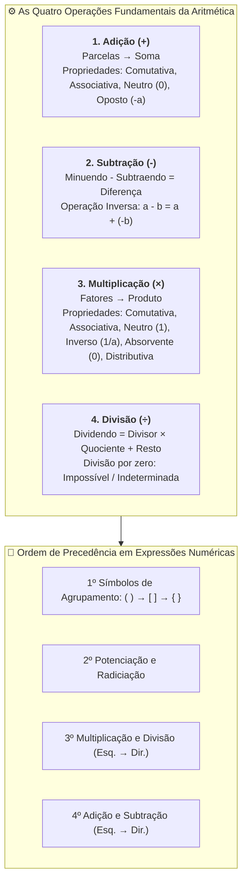
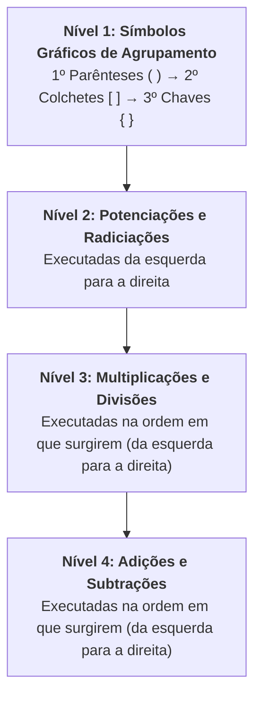

# 📖 Texto-base — Fundamentos de Matemática: Operações Básicas

> **Referência:** ARAÚJO, Luciana M. M.; FERRAZ, Mariana S. A.; LOYO, Tiago et al. **Fundamentos de matemática**. Porto Alegre: Grupo A / SAGAH, 2018. (Capítulo: *"Operações básicas"*, p. 111–119).  
> **Link na Minha Biblioteca:** [Plataforma Minha Biblioteca](https://app.minhabiblioteca.com.br/reader/books/9788595027701/pageid/110)  
> **Disciplina:** Matemática Básica (`MMB002-EC-2026S2B2-T001`) — Semana 1  

---

## 🗺️ Mapa Conceitual das Operações Básicas

---

## 📌 1. Adição

A adição é a operação aritmética primária que modela a junção, agrupamento ou acréscimo de quantidades.

$$\underbrace{a}_{\text{Parcela}} + \underbrace{b}_{\text{Parcela}} = \underbrace{S}_{\text{Soma ou Total}}$$

### 1.1. Propriedades Estruturais da Adição nos Reais ($\mathbb{R}$)

| Propriedade | Formulação Algébrica | Descrição / Exemplo |
| :--- | :--- | :--- |
| **Fechamento** | $\forall a, b \in \mathbb{R} \implies a + b \in \mathbb{R}$ | A soma de dois números reais resulta sempre em um número real. |
| **Comutativa** | $a + b = b + a$ | A ordem das parcelas não altera o resultado final.   *$14 + 27 = 27 + 14 = 41$* |
| **Associativa** | $(a + b) + c = a + (b + c)$ | O agrupamento das parcelas não altera a soma.   *$(8 + 5) + 12 = 13 + 12 = 25 = 8 + (5 + 12)$* |
| **Elemento Neutro** | $a + 0 = 0 + a = a$ | O número **zero ($0$)** é o elemento neutro aditivo. |
| **Elemento Oposto (Simétrico)** | $\forall a \in \mathbb{R}, \exists (-a) \in \mathbb{R} \mid a + (-a) = 0$ | Todo número real possui um oposto cuja soma resulta em zero.   *$7 + (-7) = 0$* |

---

## 📌 2. Subtração

A subtração é a operação inversa da adição. Formalmente, subtrair $b$ de $a$ equivale a somar $a$ com o elemento oposto de $b$:

$$\underbrace{M}_{\text{Minuendo}} - \underbrace{S}_{\text{Subtraendo}} = \underbrace{D}_{\text{Resto ou Diferença}} \iff M = S + D$$
$$a - b = a + (-b)$$

### 2.1. Características Críticas da Subtração:
* **Não é Comutativa:** $a - b \neq b - a$ (para $a \neq b$).  
  *Exemplo:* $10 - 4 = 6$, enquanto $4 - 10 = -6$.
* **Não é Associativa:** $(a - b) - c \neq a - (b - c)$.  
  *Exemplo:* $(15 - 5) - 2 = 10 - 2 = 8$, mas $15 - (5 - 2) = 15 - 3 = 12$.
* **Propriedade Invariante:** Somar ou subtrair uma mesma constante $k$ ao minuendo e ao subtraendo mantém a diferença inalterada:
  $$(M + k) - (S + k) = M - S$$

---

## 📌 3. Multiplicação

A multiplicação é a forma abreviada de somar parcelas iguais repetidas vezes ($a \times b = \underbrace{b + b + \dots + b}_{a \text{ vezes}}$).

$$\underbrace{a}_{\text{Fator}} \times \underbrace{b}_{\text{Fator}} = \underbrace{P}_{\text{Produto}}$$

### 3.1. Propriedades Estruturais da Multiplicação

| Propriedade | Formulação Algébrica | Descrição / Exemplo |
| :--- | :--- | :--- |
| **Fechamento** | $\forall a, b \in \mathbb{R} \implies a \times b \in \mathbb{R}$ | O produto de números reais é sempre real. |
| **Comutativa** | $a \cdot b = b \cdot a$ | A ordem dos fatores não altera o produto.   *$6 \times 9 = 9 \times 6 = 54$* |
| **Associativa** | $(a \cdot b) \cdot c = a \cdot (b \cdot c)$ | O agrupamento de fatores não altera o produto.   *$(3 \times 4) \times 5 = 12 \times 5 = 60 = 3 \times (4 \times 5)$* |
| **Elemento Neutro** | $a \cdot 1 = 1 \cdot a = a$ | O número **um ($1$)** é o elemento neutro multiplicativo. |
| **Elemento Inverso (Recíproco)** | $\forall a \neq 0, \exists a^{-1} = \frac{1}{a} \mid a \cdot \frac{1}{a} = 1$ | Todo real não nulo tem um inverso multiplicativo.   *$5 \times \frac{1}{5} = 1$* |
| **Elemento Absorvente (Nulidade)** | $a \cdot 0 = 0 \cdot a = 0$ | O zero anula a multiplicação por qualquer número. |
| **Distributiva em relação à Adição/Subtração** | $a \cdot (b \pm c) = a \cdot b \pm a \cdot c$ | O fator multiplica cada um dos termos internos.   *$4 \times (10 + 3) = 40 + 12 = 52$* |

### 3.2. Regra dos Sinais na Multiplicação e Divisão
* Sinais **Iguais** $\implies$ Resultado **Positivo ($+$)**:
  $$(+) \times (+) = (+) \quad \text{e} \quad (-) \times (-) = (+)$$
* Sinais **Diferentes** $\implies$ Resultado **Negativo ($-$)**:
  $$(+) \times (-) = (-) \quad \text{e} \quad (-) \times (+) = (-)$$

---

## 📌 4. Divisão

A divisão é a operação inversa da multiplicação. Dividir $D$ por $d$ ($d \neq 0$) consiste em determinar quantas vezes o divisor cabe no dividendo.

$$\begin{array}{r|l}
D & d \\ \cline{2-2}
r & q
\end{array} \iff D = d \cdot q + r$$

### 4.1. Teorema da Divisão Euclidiana (Algoritmo da Divisão)
Para quaisquer inteiros $D$ (dividendo) e $d$ (divisor, com $d \neq 0$), existem inteiros únicos $q$ (quociente) e $r$ (resto) tais que:
$$D = d \cdot q + r \quad \text{com} \quad 0 \le r < |d|$$

* **Divisão Exata:** Quando o resto é nulo ($r = 0$). Temos $D = d \cdot q \implies \frac{D}{d} = q$.
* **Divisão Não Exata:** Quando o resto é não nulo ($0 < r < |d|$).

---

### 4.2. A Divisão Envolvendo o Zero: Análise Crítica

> [!CAUTION]
> ### ⚠️ Análise dos Três Casos Fundamentais do Zero:
> 
> 1. **Zero no Dividendo ($\frac{0}{a}$ com $a \neq 0$):**
>    $$\frac{0}{a} = 0 \quad (\text{Pois } a \times 0 = 0 \text{ é único e bem definido})$$
> 
> 2. **Zero no Divisor ($\frac{a}{0}$ com $a \neq 0$):**
>    $$\frac{a}{0} \implies \textbf{IMPOSSÍVEL / INDEFINIDA}$$
>    *Justificativa:* Suponha que $\frac{a}{0} = x$. Então $0 \cdot x = a$. Como qualquer número multiplicado por zero resulta em zero ($0 \cdot x = 0 \neq a$), **não existe nenhum valor real $x$** que satisfaça a igualdade.
> 
> 3. **Zero sobre Zero ($\frac{0}{0}$):**
>    $$\frac{0}{0} \implies \textbf{INDETERMINAÇÃO}$$
>    *Justificativa:* Suponha que $\frac{0}{0} = x$. Então $0 \cdot x = 0$. Qualquer número real $x \in \mathbb{R}$ satisfaz essa equação ($0 \cdot 5 = 0, 0 \cdot (-12) = 0$). Logo, o resultado **não pode ser univocamente determinado**.

---

## 🧮 5. Expressões Numéricas e Ordem de Precedência (Hierarquia das Operações)

Para avaliar expressões matemáticas sem ambiguidade, segue-se estritamente a convenção universal de precedência:

### Exemplo Prático Resolvido Passo a Passo:

Calcule o valor da expressão:
$$E = 50 - 2 \cdot [3 + 2 \cdot (18 - 4 \cdot 3) + 10 \div 2]$$

1. **Resolver a expressão no parêntese $(18 - 4 \cdot 3)$:**  
   * Multiplicação primeiro: $4 \cdot 3 = 12$
   * Subtração: $18 - 12 = 6$
   * Expressão atual: $E = 50 - 2 \cdot [3 + 2 \cdot (6) + 10 \div 2]$

2. **Resolver dentro dos colchetes $[3 + 2 \cdot 6 + 10 \div 2]$:**  
   * Multiplicações e divisões da esquerda para a direita:  
     $2 \cdot 6 = 12$  
     $10 \div 2 = 5$  
     Termos nos colchetes: $[3 + 12 + 5]$
   * Adições: $3 + 12 + 5 = 20$
   * Expressão atual: $E = 50 - 2 \cdot [20]$

3. **Multiplicação externa:**  
   $2 \cdot 20 = 40$

4. **Subtração final:**  
   $$E = 50 - 40 = \mathbf{10}$$

---

## 💡 6. Conexões com a Programação e Engenharia de Computação

* **Precedência de Operadores em Linguagens (C++, Python, Java):**  
  As linguagens implementam exatamente a árvore sintática baseada nessas precedências aritméticas (`*`, `/`, `%` possuem precedência superior a `+`, `-`).
* **Tratamento de Exceções (`DivisionByZeroException`):**  
  Tentativas de execução de divisão inteira por zero em nível de hardware geram interrupções de CPU (`SIGFPE` - *Floating Point Exception*) ou falhas críticas se não tratadas.
* **Operador Módulo (`%`):**  
  Em ciência da computação, a operação `D % d` calcula o resto $r$ da divisão euclidiana, amplamente empregado em criptografia (Aritmética Modular, RSA) e balanceamento de carga (*hashing*).
