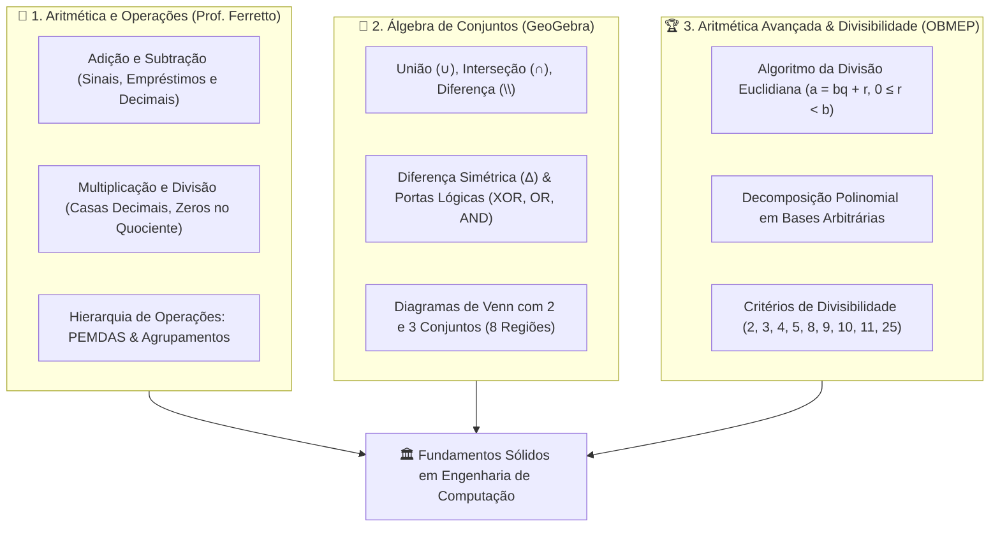
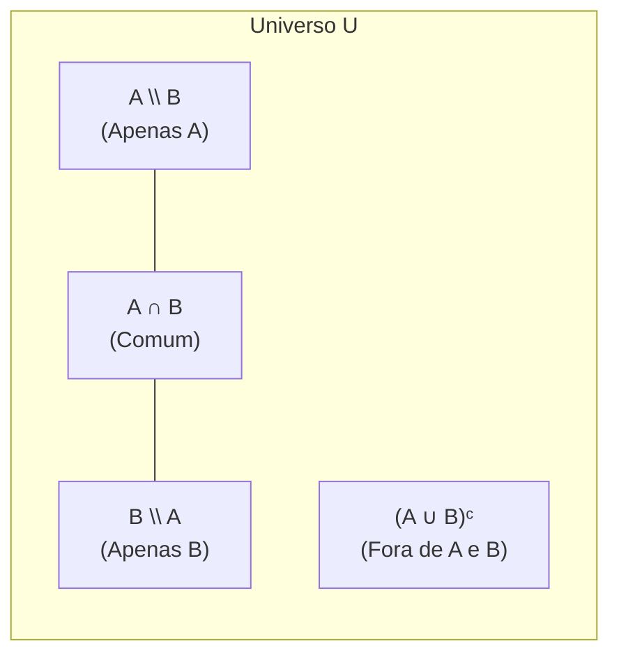
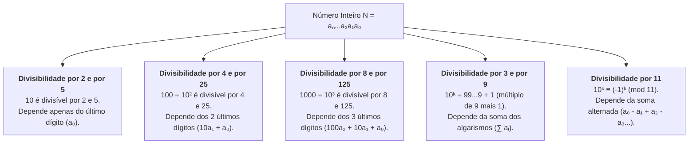

# 🔍 Aprofundando o Tema — Semana 1 (MMB002)

> **Disciplina:** Matemática Básica (`MMB002-EC-2026S2B2-T001`)  
> **Tema da Semana 1:** Números: significado numérico, operações e propriedades aritméticas  
> 
> **📚 Materiais e Recursos de Aprofundamento:**  
> 1. 🎥 **Vídeos de Apoio — Professor Ferretto:**  
>    * [Adição e Subtração: Aprenda Matemática do Zero](https://www.youtube.com/watch?v=e78_5WIssSU)  
>    * [Multiplicação e Divisão: Operações com Inteiros e Decimais](https://www.youtube.com/watch?v=0UGJRHq2PS4)  
>    * [Expressões Numéricas: Ordem nas Operações](https://www.youtube.com/watch?v=BhDm2qGy780)  
> 2. 🌐 **Material Interativo (GeoGebra):**  
>    * [Operações com Conjuntos | Sérgio de Albuquerque Souza](https://www.geogebra.org/m/JmXZpkBs)  
>    * [Trabalhando com Conjuntos | Greice Lacerda](https://www.geogebra.org/m/uyt97krj)  
> 3. 📖 **Material Bibliográfico OBMEP:**  
>    * CADAR, Luciana; DUTENHEFNER, Francisco. **Encontros de aritmética** (p. 37–62). Rio de Janeiro: IMPA/OBMEP, 2014. [Acessar Livro OBMEP (PDF)](https://www.obmep.org.br/docs/aritmetica.pdf)  

---

## 🗺️ Mapa Integrado de Aprofundamento da Semana 1

---

## 🎥 Módulo 1: Operações Aritméticas e Expressões (Prof. Ferretto)

---

### 1.1. Adição e Subtração de Inteiros e Decimais
* **Regras de Sinais na Adição e Subtração:**
  * **Sinais Iguais:** Somam-se os valores absolutos e conserva-se o sinal comum:
    $$(+7) + (+5) = +12 \quad \text{e} \quad (-8) + (-6) = -14$$
  * **Sinais Diferentes:** Subtrai-se o menor valor absoluto do maior e conserva-se o sinal do número de maior valor absoluto:
    $$(+15) + (-9) = +6 \quad \text{e} \quad (-20) + (+8) = -12$$
* **Operações com Números Decimais:**
  * Alinhar rigorosamente a **vírgula sob vírgula** (unidades sob unidades, décimos sob décimos, centésimos sob centésimos), preenchendo as ordens vazias com zeros à direita.
  * *Exemplo:* $14,25 + 3,8 = 14,25 + 3,80 = \mathbf{18,05}$.

---

### 1.2. Multiplicação e Divisão com Decimais
* **Multiplicação Decimal:**
  1. Multiplicam-se os números normalmente, desconsiderando as vírgulas momentaneamente;
  2. Conta-se a quantidade total de casas decimais somando as casas de todos os fatores;
  3. Desloca-se a vírgula no produto final da direita para a esquerda pelo total de casas acumuladas.
  * *Exemplo:* $2,35 \text{ (2 casas)} \times 1,4 \text{ (1 casa)} \implies 235 \times 14 = 3290 \implies \mathbf{3,290 = 3,29 \text{ (3 casas)}}$.
* **Divisão com Decimais e Zeros no Quociente:**
  1. Igualam-se as casas decimais do dividendo e do divisor acrescentando zeros;
  2. Eliminam-se as vírgulas e executa-se o algoritmo da divisão euclidiana;
  3. Quando o dividendo parcial for menor que o divisor após descer um algarismo, **acrescenta-se zero no quociente** antes de prosseguir.

---

### 1.3. Expressões Numéricas: A Ordem Estrita de Precedência
Para resolver qualquer expressão aritmética complexa sem incorrer em ambiguidade:

$$\begin{array}{cll}
\textbf{1º Nível (Agrupadores):} & \text{Parênteses } ( ) \implies \text{Colchetes } [ ] \implies \text{Chaves } \{ \} \\
\textbf{2º Nível (Potências/Raízes):} & x^n \text{ e } \sqrt[n]{x} \quad (\text{da esquerda para a direita}) \\
\textbf{3º Nível (Multiplicação/Divisão):} & \times \text{ e } \div \quad (\text{na ordem estrita de ocorrência: da esquerda para a direita}) \\
\textbf{4º Nível (Adição/Subtração):} & + \text{ e } - \quad (\text{na ordem estrita de ocorrência: da esquerda para a direita})
\end{array}$$

> [!WARNING]
> **Atenção Clássica:** Em expressões como $20 \div 5 \times 2$, a multiplicação **não** tem prioridade sobre a divisão. Ambas possuem o mesmo nível hierárquico e devem ser calculadas **da esquerda para a direita**: $(20 \div 5) \times 2 = 4 \times 2 = \mathbf{8}$ (e não $20 \div 10 = 2$).

---

## 🌐 Módulo 2: Álgebra de Conjuntos (GeoGebra — Sérgio de Albuquerque Souza)

O material interativo no GeoGebra explora a formalização visual das operações com diagramas de Venn:

### 2.1. Tabela Completa de Operações com Conjuntos

| Operação | Símbolo | Definição Lógica Formal | Equivalência Lógica / Computacional |
| :--- | :---: | :--- | :--- |
| **União (Reunião)** | $A \cup B$ | $\{x \in U \mid x \in A \lor x \in B\}$ | Porta **OR** ($A + B$) |
| **Interseção** | $A \cap B$ | $\{x \in U \mid x \in A \land x \in B\}$ | Porta **AND** ($A \cdot B$) |
| **Diferença Relativa** | $A \setminus B$ | $\{x \in U \mid x \in A \land x \notin B\} = A \cap B^c$ | $A \land \neg B$ |
| **Diferença Simétrica** | $A \Delta B$ | $(A \setminus B) \cup (B \setminus A) = (A \cup B) \setminus (A \cap B)$ | Porta **XOR** ($A \oplus B$) |
| **Complementar** | $A^c$ ou $\bar{A}$ | $\{x \in U \mid x \notin A\} = U \setminus A$ | Porta **NOT** ($\neg A$) |
| **Não-União (NOR)** | $(A \cup B)^c$ | $\{x \in U \mid x \notin A \land x \notin B\} = A^c \cap B^c$ | Porta **NOR** ($\overline{A + B}$) |
| **Não-Interseção (NAND)** | $(A \cap B)^c$ | $\{x \in U \mid x \notin A \lor x \notin B\} = A^c \cup B^c$ | Porta **NAND** ($\overline{A \cdot B}$) |

---

### 2.2. Leis Algébricas Fundamentais (Leis de De Morgan)
As leis formuladas por Augustus De Morgan estabelecem a dualidade entre união e interseção:
1. **Primeira Lei:** O complementar da união é a interseção dos complementares:
   $$(A \cup B)^c = A^c \cap B^c$$
2. **Segunda Lei:** O complementar da interseção é a união dos complementares:
   $$(A \cap B)^c = A^c \cup B^c$$

---

## 📖 Módulo 3: Encontros de Aritmética (OBMEP — Cadar & Dutenhefner, p. 37–62)

O Capítulo 3 da apostila da OBMEP formaliza a teoria dos números, a divisão inteira e os critérios de divisibilidade com rigor matemático olímpico.

---

### 3.1. O Algoritmo da Divisão Euclidiana (Teorema Fundamental)

> **Teorema da Divisão Euclidiana:**  
> Dados dois números inteiros $a$ (dividendo) e $b$ (divisor, com $b > 0$), existem **únicos** inteiros $q$ (quociente) e $r$ (resto) tais que:
> $$a = b \cdot q + r \quad \text{com} \quad 0 \le r < b$$

* **Unicidade do Quociente e do Resto:**  
  * O resto $r$ só pode assumir $b$ valores possíveis: $\{0, 1, 2, \dots, b - 1\}$.
  * Quando $r = 0$, dizemos que **$b$ divide $a$** ($b \mid a$) ou que $a$ é múltiplo de $b$.

#### Classificação por Paridade e Congruência:
* Divisão por $2$: todo inteiro $n$ é da forma $2k$ (par) ou $2k+1$ (ímpar).
* Divisão por $3$: todo inteiro $n$ é da forma $3k$, $3k+1$ ou $3k+2$.
* Divisão por $m$: particiona o conjunto dos inteiros $\mathbb{Z}$ em $m$ classes de restos disjuntas (classes de congruência módulo $m$).

---

### 3.2. Decomposição Decimal e em Outras Bases

Todo número inteiro positivo $N$ escrito no sistema decimal com algarismos $a_n a_{n-1} \dots a_1 a_0$ possui a expansão polinomial:
$$N = a_n \cdot 10^n + a_{n-1} \cdot 10^{n-1} + \dots + a_2 \cdot 10^2 + a_1 \cdot 10^1 + a_0 \cdot 10^0$$

Generalizando para uma **base $b \ge 2$** qualquer com dígitos $d_i \in \{0, 1, \dots, b-1\}$:
$$(d_n d_{n-1} \dots d_1 d_0)_b = \sum_{k=0}^{n} d_k \cdot b^k$$

---

### 3.3. Dedução dos Critérios de Divisibilidade (IMPA / OBMEP)

Os critérios de divisibilidade decorrem diretamente da decomposição decimal de $N = \sum_{k=0}^n a_k 10^k$:

#### Tabela Demonstrativa dos Critérios de Divisibilidade:

| Divisor | Critério Prático | Justificativa / Demonstração Algébrica |
| :---: | :--- | :--- |
| **$2$** | O último algarismo $a_0$ é par ($0, 2, 4, 6, 8$). | $N = 10 \cdot Q + a_0 = 2(5Q) + a_0$. O primeiro termo é sempre par; logo, o resto depende só de $a_0$. |
| **$5$** | O último algarismo $a_0$ é $0$ ou $5$. | $N = 10 \cdot Q + a_0 = 5(2Q) + a_0$. O resto por 5 é o resto de $a_0$ por 5. |
| **$4$** | O número formado pelos dois últimos algarismos ($a_1 a_0$) é divisível por 4. | $N = 100 \cdot Q' + (10a_1 + a_0) = 4(25Q') + (10a_1 + a_0)$. Como $100$ é múltiplo de $4$, o resto depende só de $a_1 a_0$. |
| **$25$** | Termina em $00, 25, 50$ ou $75$. | $N = 100 \cdot Q' + (10a_1 + a_0) = 25(4Q') + (10a_1 + a_0)$. |
| **$8$** | O número formado pelos três últimos algarismos ($a_2 a_1 a_0$) é divisível por 8. | $N = 1000 \cdot Q'' + (100a_2 + 10a_1 + a_0) = 8(125Q'') + (100a_2 + 10a_1 + a_0)$. |
| **$3$** | A soma dos algarismos $(a_n + \dots + a_1 + a_0)$ é divisível por 3. | Como $10^k = \underbrace{99\dots9}_{k \text{ noves}} + 1 = 3 \cdot M_k + 1$, temos $N = 3 \cdot M + \sum a_k$. Logo, $N$ e $\sum a_k$ deixam o mesmo resto na divisão por 3. |
| **$9$** | A soma dos algarismos $(a_n + \dots + a_1 + a_0)$ é divisível por 9. | Como $10^k = 99\dots9 + 1 = 9 \cdot M'_k + 1$, temos $N = 9 \cdot M' + \sum a_k$. |
| **$10$** | O último algarismo $a_0$ é igual a $0$. | $N = 10 \cdot Q + a_0$. |
| **$11$** | A diferença entre a soma dos algarismos de ordem ímpar e a soma dos de ordem par é múltipla de 11. | Como $10 \equiv -1 \pmod{11}$, temos $10^k \equiv (-1)^k \pmod{11}$. Assim: $N \equiv (a_0 - a_1 + a_2 - a_3 + \dots) \pmod{11}$. |

---

### 3.4. Problemas Resolvidos da OBMEP (Encontros de Aritmética)

#### 🔹 Problema OBMEP 1: O Enigma dos Algarismos Ocultos
> **Enunciado:** Determine os algarismos $a$ e $b$ para que o número de seis algarismos $N = 52a14b$ seja simultaneamente divisível por $4$ e por $9$.

**Resolução Passo a Passo:**
1. **Condição de Divisibilidade por 4:**
   * O número formado pelos dois últimos algarismos $4b$ deve ser divisível por $4$.
   * As opções para $b \in \{0, 1, 2, \dots, 9\}$ tais que $4b$ é múltiplo de 4 são:
     $$b \in \{0, 4, 8\} \quad (40, 44, 48)$$
2. **Condição de Divisibilidade por 9:**
   * A soma de todos os algarismos deve ser múltiplo de $9$:
     $$\text{Soma} = 5 + 2 + a + 1 + 4 + b = 12 + a + b$$
   * Para que $12 + a + b$ seja múltiplo de 9 (com $0 \le a \le 9$):
     * Se $b = 0 \implies 12 + a + 0 = 12 + a \implies a = 6$ ($12 + 6 = 18$).  
       $\implies$ **Solução 1:** $N = 526140$.
     * Se $b = 4 \implies 12 + a + 4 = 16 + a \implies a = 2$ ($16 + 2 = 18$).  
       $\implies$ **Solução 2:** $N = 522144$.
     * Se $b = 8 \implies 12 + a + 8 = 20 + a \implies a = 7$ ($20 + 7 = 27$).  
       $\implies$ **Solução 3:** $N = 527148$.

---

#### 🔹 Problema OBMEP 2: Restos Sucessivos e Periodicidade
> **Enunciado:** Qual é o resto da divisão de $2^{100}$ por $7$?

**Resolução por Congruência e Restos da Divisão Euclidiana:**
* Avaliando as potências sucessivas de $2$ divididas por $7$:
  * $2^1 = 2 \implies r = 2$
  * $2^2 = 4 \implies r = 4$
  * $2^3 = 8 = 7 \cdot 1 + 1 \implies r = 1$
* Como $2^3$ deixa resto $1$ na divisão por $7$, qualquer potência múltipla de 3 também deixará resto 1:
  $$100 = 3 \times 33 + 1 \implies 2^{100} = (2^3)^{33} \cdot 2^1$$
  $$2^{100} = (7k + 1)^{33} \cdot 2 = (7K + 1) \cdot 2 = 14K + 2 = 7(2K) + \mathbf{2}$$
* **Resposta:** O resto da divisão de $2^{100}$ por $7$ é igual a **$2$**.

---

## 💻 Módulo 4: Aplicações em Ciência da Computação e Engenharia

1. **Aritmética de Restos e Tabelas Hash (*Hash Tables*):**
   * A função hash elementar $h(k) = k \bmod m$ usa o operador de resto da divisão euclidiana para mapear chaves em índices de memória uniformes.
2. **Criptografia de Chave Pública (Algoritmo RSA):**
   * A segurança de transações bancárias e certificados digitais HTTPS/SSL apoia-se no Algoritmo da Divisão Euclidiana Estendida (MDC de Euclides) e nas propriedades de congruência modular com números primos gigantes.
3. **Detecção e Correção de Erros (Dígitos Verificadores e CRC):**
   * O cálculo de dígitos verificadores de CPF, CNPJ, ISBN de livros e códigos de barras bancários baseia-se diretamente no critério de divisibilidade módulo 11 e módulo 10.
