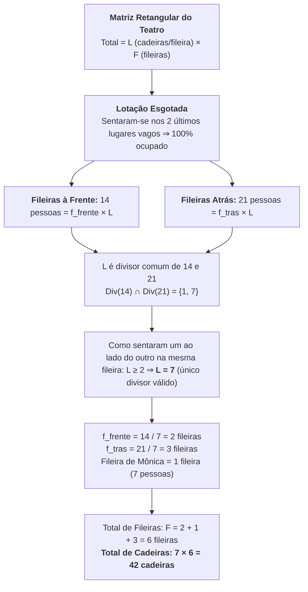

# 💬 Fórum Temático — Semana 1 (MMB002)

> **Disciplina:** Matemática Básica (`MMB002-EC-2026S2B2-T001`)  
> **Tema da Semana 1:** Números: significado numérico, operações e propriedades aritméticas  
> **Objeto de Discussão:** Desafio da Semana (OBMEP 2017 — As Cadeiras do Teatro)  

---

## 💡 O Desafio da Semana (OBMEP 2017)

### 📄 Enunciado
> *Mônica e seu namorado foram assistir a uma peça de teatro. O auditório era organizado em fileiras paralelas ao palco, todas com o mesmo número de cadeiras dispostas lado a lado. Eles se sentaram um ao lado do outro nos dois últimos lugares vagos. Mônica percebeu que havia, no total, 14 pessoas nas fileiras a sua frente e 21 pessoas nas fileiras atrás da sua.*  
> 
> **Quantas cadeiras havia no auditório?**

---

## 🧮 Resolução Matemática Passo a Passo



### 1. Modelação Algébrica:
* Seja $L$ o número de cadeiras por fileira ($L \in \mathbb{N}^*$);
* Seja $F$ o número total de fileiras no teatro ($F \in \mathbb{N}^*$);
* Capacidade total do teatro: $T = L \times F$.

### 2. Análise da Ocupação e Divisibilidade:
* Com a ocupação dos dois últimos lugares vagos pelo casal, o teatro ficou **completamente lotado** (total de pessoas = total de cadeiras).
* O número de pessoas à frente é $14$, correspondendo a $f_{\text{frente}}$ fileiras completas:
  $$f_{\text{frente}} \times L = 14 \implies L \mid 14$$
* O número de pessoas atrás é $21$, correspondendo a $f_{\text{trás}}$ fileiras completas:
  $$f_{\text{trás}} \times L = 21 \implies L \mid 21$$
* Logo, $L$ deve ser um **divisor comum** de $14$ e $21$:
  $$\text{Divisores de } 14 = \{1, 2, 7, 14\}$$
  $$\text{Divisores de } 21 = \{1, 3, 7, 21\}$$
  $$\text{Divisores Comuns}(14, 21) = \{1, 7\}$$

### 3. Restrição Real e Determinação de $L$:
* Como Mônica e seu namorado sentaram-se **um ao lado do outro na mesma fileira**, a fileira tem no mínimo 2 cadeiras ($L \ge 2$). Logo, $L \neq 1$.
* O único divisor comum maior ou igual a 2 é $L = 7$.
* Portanto:
  $$L = 7 \text{ cadeiras por fileira}$$

### 4. Contagem das Fileiras e Total de Cadeiras:
* Fileiras à frente: $f_{\text{frente}} = \frac{14}{7} = 2$ fileiras;
* Fileiras atrás: $f_{\text{trás}} = \frac{21}{7} = 3$ fileiras;
* Fileira onde Mônica e o namorado estão: $1$ fileira (com 7 pessoas);
* Total de fileiras: $F = 2 + 1 + 3 = \mathbf{6 \text{ fileiras}}$;
* Capacidade total:
  $$T = L \times F = 7 \times 6 = \mathbf{42 \text{ cadeiras}}$$

*(Verificação de consistência: $14 \text{ (à frente)} + 7 \text{ (na fileira deles)} + 21 \text{ (atrás)} = 42 \text{ pessoas})$.*

---

## 🔬 Ponto de Rigor Matemático: Por que a Solução é Única?

> [!IMPORTANT]
> **Atenção Teórica:** A regra do problema **não** é simplesmente *"L é o MDC"*. A regra é que **$L$ deve ser qualquer divisor comum $\ge 2$**.
> 
> No problema da OBMEP, a resposta é única apenas porque $\text{mdc}(14, 21) = 7$ é um **número primo**, cujos únicos divisores são $\{1, 7\}$. Como $L \ge 2$, restou apenas $L = 7$.
> 
> **Contraexemplo:**  
> Se houvesse **12 pessoas à frente** e **18 atrás**:
> * $\text{Divisores Comuns}(12, 18) = \{1, 2, 3, 6\}$.
> * Os divisores válidos $\ge 2$ seriam $L \in \{2, 3, 6\}$.
>   * $L = 2 \implies F = (12/2) + 1 + (18/2) = 6 + 1 + 9 = 16 \implies T = 2 \times 16 = \mathbf{32 \text{ cadeiras}}$.
>   * $L = 3 \implies F = (12/3) + 1 + (18/3) = 4 + 1 + 6 = 11 \implies T = 3 \times 11 = \mathbf{33 \text{ cadeiras}}$.
>   * $L = 6 \implies F = (12/6) + 1 + (18/6) = 2 + 1 + 3 = 6 \implies T = 6 \times 6 = \mathbf{36 \text{ cadeiras}}$.
> 
> Nesse cenário com MDC composto, o problema admitiria 3 respostas válidas! Isso demonstra a importância de testar todos os divisores comuns e verificar a primalidade do MDC.

---

## 💻 Código em C++ com Verificação de Unicidade (`desafio_obmep_s1.cpp`)

```cpp
#include <iostream>
#include <vector>
#include <numeric>   // std::gcd da STL (C++17)

struct Solucao {
    int assentosPorFileira; // Quantidade de cadeiras em cada fileira (L)
    int fileirasDaFrente;   // Quantidade de fileiras completas à frente (f_frente)
    int fileirasDeTras;     // Quantidade de fileiras completas atrás (f_tras)
    int totalDeFileiras;    // Total de fileiras: frente + casal + trás
    int totalDeAssentos;    // Capacidade total do auditório: L * totalDeFileiras
};

bool ehPrimo(int numero) {
    if (numero <= 1) return false;
    for (int divisor = 2; divisor * divisor <= numero; ++divisor) {
        if (numero % divisor == 0) return false;
    }
    return true;
}

std::vector<Solucao> resolverComSTL(int pessoasAFrente, int pessoasAtras) {
    std::vector<Solucao> solucoes;
    int mdc = std::gcd(pessoasAFrente, pessoasAtras);

    for (int assentosPorFileira = 2; assentosPorFileira <= mdc; ++assentosPorFileira) {
        if (mdc % assentosPorFileira == 0) {
            int fileirasDaFrente = pessoasAFrente / assentosPorFileira;
            int fileirasDeTras   = pessoasAtras   / assentosPorFileira;
            int fileiraDoCasal   = 1;
            int totalDeFileiras  = fileirasDaFrente + fileiraDoCasal + fileirasDeTras;
            int totalDeAssentos  = assentosPorFileira * totalDeFileiras;

            solucoes.push_back({assentosPorFileira, fileirasDaFrente, fileirasDeTras, totalDeFileiras, totalDeAssentos});
        }
    }
    return solucoes;
}

void analisar(int pessoasAFrente, int pessoasAtras, const char* titulo) {
    std::cout << "-----------------------------------------------------------------\n";
    std::cout << "  " << titulo << "\n";
    std::cout << "  Pessoas a frente: " << pessoasAFrente << " | Pessoas atras: " << pessoasAtras << "\n";
    
    int mdc = std::gcd(pessoasAFrente, pessoasAtras);
    std::cout << "  [STL std::gcd] MDC(" << pessoasAFrente << ", " << pessoasAtras 
              << ") = " << mdc << " (Primo? " << (ehPrimo(mdc) ? "SIM" : "NAO") << ")\n";
    std::cout << "-----------------------------------------------------------------\n";

    std::vector<Solucao> solucoes = resolverComSTL(pessoasAFrente, pessoasAtras);
    for (const Solucao& solucao : solucoes) {
        std::cout << "    " << solucao.assentosPorFileira << " assentos/fileira -> "
                  << solucao.fileirasDaFrente << " (frente) + 1 (casal) + " << solucao.fileirasDeTras << " (tras) = " 
                  << solucao.totalDeFileiras << " fileiras -> "
                  << solucao.assentosPorFileira << " x " << solucao.totalDeFileiras << " = " 
                  << solucao.totalDeAssentos << " assentos no total\n";
    }

    if (solucoes.size() == 1) {
        std::cout << "    => SOLUCAO UNICA: " << solucoes[0].totalDeAssentos << " assentos (pois MDC=" << mdc << " e primo!).\n\n";
    } else {
        std::cout << "    => " << solucoes.size() << " SOLUCOES POSSIVEIS: o problema seria ambiguo!\n\n";
    }
}

int main() {
    analisar(14, 21, "PROBLEMA ORIGINAL (OBMEP 2017)");
    analisar(12, 18, "CONTRAEXEMPLO: por que 'L = MDC' nao e a regra geral");
    return 0;
}
```

---

## 📝 Sugestão de Postagem para o Fórum da Univesp

> **Título do Tópico:** Resolução do Desafio da Semana 1 — Análise de Divisibilidade e Unicidade
>
> Olá a todos!
>
> Analisando o desafio da OBMEP 2017, cheguei ao total de **42 cadeiras**. Compartilho abaixo o raciocínio:
>
> 1. **Lotação completa:** Como Mônica e o namorado ocuparam os *dois últimos lugares vagos*, todas as cadeiras do teatro ficaram preenchidas. Assim, as pessoas à frente (14) e atrás (21) formam fileiras completas.
> 2. **Divisibilidade:** O número de cadeiras por fileira ($L$) precisa dividir tanto 14 quanto 21. Os divisores comuns de 14 e 21 são apenas 1 e 7.
> 3. **Unicidade da resposta:** Como o casal sentou lado a lado, a fileira tem pelo menos 2 cadeiras ($L \ge 2$). Descartando $L = 1$, sobra unicamente $L = 7$ cadeiras por fileira.
> 4. **Cálculo final:** 
>    * 2 fileiras à frente ($14 / 7$);
>    * 1 fileira do casal (com 7 pessoas);
>    * 3 fileiras atrás ($21 / 7$);
>    * Total de 6 fileiras $\times$ 7 cadeiras = **42 cadeiras**.
>
> **Uma curiosidade para reflexão:** A resposta só é única porque o MDC de 14 e 21 é 7 (um número primo). Se fossem 12 pessoas à frente e 18 atrás, teríamos divisores comuns 2, 3 e 6, gerando 3 respostas diferentes (32, 33 ou 36 cadeiras)!
