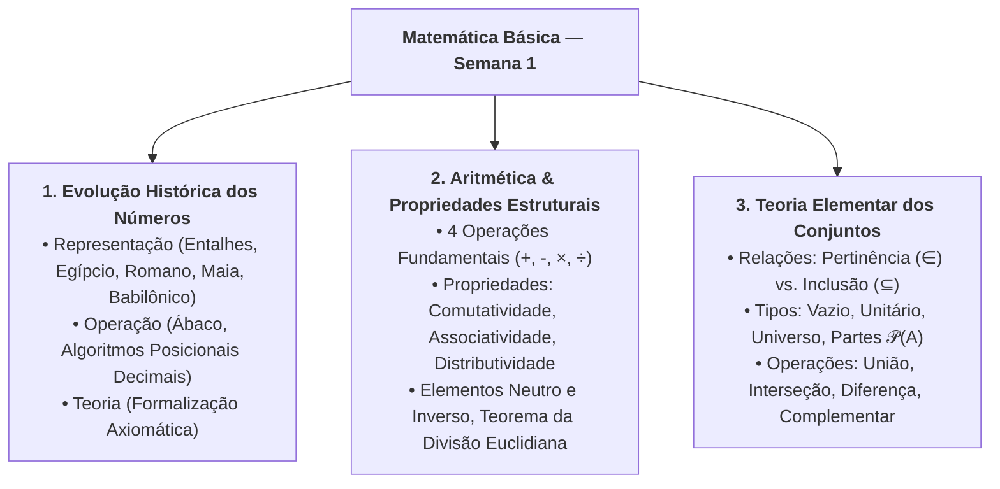
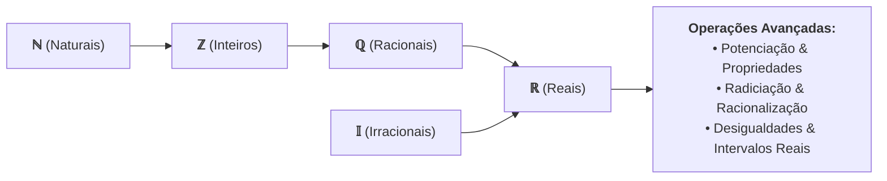

# 📌 Em Síntese — Semana 1 (MMB002)

> **Disciplina:** Matemática Básica (`MMB002-EC-2026S2B2-T001`)  
> **Tema da Semana 1:** Números: significado numérico, operações e propriedades aritméticas  
> **Docente Responsável:** Profª Dra. Rúbia Barcelos Amaral  
> **Período:** 28/09/2026 a 11/10/2026  
> **Status:** 🟢 Semana 1 Concluída com Sucesso  

---

## 🎯 Síntese e Consolidação dos Conteúdos da Semana

Nesta primeira semana, construímos os alicerces fundamentais da matemática elementar e abstrata, estruturados em três grandes eixos:

---

## 🏛️ 1. Os Três Momentos Históricos da Construção Numérica

1. **A Representação:**
   * A necessidade primordial de controle de rebanhos, colheitas e ciclos temporais originou os primeiros registros de contagem (ossos entalhados, pedras, nós em cordas).
   * Evoluiu para sistemas aditivos (egípcio, romano) e posicionais com bases variadas (sexagesimal babilônico na base 60, vigesimal maia na base 20), culminando no **Sistema Decimal Indo-Arábico**, que introduziu o zero posicional e revolucionou a economia e a ciência.
2. **A Operação:**
   * O desenvolvimento de métodos de cálculo prático, dispositivos de auxílio (ábacos, tábuas de calcular) e a formalização dos algoritmos das quatro operações fundamentais.
3. **A Teoria (como campo formal da matemática):**
   * A transição do cálculo empírico para o estudo rigoroso das propriedades aritméticas, estruturas algébricas, teoria dos números e formalização axiomática por meio da **Teoria dos Conjuntos** (iniciada por Georg Cantor no final do século XIX).

---

## 📐 2. Glossário Sistemático de Teoria dos Conjuntos

| Conceito / Notação | Definição Formal | Interpretação Prática |
| :--- | :--- | :--- |
| **Pertinência ($\in / \notin$)** | $x \in A$ | Relação exclusiva entre um **elemento** e um **conjunto**. |
| **Inclusão ($\subset / \subseteq$)** | $A \subseteq B \iff (\forall x \in A \implies x \in B)$ | Relação entre **dois conjuntos** (subconjunto). |
| **Conjunto Vazio ($\emptyset$ ou $\{\}$)** | $|\emptyset| = 0$, $\emptyset \subseteq X, \forall X$ | Conjunto sem elementos; subconjunto de qualquer conjunto existente. |
| **Conjunto Unitário** | $|X| = 1$ | Conjunto formado por um único elemento (ex.: $\{0\}$). |
| **Conjunto Universo ($U$)** | $\forall x, x \in U$ no contexto dado | Conjunto de referência que contém todos os elementos sob análise. |
| **Conjunto das Partes ($\mathcal{P}(A)$)** | $\mathcal{P}(A) = \{X \mid X \subseteq A\}$ | Conjunto de todos os subconjuntos de $A$. Se $|A| = n \implies |\mathcal{P}(A)| = 2^n$. |
| **Conjuntos Disjuntos** | $A \cap B = \emptyset$ | Conjuntos que não possuem nenhum elemento em comum. |
| **Reunião / União ($A \cup B$)** | $\{x \mid x \in A \lor x \in B\}$ | Elementos que pertencem a $A$, a $B$, ou a ambos. |
| **Interseção ($A \cap B$)** | $\{x \mid x \in A \land x \in B\}$ | Elementos comuns que pertencem simultaneamente a $A$ e $B$. |
| **Diferença ($A \setminus B$ ou $A - B$)** | $\{x \mid x \in A \land x \notin B\}$ | Elementos exclusivos de $A$ que não estão em $B$. |
| **Complementar ($A^c$ ou $\complement_U A$)** | $U \setminus A = \{x \in U \mid x \notin A\}$ | Elementos do Universo $U$ que não pertencem a $A$. |

> [!IMPORTANT]
> **Diferença Crucial:**  
> * **Pertinência ($\in$):** Liga um elemento isolado a um conjunto (ex.: $2 \in \{2, 3\}$).  
> * **Inclusão ($\subseteq$):** Liga um conjunto a outro conjunto (ex.: $\{2\} \subseteq \{2, 3\}$ e $\emptyset \subseteq \{2, 3\}$).

---

## ✅ Autoavaliação de Competências da Semana 1

Verifique as competências e habilidades consolidadas nesta semana:

- [x] **Conheci a perspectiva histórica dos números:** Compreensão dos sistemas egípcio, romano, babilônico, maia e indo-arábico, além dos 3 momentos (representação, operação e teoria).
- [x] **Recordei a definição de números, sistemas de numeração e conjuntos:** Noção de base posicional, algarismos, cardinalidade e relações de pertinência ($\in$) e inclusão ($\subseteq$).
- [x] **Recordei e apliquei propriedades das operações básicas:** Comutatividade, associatividade, distributividade, elementos neutros, inversos aritméticos e critérios de divisibilidade.
- [x] **Lembrei e resolvi operações básicas:** Hierarquia e precedência de parênteses/colchetes, equações aritméticas, cálculo de lucro líquido e problemas de contagem com Diagramas de Venn e Princípio da Inclusão-Exclusão.
- [x] **Validação Computacional:** Implementação e validação de todos os modelos matemáticos e exercícios em C++ (utilizando bibliotecas modernas da STL: `<numeric>`, `<vector>`, `<stack>`, `<map>`, `<set>`, `<algorithm>`).

---

## 🔮 Conexão com a Semana 2: O que vem a seguir?

Na **Semana 2**, daremos continuidade ao estudo de conjuntos, avançando para a estruturação formal dos **Conjuntos Numéricos** e suas operações algébricas avançadas:

* **Conjuntos Numéricos:** $\mathbb{N} \subset \mathbb{Z} \subset \mathbb{Q} \subset \mathbb{R}$ e os números irracionais ($\mathbb{I} = \mathbb{R} \setminus \mathbb{Q}$).
* **Relações Numéricas e Desigualdades:** Intervalos na reta real, desigualdades estritas e não-estritas.
* **Potenciação e Radiciação:** Propriedades dos expoentes inteiros e fracionários, simplificação de radicais e operações algébricas.

---

## 📚 Navegação Rápida — Materiais da Semana 1

* [0-Inicio.md](file:///home/henrique/Modelos/Univesp/2026S2B2/MMB002-Matematica-Basica/Semana-1/0-Inicio.md) — Apresentação, Objetivos e Desafio OBMEP 2017
* [1-Videoaulas.md](file:///home/henrique/Modelos/Univesp/2026S2B2/MMB002-Matematica-Basica/Semana-1/1-Videoaulas.md) — Videoaulas 1, 2 e 3 (História, Conjuntos e Operações)
* [2.1-Texto-base-Manual-Compacto.md](file:///home/henrique/Modelos/Univesp/2026S2B2/MMB002-Matematica-Basica/Semana-1/2.1-Texto-base-Manual-Compacto.md) — Bosquilha et al. (Sistemas Históricos e Decimal)
* [2.2-Texto-base-Teoria-dos-Numeros-Wall.md](file:///home/henrique/Modelos/Univesp/2026S2B2/MMB002-Matematica-Basica/Semana-1/2.2-Texto-base-Teoria-dos-Numeros-Wall.md) — Wall (Contagem, Bases e Investigações)
* [2.3-Texto-base-Operacoes-Basicas-Araujo.md](file:///home/henrique/Modelos/Univesp/2026S2B2/MMB002-Matematica-Basica/Semana-1/2.3-Texto-base-Operacoes-Basicas-Araujo.md) — Araújo et al. (Operações e Divisão Euclidiana)
* [3-Aprofundando-o-tema.md](file:///home/henrique/Modelos/Univesp/2026S2B2/MMB002-Matematica-Basica/Semana-1/3-Aprofundando-o-tema.md) — Ferretto, GeoGebra e OBMEP Aritmética
* [4-Forum-tematico.md](file:///home/henrique/Modelos/Univesp/2026S2B2/MMB002-Matematica-Basica/Semana-1/4-Forum-tematico.md) — Resolução Completa do Desafio do Fórum
* [5-Atividade-avaliativa.md](file:///home/henrique/Modelos/Univesp/2026S2B2/MMB002-Matematica-Basica/Semana-1/5-Atividade-avaliativa.md) — Questões 1 a 4 Gabaritadas (Nota 10/10)
* [desafio_obmep_s1.cpp](file:///home/henrique/Modelos/Univesp/2026S2B2/MMB002-Matematica-Basica/Semana-1/desafio_obmep_s1.cpp) — Validador C++ STL do Desafio do Fórum
* [resolucao_questoes_s1.cpp](file:///home/henrique/Modelos/Univesp/2026S2B2/MMB002-Matematica-Basica/Semana-1/resolucao_questoes_s1.cpp) — Validador Unificado C++ STL das Questões
