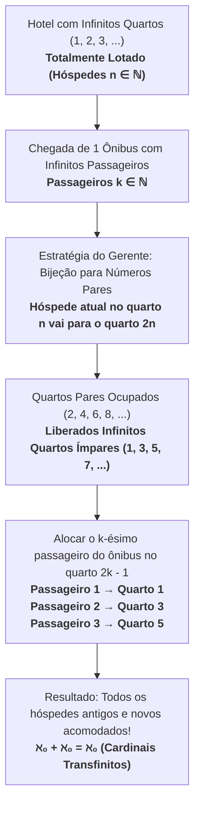

# 📌 Semana 2 — Início & Apresentação da Semana

> **Disciplina:** Matemática Básica (`MMB002-EC-2026S2B2-T001`)  
> **Tema da Semana 2:** Relações numéricas  
> **Docente Responsável:** Profª Dra. Rúbia Barcelos Amaral  
> **Período:** 05/10/2026 a 18/10/2026  

---

## 🎯 Contextualização

Boas-vindas à Semana 2 da disciplina **Matemática Básica**!

Nesta semana, daremos continuidade ao estudo dos conjuntos iniciado na Semana 1, agora explorando a fundo os **diferentes tipos de números e suas classificações estruturais**. Definiremos formalmente os conjuntos:
- **Números Naturais ($\mathbb{N}$)**
- **Números Inteiros ($\mathbb{Z}$)**
- **Números Racionais ($\mathbb{Q}$)**
- **Números Irracionais ($\mathbb{I}$ ou $\mathbb{R} \setminus \mathbb{Q}$)**
- **Números Reais ($\mathbb{R}$)**

Outro ponto fundamental da semana é o domínio e a representação dos **números decimais, números fracionários, dízimas periódicas vs. não periódicas, potenciação e radiciação**. Analisaremos o comportamento algébrico dos números quando elevados a diferentes expoentes (inteiros, negativos e fracionários) e a extração rigorosa de raízes — ferramentas matemáticas universais para Cálculo, Álgebra Linear, Engenharia da Computação e Ciência de Dados.

---

## 🎯 Objetivos de Aprendizagem

Ao final desta semana, você deverá ser capaz de:
1. **Compreender** a composição e as propriedades estruturais dos conjuntos dos números naturais ($\mathbb{N}$) e inteiros ($\mathbb{Z}$).
2. **Compreender** as particularidades, densidade e cardinalidade dos conjuntos dos números racionais ($\mathbb{Q}$), irracionais ($\mathbb{I}$) e reais ($\mathbb{R}$).
3. **Diferenciar** os tipos de dízimas (exatas, periódicas simples, periódicas compostas e não periódicas/irracionais) e encontrar suas frações geratrizes.
4. **Dominar e aplicar** com rigor as propriedades operatórias de potenciação e radiciação.

---

## 💡 Desafio da Semana: O Hotel de Hilbert

### 📌 Enunciado
*(Desafio: Hotel de Hilbert | Clube de Matemática da OBMEP)*  

> *O **Hotel de Hilbert** é um famoso hotel hipotético criado pelo matemático David Hilbert (1862–1943) que ilustra as propriedades surpreendentes e contraintuitivas do conceito de infinito.*
> 
> *O hotel possui **infinitos quartos**, numerados com números inteiros positivos ($1, 2, 3, \dots$), e todos os quartos estavam ocupados (lotação total de infinitos hóspedes).*
> 
> * **Caso 1 (1 novo hóspede):** Quando chegou um novo turista, o gerente solicitou que o hóspede do quarto $n$ se mudasse para o quarto $n + 1$. Assim, o quarto 1 ficou vago e o turista pôde ser acomodado.
> 
> * **O Desafio:** Em uma outra ocasião, chegou ao Hotel de Hilbert um **ônibus com infinitos passageiros**, e o hotel já estava com **infinitos hóspedes ocupando todos os quartos**. Agora, você é o(a) gerente! **Como acomodar todos os novos infinitos passageiros sem desalojar nenhum dos hóspedes atuais e garantindo exatamente 1 hóspede por quarto?**

---

### 🧮 Resolução Matemática Passo a Passo

#### 1. Formalização Matemática:
* Seja $H = \{1, 2, 3, \dots\} = \mathbb{N}^*$ o conjunto dos hóspedes atuais já alojados nos quartos de mesmo número.
* Seja $O = \{p_1, p_2, p_3, \dots\}$ o conjunto dos infinitos passageiros recém-chegados no ônibus, indexados por $k \in \mathbb{N}^*$.
* O conjunto de quartos disponíveis no hotel é $Q = \{1, 2, 3, \dots\} = \mathbb{N}^*$.

#### 2. Remanejamento dos Hóspedes Antigos (Gerando Vagas Infinitas):
O gerente pede que cada hóspede que está no quarto $n$ mude para o quarto de número **$2n$**:
$$f_{\text{antigos}}(n) = 2n, \quad \forall n \in \mathbb{N}^*$$

* Hóspede do quarto $1 \to$ Quarto $2$
* Hóspede do quarto $2 \to$ Quarto $4$
* Hóspede do quarto $3 \to$ Quarto $6$
* Hóspede do quarto $n \to$ Quarto $2n$

Dessa forma, **todos os quartos pares ($2, 4, 6, 8, \dots$) ficam ocupados pelos hóspedes antigos**, garantindo que nenhum hóspede antigo seja expulso.

#### 3. Alocação dos Novos Passageiros nos Quartos Ímpares:
Com o remanejamento, **todos os infinitos quartos de numeração ímpar ($1, 3, 5, 7, \dots$) ficaram completamente vagos**.

O gerente pode então alocar o $k$-ésimo passageiro do ônibus no quarto ímpar de número **$2k - 1$**:
$$g_{\text{novos}}(k) = 2k - 1, \quad \forall k \in \mathbb{N}^*$$

* Passageiro $1 \to$ Quarto $2(1) - 1 = 1$
* Passageiro $2 \to$ Quarto $2(2) - 1 = 3$
* Passageiro $3 \to$ Quarto $2(3) - 1 = 5$
* Passageiro $k \to$ Quarto $2k - 1$

#### 4. Conclusão e Significado Teórico:
Essa partição define uma **função bijetora** entre o conjunto conjunto de todos os hóspedes (antigos + novos) e o conjunto dos números naturais $\mathbb{N}^*$:
$$\mathbb{N}^* \cup \mathbb{N}^* \cong \mathbb{N}^*$$

Na teoria dos conjuntos e cardinalidade transfinita desenvolvida por Georg Cantor, isso demonstra que a união de dois conjuntos infinitos enumeráveis possui a mesma cardinalidade $\aleph_0$ (*aleph-zero*):
$$\aleph_0 + \aleph_0 = \aleph_0$$

---

### 💬 Sugestão de Postagem para o Fórum Temático

> **Título da Postagem:** Resolução do Desafio da Semana 2 — O Hotel de Hilbert e a Cardinalidade dos Infinitos Enumeráveis
>
> Olá, professora Rúbia, mediadores e colegas!
>
> Compartilho a minha proposta de solução para o desafio da gerência do Hotel de Hilbert com a chegada de um ônibus contendo infinitos passageiros:
>
> **Solução Proposta:**
> 1. **Remanejamento dos Hóspedes Antigos:** Solicito que cada hóspede atualmente hospedado no quarto de número $n$ mude para o quarto de número par **$2n$** (o hóspede do quarto 1 vai para o 2, o do quarto 2 vai para o 4, o do quarto 3 vai para o 6, e assim por diante). Com isso, todos os infinitos hóspedes antigos continuam acomodados, porém ocupando exclusivamente os quartos pares.
> 2. **Alocação dos Novos Passageiros:** Como todos os infinitos quartos de numeração ímpar ($1, 3, 5, 7, \dots$) ficaram totalmente liberados, acomodamos o $k$-ésimo passageiro do ônibus no quarto ímpar correspondente a **$2k - 1$** (o passageiro 1 vai para o quarto 1, o passageiro 2 vai para o quarto 3, o passageiro 3 vai para o quarto 5, etc.).
>
> **Relação com os Conteúdos da Disciplina:**
> Esse clássico paradoxo formulado por David Hilbert explora a natureza contraintuitiva dos **números naturais ($\mathbb{N}$)** e dos conjuntos infinitos enumeráveis. Ele demonstra de forma lúdica a existência de bijeções entre um conjunto infinito e um subconjunto próprio seu (como a bijeção entre os naturais e os números pares), conceito basilar formulado por Georg Cantor que fundamenta a teoria moderna dos conjuntos e os tipos de infinitos ($\aleph_0$).

---

## 🗺️ Roteiro e Orientação de Estudos da Semana

1. 🎬 **Videoaulas 4 e 5:**
   * **Videoaula 4:** Conjuntos numéricos — Números Naturais ($\mathbb{N}$) e Inteiros ($\mathbb{Z}$), propriedades de fechamento e reta orientada.
   * **Videoaula 5:** Números Racionais ($\mathbb{Q}$), representação fracionária, números decimais e dízimas periódicas.
2. 📖 **Textos-Base Principais:**
   * *Fundamentos de Matemática* (definição formal dos conjuntos numéricos).
   * *Conjuntos Numéricos* (José Kahl) — operações e propriedades.
   * *Matemática Básica: para administração, economia, contabilidade e negócios* — consolidação de conjuntos.
3. 📊 **Materiais Interativos:**
   * *Números Decimais* e *Números Decimais na Reta Numérica*.
   * *Manual Compacto de Matemática* e material interativo *Frações na Reta Numérica*.
4. 🎬 **Videoaula 6 & Aprofundamento:**
   * **Videoaula 6:** Potenciação e Radiciação (propriedades dos expoentes, expoentes fracionários e racionalização de denominadores).
   * Trecho complementar do *Manual Compacto de Matemática*.

---
