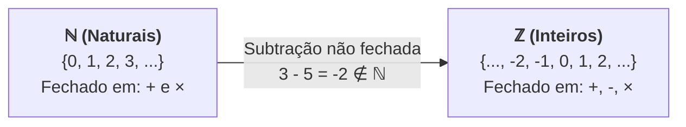
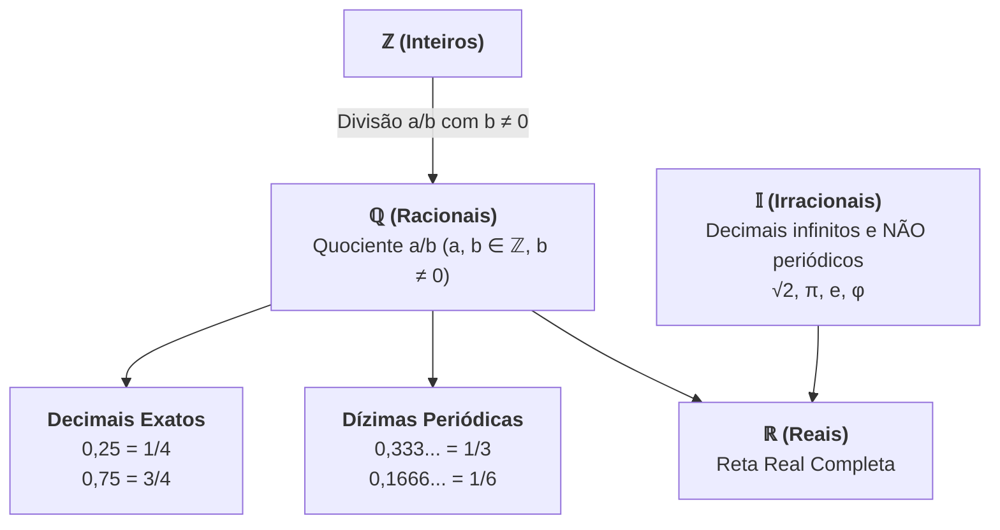

# 🎥 Videoaulas — Semana 2 (MMB002)

> **Disciplina:** Matemática Básica (`MMB002-EC-2026S2B2-T001`)  
> **Tema da Semana 2:** Relações numéricas (Conjuntos Numéricos, Decimais, Dízimas, Potenciação e Radiciação)  
> **Docente Responsável:** Profª Dra. Rúbia Barcelos Amaral  
> **Período:** 05/10/2026 a 18/10/2026  

---

## 📑 Sumário das Videoaulas

1. [**Videoaula 4:** Conjuntos Numéricos (Parte 1) — Naturais ($\mathbb{N}$) e Inteiros ($\mathbb{Z}$)](#-videoaula-4--conjuntos-numéricos-parte-1--naturais-mathbfn-e-inteiros-mathbfz)
2. [**Videoaula 5:** Conjuntos Numéricos (Parte 2) — Racionais ($\mathbb{Q}$), Decimais e Dízimas](#-videoaula-5--conjuntos-numéricos-parte-2--racionais-mathbfq-decimais-e-dízimas)
3. [**Videoaula 6:** Potenciação e Radiciação](#-videoaula-6--potenciação-e-radiciação)

---

## 🎬 Videoaula 4 — Conjuntos Numéricos (Parte 1) — Naturais ($\mathbb{N}$) e Inteiros ($\mathbb{Z}$)

> **Docente:** Profª Dra. Rúbia Barcelos Amaral  
> **Link da Aula:** [Assistir no YouTube](https://www.youtube.com/watch?v=A1VO9af4rxA)  
> **Sinopse:** Início da construção formal dos conjuntos numéricos, abordando os conjuntos dos números naturais ($\mathbb{N}$) e inteiros ($\mathbb{Z}$), incluindo as operações que são definidas em cada conjunto, bem como suas propriedades e limitações de fechamento.



### 1. O Conjunto dos Números Naturais ($\mathbb{N}$)

* **Definição:** Conjunto construído historicamente a partir da necessidade de contagem de objetos discretos e ordenação:
  $$\mathbb{N} = \{0, 1, 2, 3, 4, 5, \dots\}$$
* **Subconjunto dos Naturais Não Nulos ($\mathbb{N}^*$):**
  $$\mathbb{N}^* = \{1, 2, 3, 4, 5, \dots\} = \mathbb{N} \setminus \{0\}$$
* **Operações Fechadas em $\mathbb{N}$:**
  1. **Adição ($+$):** $\forall a, b \in \mathbb{N} \implies a + b \in \mathbb{N}$.
  2. **Multiplicação ($\times$ ou $\cdot$):** $\forall a, b \in \mathbb{N} \implies a \cdot b \in \mathbb{N}$.
* **Limitação Estrutural de $\mathbb{N}$:** A subtração **não** é uma operação fechada em $\mathbb{N}$. Por exemplo, $3 - 8 = -5 \notin \mathbb{N}$. Essa necessidade algébrica de resolver equações do tipo $x + a = b$ (quando $a > b$) motiva a criação dos números inteiros.

---

### 2. O Conjunto dos Números Inteiros ($\mathbb{Z}$)

* **Definição:** Ampliação do conjunto dos números naturais, incluindo os números negativos (os opostos/simétricos aditivos dos naturais):
  $$\mathbb{Z} = \{\dots, -4, -3, -2, -1, 0, 1, 2, 3, 4, \dots\}$$
  Note que $\mathbb{N} \subset \mathbb{Z}$.

* **Subconjuntos Notáveis de $\mathbb{Z}$:**
  * $\mathbb{Z}^* = \mathbb{Z} \setminus \{0\} = \{\dots, -2, -1, 1, 2, \dots\}$ (Inteiros não nulos)
  * $\mathbb{Z}_+ = \{0, 1, 2, 3, \dots\} = \mathbb{N}$ (Inteiros não negativos)
  * $\mathbb{Z}_- = \{\dots, -3, -2, -1, 0\}$ (Inteiros não positivos)
  * $\mathbb{Z}_+^* = \{1, 2, 3, \dots\} = \mathbb{N}^*$ (Inteiros estritamente positivos)
  * $\mathbb{Z}_-^* = \{\dots, -3, -2, -1\}$ (Inteiros estritamente negativos)

* **Propriedades Estruturais das Operações em $\mathbb{Z}$:**

| Propriedade | Adição ($a + b$) | Multiplicação ($a \cdot b$) |
| :--- | :--- | :--- |
| **Fechamento** | $a + b \in \mathbb{Z}$ | $a \cdot b \in \mathbb{Z}$ |
| **Comutatividade** | $a + b = b + a$ | $a \cdot b = b \cdot a$ |
| **Associatividade** | $(a + b) + c = a + (b + c)$ | $(a \cdot b) \cdot c = a \cdot (b \cdot c)$ |
| **Elemento Neutro** | $a + 0 = a$ (Elemento: $0$) | $a \cdot 1 = a$ (Elemento: $1$) |
| **Elemento Simétrico / Oposto** | $a + (-a) = 0$ | *Não existe em $\mathbb{Z}$ para todo elemento* |
| **Distributividade** | \multicolumn{2}{c|}{$a \cdot (b + c) = a \cdot b + a \cdot c$} |

* **Limitação Estrutural de $\mathbb{Z}$:** A divisão **não** é fechada em $\mathbb{Z}$. A equação $2x = 1$ não possui solução em $\mathbb{Z}$, pois $x = \frac{1}{2} \notin \mathbb{Z}$. Isso motiva a expansão para os números racionais.

---

## 🎬 Videoaula 5 — Conjuntos Numéricos (Parte 2) — Racionais ($\mathbb{Q}$), Decimais e Dízimas

> **Docente:** Profª Dra. Rúbia Barcelos Amaral Schio  
> **Link da Aula:** [Assistir no YouTube](https://www.youtube.com/watch?v=26zpa9b46-A)  
> **Sinopse:** Construção do conjunto dos números racionais ($\mathbb{Q}$), números decimais e dízimas periódicas.  
> 
> > [!WARNING]
> > **Errata Oficial da Videoaula (aos 8 minutos):**  
> > No slide original da aula constava uma incorreção na divisão de frações. O correto é:
> > $$\frac{a}{b} \div \frac{c}{d} = \frac{a}{b} \cdot \frac{d}{c}, \quad \text{com } b \neq 0, c \neq 0, d \neq 0$$



### 1. O Conjunto dos Números Racionais ($\mathbb{Q}$)

* **Definição Formal:** Todo número que pode ser expresso como a razão (quociente) entre dois números inteiros $a$ e $b$, com $b \neq 0$:
  $$\mathbb{Q} = \left\{ \frac{a}{b} \;\middle|\; a \in \mathbb{Z} \text{ e } b \in \mathbb{Z}^* \right\}$$
  Note a cadeia de inclusão: $\mathbb{N} \subset \mathbb{Z} \subset \mathbb{Q}$.

* **Operações Fundamentais com Frações:**
  * **Soma/Subtração com mesmo denominador:** $\frac{a}{m} \pm \frac{b}{m} = \frac{a \pm b}{m}$
  * **Soma/Subtração com denominadores distintos:** $\frac{a}{b} \pm \frac{c}{d} = \frac{a \cdot d \pm b \cdot c}{b \cdot d}$ (via MMC)
  * **Multiplicação:** $\frac{a}{b} \cdot \frac{c}{d} = \frac{a \cdot c}{b \cdot d}$
  * **Divisão (Multiplicação pelo Inverso):** $\frac{a}{b} \div \frac{c}{d} = \frac{a}{b} \cdot \frac{d}{c} = \frac{a \cdot d}{b \cdot c}$

---

### 2. Representação Decimal e Dízimas

Ao efetuar a divisão do numerador pelo denominador $\frac{a}{b}$, obtemos uma representação decimal:

1. **Decimais Exatos (Finitos):**
   * Ocorre quando os fatores primos do denominador (na forma irredutível) são exclusivamente $2$ e/ou $5$.
   * *Exemplos:* $\frac{1}{4} = 0,25$; $\frac{3}{8} = 0,375$; $\frac{7}{20} = 0,35$.

2. **Dízimas Periódicas Simples:**
   * A parte decimal repete-se infinitamente logo após a vírgula (período).
   * *Exemplos:* 
     * $0,333\dots = 0,\bar{3} = \frac{3}{9} = \frac{1}{3}$
     * $0,4545\dots = 0,\overline{45} = \frac{45}{99} = \frac{5}{11}$

3. **Dízimas Periódicas Compostas:**
   * Possuem uma parte não periódica (antiperíodo) entre a vírgula e o período.
   * *Exemplo:* $0,1666\dots = 0,1\bar{6}$ (antiperíodo: $1$, período: $6$).

---

### 3. Método Algébrico para Encontrar a Fração Geratriz

Para encontrar a fração irredutível $\frac{a}{b}$ de uma dízima periódica:

#### Exemplo 1: Dízima Periódica Simples ($x = 0,4545\dots$)
1. Multiplica-se por $10^k$ onde $k$ é o tamanho do período ($k=2 \implies 100$):
   $$100x = 45,4545\dots$$
2. Subtrai-se a equação original ($x = 0,4545\dots$):
   $$100x - x = 45,4545\dots - 0,4545\dots$$
   $$99x = 45 \implies x = \frac{45}{99} = \mathbf{\frac{5}{11}}$$

#### Exemplo 2: Dízima Periódica Composta ($x = 0,1333\dots$)
1. Multiplica-se para isolar o antiperíodo ($10x = 1,333\dots$).
2. Multiplica-se para avançar 1 período ($100x = 13,333\dots$).
3. Subtraem-se as equações:
   $$100x - 10x = 13,333\dots - 1,333\dots$$
   $$90x = 12 \implies x = \frac{12}{90} = \mathbf{\frac{2}{15}}$$

---

### 4. Números Irracionais ($\mathbb{I}$) e Números Reais ($\mathbb{R}$)

* **Números Irracionais ($\mathbb{I}$):** Números decimais **infinitos e não periódicos** que **não** podem ser escritos como quociente de dois inteiros:
  $$\mathbb{I} = \{\sqrt{2}, \sqrt{3}, \pi, e, \phi, 0,1010010001\dots\}$$
* **Números Reais ($\mathbb{R}$):** Reunião de todos os números racionais e irracionais:
  $$\mathbb{R} = \mathbb{Q} \cup \mathbb{I} \quad \text{e} \quad \mathbb{Q} \cap \mathbb{I} = \emptyset$$

---

## 🎬 Videoaula 6 — Potenciação e Radiciação

> **Docente:** Profª Dra. Rúbia Barcelos Amaral  
> **Link da Aula:** [Assistir no YouTube](https://www.youtube.com/watch?v=xMKQo5QAzAk)  
> **Sinopse:** Apresentação rigorosa das operações de potenciação e radiciação, definições formais para expoentes inteiros, negativos e fracionários, e estudo sistemático de suas propriedades algébricas.

```mermaid
flowchart LR
    P["<b>Potenciação</b><br>aⁿ = a · a · ... · a"] <-->|<b>Relação Fundamental</b><br>a^(m/n) = ⁿ√(aᵐ)| R["<b>Radiciação</b><br>ⁿ√a = b ⇔ bⁿ = a"]
```

### 1. Potenciação: Definições Fundamentais

Seja $a \in \mathbb{R}$ (base) e $n \in \mathbb{N}^*$ (expoente):
* **Expoente Positivo:**
  $$a^n = \underbrace{a \cdot a \cdot a \cdots a}_{n \text{ fatores}}$$
* **Casos Especiais:**
  * $a^1 = a$
  * $a^0 = 1$ (para qualquer $a \neq 0$)
  * $0^0$ é uma **indeterminação matemática**.
* **Expoente Inteiro Negativo:**
  $$a^{-n} = \frac{1}{a^n} \quad (a \neq 0)$$
  $$\left(\frac{a}{b}\right)^{-n} = \left(\frac{b}{a}\right)^n \quad (a \neq 0, b \neq 0)$$

---

### 2. Propriedades Operatórias da Potenciação

Para bases $a, b \in \mathbb{R}^*$ e expoentes $m, n \in \mathbb{Z}$:

| Propriedade | Expressão Algébrica | Exemplo Numérico |
| :--- | :--- | :--- |
| **Produto de potências de mesma base** | $a^m \cdot a^n = a^{m+n}$ | $2^3 \cdot 2^4 = 2^{3+4} = 2^7 = 128$ |
| **Quociente de potências de mesma base** | $\frac{a^m}{a^n} = a^{m-n}$ | $\frac{5^6}{5^2} = 5^{6-2} = 5^4 = 625$ |
| **Potência de uma potência** | $(a^m)^n = a^{m \cdot n}$ | $(3^2)^3 = 3^{2 \times 3} = 3^6 = 729$ |
| **Potência do produto** | $(a \cdot b)^n = a^n \cdot b^n$ | $(2 \cdot 5)^3 = 2^3 \cdot 5^3 = 8 \cdot 125 = 1000$ |
| **Potência do quociente** | $\left(\frac{a}{b}\right)^n = \frac{a^n}{b^n}$ | $\left(\frac{3}{2}\right)^3 = \frac{3^3}{2^3} = \frac{27}{8}$ |

> [!CAUTION]
> **Cuidado com parênteses e sinais:**  
> $(-2)^4 = (-2) \cdot (-2) \cdot (-2) \cdot (-2) = +16$  
> $-2^4 = -(2^4) = -16$  
> $(a + b)^n \neq a^n + b^n$ (Potenciação **não** é distributiva sobre a adição!).

---

### 3. Radiciação e Expoentes Fracionários

* **Definição de Radiciação:** Sendo $n \in \mathbb{N}^*$ ($n \ge 2$) e $a \in \mathbb{R}$:
  $$\sqrt[n]{a} = b \iff b^n = a$$
  * Se o índice $n$ for **ímpar**, a raiz existe para qualquer $a \in \mathbb{R}$ (ex.: $\sqrt[3]{-8} = -2$).
  * Se o índice $n$ for **par**, a raiz real só existe para $a \ge 0$ (ex.: $\sqrt{-4} \notin \mathbb{R}$).

* **Relação Fundamental (Expoente Racional / Fracionário):**
  $$a^{\frac{m}{n}} = \sqrt[n]{a^m}$$
  * *Exemplo:* $8^{\frac{2}{3}} = \sqrt[3]{8^2} = \sqrt[3]{64} = 4$ ou $(\sqrt[3]{8})^2 = 2^2 = 4$.

---

### 4. Propriedades Operatórias dos Radicais

| Propriedade | Expressão Algébrica | Exemplo |
| :--- | :--- | :--- |
| **Raiz do Produto** | $\sqrt[n]{a \cdot b} = \sqrt[n]{a} \cdot \sqrt[n]{b}$ | $\sqrt{36} = \sqrt{4 \cdot 9} = \sqrt{4} \cdot \sqrt{9} = 2 \cdot 3 = 6$ |
| **Raiz do Quociente** | $\sqrt[n]{\frac{a}{b}} = \frac{\sqrt[n]{a}}{\sqrt[n]{b}}$ | $\sqrt{\frac{25}{16}} = \frac{\sqrt{25}}{\sqrt{16}} = \frac{5}{4}$ |
| **Potência de Radical** | $(\sqrt[n]{a})^m = \sqrt[n]{a^m}$ | $(\sqrt[3]{2})^6 = \sqrt[3]{2^6} = 2^{\frac{6}{3}} = 2^2 = 4$ |
| **Raiz de Radical** | $\sqrt[m]{\sqrt[n]{a}} = \sqrt[m \cdot n]{a}$ | $\sqrt[3]{\sqrt{64}} = \sqrt[6]{64} = 2$ |
| **Simplificação de Índices** | $\sqrt[n \cdot p]{a^{m \cdot p}} = \sqrt[n]{a^m}$ | $\sqrt[6]{2^4} = \sqrt[3]{2^2} = \sqrt[3]{4}$ |

---

### 5. Racionalização de Denominadores

Procedimento algébrico para eliminar radicais do denominador de uma fração:

1. **Denominador do tipo $\sqrt{a}$:** Multiplica-se numerador e denominador por $\sqrt{a}$:
   $$\frac{1}{\sqrt{3}} = \frac{1 \cdot \sqrt{3}}{\sqrt{3} \cdot \sqrt{3}} = \mathbf{\frac{\sqrt{3}}{3}}$$

2. **Denominador do tipo $\sqrt[n]{a^k}$ ($k < n$):** Multiplica-se por $\sqrt[n]{a^{n-k}}$:
   $$\frac{2}{\sqrt[3]{5}} = \frac{2 \cdot \sqrt[3]{5^2}}{\sqrt[3]{5^1} \cdot \sqrt[3]{5^2}} = \frac{2\sqrt[3]{25}}{\sqrt[3]{5^3}} = \mathbf{\frac{2\sqrt[3]{25}}{5}}$$

3. **Denominador do tipo $\sqrt{a} \pm \sqrt{b}$ (Uso do Conjugado):**  
   Utiliza-se o produto notável da diferença de quadrados $(u - v)(u + v) = u^2 - v^2$:
   $$\frac{3}{\sqrt{5} - \sqrt{2}} = \frac{3(\sqrt{5} + \sqrt{2})}{(\sqrt{5} - \sqrt{2})(\sqrt{5} + \sqrt{2})} = \frac{3(\sqrt{5} + \sqrt{2})}{5 - 2} = \frac{3(\sqrt{5} + \sqrt{2})}{3} = \mathbf{\sqrt{5} + \sqrt{2}}$$

---
