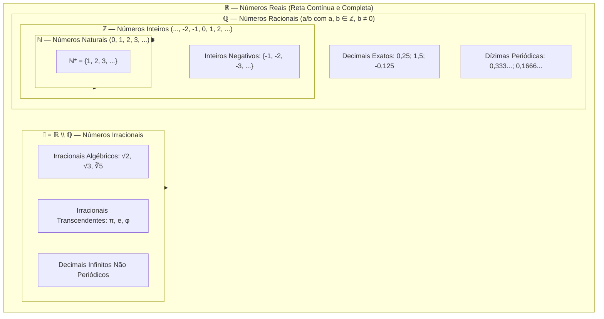
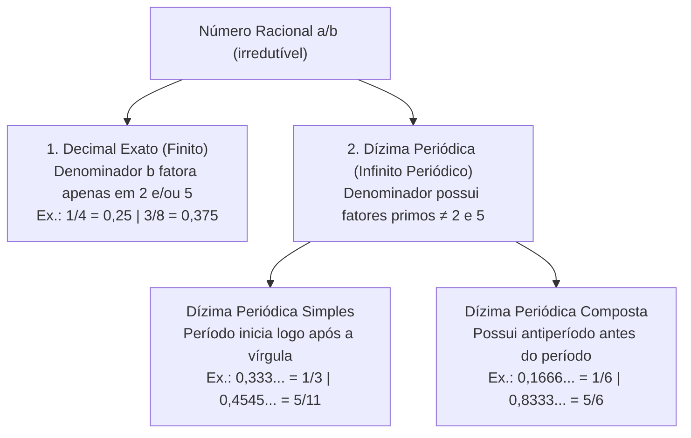
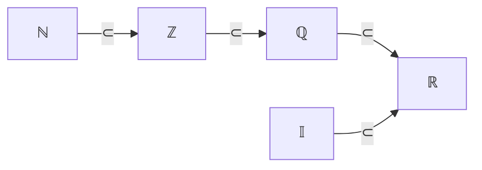

# 📖 Texto-base — Fundamentos de Matemática: Conjuntos Numéricos

> **Referência:** ARAÚJO, Luciana M. M.; FERRAZ, Mariana S. A.; LOYO, Tiago et al. **Fundamentos de matemática**. Porto Alegre: Grupo A / SAGAH, 2018. (Capítulo: *"Conjuntos numéricos"*, p. 21–24).  
> **Link na Minha Biblioteca:** [Plataforma Minha Biblioteca](https://app.minhabiblioteca.com.br/reader/books/9788595027701/pageid/21)  
> **Disciplina:** Matemática Básica (`MMB002-EC-2026S2B2-T001`) — Semana 2  
> **Tema:** Relações numéricas, conjuntos numéricos ($\mathbb{N}, \mathbb{Z}, \mathbb{Q}, \mathbb{I}, \mathbb{R}$), representação decimal e intervalos  

---

## 🗺️ Mapa Conceitual dos Conjuntos Numéricos

---

## 📌 1. Motivação Estrutural da Evolução dos Números

A história do pensamento matemático evidencia que cada novo conjunto numérico surgiu da **insuficiência algébrica e geométrica** do conjunto anterior para resolver determinadas classes de equações e problemas do mundo real:

| Conjunto | Símbolo | Motivação Algébrica / Problema Gerador | Exemplo de Equação sem Solução no Conjunto Anterior |
| :--- | :---: | :--- | :--- |
| **Naturais** | $\mathbb{N}$ | Necessidade de contagem discreta e ordenação de elementos. | — |
| **Inteiros** | $\mathbb{Z}$ | Necessidade de subtrair quantidades maiores de menores (dívidas, saldo negativo, temperatura). | $x + 5 = 2 \implies x = -3 \notin \mathbb{N}$ |
| **Racionais** | $\mathbb{Q}$ | Necessidade de medir partes fracionárias e repartir grandezas continuadas. | $3x = 7 \implies x = \frac{7}{3} \notin \mathbb{Z}$ |
| **Irracionais** | $\mathbb{I}$ | Incomensurabilidade geométrica (diagonal do quadrado unitário, razão entre perímetro e diâmetro). | $x^2 = 2 \implies x = \sqrt{2} \notin \mathbb{Q}$ |
| **Reais** | $\mathbb{R}$ | Preenchimento contínuo de todos os pontos da reta geométrica (completude). | $\mathbb{R} = \mathbb{Q} \cup \mathbb{I}$ |

---

## 📌 2. O Conjunto dos Números Naturais ($\mathbb{N}$)

O conjunto dos números naturais surge da necessidade primitiva de contagem:

$$\mathbb{N} = \{0, 1, 2, 3, 4, 5, \dots\}$$

### 2.1. Subconjuntos e Notações Notáveis
* **Naturais não nulos:**
  $$\mathbb{N}^* = \mathbb{N} \setminus \{0\} = \{1, 2, 3, 4, 5, \dots\}$$
* **Números Pares:** $P = \{x \in \mathbb{N} \mid x = 2k, \, k \in \mathbb{N}\} = \{0, 2, 4, 6, \dots\}$
* **Números Ímpares:** $I = \{x \in \mathbb{N} \mid x = 2k + 1, \, k \in \mathbb{N}\} = \{1, 3, 5, 7, \dots\}$
* **Números Primos:** Conjunto dos números naturais maiores que 1 que possuem exatamente dois divisores distintos (o 1 e ele mesmo): $\{2, 3, 5, 7, 11, 13, 17, 19, \dots\}$.

### 2.2. Fechamento e Limitações Operatórias
* **Fechado para a Adição:** $\forall a, b \in \mathbb{N} \implies a + b \in \mathbb{N}$.
* **Fechado para a Multiplicação:** $\forall a, b \in \mathbb{N} \implies a \cdot b \in \mathbb{N}$.
* ⚠️ **Não é Fechado para a Subtração:** $4 - 9 = -5 \notin \mathbb{N}$.
* ⚠️ **Não é Fechado para a Divisão:** $7 \div 2 = 3,5 \notin \mathbb{N}$.

---

## 📌 3. O Conjunto dos Números Inteiros ($\mathbb{Z}$)

O conjunto dos números inteiros expande os naturais, incorporando os simétricos (opostos aditivos) dos números positivos:

$$\mathbb{Z} = \{\dots, -4, -3, -2, -1, 0, 1, 2, 3, 4, \dots\}$$

Observa-se diretamente a relação de inclusão estrita: $\mathbb{N} \subset \mathbb{Z}$.

### 3.1. Subconjuntos Notáveis de $\mathbb{Z}$
* **Inteiros não nulos:** $\mathbb{Z}^* = \mathbb{Z} \setminus \{0\} = \{\dots, -2, -1, 1, 2, \dots\}$
* **Inteiros não negativos:** $\mathbb{Z}_+ = \{0, 1, 2, 3, \dots\} = \mathbb{N}$
* **Inteiros não positivos:** $\mathbb{Z}_- = \{\dots, -3, -2, -1, 0\}$
* **Inteiros estritamente positivos:** $\mathbb{Z}_+^* = \{1, 2, 3, \dots\} = \mathbb{N}^*$
* **Inteiros estritamente negativos:** $\mathbb{Z}_-^* = \{\dots, -3, -2, -1\}$

### 3.2. Módulo ou Valor Absoluto
O módulo de um número real $x$, denotado por $|x|$, representa geometricamente a sua distância até a origem ($0$) na reta numérica:

$$|x| = \begin{cases} x, & \text{se } x \ge 0 \\ -x, & \text{se } x < 0 \end{cases}$$

**Propriedades Fundamentais:**
1. $|x| \ge 0, \quad \forall x \in \mathbb{Z}$ (não negatividade).
2. $|x| = 0 \iff x = 0$.
3. $|x \cdot y| = |x| \cdot |y|$.
4. $|-x| = |x|$.
5. Desigualdade Triangular: $|x + y| \le |x| + |y|$.

### 3.3. Fechamento Operatório de $\mathbb{Z}$
* **Fechado para Adição, Subtração e Multiplicação.**
* ⚠️ **Não é Fechado para Divisão:** $\frac{5}{2} = 2,5 \notin \mathbb{Z}$.

---

## 📌 4. O Conjunto dos Números Racionais ($\mathbb{Q}$)

Os números racionais representam todos os números que podem ser expressos como a razão entre dois números inteiros:

$$\mathbb{Q} = \left\{ \frac{a}{b} \;\middle|\; a \in \mathbb{Z} \text{ e } b \in \mathbb{Z}^* \right\}$$

Note a cadeia de subconjuntos: $\mathbb{N} \subset \mathbb{Z} \subset \mathbb{Q}$.

### 4.1. Representação Decimal dos Racionais
Qualquer número racional $\frac{a}{b}$ resulta em uma das duas formas decimais:

### 4.2. Determinação Formal da Fração Geratriz

#### Regra Prática para Dízima Simples ($x = 0,\overline{p}$):
$$\text{Fração Geratriz} = \frac{\text{Período}}{\underbrace{99\dots9}_{k \text{ noves para } k \text{ dígitos do período}}}$$
* *Exemplo:* $0,\overline{7} = \frac{7}{9}$
* *Exemplo:* $0,\overline{42} = \frac{42}{99} = \frac{14}{33}$

#### Regra Prática para Dízima Composta ($x = 0,a\overline{p}$):
$$\text{Fração Geratriz} = \frac{(\text{Antiperíodo seguido do Período}) - (\text{Antiperíodo})}{\underbrace{99\dots9}_{k \text{ noves}} \underbrace{00\dots0}_{m \text{ zeros}}}$$
onde $k$ é o número de dígitos do período e $m$ é o número de dígitos do antiperíodo.

* *Exemplo:* $x = 0,12\overline{3}$ (antiperíodo $12 \implies m=2$, período $3 \implies k=1$):
  $$x = \frac{123 - 12}{900} = \frac{111}{900} = \frac{37}{300}$$

### 4.3. Propriedade da Densidade de $\mathbb{Q}$
O conjunto $\mathbb{Q}$ é **denso na reta**: entre quaisquer dois números racionais distintos $r_1 < r_2$, existe uma infinidade de outros números racionais. O ponto médio sempre pertence a $\mathbb{Q}$:
$$r_{\text{médio}} = \frac{r_1 + r_2}{2} \in \mathbb{Q}, \quad \text{onde } r_1 < \frac{r_1 + r_2}{2} < r_2$$

---

## 📌 5. O Conjunto dos Números Irracionais ($\mathbb{I}$)

Os números irracionais são números decimais **infinitos e não periódicos**, isto é, números que **não** podem ser escritos sob a forma de fração $\frac{a}{b}$ com $a \in \mathbb{Z}$ e $b \in \mathbb{Z}^*$:

$$\mathbb{I} = \mathbb{R} \setminus \mathbb{Q}$$

### 5.1. Classificação dos Irracionais
1. **Irracionais Algébricos:** Raízes não exatas de equações polinomiais com coeficientes inteiros.
   * $\sqrt{2} \approx 1,41421356\dots$ (raiz de $x^2 - 2 = 0$)
   * $\sqrt{3} \approx 1,73205080\dots$
   * $\sqrt[3]{5} \approx 1,70997594\dots$
   * Razão Áurea: $\phi = \frac{1 + \sqrt{5}}{2} \approx 1,61803398\dots$
2. **Irracionais Transcendentes:** Números que não são raízes de nenhuma equação polinomial não nula com coeficientes inteiros.
   * $\pi \approx 3,14159265\dots$ (razão entre o perímetro de uma circunferência e seu diâmetro)
   * $e \approx 2,71828182\dots$ (base dos logaritmos naturais / constante de Euler)

### 5.2. Demonstração Clássica: A Irracionalidade de $\sqrt{2}$ (Prova por Contradição)

> **Teorema:** O número $\sqrt{2}$ é irracional ($\sqrt{2} \notin \mathbb{Q}$).

* **Demonstração (Redução ao Absurdo):**
  1. Suponha, por absurdo, que $\sqrt{2} \in \mathbb{Q}$. Então existem inteiros positivos $a$ e $b$, primos entre si ($\text{mdc}(a,b) = 1$, ou seja, fração irredutível), tais que:
     $$\sqrt{2} = \frac{a}{b}$$
  2. Elevando ambos os membros ao quadrado:
     $$2 = \frac{a^2}{b^2} \implies a^2 = 2b^2$$
  3. Como $a^2$ é múltiplo de $2$, segue que $a^2$ é par. Pela propriedade dos números inteiros, se $a^2$ é par, então **$a$ é par**.
  4. Logo, podemos escrever $a = 2k$ para algum inteiro $k$. Substituindo na equação:
     $$(2k)^2 = 2b^2 \implies 4k^2 = 2b^2 \implies b^2 = 2k^2$$
  5. Isso implica que $b^2$ é múltiplo de $2$, logo **$b$ também é par**.
  6. **Contradição:** Se $a$ e $b$ são ambos pares, ambos são divisíveis por $2$, o que contradiz a hipótese inicial de que $\frac{a}{b}$ é uma fração irredutível ($\text{mdc}(a,b) = 1$).
  7. **Conclusão:** A suposição de que $\sqrt{2} \in \mathbb{Q}$ é falsa. Portanto, $\sqrt{2} \in \mathbb{I}$. $\blacksquare$

---

## 📌 6. O Conjunto dos Números Reais ($\mathbb{R}$)

O conjunto dos números reais é formado pela união disjunta dos números racionais e irracionais:

$$\mathbb{R} = \mathbb{Q} \cup \mathbb{I}, \quad \text{onde } \mathbb{Q} \cap \mathbb{I} = \emptyset$$

### 6.1. A Reta Real e a Completude
Existe uma **correspondência biunívoca** (bijeção) entre o conjunto dos números reais ($\mathbb{R}$) e os pontos de uma reta geométrica orientada:
* A cada ponto da reta corresponde exatamente um número real.
* A cada número real corresponde exatamente um ponto da reta.
* A reta real **não possui "buracos"** (completude de Dedekind).

---

## 📌 7. Intervalos Reais

Subconjuntos contínuos da reta real definidos por desigualdades:

| Nome do Intervalo | Notação de Colchetes | Notação de Conjunto | Representação Gráfica na Reta |
| :--- | :---: | :--- | :---: |
| **Aberto** | $]a, b[$ ou $(a, b)$ | $\{x \in \mathbb{R} \mid a < x < b\}$ | Extremos com bolas abertas $\circ$ |
| **Fechado** | $[a, b]$ | $\{x \in \mathbb{R} \mid a \le x \le b\}$ | Extremos com bolas fechadas $\bullet$ |
| **Fechado à esquerda** | $[a, b[$ ou $[a, b)$ | $\{x \in \mathbb{R} \mid a \le x < b\}$ | Fechado em $a$, aberto em $b$ |
| **Fechado à direita** | $]a, b]$ ou $(a, b]$ | $\{x \in \mathbb{R} \mid a < x \le b\}$ | Aberto em $a$, fechado em $b$ |
| **Semirreta à direita** | $[a, +\infty[$ ou $[a, +\infty)$ | $\{x \in \mathbb{R} \mid x \ge a\}$ | Fechado em $a$, estende ao $+\infty$ |
| **Semirreta aberta** | $]-\infty, b[$ ou $(-\infty, b)$ | $\{x \in \mathbb{R} \mid x < b\}$ | Aberto em $b$, estende ao $-\infty$ |
| **Reta Real Completa** | $]-\infty, +\infty[$ | $\mathbb{R}$ | Reta inteira preenchida |

### 7.1. Operações com Intervalos
Sejam os intervalos $A = [-2, 4[$ e $B = [1, 6]$:
* **União ($A \cup B$):** $A \cup B = [-2, 6]$
* **Interseção ($A \cap B$):** $A \cap B = [1, 4[$
* **Diferença ($A - B$):** $A - B = [-2, 1[$
* **Diferença ($B - A$):** $B - A = [4, 6]$

---

## 💻 8. Conexão com Engenharia da Computação & Modelagem Numérica

Na Ciência da Computação e na Engenharia de Software, a compreensão dos conjuntos numéricos é crucial para o projeto de sistemas e arquitetura de hardware:

1. **Naturais ($\mathbb{N}$):**
   * Tipos inteiros não sinalizados: `uint8_t` ($0$ a $255$), `uint32_t` ($0$ a $2^{32}-1$), `size_t` (indexação de memória e tamanhos de vetores).
2. **Inteiros ($\mathbb{Z}$):**
   * Tipos inteiros sinalizados com representação em **Complemento de Dois**: `int8_t` ($-128$ a $+127$), `int32_t`, `int64_t`. Atenção a *integer overflow*.
3. **Racionais ($\mathbb{Q}$) e Reais ($\mathbb{R}$):**
   * Computadores digitais possuem memória finita e não conseguem representar todos os números reais contínuos de $\mathbb{R}$.
   * Utiliza-se a aproximação de ponto flutuante padrão **IEEE 754** (`float` 32 bits, `double` 64 bits):
     $$\text{Valor} = (-1)^s \times (1 + M) \times 2^{E - \text{bias}}$$
   * **Erro de Arredondamento (*Roundoff Error*):** O número racional $\frac{1}{10} = 0,1_{10}$ torna-se uma dízima periódica em binário ($0,0001100110011\dots_2$), gerando imprecisões acumuladas em finanças quantitativas e simulação numérica.
4. **Tipos de Alta Precisão / Aritmética Simbólica:**
   * Em criptografia e computação algébrica (como SymPy e bibliotecas GMP/MPFR), implementam-se classes de frações exatas (`Rational(a, b)`) para evitar perda de precisão de $\mathbb{Q}$.

---

## 📝 9. Síntese dos Principais Conceitos

> [!NOTE]
> * **Cadeia de Inclusão:** $\mathbb{N} \subset \mathbb{Z} \subset \mathbb{Q} \subset \mathbb{R}$.
> * **Disjunção Fundamental:** $\mathbb{Q} \cap \mathbb{I} = \emptyset$ e $\mathbb{Q} \cup \mathbb{I} = \mathbb{R}$.
> * **Densidade vs. Completude:** Tanto $\mathbb{Q}$ quanto $\mathbb{R}$ são conjuntos densos, mas apenas $\mathbb{R}$ é completo (sem vazios na reta contínua).
> * **Dízimas:** Toda dízima periódica é um número racional ($\mathbb{Q}$); todo decimal infinito não periódico é irracional ($\mathbb{I}$).
