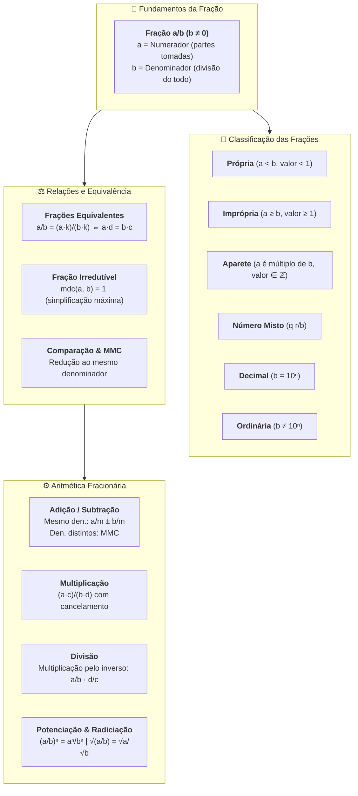
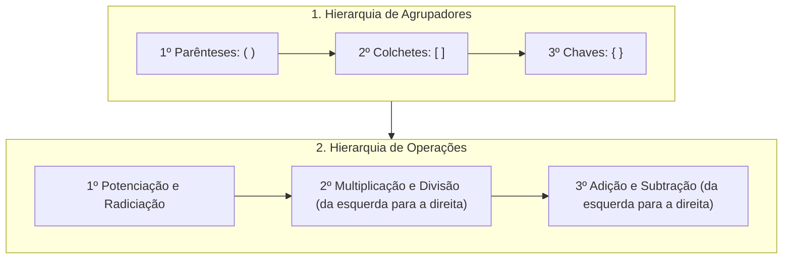

# 📖 Texto-base — Manual Compacto de Matemática: Os Números Fracionários

> **Referência:** BOSQUILHA, Alessandra; AMARAL, João Tomás do; MIRANDA, Mônica. **Manual compacto de matemática: ensino fundamental**. 3. ed. São Paulo: Rideel, 2010. (Capítulo 5: *"Os números fracionários"*, p. 74–108).  
> **Link na Biblioteca Virtual da Univesp:** [Plataforma Biblioteca Virtual / Rideel](https://leitor.bvirtual.com.br/reader/182305/pdf/74)  
> **Disciplina:** Matemática Básica (`MMB002-EC-2026S2B2-T001`) — Semana 2  
> **Tema:** Números fracionários, equivalência, simplificação, comparação, operações aritméticas fundamentais, números mistos e problemas clássicos  

---

## 🗺️ Mapa Conceitual dos Números Fracionários



---

## 📌 1. O Conceito Fundamental de Fração

Uma fração é a representação numérica de uma ou mais partes de uma unidade ou de um todo que foi dividido em partes **iguais**.

$$\frac{a}{b} \quad \left(a \in \mathbb{Z}, \, b \in \mathbb{Z}^*\right)$$

### 1.1. Anatomia da Fração
* **Numerador ($a$):** Indica o número de partes tomadas, consideradas ou destacadas do todo.
* **Denominador ($b$):** Indica em quantas partes iguais a unidade ou conjunto foi dividida. **Condição estrita: $b \neq 0$**, pois a divisão por zero não é definida na matemática.
* **Traço de Fração:** Representa a operação formal de divisão ($a \div b$).

### 1.2. Leitura e Nomenclatura das Frações
* **Denominadores de 2 a 9:** meio ($\frac{1}{2}$), terço ($\frac{1}{3}$), quarto ($\frac{1}{4}$), quinto ($\frac{1}{5}$), sexto ($\frac{1}{6}$), sétimo ($\frac{1}{7}$), oitavo ($\frac{1}{8}$), nono ($\frac{1}{9}$).
* **Denominadores potências de 10:** décimo ($\frac{1}{10}$), centésimo ($\frac{1}{100}$), milésimo ($\frac{1}{1.000}$).
* **Demais denominadores maiores que 10:** lê-se o numerador seguido do denominador e da palavra **avos**.
  * $\frac{5}{12} \implies$ "cinco doze avos"
  * $\frac{7}{35} \implies$ "sete trinta e cinco avos"

---

## 📌 2. Classificação Completa das Frações

O texto-base estabelece a classificação taxonômica rigorosa das frações com base na relação quantitativa entre numerador e denominador:

| Tipo de Fração | Condição Algébrica | Comportamento Numérico | Exemplos |
| :--- | :---: | :--- | :--- |
| **Própria** | $a < b$ (com $a, b > 0$) | O valor é estritamente menor que a unidade ($0 < \frac{a}{b} < 1$). | $\frac{3}{5} = 0,6$; $\frac{7}{10} = 0,7$; $\frac{1}{8} = 0,125$ |
| **Imprópria** | $a \ge b$ | O valor é maior ou igual a uma unidade inteira ($\frac{a}{b} \ge 1$). | $\frac{7}{4} = 1,75$; $\frac{9}{2} = 4,5$; $\frac{5}{5} = 1$ |
| **Aparente** | $a = k \cdot b$ ($k \in \mathbb{Z}$) | Subconjunto das impróprias onde o numerador é múltiplo do denominador. O resultado é um **número inteiro**. | $\frac{12}{3} = 4$; $\frac{25}{5} = 5$; $\frac{0}{7} = 0$ |
| **Decimal** | $b = 10^n$ ($n \in \mathbb{N}^*$) | O denominador é uma potência de 10 ($10, 100, 1000, \dots$). | $\frac{3}{10} = 0,3$; $\frac{45}{100} = 0,45$; $\frac{17}{1000} = 0,017$ |
| **Ordinária** | $b \neq 10^n$ | O denominador não é potência de 10. | $\frac{2}{3}$; $\frac{5}{7}$; $\frac{11}{13}$ |

---

## 📌 3. Números Mistos (Frações Mistas)

Um **número misto** é uma notação compacta que expressa uma fração imprópria não aparente como a soma de uma parte inteira com uma fração própria:

$$q \frac{r}{b} = q + \frac{r}{b}$$

### 3.1. Algoritmo de Conversão: Fração Imprópria $\to$ Número Misto
Aplica-se a divisão euclidiana de $a$ por $b$:
$$a = b \cdot q + r, \quad \text{onde } 0 \le r < b$$

* **Quociente ($q$):** Parte inteira.
* **Resto ($r$):** Numerador da parte fracionária.
* **Divisor ($b$):** Denominador mantido.

$$\frac{17}{5} \implies 17 \div 5 = 3 \text{ (resto } 2) \implies \mathbf{3 \frac{2}{5}}$$

### 3.2. Algoritmo de Conversão: Número Misto $\to$ Fração Imprópria
Multiplica-se a parte inteira pelo denominador e soma-se o numerador:
$$q \frac{r}{b} = \frac{q \cdot b + r}{b}$$

* *Exemplo:* $4 \frac{3}{7} = \frac{4 \cdot 7 + 3}{7} = \frac{28 + 3}{7} = \mathbf{\frac{31}{7}}$

---

## 📌 4. Equivalência e Simplificação de Frações

### 4.1. Princípio Fundamental da Equivalência
Duas frações $\frac{a}{b}$ e $\frac{c}{d}$ são **equivalentes** ($\frac{a}{b} = \frac{c}{d}$) se representam a mesma grandeza ou o mesmo ponto na reta real:

$$\frac{a}{b} = \frac{a \cdot k}{b \cdot k} = \frac{a \div p}{b \div p} \quad (k \neq 0, \, p \neq 0)$$

* **Critério do Produto Cruzado:**
  $$\frac{a}{b} = \frac{c}{d} \iff a \cdot d = b \cdot c$$
  * *Exemplo:* $\frac{3}{4} = \frac{18}{24} \iff 3 \times 24 = 72 \text{ e } 4 \times 18 = 72$.

### 4.2. Simplificação e Frações Irredutíveis
Simplificar uma fração significa reduzi-la dividindo numerador e denominador por fatores comuns até que se tornem **primos entre si**:

$$\text{Fração Irredutível} \iff \text{mdc}(a, b) = 1$$

* **Método Rápido via MDC:**
  Para simplificar $\frac{72}{108}$:
  1. $\text{mdc}(72, 108) = 36$.
  2. $\frac{72 \div 36}{108 \div 36} = \mathbf{\frac{2}{3}}$ (já na forma irredutível direta).

---

## 📌 5. Comparação e Redução ao Menor Denominador Comum (MMC)

Para ordenar ou comparar frações com denominadores distintos, utiliza-se a técnica de redução ao mesmo denominador pelo **Mínimo Múltiplo Comum (MMC)**:

### 5.1. Regras de Comparação Direta
1. **Mesmo Denominador:** A maior fração é a que possui o **maior numerador**.
   $$\frac{7}{12} > \frac{5}{12}$$
2. **Mesmo Numerador:** A maior fração é a que possui o **menor denominador** (o todo foi dividido em pedaços maiores).
   $$\frac{4}{7} > \frac{4}{11}$$

### 5.2. Procedimento de Redução ao MMC
Dadas as frações $\frac{3}{4}$, $\frac{5}{6}$ e $\frac{7}{10}$:
1. Calcula-se $M = \text{mmc}(4, 6, 10) = 60$.
2. Para cada fração, divide-se o novo denominador pelo antigo e multiplica-se pelo numerador:
   * $\frac{3}{4} = \frac{3 \cdot (60 \div 4)}{60} = \frac{3 \cdot 15}{60} = \frac{45}{60}$
   * $\frac{5}{6} = \frac{5 \cdot (60 \div 6)}{60} = \frac{5 \cdot 10}{60} = \frac{50}{60}$
   * $\frac{7}{10} = \frac{7 \cdot (60 \div 10)}{60} = \frac{7 \cdot 6}{60} = \frac{42}{60}$
3. Ordenação crescente: $\frac{42}{60} < \frac{45}{60} < \frac{50}{60} \implies \mathbf{\frac{7}{10} < \frac{3}{4} < \frac{5}{6}}$.

---

## 📌 6. Operações Aritméticas Fundamentais com Frações

### 6.1. Adição e Subtração
* **Denominadores Iguais:** Conserva-se o denominador e somam-se/subtraem-se os numeradores.
  $$\frac{a}{m} \pm \frac{b}{m} = \frac{a \pm b}{m}$$
* **Denominadores Diferentes:** Reduz-se ao MMC dos denominadores.
  $$\frac{a}{b} \pm \frac{c}{d} = \frac{a \cdot \frac{M}{b} \pm c \cdot \frac{M}{d}}{M}, \quad \text{onde } M = \text{mmc}(b, d)$$
  * *Exemplo:* $\frac{5}{8} - \frac{1}{6} + \frac{2}{3}$ (com $\text{mmc}(8, 6, 3) = 24$):
    $$\frac{5 \cdot 3 - 1 \cdot 4 + 2 \cdot 8}{24} = \frac{15 - 4 + 16}{24} = \mathbf{\frac{27}{24}} = \mathbf{\frac{9}{8}}$$

---

### 6.2. Multiplicação e a Técnica do Cancelamento
Multiplicam-se os numeradores entre si e os denominadores entre si:

$$\frac{a}{b} \cdot \frac{c}{d} = \frac{a \cdot c}{b \cdot d}$$

* **Técnica do Cancelamento (Simplificação Prévia):**
  Evita trabalhar com números excessivamente grandes:
  $$\frac{14}{25} \cdot \frac{15}{28} = \frac{\cancelto{1}{14}}{\cancelto{5}{25}} \cdot \frac{\cancelto{3}{15}}{\cancelto{2}{28}} = \frac{1 \cdot 3}{5 \cdot 2} = \mathbf{\frac{3}{10}}$$

* **Fração como Operador ("Fração de uma Quantidade"):**
  A preposição "de" traduz-se algebricamente como **multiplicação**:
  $$\text{Calcular } \frac{3}{4} \text{ de } 80 \implies \frac{3}{4} \cdot 80 = \frac{240}{4} = 60$$

---

### 6.3. Divisão de Frações
Dividir por uma fração equivale a **multiplicar pela fração inversa** (recíproca):

$$\frac{a}{b} \div \frac{c}{d} = \frac{a}{b} \cdot \frac{d}{c} = \frac{a \cdot d}{b \cdot c} \quad (b \neq 0, c \neq 0, d \neq 0)$$

* **Frações Complexas (Torre de Frações):**
  $$\frac{\frac{a}{b}}{\frac{c}{d}} = \frac{a}{b} \div \frac{c}{d} = \frac{a \cdot d}{b \cdot c}$$
  * *Exemplo:* $\frac{\frac{2}{3}}{\frac{4}{9}} = \frac{2}{3} \cdot \frac{9}{4} = \frac{18}{12} = \mathbf{\frac{3}{2}}$

---

### 6.4. Potenciação e Radiciação de Frações
* **Potenciação com Expoente Natural:**
  $$\left(\frac{a}{b}\right)^n = \frac{a^n}{b^n} \quad (b \neq 0)$$
  * *Exemplo:* $\left(\frac{2}{3}\right)^4 = \frac{2^4}{3^4} = \frac{16}{81}$
* **Potenciação com Expoente Inteiro Negativo:**
  $$\left(\frac{a}{b}\right)^{-n} = \left(\frac{b}{a}\right)^n = \frac{b^n}{a^n} \quad (a \neq 0, b \neq 0)$$
  * *Exemplo:* $\left(\frac{3}{5}\right)^{-2} = \left(\frac{5}{3}\right)^2 = \frac{25}{9}$
* **Radiciação:**
  $$\sqrt[n]{\frac{a}{b}} = \frac{\sqrt[n]{a}}{\sqrt[n]{b}} \quad (b > 0 \text{ e existência no radicando})$$
  * *Exemplo:* $\sqrt{\frac{49}{144}} = \frac{\sqrt{49}}{\sqrt{144}} = \frac{7}{12}$

---

## 📌 7. Expressões Numéricas Fracionárias

Para avaliar expressões contendo múltiplas operações com frações, obedece-se à hierarquia formal:



### Exemplo Resolvido Passo a Passo:
Calcular o valor de $E = \left( \frac{1}{2} + \frac{2}{3} \right) \div \left( 1 - \frac{1}{6} \right)^2$:

1. Resolve-se a primeira soma interna:
   $$\frac{1}{2} + \frac{2}{3} = \frac{3 + 4}{6} = \frac{7}{6}$$
2. Resolve-se a subtração interna:
   $$1 - \frac{1}{6} = \frac{6 - 1}{6} = \frac{5}{6}$$
3. Aplica-se a potenciação:
   $$\left(\frac{5}{6}\right)^2 = \frac{25}{36}$$
4. Efetua-se a divisão final (multiplicação pelo inverso):
   $$E = \frac{7}{6} \div \frac{25}{36} = \frac{7}{6} \cdot \frac{36}{25} = \frac{7}{\cancelto{1}{6}} \cdot \frac{\cancelto{6}{36}}{25} = \frac{7 \cdot 6}{1 \cdot 25} = \mathbf{\frac{42}{25}}$$

---

## 📌 8. Problemas Clássicos Modelados por Frações

### 8.1. Problema das Torneiras / Trabalho Compartilhado
* **Enunciado:** Uma torneira $A$ enche um tanque em $4$ horas, e uma torneira $B$ o enche em $6$ horas. Se abertas simultaneamente, em quanto tempo encherão o tanque?
* **Modelagem Algébrica:**
  * Vazão da torneira $A$: $v_A = \frac{1}{4}$ do tanque por hora.
  * Vazão da torneira $B$: $v_B = \frac{1}{6}$ do tanque por hora.
  * Vazão combinada: $v_C = \frac{1}{4} + \frac{1}{6} = \frac{3 + 2}{12} = \frac{5}{12}$ do tanque por hora.
  * Tempo total $t$:
    $$t = \frac{1}{v_C} = \frac{1}{\frac{5}{12}} = \frac{12}{5} \text{ horas} = 2,4 \text{ horas} = \mathbf{2\text{h } 24\text{min}}$$

### 8.2. Problema das Frações Sucessivas e Resto
* **Enunciado:** Um estudante gasta $\frac{2}{5}$ do seu tempo em videoaulas, $\frac{1}{3}$ do **tempo restante** em leitura e ainda sobram $4$ horas para exercícios. Qual é o tempo total de estudo?
* **Modelagem Algébrica:**
  * Seja $T$ o tempo total.
  * Gasto com videoaulas: $\frac{2}{5}T \implies \text{Resto}_1 = T - \frac{2}{5}T = \frac{3}{5}T$.
  * Gasto com leitura: $\frac{1}{3} \cdot \left(\frac{3}{5}T\right) = \frac{1}{5}T$.
  * Resto final dedicado a exercícios:
    $$\text{Resto}_2 = \frac{3}{5}T - \frac{1}{5}T = \frac{2}{5}T$$
  * Igualando ao valor dado:
    $$\frac{2}{5}T = 4 \implies T = 4 \cdot \frac{5}{2} = \mathbf{10\text{ horas}}$$

---

## 💻 9. Implementação em Computação (C++20 / Estrutura `Rational`)

Na Engenharia de Software, tipos fracionários são fundamentais para evitar erros de ponto flutuante em sistemas que exigem exatidão absoluta (ex.: bolsas de valores, sistemas aeroespaciais, computação gráfica exata):

```cpp
#include <iostream>
#include <numeric> // std::gcd

struct Rational {
    int64_t num;
    int64_t den;

    Rational(int64_t n = 0, int64_t d = 1) {
        if (d == 0) throw std::invalid_argument("Denominador não pode ser zero!");
        if (d < 0) { n = -n; d = -d; }
        int64_t g = std::gcd(std::abs(n), d);
        num = n / g;
        den = d / g;
    }

    Rational operator+(const Rational& o) const {
        return Rational(num * o.den + o.num * den, den * o.den);
    }

    Rational operator-(const Rational& o) const {
        return Rational(num * o.den - o.num * den, den * o.den);
    }

    Rational operator*(const Rational& o) const {
        return Rational(num * o.num, den * o.den);
    }

    Rational operator/(const Rational& o) const {
        if (o.num == 0) throw std::invalid_argument("Divisão por zero!");
        return Rational(num * o.den, den * o.num);
    }

    void print() const {
        if (den == 1) std::cout << num;
        else std::cout << num << "/" << den;
    }
};
```

---

## 📝 10. Síntese dos Pontos Críticos

> [!IMPORTANT]
> 1. **Denominador Não Nulo:** Em qualquer contexto algébrico, $b \neq 0$.
> 2. **Soma e Subtração:** **Nunca** some numeradores com numeradores e denominadores com denominadores ($\frac{a}{b} + \frac{c}{d} \neq \frac{a+c}{b+d}$). O MMC é obrigatório quando $b \neq d$.
> 3. **Divisão:** Conserva-se a primeira fração e multiplica-se pelo inverso da segunda ($\frac{a}{b} \div \frac{c}{d} = \frac{a}{b} \cdot \frac{d}{c}$).
> 4. **Cancelamento Prévio:** Sempre busque simplificar antes de efetuar multiplicações para evitar erros de cálculo e números gigantescos.
