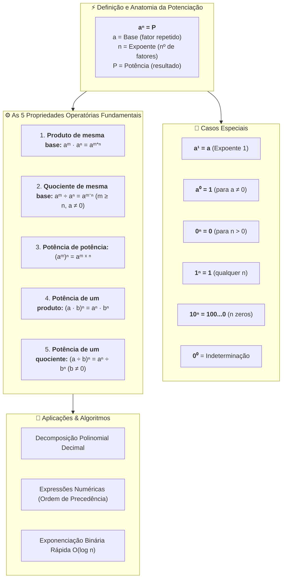

# 📖 Texto-base — Manual Compacto de Matemática: Potenciação com Números Naturais

> **Referência:** BOSQUILHA, Alessandra; AMARAL, João Tomás do; MIRANDA, Mônica. **Manual compacto de matemática: ensino fundamental**. 3. ed. São Paulo: Rideel, 2010. (Capítulo 3: *"Operações no conjunto dos números naturais"*, Seção 5: *"A potenciação com números naturais"*, p. 43–49).  
> **Link na Biblioteca Virtual da Univesp:** [Plataforma Biblioteca Virtual / Rideel](https://leitor.bvirtual.com.br/reader/182305/pdf/43)  
> **Disciplina:** Matemática Básica (`MMB002-EC-2026S2B2-T001`) — Semana 2  
> **Tema:** Potenciação em $\mathbb{N}$, elementos e nomenclatura, propriedades operatórias fundamentais, potências de base 10, expressões numéricas e exponenciação rápida  

---

## 🗺️ Mapa Conceitual da Potenciação em $\mathbb{N}$



---

## 📌 1. O Conceito Fundamental de Potenciação

Assim como a multiplicação é uma forma abreviada de registrar a adição de parcelas iguais, a **potenciação** é a operação matemática que expressa a **multiplicação de fatores iguais**:

$$\underbrace{a \cdot a \cdot a \cdots a}_{n \text{ fatores}} = a^n = P$$

### 1.1. Elementos da Potenciação
* **Base ($a$):** É o número (fator) que se repete na multiplicação.
* **Expoente ($n$):** É o número natural que indica quantas vezes a base é multiplicada por si mesma.
* **Potência ($P$):** É o valor numérico resultante da operação.

$$\begin{array}{rcl}
2^5 & = & 2 \cdot 2 \cdot 2 \cdot 2 \cdot 2 = 32 \\
\uparrow & & \uparrow \\
\text{Base: } 2 & & \text{Potência: } 32 \\
\text{Expoente: } 5 & & 
\end{array}$$

### 1.2. Leitura e Nomenclatura Tradicional
* $a^2$: lê-se "$a$ elevado ao quadrado" (origem geométrica: área do quadrado de lado $a$).
* $a^3$: lê-se "$a$ elevado ao cubo" (origem geométrica: volume do cubo de aresta $a$).
* $a^4$: lê-se "$a$ elevado à quarta potência" (ou "$a$ à quarta").
* $a^n$: lê-se "$a$ elevado à $n$-ésima potência".

---

## 📌 2. Casos Especiais e Convenções Algébricas

O texto-base destaca convenções indispensáveis para a consistência algébrica da aritmética:

| Caso | Formulação | Justificativa / Demonstração | Exemplo |
| :--- | :---: | :--- | :--- |
| **Expoente 1** | $a^1 = a$ | Uma base repetida uma única vez representa o próprio número. | $8^1 = 8$, $2026^1 = 2026$ |
| **Expoente 0** | $a^0 = 1 \quad (a \neq 0)$ | Decorre da divisão de potências de mesma base: $\frac{a^n}{a^n} = a^{n-n} = a^0$. Como qualquer número não nulo dividido por si mesmo é $1$, temos $a^0 = 1$. | $7^0 = 1$, $150^0 = 1$ |
| **Base 1** | $1^n = 1$ | O produto $1 \cdot 1 \cdots 1$ resulta invariavelmente em $1$. | $1^9 = 1$, $1^{1000} = 1$ |
| **Base 0** | $0^n = 0 \quad (n > 0)$ | O produto $0 \cdot 0 \cdots 0$ é nulo. | $0^4 = 0$, $0^{25} = 0$ |
| **Indeterminação** | $0^0$ | Não possui valor definido nos reais (conflito entre $0^x = 0$ e $x^0 = 1$). | *Indeterminado* |

---

## 📌 3. As 5 Propriedades Operatórias Fundamentais

As propriedades da potenciação simplificam o cálculo de expressões complexas, permitindo operar diretamente com os expoentes:

### 3.1. Propriedade 1: Produto de Potências de Mesma Base
Para multiplicar potências com bases idênticas, **conserva-se a base e somam-se os expoentes**:

$$a^m \cdot a^n = a^{m + n}$$

* **Demonstração:**
  $$a^m \cdot a^n = (\underbrace{a \cdot a \dots a}_{m \text{ fatores}}) \cdot (\underbrace{a \cdot a \dots a}_{n \text{ fatores}}) = \underbrace{a \cdot a \dots a}_{m+n \text{ fatores}} = a^{m+n}$$
* *Exemplo:* $3^4 \cdot 3^2 = 3^{4+2} = 3^6 = 729$

---

### 3.2. Propriedade 2: Quociente de Potências de Mesma Base
Para dividir potências com bases idênticas ($a \neq 0$ e $m \ge n$ em $\mathbb{N}$), **conserva-se a base e subtraem-se os expoentes**:

$$\frac{a^m}{a^n} = a^m \div a^n = a^{m - n}$$

* **Demonstração:**
  $$\frac{a^m}{a^n} = \frac{\overbrace{a \cdot a \dots a}^{m \text{ fatores}}}{\underbrace{a \cdot a \dots a}_{n \text{ fatores}}} = \overbrace{a \cdot a \dots a}^{m-n \text{ fatores}} = a^{m-n}$$
* *Exemplo:* $\frac{5^7}{5^4} = 5^{7-4} = 5^3 = 125$

---

### 3.3. Propriedade 3: Potência de uma Potência
Para elevar uma potência a outro expoente, **conserva-se a base e multiplicam-se os expoentes**:

$$(a^m)^n = a^{m \cdot n}$$

* **Demonstração:**
  $$(a^m)^n = \underbrace{a^m \cdot a^m \dots a^m}_{n \text{ fatores}} = a^{\overbrace{m + m + \dots + m}^{n \text{ parcelas}}} = a^{m \cdot n}$$
* *Exemplo:* $(2^3)^2 = 2^{3 \cdot 2} = 2^6 = 64$

> [!CAUTION]
> **Cuidado com a Torre de Expoentes:**  
> $$(a^m)^n \neq a^{m^n}$$
> Na notação sem parênteses $a^{m^n}$, a resolução ocorre de cima para baixo:
> * $(2^3)^2 = 2^{3 \times 2} = 2^6 = \mathbf{64}$
> * $2^{3^2} = 2^{(3^2)} = 2^9 = \mathbf{512}$

---

### 3.4. Propriedade 4: Potência de um Produto
Para elevar um produto de bases a um expoente, **eleva-se cada um dos fatores individualmente ao expoente**:

$$(a \cdot b)^n = a^n \cdot b^n$$

* *Exemplo:* $(2 \cdot 5)^3 = 2^3 \cdot 5^3 = 8 \cdot 125 = 1000$ (e note que $(10)^3 = 1000$).

---

### 3.5. Propriedade 5: Potência de um Quociente
Para elevar uma divisão a um expoente ($b \neq 0$), **eleva-se o dividendo (numerador) e o divisor (denominador) ao expoente**:

$$\left(\frac{a}{b}\right)^n = \frac{a^n}{b^n} \quad \text{ou} \quad (a \div b)^n = a^n \div b^n$$

* *Exemplo:* $(12 \div 4)^2 = 12^2 \div 4^2 = 144 \div 16 = 9$ (e $(3)^2 = 9$).

> [!WARNING]
> **Não-Distributividade em Relação à Adição e Subtração:**  
> A potenciação **NÃO** é distributiva na soma nem na subtração!
> $$(a + b)^n \neq a^n + b^n$$
> $$(a - b)^n \neq a^n - b^n$$
> *Contraexemplo:* $(3 + 4)^2 = 7^2 = 49$, enquanto $3^2 + 4^2 = 9 + 16 = 25 \neq 49$.

---

## 📌 4. Potências de Base 10 e Notação Posicional

Uma potência de base 10 com expoente natural $n$ é expressa pelo algarismo $1$ seguido de exatamente $n$ zeros:

$$10^n = 1\underbrace{00\dots0}_{n \text{ zeros}}$$

* $10^0 = 1$ ($0$ zeros)
* $10^1 = 10$ ($1$ zero)
* $10^3 = 1.000$ (mil — $3$ zeros)
* $10^6 = 1.000.000$ (milhão — $6$ zeros)
* $10^9 = 1.000.000.000$ (bilhão — $9$ zeros)

### 4.1. Decomposição Polinomial de Números Naturais
Todo número natural no sistema decimal pode ser escrito como uma soma de produtos de seus algarismos por potências de base 10:

$$58.423 = 5 \times 10^4 + 8 \times 10^3 + 4 \times 10^2 + 2 \times 10^1 + 3 \times 10^0$$

---

## 📌 5. Expressões Numéricas Envolvendo Potenciação em $\mathbb{N}$

### 5.1. Regra de Precedência Completa
1. **Agrupadores:** $1^\circ$ Parênteses $( )$, $2^\circ$ Colchetes $[ ]$, $3^\circ$ Chaves $\{ \}$.
2. **Operações:**
   * $1^\circ$ **Potenciações e Radiciações** (na ordem em que aparecem).
   * $2^\circ$ **Multiplicações e Divisões** (na ordem em que aparecem, da esquerda para a direita).
   * $3^\circ$ **Adições e Subtrações** (na ordem em que aparecem, da esquerda para a direita).

### 5.2. Exemplo Passo a Passo
Calcular o valor da expressão:
$$E = 3 \cdot 2^4 - [5^2 - (4^2 - 3 \cdot 2^2)] \div 3$$

1. Potências internas aos parênteses:
   $$4^2 = 16 \quad \text{e} \quad 2^2 = 4 \implies (16 - 3 \cdot 4) = (16 - 12) = 4$$
2. Potência interna aos colchetes:
   $$5^2 = 25 \implies [25 - 4] = 21$$
3. Potência restante e reescrita da expressão:
   $$2^4 = 16 \implies E = 3 \cdot 16 - 21 \div 3$$
4. Multiplicação e Divisão:
   $$3 \cdot 16 = 48 \quad \text{e} \quad 21 \div 3 = 7$$
5. Subtração final:
   $$E = 48 - 7 = \mathbf{41}$$

---

## 💻 6. Algoritmo em Computação: Exponenciação Rápida (*Binary Exponentiation*)

Calcular $a^n$ multiplicando $a$ repetidamente $n$ vezes consome tempo $O(n)$, o que é inviável para potências gigantes (como em criptografia RSA, onde expoentes possuem centenas de dígitos).

O algoritmo de **Exponenciação Binária** reduz a complexidade para **$O(\log n)$**, explorando as propriedades das potências:

$$a^n = \begin{cases} 1, & \text{se } n = 0 \\ (a^2)^{\frac{n}{2}}, & \text{se } n \text{ é par} \\ a \cdot a^{n-1}, & \text{se } n \text{ é ímpar} \end{cases}$$

### Implementação em C++20:
```cpp
#include <iostream>
#include <cstdint>

// Exponenciação rápida iterativa O(log n)
uint64_t power(uint64_t base, uint64_t exp) {
    uint64_t res = 1;
    base = base;
    while (exp > 0) {
        if (exp & 1) { // Se o bit menos significativo for 1 (ímpar)
            res *= base;
        }
        base *= base;  // Eleva a base ao quadrado
        exp >>= 1;     // Divide o expoente por 2
    }
    return res;
}

int main() {
    uint64_t base = 3;
    uint64_t exp = 13; // 3^13 = 1.594.323
    std::cout << base << "^" << exp << " = " << power(base, exp) << "\n";
    return 0;
}
```

---

## 📝 7. Resumo Prático dos Erros Comuns a Evitar

> [!TIP]
> * **$a^0 = 1$** para qualquer número $a \neq 0$ (não confunda com $0$).
> * **$(2^3)^2 = 2^6 = 64$**, enquanto **$2^{3^2} = 2^9 = 512$**.
> * **$2 \cdot 3^2 = 2 \cdot 9 = 18$** (efetua-se a potência antes da multiplicação; não faça $(2 \cdot 3)^2 = 36$).
> * A potenciação **nunca se distribui sobre a soma**: $(a+b)^2 \neq a^2 + b^2$.
