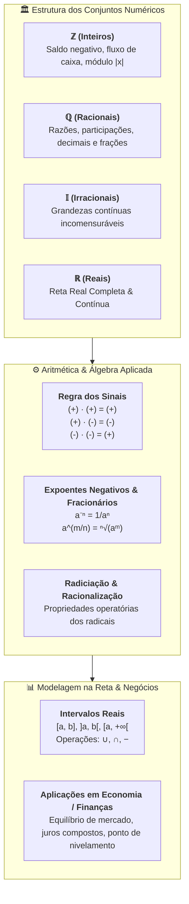

# 📖 Texto-base — Matemática Básica (Hazzan): Números Inteiros, Racionais e Reais

> **Referência:** HAZZAN, Samuel. **Matemática básica: para administração, economia, contabilidade e negócios**. São Paulo: Saraiva / Grupo GEN, 2017. (Capítulo 2: *"Números Inteiros, Racionais e Reais"*, p. 49–70).  
> **Link na Minha Biblioteca:** [Plataforma Minha Biblioteca](https://app.minhabiblioteca.com.br/reader/books/9788597027501/epubcfi/6/20[%3Bvnd.vst.idref%3Dchapter02]!/4)  
> **Disciplina:** Matemática Básica (`MMB002-EC-2026S2B2-T001`) — Semana 2  
> **Tema:** Conjuntos $\mathbb{Z}, \mathbb{Q}, \mathbb{I}, \mathbb{R}$, operações com sinais, expoentes inteiros negativos e fracionários, radiciação, intervalos reais e aplicações em modelagem quantitativa  

---

## 🗺️ Mapa Conceitual do Capítulo 2 (Hazzan)



---

## 📌 1. O Conjunto dos Números Inteiros ($\mathbb{Z}$) e Modelagem Financeira

O conjunto $\mathbb{Z} = \{\dots, -3, -2, -1, 0, 1, 2, 3, \dots\}$ fornece o ferramental matemático para representar **grandezas relativas** (acima/abaixo de zero, lucros/prejuízos, receitas/despesas, variações de balanço patrimonial):

$$\mathbb{Z} = \mathbb{Z}_-^* \cup \{0\} \cup \mathbb{Z}_+^*$$

### 1.1. Módulo, Distância e Ordenação
* O módulo $|x|$ mede a magnitude escalar ou a distância de $x$ até o ponto de equilíbrio $0$:
  $$|x| = \begin{cases} x, & \text{se } x \ge 0 \\ -x, & \text{se } x < 0 \end{cases}$$
* **Desigualdade e Relação de Ordem:** Dadas duas grandezas $a, b \in \mathbb{Z}$, dizemos que $a < b$ se $a$ situa-se à esquerda de $b$ na reta orientada, o que equivale a $b - a > 0$.
  * *Exemplo:* $-15 < -3$, pois $-3 - (-15) = +12 > 0$.

### 1.2. Regra dos Sinais na Multiplicação e Divisão
A justificativa formal para a regra $(-a) \cdot (-b) = +(a \cdot b)$ decorre da **propriedade distributiva** e da unicidade do elemento neutro aditivo ($0$):

$$(-a) \cdot [b + (-b)] = (-a) \cdot 0 = 0$$
$$(-a) \cdot b + (-a) \cdot (-b) = 0$$
$$-(a \cdot b) + (-a) \cdot (-b) = 0 \implies \mathbf{(-a) \cdot (-b) = a \cdot b}$$

### 1.3. Potenciação com Base Inteira
* Base **positiva** elevada a qualquer expoente resulta sempre em número **positivo**: $(+3)^4 = +81$.
* Base **negativa** com expoente **par** resulta em número **positivo**: $(-2)^4 = +16$.
* Base **negativa** com expoente **ímpar** resulta em número **negativo**: $(-2)^3 = -8$.

> [!CAUTION]
> **Atenção aos parênteses:**
> * $(-3)^2 = (-3) \cdot (-3) = +9$
> * $-3^2 = -(3 \cdot 3) = -9$

---

## 📌 2. O Conjunto dos Números Racionais ($\mathbb{Q}$) & Expoentes Inteiros Negativos

Um número é racional se pode ser escrito na forma $\frac{a}{b}$ com $a, b \in \mathbb{Z}$ e $b \neq 0$:

$$\mathbb{Q} = \left\{ \frac{a}{b} \;\middle|\; a \in \mathbb{Z}, \, b \in \mathbb{Z}^* \right\}$$

### 2.1. Expoentes Inteiros Negativos
Estendendo a definição de potências para expoentes inteiros negativos ($n \in \mathbb{N}^*$ e $a \neq 0$):

$$a^{-n} = \frac{1}{a^n} \quad \text{e} \quad \left(\frac{a}{b}\right)^{-n} = \left(\frac{b}{a}\right)^n = \frac{b^n}{a^n}$$

* *Exemplo:* $5^{-3} = \frac{1}{5^3} = \frac{1}{125} = 0,008$.
* *Exemplo:* $\left(\frac{2}{5}\right)^{-3} = \left(\frac{5}{2}\right)^3 = \frac{125}{8} = 15,625$.

### 2.2. Aplicação em Desconto e Valor Presente
Em matemática financeira e economia quantitativa, o fator de atualização monetária para trazer um capital futuro $FV$ ao valor presente $PV$ a uma taxa de juros $i$ utiliza potências com expoentes negativos:

$$PV = FV \cdot (1 + i)^{-n} = \frac{FV}{(1 + i)^n}$$

---

## 📌 3. O Conjunto dos Números Reais ($\mathbb{R}$) & Radiciação

O conjunto dos reais $\mathbb{R} = \mathbb{Q} \cup \mathbb{I}$ contempla todas as grandezas comensuráveis e incomensuráveis.

### 3.1. Definição Algébrica de Raiz $n$-ésima
Sendo $a \in \mathbb{R}$ e $n \in \mathbb{N}^*$ com $n \ge 2$:

$$\sqrt[n]{a} = b \iff b^n = a$$

* Se $n$ é **par**, $a$ deve ser $\ge 0$, e $\sqrt[n]{a} \ge 0$ (raiz aritmética principal).
* Se $n$ é **ímpar**, a raiz existe para qualquer $a \in \mathbb{R}$ e preserva o sinal do radicando: $\sqrt[3]{-27} = -3$.

### 3.2. Expoentes Racionais (Fracionários)
A conexão unificadora entre potenciação e radiciação é expressa por:

$$a^{\frac{m}{n}} = \sqrt[n]{a^m} = (\sqrt[n]{a})^m \quad (a > 0, \, m \in \mathbb{Z}, \, n \in \mathbb{N}^*)$$

* *Exemplo:* $16^{\frac{3}{4}} = (\sqrt[4]{16})^3 = 2^3 = 8$.
* *Exemplo:* $27^{-\frac{2}{3}} = \frac{1}{27^{\frac{2}{3}}} = \frac{1}{(\sqrt[3]{27})^2} = \frac{1}{3^2} = \mathbf{\frac{1}{9}}$.

### 3.3. Propriedades Operatórias e Racionalização
1. $\sqrt[n]{a \cdot b} = \sqrt[n]{a} \cdot \sqrt[n]{b}$
2. $\sqrt[n]{\frac{a}{b}} = \frac{\sqrt[n]{a}}{\sqrt[n]{b}}$
3. $\sqrt[m]{\sqrt[n]{a}} = \sqrt[m \cdot n]{a}$
4. $(\sqrt[n]{a})^p = \sqrt[n]{a^p}$

#### Racionalização com Conjugado:
Para frações com denominador binomial irracional, aplica-se o produto notável $(u-v)(u+v) = u^2 - v^2$:

$$\frac{6}{\sqrt{7} - 2} = \frac{6(\sqrt{7} + 2)}{(\sqrt{7} - 2)(\sqrt{7} + 2)} = \frac{6(\sqrt{7} + 2)}{7 - 4} = \frac{6(\sqrt{7} + 2)}{3} = \mathbf{2(\sqrt{7} + 2)} = 2\sqrt{7} + 4$$

---

## 📌 4. Intervalos Reais e Inequações

Os intervalos reais são os blocos fundamentais para expressar domínios de funções, regiões de lucro/prejuízo e restrições de otimização:

| Notação | Conjunto | Significado Geométrico |
| :---: | :--- | :--- |
| $[a, b]$ | $\{x \in \mathbb{R} \mid a \le x \le b\}$ | Segmento fechado com ambos os extremos incluídos |
| $]a, b[$ ou $(a, b)$ | $\{x \in \mathbb{R} \mid a < x < b\}$ | Segmento aberto com ambos os extremos excluídos |
| $[a, b[$ ou $[a, b)$ | $\{x \in \mathbb{R} \mid a \le x < b\}$ | Fechado em $a$, aberto em $b$ |
| $]a, b]$ ou $(a, b]$ | $\{x \in \mathbb{R} \mid a < x \le b\}$ | Aberto em $a$, fechado em $b$ |
| $[a, +\infty[$ | $\{x \in \mathbb{R} \mid x \ge a\}$ | Semirreta fechada à direita |
| $]-\infty, b[$ | $\{x \in \mathbb{R} \mid x < b\}$ | Semirreta aberta à esquerda |

### 4.1. Álgebra de Intervalos (Exemplo Completo)
Sejam os intervalos $A = ]-3, 5]$ e $B = [1, 8[$:
* **União:** $A \cup B = ]-3, 8[$
* **Interseção:** $A \cap B = [1, 5]$
* **Diferença $A - B$:** $A - B = ]-3, 1[$
* **Diferença $B - A$:** $B - A = ]5, 8[$

---

## 📊 5. Aplicações em Economia, Finanças e Negócios

### 5.1. Ponto de Nivelamento (*Break-Even Point*)
Seja uma empresa com:
* **Custo Fixo ($CF$):** $R\$\,12.000$
* **Custo Variável Unitário ($CV$):** $R\$\,40$ por unidade
* **Preço de Venda Unitário ($P$):** $R\$\,70$ por unidade

A função Lucro $L(q)$ em termos da quantidade produzida $q \in \mathbb{N}$ é dada por:
$$L(q) = \text{Receita} - \text{Custo Total} = 70q - (12.000 + 40q) = 30q - 12.000$$

* **Zona de Prejuízo:** $L(q) < 0 \implies 30q < 12.000 \implies q \in [0, 400[$.
* **Ponto de Equilíbrio (*Break-Even*):** $L(q) = 0 \implies q = 400$ unidades.
* **Zona de Lucro:** $L(q) > 0 \implies q \in ]400, +\infty[$.

---

## 💻 6. Conexão com Algoritmos & Computação Científica

Em Python e C++, a manipulação de expoentes fracionários e números reais exige atenção quanto aos tipos:

```python
# Cálculo analítico exato vs numérico
import math
from fractions import Fraction

# 1. Frações exatas
q1 = Fraction(3, 4)
q2 = Fraction(5, 6)
print(f"Soma exata: {q1 + q2}")  # 19/12

# 2. Expoente fracionário e radiciação
base = 16
exp_frac = 3 / 4
resultado = base ** exp_frac
print(f"16^(3/4) = {resultado}")  # 8.0

# 3. Raiz de números negativos com índice ímpar
# math.pow(-27, 1/3) resultaria em erro ou número complexo em Python
# Solução correta para índice ímpar em R:
def real_nth_root(val, n):
    if val < 0 and n % 2 != 0:
        return -((-val) ** (1.0 / n))
    return val ** (1.0 / n)

print(f"Raiz cúbica de -27 em R: {real_nth_root(-27, 3)}")  # -3.0
```

---

## 📝 7. Síntese dos Conceitos do Capítulo

> [!NOTE]
> * **$\mathbb{Z}$:** Estrutura ordenada fechada para adição, subtração e multiplicação; base de fluxos direcionados de caixa e balanços.
> * **$\mathbb{Q}$:** Números com representação decimal exata ou periódica; formaliza proporções e expoentes negativos ($a^{-n} = 1/a^n$).
> * **$\mathbb{R}$:** Reta contínua completa ($\mathbb{Q} \cup \mathbb{I}$); suporte para cálculo de limites, derivadas, funções de custo e otimização contínua.
> * **Intervalos:** Linguagem geométrica para delimitar domínios de viabilidade e restrições econômicas.
