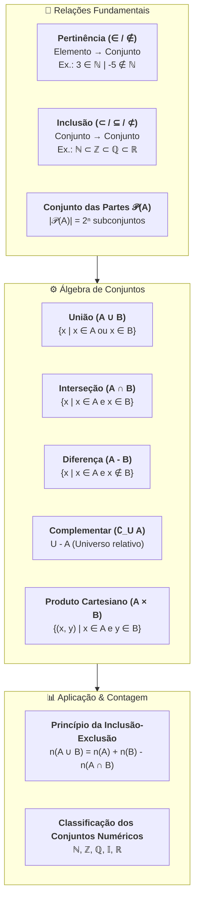
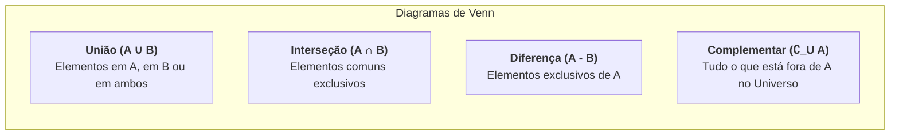

# 📖 Texto-base — Conjuntos Numéricos & Operações entre Conjuntos (José Carlos Kahl)

> **Referência:** KAHL, José Carlos. **Conjuntos numéricos**. Material didático institucional — Univesp / Fundação Padre Anchieta.  
> **Link Oficial:** [PDF Univesp — s2_texto_base-conjuntos_numericos.pdf](https://assets.univesp.br/disciplinas/MMB002/pdf/s2_texto_base-conjuntos_numericos.pdf)  
> **Disciplina:** Matemática Básica (`MMB002-EC-2026S2B2-T001`) — Semana 2  
> **Tema:** Teoria dos conjuntos, relações de pertinência e inclusão, operações estruturais (união, interseção, diferença, complementar, produto cartesiano), conjuntos numéricos e Princípio da Inclusão-Exclusão  

---

## 🗺️ Mapa Conceitual da Teoria dos Conjuntos (Kahl)



---

## 📌 1. Relações Fundamentais: Pertinência vs. Inclusão

A correta aplicação da linguagem matemática exige distinção categórica entre relações de elementos e relações entre conjuntos:

| Relação | Símbolos | Escopo de Aplicação | Significado Algébrico | Exemplo |
| :--- | :---: | :--- | :--- | :--- |
| **Pertinência** | $\in$ (pertence)<br>$\notin$ (não pertence) | **Elemento $\to$ Conjunto** | Indica se um elemento específico é membro de um determinado conjunto. | $5 \in \mathbb{N}$<br>$-3 \notin \mathbb{N}$<br>$\sqrt{2} \in \mathbb{R}$ |
| **Inclusão** | $\subset$ (está contido)<br>$\supset$ (contém)<br>$\subseteq$ (contido ou igual)<br>$\not\subset$ (não está contido) | **Conjunto $\to$ Conjunto** | Indica se todos os elementos de um conjunto $A$ também pertencem ao conjunto $B$. | $\mathbb{N} \subset \mathbb{Z}$<br>$\mathbb{Z} \subset \mathbb{Q}$<br>$\{2, 3\} \subset \{1, 2, 3, 4\}$ |

> [!CAUTION]
> **Erro Clássico de Notação:**  
> * **Correto:** $3 \in \mathbb{N}$ e $\{3\} \subset \mathbb{N}$.
> * **Incorreto:** $\{3\} \in \mathbb{N}$ (a menos que o conjunto dos naturais tivesse conjuntos como elementos, o que não é o caso).

---

## 📌 2. Conjunto das Partes ($\mathcal{P}(A)$)

Dado um conjunto finito $A$ com $n$ elementos ($|A| = n$), o **conjunto das partes** $\mathcal{P}(A)$ (ou $2^A$) é a coleção de todos os subconjuntos possíveis de $A$, incluindo o conjunto vazio ($\emptyset$) e o próprio conjunto $A$:

$$\mathcal{P}(A) = \{X \mid X \subseteq A\}$$

* **Cardinalidade do Conjunto das Partes:**
  $$|\mathcal{P}(A)| = 2^n$$
* *Exemplo:* Seja $A = \{a, b, c\}$ ($n = 3$):
  $$\mathcal{P}(A) = \{\emptyset, \{a\}, \{b\}, \{c\}, \{a, b\}, \{a, c\}, \{b, c\}, \{a, b, c\}\}$$
  $$|\mathcal{P}(A)| = 2^3 = 8 \text{ subconjuntos}$$

---

## 📌 3. Álgebra das Operações Fundamentais com Conjuntos

O texto-base de José Carlos Kahl detalha rigorosamente as operações binárias e unárias sobre conjuntos:



### 3.1. União (Reunião) — $A \cup B$
Reúne todos os elementos que pertencem a $A$, a $B$ ou a ambos:
$$A \cup B = \{x \mid x \in A \lor x \in B\}$$
* **Propriedades:** Comutativa ($A \cup B = B \cup A$), Associativa ($(A \cup B) \cup C = A \cup (B \cup C)$), Elemento Neutro ($A \cup \emptyset = A$).

### 3.2. Interseção — $A \cap B$
Contempla apenas os elementos que pertencem **simultaneamente** a $A$ e a $B$:
$$A \cap B = \{x \mid x \in A \land x \in B\}$$
* **Conjuntos Disjuntos:** Se $A \cap B = \emptyset$, diz-se que $A$ e $B$ são mutuamente disjuntos (ex.: $\mathbb{Q} \cap \mathbb{I} = \emptyset$).
* **Propriedades:** Distributiva da união em relação à interseção ($A \cup (B \cap C) = (A \cup B) \cap (A \cup C)$) e vice-versa.

### 3.3. Diferença de Conjuntos — $A - B$ ou $A \setminus B$
Formado por todos os elementos que pertencem a $A$ e **não** pertencem a $B$:
$$A - B = \{x \mid x \in A \land x \notin B\}$$
* *Nota:* Em geral, $A - B \neq B - A$.
* *Exemplo:* Se $A = \{1, 2, 3, 4, 5\}$ e $B = \{4, 5, 6, 7\}$, então:
  * $A - B = \{1, 2, 3\}$
  * $B - A = \{6, 7\}$

### 3.4. Conjunto Complementar — $\complement_U A$ ou $A^c$ ou $\overline{A}$
Quando $A \subseteq U$ (onde $U$ é o conjunto Universo de referência), o complementar de $A$ em relação a $U$ é a diferença $U - A$:
$$\complement_U A = \{x \in U \mid x \notin A\}$$

* **Leis de De Morgan:**
  1. $\overline{A \cup B} = \overline{A} \cap \overline{B}$ (O complementar da união é a interseção dos complementares).
  2. $\overline{A \cap B} = \overline{A} \cup \overline{B}$ (O complementar da interseção é a união dos complementares).

### 3.5. Produto Cartesiano — $A \times B$
Conjunto de todos os pares ordenados $(x, y)$ onde o primeiro elemento pertence a $A$ e o segundo pertence a $B$:
$$A \times B = \{(x, y) \mid x \in A \land y \in B\}$$
* **Cardinalidade:** $|A \times B| = |A| \cdot |B|$.
* **Plano Cartesiano:** $\mathbb{R} \times \mathbb{R} = \mathbb{R}^2$ representa todos os pontos do plano bidimensional.

---

## 📌 4. O Princípio da Inclusão-Exclusão (Contagem de Conjuntos)

Para determinar o número de elementos da união de conjuntos finitos sem duplicar elementos pertencentes à interseção:

### 4.1. Para Dois Conjuntos:
$$n(A \cup B) = n(A) + n(B) - n(A \cap B)$$

### 4.2. Para Três Conjuntos:
$$n(A \cup B \cup C) = n(A) + n(B) + n(C) - [n(A \cap B) + n(A \cap C) + n(B \cap C)] + n(A \cap B \cap C)$$

### Exemplo Resolvido de Aplicação Prática:
* Em uma turma de 100 estudantes de Engenharia:
  * $60$ estudam Algoritmos em C++.
  * $50$ estudam Cálculo 1.
  * $25$ estudam ambas as matérias.
* **Pergunta:** Quantos alunos estudam pelo menos uma das duas matérias? Quantos não estudam nenhuma?
* **Resolução:**
  * $n(C++ \cup \text{Cálc}) = 60 + 50 - 25 = \mathbf{85}$ alunos estudam pelo menos uma.
  * Alunos que não estudam nenhuma: $100 - 85 = \mathbf{15}$ alunos.
  * Alunos que estudam **exclusivamente** C++: $60 - 25 = 35$ alunos.
  * Alunos que estudam **exclusivamente** Cálculo: $50 - 25 = 25$ alunos.

---

## 💻 5. Implementação Computacional da Teoria dos Conjuntos (C++20 / `std::set`)

Na Ciência da Computação, operações de teoria dos conjuntos são nativamente otimizadas na biblioteca padrão (`<algorithm>`):

```cpp
#include <iostream>
#include <vector>
#include <set>
#include <algorithm>

void print_set(const std::string& label, const std::vector<int>& s) {
    std::cout << label << ": { ";
    for (int x : s) std::cout << x << " ";
    std::cout << "}\n";
}

int main() {
    std::vector<int> A = {1, 2, 3, 4, 5};
    std::vector<int> B = {3, 4, 5, 6, 7};

    // 1. União (A ∪ B)
    std::vector<int> uniao;
    std::set_union(A.begin(), A.end(), B.begin(), B.end(), std::back_inserter(uniao));
    print_set("A ∪ B", uniao); // { 1 2 3 4 5 6 7 }

    // 2. Interseção (A ∩ B)
    std::vector<int> inter;
    std::set_intersection(A.begin(), A.end(), B.begin(), B.end(), std::back_inserter(inter));
    print_set("A ∩ B", inter); // { 3 4 5 }

    // 3. Diferença (A - B)
    std::vector<int> diff;
    std::set_difference(A.begin(), A.end(), B.begin(), B.end(), std::back_inserter(diff));
    print_set("A - B", diff); // { 1 2 }

    return 0;
}
```

---

## 📝 6. Síntese dos Axiomas e Propriedades Fundamentais

> [!NOTE]
> * **$\emptyset$ é subconjunto de qualquer conjunto:** $\forall A, \, \emptyset \subseteq A$.
> * **Identidade e Idempotência:** $A \cup A = A$, $A \cap A = A$, $A \cup \emptyset = A$, $A \cap \emptyset = \emptyset$.
> * **Absorção:** $A \cup (A \cap B) = A$ e $A \cap (A \cup B) = A$.
> * **Diferença Simétrica:** $A \Delta B = (A - B) \cup (B - A) = (A \cup B) - (A \cap B)$.
