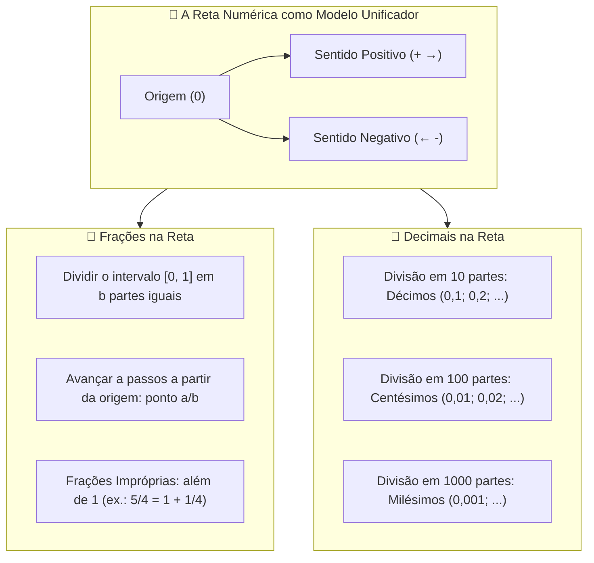

# 🌐 Material Interativo — Khan Academy: Frações e Números Decimais na Reta Numérica

> **Referência:** KHAN ACADEMY. Recursos Interativos e Videoaulas de Revisão Aritmética.  
> **Links Oficiais:**
> * [Números Decimais (Revisão e Estrutura)](https://pt-pt.khanacademy.org/math/arithmetic-home/arith-review-decimals)
> * [Números Decimais na Reta Numérica](https://pt-pt.khanacademy.org/math/arithmetic-home/arith-review-decimals/decimals-number-line/v/decimals-on-a-number-line)
> * [Frações na Reta Numérica (Exercícios e Visualização)](https://pt.khanacademy.org/math/arithmetic/fraction-arithmetic/x18ca194a:fractions-on-the-number-line/e/fractions_on_the_number_line_1)  
> **Disciplina:** Matemática Básica (`MMB002-EC-2026S2B2-T001`) — Semana 2  
> **Tema:** Representação geométrica e espacial de frações e números decimais na reta numérica, subdivisões decimais/fracionárias, comparação, densidade e resolução de exercícios  

---

## 🗺️ Mapa Conceitual da Reta Numérica



---

## 📌 1. Representação de Frações na Reta Numérica

A reta numérica converte o conceito estático de fração ("pedaço de pizza") em uma grandeza dimensional e orientada de **distância e posição**:

### 1.1. Procedimento Geométrico de Construção:
Para posicionar uma fração $\frac{a}{b}$ ($b > 0$):
1. Identifica-se o intervalo unitário entre dois inteiros consecutivos em que a fração reside.
   * Se for **própria** ($0 < \frac{a}{b} < 1$), situa-se entre $0$ e $1$.
   * Se for **imprópria** ($\frac{a}{b} \ge 1$), escreve-se como número misto $q \frac{r}{b}$, situando-se no intervalo $[q, q+1]$.
2. Divide-se o intervalo unitário em exatamente **$b$ segmentos de comprimento igual**.
3. A partir do inteiro base $q$, contam-se **$r$ marcas (passos)** para a direita.

```
0          1/4         2/4=1/2       3/4          1
|-----------|-----------|-----------|-----------|
0          0,25        0,50        0,75        1,00
```

* **Exemplo de Fração Imprópria ($\frac{7}{4}$):**
  $$\frac{7}{4} = 1 \frac{3}{4} = 1 + \frac{3}{4}$$
  Localiza-se entre $1$ e $2$, dividindo-se esse segmento em $4$ partes e tomando-se a $3ª$ marcação após o $1$.

---

## 📌 2. Representação de Números Decimais na Reta Numérica

O sistema decimal posicional opera através de **subdivisões sucessivas por potências de 10**:

```
Escala de Décimos (zoom entre 0 e 1):
0,0    0,1    0,2    0,3    0,4    0,5    0,6    0,7    0,8    0,9    1,0
 |------|------|------|------|------|------|------|------|------|------|

Escala de Centésimos (zoom entre 0,4 e 0,5):
0,40   0,41   0,42   0,43   0,44   0,45   0,46   0,47   0,48   0,49   0,50
 |------|------|------|------|------|------|------|------|------|------|
```

### 2.1. Nomenclatura das Ordens Decimais:
* **$1ª$ casa decimal:** Décimos ($10^{-1} = 0,1$).
* **$2ª$ casa decimal:** Centésimos ($10^{-2} = 0,01$).
* **$3ª$ casa decimal:** Milésimos ($10^{-3} = 0,001$).
* **$4ª$ casa decimal:** Décimos de milésimo ($10^{-4} = 0,0001$).

---

## 📌 3. Conversão e Equivalência Visual: Frações vs. Decimais

| Posição Visual na Reta | Fração Irredutível | Fração Decimal | Número Decimal |
| :---: | :---: | :---: | :---: |
| Um décimo | $\frac{1}{10}$ | $\frac{1}{10}$ | $0,1$ |
| Um quarto | $\frac{1}{4}$ | $\frac{25}{100}$ | $0,25$ |
| Um terço (dízima) | $\frac{1}{3}$ | $\approx \frac{333}{1000}$ | $0,333\dots = 0,\bar{3}$ |
| Metade | $\frac{1}{2}$ | $\frac{5}{10} = \frac{50}{100}$ | $0,5$ |
| Três quartos | $\frac{3}{4}$ | $\frac{75}{100}$ | $0,75$ |
| Quatro quintos | $\frac{4}{5}$ | $\frac{8}{10}$ | $0,8$ |
| Nove décimos | $\frac{9}{10}$ | $\frac{9}{10}$ | $0,9$ |
| Sete quintos | $\frac{7}{5} = 1 \frac{2}{5}$ | $\frac{14}{10}$ | $1,4$ |

---

## 🎯 4. Banco de Exercícios Interativos Resolvidos (Padrão Khan Academy)

### Exercício 1: Identificação de Ponto Fracionário
* **Problema:** A reta numérica entre $0$ e $1$ está dividida em $6$ partes iguais. Qual fração irredutível representa a $4ª$ marcação à direita de $0$?
* **Resolução:**
  1. O número de divisões é $6$ (denominador $6$).
  2. A posição é a $4ª$ marca (numerador $4$).
  3. Fração correspondente: $\frac{4}{6}$.
  4. Simplificando pelo $\text{mdc}(4, 6) = 2$:
     $$\frac{4 \div 2}{6 \div 2} = \mathbf{\frac{2}{3}} \approx 0,666\dots$$

### Exercício 2: Localização de Decimais Negativos
* **Problema:** Onde se situa o ponto $-1,35$ em relação aos inteiros na reta numérica?
* **Resolução:**
  * No sentido negativo (à esquerda do zero), $-1,35$ situa-se entre $-2$ e $-1$.
  * Especificamente, dista $0,35$ unidades à esquerda do $-1$ e $0,65$ unidades à direita do $-2$:
    $$-2 < -1,35 < -1$$

### Exercício 3: Ponto Médio e Densidade
* **Problema:** Encontre o número decimal e fracionário correspondente ao ponto médio exato entre $0,6$ e $0,7$.
* **Resolução:**
  $$P_{\text{médio}} = \frac{0,6 + 0,7}{2} = \frac{1,3}{2} = \mathbf{0,65}$$
  Em forma de fração irredutível:
  $$0,65 = \frac{65}{100} = \frac{65 \div 5}{100 \div 5} = \mathbf{\frac{13}{20}}$$

---

## 💻 5. Visualização e Plotagem Computacional (Python / Matplotlib)

O script abaixo plota uma reta numérica de alta precisão comparando frações e decimais:

```python
import matplotlib.pyplot as plt
import numpy as np

# Configuração da Reta Numérica
fig, ax = plt.subplots(figsize=(10, 2.5), dpi=150)
ax.axhline(0, color='black', linewidth=1.5)

# Pontos de destaque
points = [
    (0, "0"),
    (1/4, "1/4\n(0.25)"),
    (1/2, "1/2\n(0.50)"),
    (3/4, "3/4\n(0.75)"),
    (1, "1"),
    (5/4, "5/4\n(1.25)")
]

for x, label in points:
    ax.plot(x, 0, 'ro', markersize=6)
    ax.annotate(label, (x, 0.03), ha='center', fontsize=9, fontweight='bold')

# Ajustes de Eixos
ax.set_xlim(-0.1, 1.4)
ax.set_ylim(-0.1, 0.15)
ax.set_yticks([])
ax.set_xticks(np.arange(0, 1.5, 0.25))
ax.set_title("Representação de Frações e Decimais na Reta Real", fontsize=11)
ax.spines['top'].set_visible(False)
ax.spines['right'].set_visible(False)
ax.spines['left'].set_visible(False)

plt.tight_layout()
plt.savefig("reta_numerica_fracoes_decimais.png")
```

---

## 📝 6. Síntese Didática

> [!TIP]
> * **A Reta é Contínua:** Todo número racional possui uma localização espacial exata na reta numérica.
> * **Ordem Geométrica:** Dados dois números $x$ e $y$, se $x$ está à esquerda de $y$, então $x < y$, independentemente de serem positivos ou negativos.
> * **Equivalência Espacial:** Frações equivalentes (ex.: $\frac{1}{2}, \frac{2}{4}, \frac{5}{10}$) e seu decimal associado ($0,5$) ocupam exatamente o **mesmo ponto geométrico** na reta.
