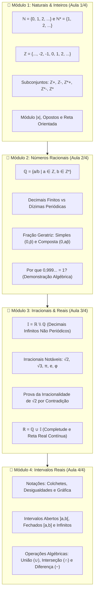
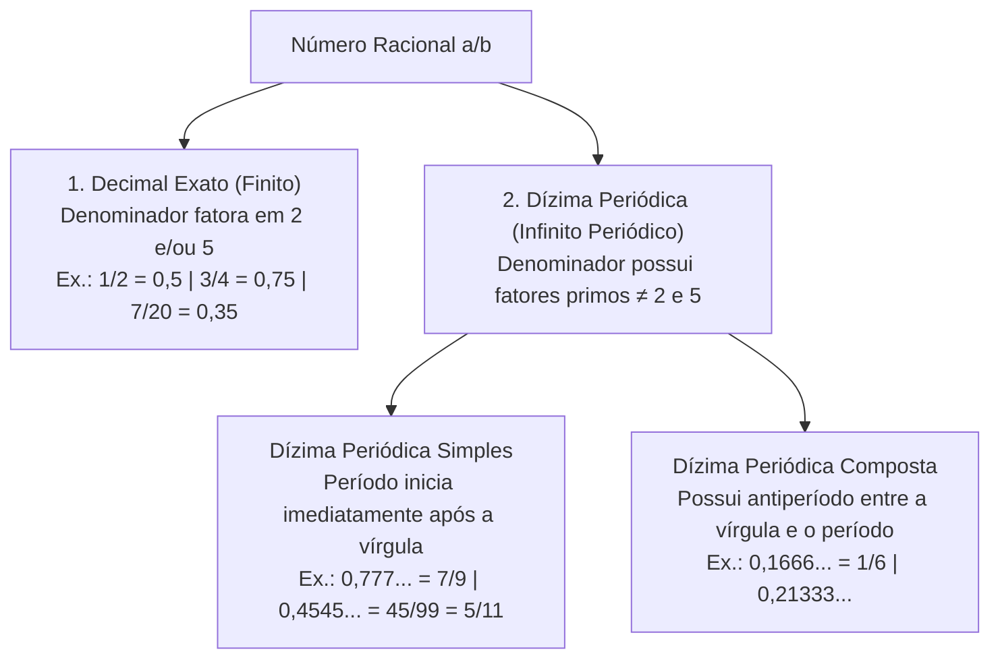

# 🔍 Aprofundando o Tema — Semana 2 (MMB002)

> **Disciplina:** Matemática Básica (`MMB002-EC-2026S2B2-T001`)  
> **Tema da Semana 2:** Relações numéricas (Conjuntos Numéricos, Decimais, Dízimas, Potenciação e Radiciação)  
> 
> **📚 Videoaulas de Aprofundamento — Professor Ferretto (Série Completa de Conjuntos Numéricos):**  
> 1. 🎥 [**Aula 1 de 4:** Conjuntos Numéricos — Números Naturais e Inteiros](https://www.youtube.com/watch?v=Y_mYgLkuEl4)  
> 2. 🎥 [**Aula 2 de 4:** Conjuntos Numéricos — Números Racionais](https://www.youtube.com/watch?v=NYAeWhz53NM)  
> 3. 🎥 [**Aula 3 de 4:** Conjuntos Numéricos — Números Irracionais e Reais](https://www.youtube.com/watch?v=J4vD5RpOqJY)  
> 4. 🎥 [**Aula 4 de 4:** Conjuntos Numéricos — Intervalos Reais, Operações e Propriedades](https://www.youtube.com/watch?v=OPACJhL_mLY)  

---

## 🗺️ Mapa Integrado de Aprofundamento da Semana 2



---

## 🎥 Módulo 1: Números Naturais ($\mathbb{N}$) e Inteiros ($\mathbb{Z}$) — Prof. Ferretto

> **Link da Aula 1:** [Assistir no YouTube (Y_mYgLkuEl4)](https://www.youtube.com/watch?v=Y_mYgLkuEl4)

### 1.1. O Conjunto dos Números Naturais ($\mathbb{N}$)
* **Definição:** Conjunto infinito utilizado para contagem e ordenação:
  $$\mathbb{N} = \{0, 1, 2, 3, 4, 5, \dots\}$$
* **Subconjunto dos Naturais Não Nulos ($\mathbb{N}^*$):**
  $$\mathbb{N}^* = \mathbb{N} \setminus \{0\} = \{1, 2, 3, 4, 5, \dots\}$$
* **Sucessor de um Natural:** Todo número $n \in \mathbb{N}$ possui um sucessor imediato $n + 1$. O zero é o único elemento de $\mathbb{N}$ que não é sucessor de nenhum natural.

### 1.2. O Conjunto dos Números Inteiros ($\mathbb{Z}$)
* **Motivação:** Necessidade de expressar grandezas opostas e subtrair quantidades maiores de menores ($3 - 7 = -4$).
  $$\mathbb{Z} = \{\dots, -4, -3, -2, -1, 0, 1, 2, 3, 4, \dots\}$$
  Note que $\mathbb{N} \subset \mathbb{Z}$.

* **Quadro de Subconjuntos Notáveis de $\mathbb{Z}$:**

| Símbolo | Denominação Formal | Elementos / Notação |
| :--- | :--- | :--- |
| $\mathbb{Z}^*$ | Inteiros não nulos | $\mathbb{Z} \setminus \{0\} = \{\dots, -2, -1, 1, 2, \dots\}$ |
| $\mathbb{Z}_+$ | Inteiros não negativos | $\{0, 1, 2, 3, \dots\} = \mathbb{N}$ |
| $\mathbb{Z}_-$ | Inteiros não positivos | $\{\dots, -3, -2, -1, 0\}$ |
| $\mathbb{Z}_+^*$ | Inteiros estritamente positivos | $\{1, 2, 3, \dots\} = \mathbb{N}^*$ |
| $\mathbb{Z}_-^*$ | Inteiros estritamente negativos | $\{\dots, -3, -2, -1\}$ |

* **Módulo ou Valor Absoluto ($|x|$):**
  Geometricamente representa a **distância** do ponto $x$ até a origem $0$:
  $$|x| = \begin{cases} x, & \text{se } x \ge 0 \\ -x, & \text{se } x < 0 \end{cases}$$
  * *Exemplos:* $|+5| = 5$, $|-5| = -(-5) = 5$, $|0| = 0$.

---

## 🎥 Módulo 2: Números Racionais ($\mathbb{Q}$) — Prof. Ferretto

> **Link da Aula 2:** [Assistir no YouTube (NYAeWhz53NM)](https://www.youtube.com/watch?v=NYAeWhz53NM)

### 2.1. Definição Formal e Relações de Inclusão
Todo número que pode ser expresso como a razão entre dois números inteiros $a$ e $b$, com $b \neq 0$:

$$\mathbb{Q} = \left\{ \frac{a}{b} \;\middle|\; a \in \mathbb{Z}, \, b \in \mathbb{Z}^* \right\}$$

$$\mathbb{N} \subset \mathbb{Z} \subset \mathbb{Q}$$

### 2.2. Tipos de Representação Decimal dos Racionais
Ao dividir o numerador pelo denominador ($\frac{a}{b}$), temos duas possibilidades excludentes:



### 2.3. Método Algébrico Rápido para Fração Geratriz

#### Dízima Simples:
$$\text{Fração Geratriz} = \frac{\text{Período}}{\underbrace{99\dots9}_{k \text{ noves para } k \text{ dígitos do período}}}$$
* $0,444\dots = \frac{4}{9}$
* $0,2727\dots = \frac{27}{99} = \frac{3}{11}$
* $2,333\dots = 2 + 0,333\dots = 2 + \frac{3}{9} = 2 + \frac{1}{3} = \frac{7}{3}$

#### Dízima Composta:
$$\text{Fração Geratriz} = \frac{(\text{Antiperíodo seguido do Período}) - (\text{Antiperíodo})}{\underbrace{99\dots9}_{k \text{ noves}} \underbrace{00\dots0}_{m \text{ zeros}}}$$
* **Exemplo 1 ($x = 0,1666\dots$):** Antiperíodo $1$ ($m=1$), Período $6$ ($k=1$):
  $$x = \frac{16 - 1}{90} = \frac{15}{90} = \mathbf{\frac{1}{6}}$$
* **Exemplo 2 ($x = 0,35222\dots$):** Antiperíodo $35$ ($m=2$), Período $2$ ($k=1$):
  $$x = \frac{352 - 35}{900} = \frac{317}{900}$$

---

## 🎥 Módulo 3: Números Irracionais ($\mathbb{I}$) e Reais ($\mathbb{R}$) — Prof. Ferretto

> **Link da Aula 3:** [Assistir no YouTube (J4vD5RpOqJY)](https://www.youtube.com/watch?v=J4vD5RpOqJY)

### 3.1. O Conjunto dos Números Irracionais ($\mathbb{I}$)
Números decimais **infinitos e NÃO periódicos** que não podem ser representados por fração de inteiros:

$$\mathbb{I} = \mathbb{R} \setminus \mathbb{Q}$$

* **Irracionais Algébricos:** $\sqrt{2} \approx 1,4142\dots$, $\sqrt{3} \approx 1,7320\dots$, $\sqrt[3]{7}$, $\phi = \frac{1+\sqrt{5}}{2} \approx 1,6180\dots$.
* **Irracionais Transcendentes:** $\pi \approx 3,14159265\dots$, $e \approx 2,71828182\dots$.

### 3.2. Prova Clássica: Irracionalidade de $\sqrt{2}$ (Demonstração por Absurdo)
1. Suponha que $\sqrt{2} \in \mathbb{Q} \implies \sqrt{2} = \frac{a}{b}$, com $\text{mdc}(a, b) = 1$ (fração irredutível).
2. $2 = \frac{a^2}{b^2} \implies a^2 = 2b^2 \implies a^2 \text{ é par} \implies \mathbf{a \text{ é par}}$.
3. Seja $a = 2k$. Então: $(2k)^2 = 2b^2 \implies 4k^2 = 2b^2 \implies b^2 = 2k^2 \implies \mathbf{b \text{ é par}}$.
4. Se $a$ e $b$ são ambos pares, $\text{mdc}(a, b) \ge 2$, o que contradiz a irredutibilidade da fração inicial ($\text{mdc}(a, b) = 1$).
5. **Conclusão:** $\sqrt{2}$ não pode ser racional. Logo, $\sqrt{2} \in \mathbb{I}$. $\blacksquare$

### 3.3. O Conjunto dos Números Reais ($\mathbb{R}$)
União de todos os racionais com todos os irracionais:
$$\mathbb{R} = \mathbb{Q} \cup \mathbb{I}, \quad \text{com } \mathbb{Q} \cap \mathbb{I} = \emptyset$$

---

## 🎥 Módulo 4: Intervalos Reais, Operações e Propriedades — Prof. Ferretto

> **Link da Aula 4:** [Assistir no YouTube (OPACJhL_mLY)](https://www.youtube.com/watch?v=OPACJhL_mLY)

### 4.1. Taxonomia dos Intervalos Reais

```
Notação de Bolinhas na Reta:
● Bolinha Fechada (Extremo incluído: ≤, ≥, colchete fechado [ ])
○ Bolinha Aberta  (Extremo excluído: <, >, colchete invertido ] [ ou parêntese ( ))
```

| Tipo de Intervalo | Notação de Colchetes | Notação de Conjuntos | Reta Real |
| :--- | :---: | :--- | :---: |
| **Fechado** | $[a, b]$ | $\{x \in \mathbb{R} \mid a \le x \le b\}$ | $\bullet \text{ em } a \text{ e } \bullet \text{ em } b$ |
| **Aberto** | $]a, b[$ ou $(a, b)$ | $\{x \in \mathbb{R} \mid a < x < b\}$ | $\circ \text{ em } a \text{ e } \circ \text{ em } b$ |
| **Fechado à esquerda** | $[a, b[$ ou $[a, b)$ | $\{x \in \mathbb{R} \mid a \le x < b\}$ | $\bullet \text{ em } a \text{ e } \circ \text{ em } b$ |
| **Fechado à direita** | $]a, b]$ ou $(a, b]$ | $\{x \in \mathbb{R} \mid a < x \le b\}$ | $\circ \text{ em } a \text{ e } \bullet \text{ em } b$ |
| **Infinito à direita** | $[a, +\infty[$ | $\{x \in \mathbb{R} \mid x \ge a\}$ | $\bullet \text{ em } a \to +\infty$ |
| **Infinito à esquerda** | $]-\infty, b[$ | $\{x \in \mathbb{R} \mid x < b\}$ | $-\infty \leftarrow \circ \text{ em } b$ |

---

### 4.2. Operações com Intervalos na Prática

Considere os conjuntos $A = \{x \in \mathbb{R} \mid -2 \le x < 5\} = [-2, 5[$ e $B = \{x \in \mathbb{R} \mid 1 \le x \le 8\} = [1, 8]$:

```
Reta A:       ●=================○                [-2, 5[
             -2                 5

Reta B:                 ●=================●      [1, 8]
                        1                 8

A ∪ B:        ●===========================●      [-2, 8]
             -2                           8

A ∩ B:                  ●=======○                [1, 5[
                        1       5

A - B:        ●=========○                        [-2, 1[
             -2         1
```

* **União ($A \cup B$):** $[-2, 8]$
* **Interseção ($A \cap B$):** $[1, 5[$
* **Diferença ($A - B$):** $[-2, 1[$ *(Note: $1 \in B$, logo $1$ é excluído de $A - B$, ficando bola aberta em $1$)*
* **Diferença ($B - A$):** $[5, 8]$ *(Note: $5 \notin A$, logo $5$ permanece em $B - A$, ficando bola fechada em $5$)*

---

## 💻 5. Algoritmo em C++20: Operações com Intervalos Reais

```cpp
#include <iostream>
#include <algorithm>
#include <optional>

struct Interval {
    double min_val;
    bool closed_left;
    double max_val;
    bool closed_right;

    void print(const std::string& name) const {
        std::cout << name << ": " 
                  << (closed_left ? "[" : "]")
                  << min_val << ", " << max_val
                  << (closed_right ? "]" : "[") << "\n";
    }

    std::optional<Interval> intersect(const Interval& o) const {
        double new_min = std::max(min_val, o.min_val);
        double new_max = std::min(max_val, o.max_val);

        if (new_min > new_max) return std::nullopt; // Interseção vazia

        bool new_cl = (min_val == o.min_val) ? (closed_left && o.closed_left) 
                                             : (min_val > o.min_val ? closed_left : o.closed_left);
        bool new_cr = (max_val == o.max_val) ? (closed_right && o.closed_right) 
                                             : (max_val < o.max_val ? closed_right : o.closed_right);

        return Interval{new_min, new_cl, new_max, new_cr};
    }
};

int main() {
    Interval A{-2.0, true, 5.0, false}; // [-2, 5[
    Interval B{1.0, true, 8.0, true};   // [1, 8]

    A.print("Intervalo A");
    B.print("Intervalo B");

    auto inter = A.intersect(B);
    if (inter) inter->print("A ∩ B");
    else std::cout << "A ∩ B é vazio!\n";

    return 0;
}
```

---

## 📝 6. Síntese dos Pontos Críticos do Aprofundamento

> [!IMPORTANT]
> 1. **Cadeia de Inclusão Universal:** $\mathbb{N} \subset \mathbb{Z} \subset \mathbb{Q} \subset \mathbb{R}$.
> 2. **Dízimas:** Toda dízima periódica é racional ($\mathbb{Q}$) e admite fração geratriz exata.
> 3. **Irracionais:** Não admitem fração de inteiros ($\mathbb{I} = \mathbb{R} \setminus \mathbb{Q}$).
> 4. **Operações com Intervalos:** Na diferença $A - B$, atenção redobrada aos extremos: se o ponto de corte pertence a $B$, ele é removido de $A$, resultando em extremidade aberta em $A - B$.
