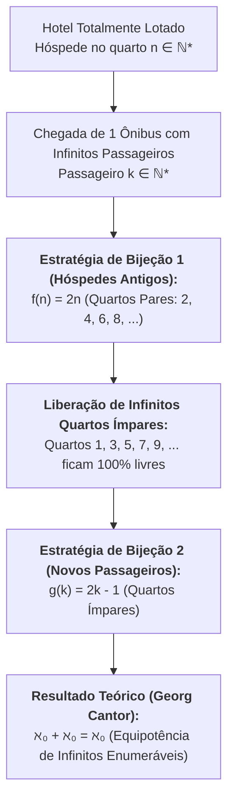

# 💬 Fórum Temático — Semana 2 (MMB002)

> **Disciplina:** Matemática Básica (`MMB002-EC-2026S2B2-T001`)  
> **Tema da Semana 2:** Relações numéricas (Conjuntos Numéricos, Infinito e Cardinalidade)  
> **Objeto de Discussão:** Desafio da Semana (O Hotel de Hilbert e a Acomodação de Infinitos Hóspedes)  

---

## 💡 O Desafio da Semana: O Paradoxo do Hotel de Hilbert

### 📄 Enunciado Oficial
> *O **Hotel de Hilbert** é um célebre experimento mental formulado pelo matemático alemão David Hilbert (1862–1943) para demonstrar as propriedades contraintuitivas dos conjuntos infinitos.*  
> *O hotel possui **infinitos quartos numerados** ($1, 2, 3, 4, \dots = \mathbb{N}^*$), e todos os quartos estão completamente ocupados (lotação total).*  
> *Em determinado momento, chega um **ônibus contendo infinitos passageiros** (indexados por $k = 1, 2, 3, \dots$).*  
> 
> **Desafio:** Como o gerente do hotel pode acomodar todos os novos passageiros sem desalojar nenhum dos hóspedes atuais, mantendo estritamente um único hóspede por quarto?

---

## 🧮 Formalização Matemática da Solução

### 1. Remanejamento dos Hóspedes Antigos:
O gerente instrui cada hóspede que ocupa o quarto $n$ a mudar-se para o quarto de número par **$2n$**:
$$f_{\text{antigos}}(n) = 2n, \quad \forall n \in \mathbb{N}^*$$
* Quarto $1 \to$ Quarto $2$
* Quarto $2 \to$ Quarto $4$
* Quarto $3 \to$ Quarto $6$
* Quarto $n \to$ Quarto $2n$

Dessa forma, todos os infinitos hóspedes originais permanecem acomodados, ocupando exclusivamente o subconjunto próprio dos números pares:
$$P = \{2, 4, 6, 8, \dots\} = 2\mathbb{N}^*$$

### 2. Acomodação dos Novos Passageiros nos Quartos Ímpares:
Com o remanejamento, todos os infinitos quartos ímpares ficaram desocupados:
$$I = \{1, 3, 5, 7, \dots\} = 2\mathbb{N}^* - 1$$

O gerente aloca o $k$-ésimo passageiro do ônibus no quarto ímpar **$2k - 1$**:
$$g_{\text{novos}}(k) = 2k - 1, \quad \forall k \in \mathbb{N}^*$$
* Passageiro $1 \to$ Quarto $2(1) - 1 = 1$
* Passageiro $2 \to$ Quarto $2(2) - 1 = 3$
* Passageiro $3 \to$ Quarto $2(3) - 1 = 5$
* Passageiro $k \to$ Quarto $2k - 1$

---

## 📝 Modelos de Postagem para o Fórum da Univesp

### 📌 Opção 1: Postagem Principal (Estruturada e Rigorosa)

> **Título:** Solução do Desafio da Semana 2 — O Hotel de Hilbert e a Bijeção com Subconjuntos Próprios
>
> Olá, professora Rúbia, tutores e colegas!
>
> Apresento minha solução para o desafio da gerência do Hotel de Hilbert diante da chegada de um ônibus com infinitos passageiros:
>
> **1. Estratégia de Realocação dos Hóspedes Atuais:**  
> Solicito que cada hóspede que já ocupa o quarto $n$ se mude para o quarto de número **$2n$** ($1 \to 2$, $2 \to 4$, $3 \to 6$, etc.). Como o conjunto dos números pares é infinito, todos os hóspedes antigos continuam acomodados sem qualquer conflito, liberando 100% dos quartos ímpares.
>
> **2. Alocação dos Novos Passageiros:**  
> Com os quartos de numeração ímpar totalmente vagos, aloco o $k$-ésimo passageiro do ônibus no quarto ímpar correspondente a **$2k - 1$** (Passageiro $1 \to$ Quarto $1$, Passageiro $2 \to$ Quarto $3$, Passageiro $3 \to$ Quarto $5$, etc.).
>
> **Conexão com os Conteúdos da Semana:**  
> Esse paradoxo ilustra de forma magistral a definição de conjunto infinito formulada por Richard Dedekind e Georg Cantor: um conjunto é infinito se, e somente se, pode ser colocado em bijeção com um subconjunto próprio seu. Na aritmética transfinita, demonstramos que a união de dois conjuntos infinitos enumeráveis possui a mesma cardinalidade $\aleph_0$ ($\aleph_0 + \aleph_0 = \aleph_0$).
>
> Um abraço a todos e bons estudos!

---

### 📌 Opção 2: Réplica a Colegas no Fórum

> **Título:** Re: Desafio do Hotel de Hilbert — E se chegassem infinitos ônibus?
>
> Excelente contribuição, colega!
>
> Sua explicação sobre o particionamento entre pares ($2n$) e ímpares ($2k-1$) foi muito clara. Vale destacar uma extensão fascinante desse problema: caso chegassem **infinitos ônibus, cada um com infinitos passageiros**, o gerente ainda assim conseguiria acomodar todos utilizando as **potências de números primos**:
> * Hóspedes atuais vão para os quartos $2^n$;
> * Passageiros do 1º ônibus vão para os quartos $3^k$;
> * Passageiros do 2º ônibus vão para os quartos $5^k$;
> * Passageiros do $i$-ésimo ônibus vão para os quartos $p_{i+1}^k$ (onde $p_j$ é o $j$-ésimo número primo).
>
> Pelo Teorema Fundamental da Aritmética (fatoração única em primos), nenhum quarto seria compartilhado! Isso reforça a riqueza da teoria dos números estudada em nossa disciplina.
