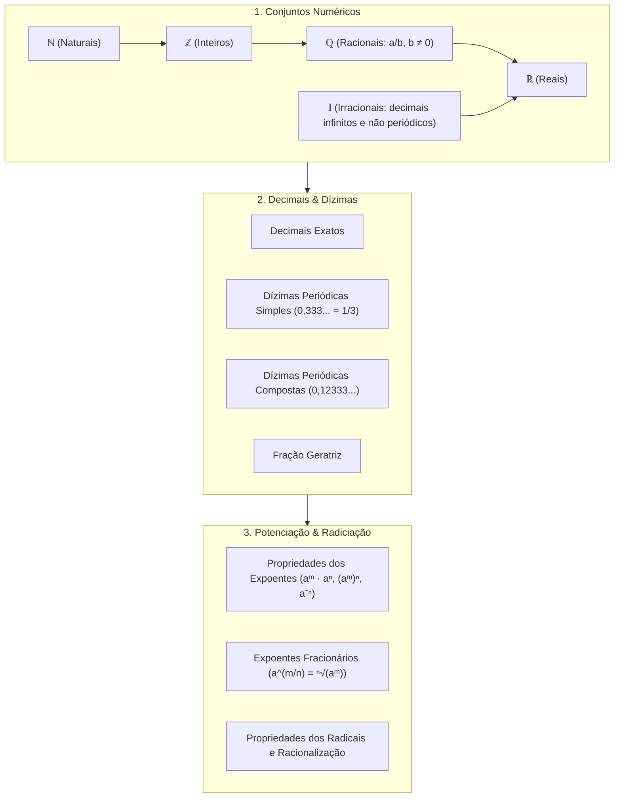

# 📚 Semana 2: Relações Numéricas

> **Disciplina:** Matemática Básica (`MMB002-EC-2026S2B2-T001`)  
> **Tema:** Relações numéricas (Conjuntos Numéricos, Decimais, Dízimas, Potenciação e Radiciação)  
> **Docente:** Profª Dra. Rúbia Barcelos Amaral  
> **Período:** 05/10/2026 a 18/10/2026  

---

## 📁 Estrutura de Arquivos da Semana 2

| Arquivo | Descrição |
| :--- | :--- |
| [**`0-Inicio.md`**](file:///home/henrique/Modelos/Univesp/2026S2B2/MMB002-Matematica-Basica/Semana-2/0-Inicio.md) | Contextualização, objetivos, roteiro e **resolução do Desafio do Hotel de Hilbert** |
| `1-Videoaulas.md` | Resumos estruturados das Videoaulas 4, 5 e 6 com exemplos e fórmulas |
| `2-Textos-base.md` | Sínteses dos livros-texto (*Fundamentos de Matemática*, Kahl, *Manual Compacto*) |
| `3-Aprofundando-o-tema.md` | Materiais complementares, representação na reta real e dízimas periódicas |
| `4-Forum-tematico.md` | Proposta e texto pronto para postagem no Fórum da Univesp |
| `5-Atividade-avaliativa.md` | Resolução comentada e gabarito passo a passo dos exercícios avaliativos |
| `6-Em-sintese.md` | Resumo executivo em tópicos e mapa mental da semana |

---

## 🗺️ Mapa de Tópicos da Semana 2

