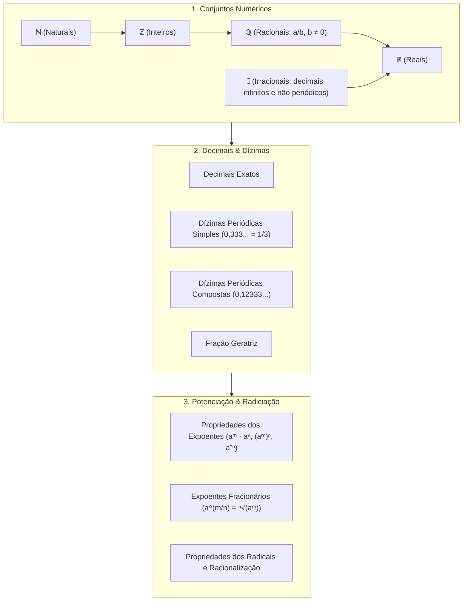

# 📚 Semana 2: Relações Numéricas

> **Disciplina:** Matemática Básica (`MMB002-EC-2026S2B2-T001`)  
> **Tema:** Relações numéricas (Conjuntos Numéricos, Decimais, Dízimas, Potenciação e Radiciação)  
> **Docente:** Profª Dra. Rúbia Barcelos Amaral  
> **Período:** 05/10/2026 a 18/10/2026  

---

## 📁 Estrutura de Arquivos da Semana 2

| Arquivo | Descrição |
| :--- | :--- |
| [**`0-Inicio.md`**](file:///home/henrique/Modelos/Univesp/2026S2B2/MMB002-Matematica-Basica/Semana-2/0-Inicio.md) | Contextualização, objetivos, roteiro e **resolução do Desafio do Hotel de Hilbert** |
| [**`1-Videoaulas.md`**](file:///home/henrique/Modelos/Univesp/2026S2B2/MMB002-Matematica-Basica/Semana-2/1-Videoaulas.md) | Resumos estruturados das Videoaulas 4, 5 e 6 com exemplos e fórmulas |
| [**`2.1-Texto-base-Conjuntos-Numericos-Araujo.md`**](file:///home/henrique/Modelos/Univesp/2026S2B2/MMB002-Matematica-Basica/Semana-2/2.1-Texto-base-Conjuntos-Numericos-Araujo.md) | Síntese do capítulo *"Conjuntos numéricos"* (p. 21–24) de *Fundamentos de Matemática* |
| [**`2.2-Texto-base-Manual-Compacto-Fracoes.md`**](file:///home/henrique/Modelos/Univesp/2026S2B2/MMB002-Matematica-Basica/Semana-2/2.2-Texto-base-Manual-Compacto-Fracoes.md) | Síntese do capítulo 5 (*"Os números fracionários"*, p. 74–108) do *Manual Compacto* |
| [**`2.3-Texto-base-Manual-Compacto-Potenciacao.md`**](file:///home/henrique/Modelos/Univesp/2026S2B2/MMB002-Matematica-Basica/Semana-2/2.3-Texto-base-Manual-Compacto-Potenciacao.md) | Síntese do capítulo 3 (*"A potenciação com números naturais"*, p. 43–49) do *Manual Compacto* |
| [**`2.4-Texto-base-Hazzan-Inteiros-Racionais-Reais.md`**](file:///home/henrique/Modelos/Univesp/2026S2B2/MMB002-Matematica-Basica/Semana-2/2.4-Texto-base-Hazzan-Inteiros-Racionais-Reais.md) | Síntese do capítulo 2 (*"Números Inteiros, Racionais e Reais"*, p. 49–70) de *Matemática Básica* (Hazzan) |
| [**`2.5-Texto-base-Kahl-Conjuntos-Numericos.md`**](file:///home/henrique/Modelos/Univesp/2026S2B2/MMB002-Matematica-Basica/Semana-2/2.5-Texto-base-Kahl-Conjuntos-Numericos.md) | Síntese do texto-base *Conjuntos numéricos & Operações entre Conjuntos* (José Carlos Kahl) |
| [**`2.6-Material-Interativo-Khan-Academy-Reta-Numerica.md`**](file:///home/henrique/Modelos/Univesp/2026S2B2/MMB002-Matematica-Basica/Semana-2/2.6-Material-Interativo-Khan-Academy-Reta-Numerica.md) | Síntese dos materiais interativos da Khan Academy (Decimais e Frações na Reta Numérica) |
| [**`3-Aprofundando-o-tema.md`**](file:///home/henrique/Modelos/Univesp/2026S2B2/MMB002-Matematica-Basica/Semana-2/3-Aprofundando-o-tema.md) | Série completa do Prof. Ferretto (4 videoaulas: ℕ, ℤ, ℚ, 𝕀, ℝ e Intervalos Reais) |
| [**`4-Forum-tematico.md`**](file:///home/henrique/Modelos/Univesp/2026S2B2/MMB002-Matematica-Basica/Semana-2/4-Forum-tematico.md) | Proposta e texto pronto para postagem no Fórum (Desafio do Hotel de Hilbert) |
| [**`5-Atividade-avaliativa.md`**](file:///home/henrique/Modelos/Univesp/2026S2B2/MMB002-Matematica-Basica/Semana-2/5-Atividade-avaliativa.md) | Resolução comentada e gabarito passo a passo dos exercícios avaliativos |
| [**`6-Em-sintese.md`**](file:///home/henrique/Modelos/Univesp/2026S2B2/MMB002-Matematica-Basica/Semana-2/6-Em-sintese.md) | Resumo executivo em tópicos, mapas mentais, tabela comparativa e flashcards |

---

## 🗺️ Mapa de Tópicos da Semana 2

