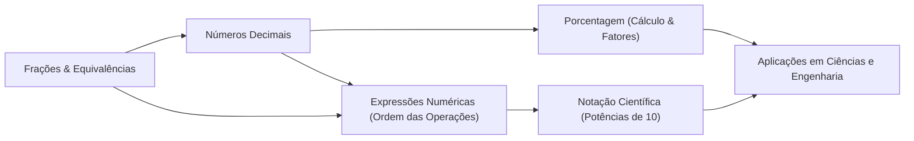

# Semana 3: Equivalências e Estratégias — Modalidades de Cálculo

> **Disciplina:** Matemática Básica (MMB002)  
> **Docente Responsável:** Profª Dra. Rúbia Barcelos Amaral  
> **Bimestre:** 2026S2B2 — Univesp  

---

## 📌 Apresentação da Semana 3

Boas-vindas à terceira semana de Matemática Básica!

Nesta semana, prosseguiremos com o estudo aprofundado de **frações e números decimais**, construindo a ponte conceitual necessária para o cálculo e interpretação de **porcentagens**, além de explorarmos as potências de dez na forma de **notação científica** e a resolução estruturada de **expressões numéricas**.

Frações, decimais e porcentagens são ferramentas matemáticas indispensáveis presentes no cotidiano técnico e profissional — desde o cálculo de taxas e descontos até proporções de grandezas em engenharia. A notação científica permite manipular números astronomicamente grandes ou subatômicos com clareza operacional, enquanto o domínio das expressões numéricas estabelece as bases indispensáveis para a álgebra e a resolução de equações nas próximas semanas.

---

## 🎯 Objetivos de Aprendizagem

Ao final desta semana, você deverá ser capaz de:

* [ ] **Compreender como encontrar frações equivalentes:** Aplicar o princípio fundamental da equivalência multiplicando ou dividindo numerador e denominador por fatores comuns.
* [ ] **Resolver operações com frações, decimais e porcentagem:** Dominar adição, subtração, multiplicação e divisão com denominadores distintos, conversão mútua entre fração/decimal/porcentagem e fatores de aumento/desconto.
* [ ] **Escrever e operar números em notação científica:** Representar grandezas no formato $N = a \times 10^b$, onde $1 \leq |a| < 10$ e $b \in \mathbb{Z}$, realizando produtos, quocientes e comparações de ordens de magnitude.
* [ ] **Resolver expressões numéricas complexas:** Aplicar rigorosamente a ordem de precedência dos operadores (parênteses, colchetes, chaves, potências/raízes, multiplicações/divisões e adições/subtrações).

---

## 🔬 Desafio da Semana: O Relógio Atômico e a Notação Científica

> *"Os relógios atômicos são tão estáveis que, em princípio, dois relógios de césio (relógio atômico baseado na diferença de energia entre dois estados do núcleo de césio-133) teriam que funcionar por 6.000 anos para que a diferença entre suas leituras fosse maior que 1s. Mesmo assim, essa precisão não é nada em comparação com a dos relógios que estão sendo desenvolvidos atualmente, que pode chegar a uma parte em $10^{18}$, ou seja, $1\text{ s}$ em $1 \times 10^{18}\text{ s}$."*  
> — **HALLIDAY, D.; RESNICK, R.; WALKER, J.** *Fundamentos de Física*. 8. ed., v. 2. Rio de Janeiro: LTC, 2008. p. 7.

### ❓ A Questão do Desafio:
* O texto apresenta uma quantidade de tempo expressa em notação científica: **$T = 1 \times 10^{18}\text{ s}$**.
* Essa quantidade representa muito ou pouco tempo?
* Converta essa grandeza para unidades do cotidiano: **minutos, horas, dias e anos**.

---

### 📐 Resolução Analítica e Conversão de Unidades

Dados os fatores de conversão usuais:
* $1\text{ minuto} = 60\text{ s}$
* $1\text{ hora} = 60\text{ min} = 3.600\text{ s}$
* $1\text{ dia} = 24\text{ h} = 86.400\text{ s}$
* $1\text{ ano (juliano)} = 365,25\text{ dias} = 31.557.600\text{ s} = 3,15576 \times 10^7\text{ s}$

#### 1. Conversão para Minutos:
$$T_{\text{min}} = \frac{10^{18}}{60} = \frac{10}{6} \times 10^{16} \approx \mathbf{1,6667 \times 10^{16}\text{ minutos}}$$
*(Aproximadamente 16,67 quatrilhões de minutos).*

#### 2. Conversão para Horas:
$$T_{\text{h}} = \frac{10^{18}}{3.600} = \frac{10^{18}}{3,6 \times 10^3} \approx \mathbf{2,7778 \times 10^{14}\text{ horas}}$$
*(Aproximadamente 277,78 trilhões de horas).*

#### 3. Conversão para Dias:
$$T_{\text{dias}} = \frac{10^{18}}{86.400} = \frac{10^{18}}{8,64 \times 10^4} \approx \mathbf{1,1574 \times 10^{13}\text{ dias}}$$
*(Cerca de 11,57 trilhões de dias).*

#### 4. Conversão para Anos:
Considerando o ano civil médio de $365,25\text{ dias}$ ($3,15576 \times 10^7\text{ s}$):
$$T_{\text{anos}} = \frac{10^{18}}{3,15576 \times 10^7} \approx \mathbf{31.688.087.814\text{ anos}} \approx \mathbf{3,17 \times 10^{10}\text{ anos}}$$

> [!IMPORTANT]
> **Dimensão Cosmológica do Resultado:**  
> $3,17 \times 10^{10}\text{ anos}$ equivalem a aproximadamente **31,7 bilhões de anos**.  
> Como a idade estimada de todo o Universo é de aproximadamente **13,8 bilhões de anos** ($1,38 \times 10^{10}\text{ anos}$), a precisão de $1 \text{ s}$ em $10^{18} \text{ s}$ significa que esse relógio atômico de última geração atrasaria apenas 1 segundo se funcionasse ininterruptamente por **mais que o dobro de todo o tempo decorrido desde o Big Bang**!

---

## 🧭 Roteiro e Sequência de Estudos da Semana

1. **Videoaulas 7 e 8:** Retomada de operações com frações e exercícios práticos.  
   * Materiais-base: *"Operações com frações"* e *"Entendendo números decimais"*.
2. **Videoaula 9:** Porcentagem: representações fracionárias, decimais e cálculo no cotidiano.  
   * Textos-base: *"Fundamentos de matemática"*, *"Porcentagem e frações: o que têm em comum?"* e *"Porcentagem"*.
3. **Videoaula 10:** Notação científica, potências de base 10 e ordens de grandeza.  
   * Material-base: *"Afogando em zeros"*.
4. **Videoaulas 11 e 12:** Expressões numéricas e ordem de precedência operacional.
5. **Fórum Temático & Atividade Avaliativa Semanal.**
