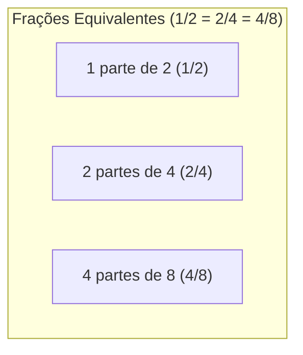
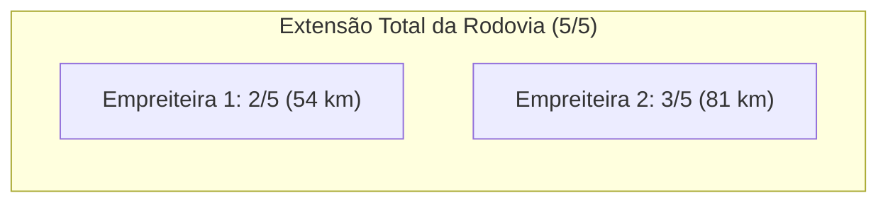
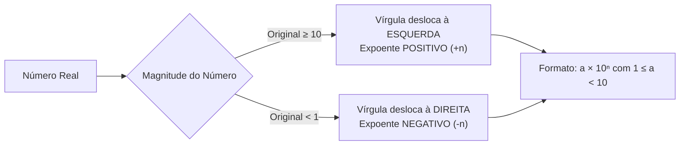
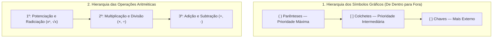
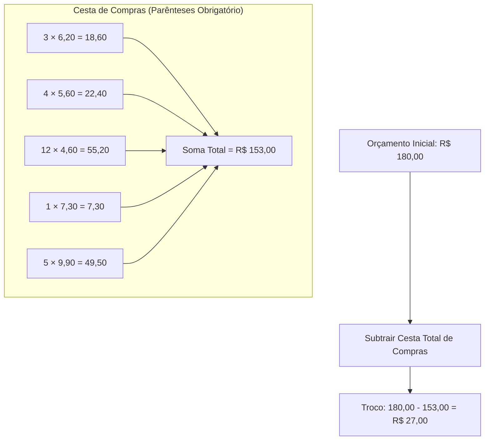

# Videoaulas da Semana 3: Frações, Decimais, Porcentagem e Expressões

> **Disciplina:** Matemática Básica (MMB002)  
> **Docente Responsável:** Profª Dra. Rúbia Barcelos Amaral  
> **Bimestre:** 2026S2B2 — Univesp  

---

## 📺 Videoaula 7: Frações — Equivalência e Operações Fundamentais

* **Docente:** Profª Dra. Rúbia Barcelos Amaral (com participação de Nicole, Pamella e Luca)
* **Link da Videoaula:** [YouTube (p-uMa0XPQIc)](https://www.youtube.com/watch?v=p-uMa0XPQIc)
* **Duração:** ~12 minutos

---

### 1. 📌 O que é uma Fração?
Uma fração representa a divisão de um número inteiro em partes iguais:
* **Definição formal:** Pertence ao conjunto dos números racionais ($\mathbb{Q}$):
  $$\mathbb{Q} = \left\{ \frac{a}{b} \;\middle|\; a, b \in \mathbb{Z} \text{ e } b \neq 0 \right\}$$
* **Numerador ($a$):** A quantidade de partes tomadas/consideradas do todo (fica acima).
* **Denominador ($b$):** O número total de partes iguais em que o todo foi dividido (fica abaixo).

---

### 2. ⚖️ Frações Equivalentes
Frações equivalentes representam a **mesma proporção ou quantidade** em relação à unidade, embora expressas com termos numéricos distintos:



#### Como obter frações equivalentes:
Multiplica-se ou divide-se o numerador e o denominador pelo **mesmo número natural diferente de zero**:
* **Amplificação:** $\frac{1 \times 2}{2 \times 2} = \frac{2}{4} = \frac{4}{8}$
* **Simplificação (Redução à fração irredutível):**
  * $\frac{10}{14} = \frac{10 \div 2}{14 \div 2} = \frac{5}{7}$
  * $\frac{12}{30} = \frac{12 \div 2}{30 \div 2} = \frac{6}{15} = \frac{6 \div 3}{15 \div 3} = \frac{2}{5}$ *(ou direto por $\text{MDC}(12, 30) = 6$)*

---

### 3. ✖️ Multiplicação de Frações
A multiplicação é a operação mais direta: multiplica-se numerador por numerador e denominador por denominador.

$$\frac{a}{b} \times \frac{c}{d} = \frac{a \times c}{b \times d}$$

* **Com número inteiro:** O inteiro possui implicitamente denominador $1$:
  $$a \times \frac{b}{c} = \frac{a}{1} \times \frac{b}{c} = \frac{a \times b}{c}$$
  * *Exemplo da aula:* $4 \times \frac{8}{4} = \frac{32}{4} = 8$

---

### 4. ➕➖ Adição e Subtração de Frações

> [!CAUTION]
> **Alerta Fundamental da Professora:**  
> **JAMAIS** some ou subtraia numeradores e denominadores diretamente ($\frac{a}{b} + \frac{c}{d} \neq \frac{a+c}{b+d}$).  
> Para somar ou subtrair, as partes devem obrigatoriamente ter o **mesmo tamanho** (mesmo denominador).

#### Caso 1: Denominadores Iguais
Mantém-se o denominador comum e operam-se os numeradores:
* Barra de chocolate: $\frac{1}{4} + \frac{2}{4} = \frac{1 + 2}{4} = \frac{3}{4}$
* Hexágono: $\frac{3}{6} - \frac{1}{6} = \frac{2}{6} = \frac{1}{3}$
* Rodízio de pizza: $\frac{5}{8} + \frac{1}{8} + \frac{4}{8} = \frac{10}{8} = \frac{5}{4} = 1\frac{1}{4}$ *(fração imprópria: mais de uma pizza inteira).*

#### Caso 2: Denominadores Diferentes (Uso do MMC)
Encontra-se o **Mínimo Múltiplo Comum (MMC)** dos denominadores para construir frações equivalentes:

* **Exemplo 1 da aula:** $\frac{4}{6} + \frac{11}{8}$
  1. $\text{MMC}(6, 8) = 24$
  2. Para $\frac{4}{6}$: $24 \div 6 = 4 \implies 4 \times 4 = 16 \implies \frac{16}{24}$
  3. Para $\frac{11}{8}$: $24 \div 8 = 3 \implies 3 \times 11 = 33 \implies \frac{33}{24}$
  4. Soma: $\frac{16}{24} + \frac{33}{24} = \frac{16 + 33}{24} = \mathbf{\frac{49}{24}}$

* **Exemplo 2 (Método prático "Divide pelo de baixo, multiplica pelo de cima"):**
  $$\frac{3}{2} + \frac{6}{5}$$
  * $\text{MMC}(2, 5) = 10$
  * Termo 1: $10 \div 2 = 5 \implies 5 \times 3 = 15$
  * Termo 2: $10 \div 5 = 2 \implies 2 \times 6 = 12$
  * Resultado: $\frac{15 + 12}{10} = \mathbf{\frac{27}{10}}$

---

### 5. ➗ Divisão de Frações
Para dividir frações, **mantém-se a primeira fração e multiplica-se pelo inverso da segunda**:

$$\frac{a}{b} \div \frac{c}{d} = \frac{a}{b} \times \frac{d}{c} = \frac{a \times d}{b \times c}$$

* **Exemplo da aula:**
  $$\frac{4}{12} \div \frac{8}{3} = \frac{4}{12} \times \frac{3}{8} = \frac{12}{96} = \frac{12 \div 12}{96 \div 12} = \mathbf{\frac{1}{8}}$$
* **Divisão de fração por número inteiro:**
  $$\frac{a}{b} \div c = \frac{a}{b} \times \frac{1}{c} = \frac{a}{b \times c}$$

---

## 📺 Videoaula 8: Operações com Frações — Resolução Prática de Problemas

* **Docente:** Profª Dra. Rúbia Barcelos Amaral
* **Link da Videoaula:** [YouTube (ziDgbH5PC1A)](https://www.youtube.com/watch?v=ziDgbH5PC1A)
* **Duração:** ~18 minutos

---

### ⚠️ Notas de Errata Oficial da Videoaula 8

> [!WARNING]
> **Errata 1 (Minuto 1:11 a 2:26 — Cálculo Aritmético):**  
> * Onde o vídeo apresenta:  
>   $$\frac{1280 + 665 - 1288}{280} = \frac{600}{280} = \frac{33}{14} \quad (\text{INCORRETO})$$
> * O cálculo correto é:  
>   $$1280 + 665 = 1945 \implies 1945 - 1288 = 657$$  
>   $$\mathbf{\frac{1280 + 665 - 1288}{280} = \frac{657}{280}} \quad (\text{CORRETO e Irredutível})$$
>   *(Pois $\text{mdc}(657, 280) = 1$, já que $657 = 3^2 \times 73$ e $280 = 2^3 \times 5 \times 7$).*

> [!WARNING]
> **Errata 2 (Minuto 10:36 — Resposta ao Enunciado do Problema):**  
> * O exercício pede: *"A terça parte de um número adicionado a seus 3/5 é igual a 28. Calcule a metade desse número."*  
> * O vídeo calculou corretamente a incógnita $x = 30$, porém encerrou sem calcular a **metade do número**.  
> * A resposta final exigida pelo enunciado é:  
>   $$\mathbf{\frac{x}{2} = \frac{30}{2} = 15}$$

---

### 📋 Caderno Completo de Exercícios Resolvidos na Videoaula

#### 🔹 Exercício 1: Adição e Subtração com Mesmo Denominador
$$\frac{1280}{280} + \frac{665}{280} - \frac{1288}{280}$$
* Como os denominadores são idênticos ($280$), conservamos o denominador e operamos os numeradores:
  $$\frac{1280 + 665 - 1288}{280} = \mathbf{\frac{657}{280}}$$

---

#### 🔹 Exercício 2: Multiplicação com Simplificação Cruzada
* A ordem dos fatores não altera o produto:
  $$\frac{2}{3} \times \frac{3}{2} = \frac{2 \times 3}{3 \times 2} = \frac{6}{6} = \mathbf{1}$$
* **Dica de Ouro da Professora:** Simplifique antes de multiplicar! Cancelar fatores comuns no numerador e denominador poupa tempo e evita manipular números gigantescos desnecessariamente.

---

#### 🔹 Exercício 3: Divisões Fundamentais
* **Caso Fracionário:**
  $$\frac{3}{5} \div \frac{1}{10} = \frac{3}{5} \times \frac{10}{1} = \frac{3 \times 10}{5} = \frac{30}{5} = \mathbf{6}$$
* **Divisão de Fração por Número Inteiro:**
  $$\frac{1}{4} \div 2 = \frac{1}{4} \times \frac{1}{2} = \mathbf{\frac{1}{8}}$$

---

#### 🔹 Exercício 4: Problema do Envasamento de Suco
* **Enunciado:** Deseja-se envasar $12\text{ litros}$ de suco em garrafas cuja capacidade unitária é de $\frac{2}{3}\text{ de litro}$. Quantas garrafas serão necessárias?
* **Resolução:**
  $$\text{Nº de garrafas} = 12 \div \frac{2}{3} = 12 \times \frac{3}{2} = \frac{36}{2} = \mathbf{18\text{ garrafas}}$$
* *Observação didática:* Sempre indique a unidade da grandeza obtida ($18$ garrafas, e não litros).

---

#### 🔹 Exercício 5: Equação Fracionária do 1º Grau
* **Enunciado:** A terça parte de um número adicionada a seus três quintos resulta em 28. Qual é a metade desse número?
* **Modelagem:**
  $$\frac{x}{3} + \frac{3x}{5} = 28$$
* **Resolução:**
  1. $\text{MMC}(3, 5) = 15$
  2. Homogeneizando: $\frac{5x + 9x}{15} = 28 \implies \frac{14x}{15} = 28$
  3. Isolando $x$ com simplificação prévia:
     $$x = \frac{28 \times 15}{14} = 2 \times 15 = 30$$
  4. Calculando a **metade do número** (conforme Errata 2):
     $$\frac{x}{2} = \frac{30}{2} = \mathbf{15}$$

---

#### 🔹 Exercício 6: Contexto Real da Cartela de Comprimidos
* **Situação:** Uma cartela contém $16$ comprimidos. O paciente ingere $2$ comprimidos no 1º dia ($\frac{2}{16}$) e $2$ no 2º dia ($\frac{2}{16}$).
* **Total consumido:** $\frac{2}{16} + \frac{2}{16} = \frac{4}{16}$
* **Total restante:** $\frac{16}{16} - \frac{4}{16} = \frac{12}{16}$
* **Reflexão sobre a Fração Irredutível:**
  * Matematicamente: $\frac{4}{16} = \frac{1}{4} = 25\%$ e $\frac{12}{16} = \frac{3}{4} = 75\%$.
  * *No contexto prático:* Manter a fração não simplificada $\frac{4}{16}$ e $\frac{12}{16}$ comunica de forma imediata a realidade física: foram consumidos $4$ comprimidos e ainda restam $12$ na cartela de $16$.

---

#### 🔹 Exercício 7: Bolão de Apostas da Copa
* **Situação:** $30$ colegas arrecadaram $\text{R\$} 20,00$ cada.  
  $$\text{Montante Total} = 30 \times 20 = \text{R\$} 600,00$$
* **Distribuição:**
  * **1º colocado:** Metade do total $\rightarrow \frac{1}{2} \times 600 = \mathbf{\text{R\$} 300,00}$
  * **2º colocado:** Um terço do total $\rightarrow \frac{1}{3} \times 600 = \mathbf{\text{R\$} 200,00}$
  * **3º colocado:** O saldo restante:
    $$600 - (300 + 200) = \mathbf{\text{R\$} 100,00} \quad \left(\text{correspondente a } \frac{1}{6} \text{ do total}\right)$$

---

#### 🔹 Exercício 8: Pavimentação da Estrada pelas Empreiteiras
* **Enunciado:** Duas empreiteiras pavimentam uma rodovia partindo de pontas opostas. A primeira pavimentou $\frac{2}{5}$ da extensão total, e a segunda pavimentou os $81\text{ km}$ restantes. Qual a extensão total da rodovia?



* **Resolução:**
  1. A fração pavimentada pela 2ª empreiteira é:
     $$1 - \frac{2}{5} = \frac{3}{5}$$
  2. Como $\frac{3}{5}$ equivalem a $81\text{ km}$, cada $\frac{1}{5}$ da rodovia mede:
     $$\frac{1}{5} = \frac{81}{3} = 27\text{ km}$$
  3. Extensão total da estrada ($\frac{5}{5}$):
     $$\text{Total} = 5 \times 27 = \mathbf{135\text{ km}}$$
     *(Ou: $54\text{ km} + 81\text{ km} = 135\text{ km}$).*

---

## 📺 Videoaula 9: Porcentagem — Conceito, Representações e Fatores de Cálculo

* **Docente:** Profª Dra. Rúbia Barcelos Amaral
* **Link da Videoaula:** [YouTube (w0KQvLcPjw0)](https://www.youtube.com/watch?v=w0KQvLcPjw0)
* **Duração:** ~16 minutos

---

### 1. 📜 Origem Histórica e Definição
* **Etimologia:** Do italiano *per cento* ("por cento"), com registros em documentos mercantis dos séculos XIV e XV.
* **Evolução do Símbolo:** O símbolo `%` derivou da contração gráfica manuscrita de *p. 100*, consolidando-se no padrão moderno em meados do século XX (década de 1940).
* **Conceito Matemático:** A porcentagem é uma **razão centesimal**, isto é, uma fração cujo denominador é estritamente igual a $100$.

---

### 2. 🔄 As Três Representações da Porcentagem

Qualquer percentual pode transitar de forma equivalente entre três linguagens:

| Taxa Percentual | Representação Fracionária | Fração Irredutível | Representação Decimal |
| :---: | :---: | :---: | :---: |
| **$10\%$** | $\frac{10}{100}$ | $\frac{1}{10}$ | $0,10$ ou $0,1$ |
| **$25\%$** | $\frac{25}{100}$ | $\frac{1}{4}$ | $0,25$ |
| **$50\%$** | $\frac{50}{100}$ | $\frac{1}{2}$ | $0,50$ ou $0,5$ |
| **$75\%$** | $\frac{75}{100}$ | $\frac{3}{4}$ | $0,75$ |
| **$100\%$** | $\frac{100}{100}$ | $1$ | $1,00$ ou $1$ |
| **$5\%$** | $\frac{5}{100}$ | $\frac{1}{20}$ | $0,05$ |
| **$1\%$** | $\frac{1}{100}$ | $\frac{1}{100}$ | $0,01$ |

> [!TIP]
> **Estratégias de Cálculo Mental Rápido:**
> * Calcular $10\% \implies$ Dividir o valor por $10$.
> * Calcular $5\% \implies$ Calcular $10\%$ e tomar a metade.
> * Calcular $1\% \implies$ Dividir o valor por $100$ (ou deslocar a vírgula duas casas à esquerda).
> * Calcular $25\% \implies$ Dividir por $4$ (ou metade da metade).
> * Calcular $50\% \implies$ Dividir por $2$ (metade).
> * Calcular $75\% \implies$ Somar $50\% + 25\%$ (ou calcular $\frac{3}{4}$ do valor).

---

### 3. ✖️ O Operador "DE" como Multiplicação

Na linguagem matemática, a preposição **"de"** atua como operador de **multiplicação** ($\times$):

$$p\% \text{ de } V = \frac{p}{100} \times V$$

#### Exemplos Resolvidos na Aula:
* **Exemplo 1:** $30\%$ de $\text{R\$} 50,00$
  $$\frac{30}{100} \times 50 = \frac{1500}{100} = \mathbf{\text{R\$} 15,00}$$

* **Exemplo 2:** $25\%$ de $960$
  * *Caminho 1 (fração irredutível):* $\frac{1}{4} \times 960 = \mathbf{240}$
  * *Caminho 2 (decomposição mental):* $10\% (96) + 10\% (96) + 5\% (48) = 96 + 96 + 48 = \mathbf{240}$

* **Exemplo 3:** $95\%$ de $380$
  * *Caminho 1 (estratégia complementar $100\% - 5\%$):*
    $$10\% \text{ de } 380 = 38 \implies 5\% = 19$$
    $$95\% = 380 - 19 = \mathbf{361}$$

* **Exemplo 4:** $12\%$ de $1024\text{ kg}$
  * *Decomposição ($10\% + 1\% + 1\%$):*
    $$10\% = 102,4\text{ kg}$$
    $$1\% = 10,24\text{ kg}$$
    $$\text{Total} = 102,4 + 10,24 + 10,24 = \mathbf{122,88\text{ kg}}$$

---

### 4. 📈📉 Acréscimos e Descontos Percentuais (Fatores Multiplicativos)

A determinação de valores finais após aumentos ou reduções percentuais pode ser feita diretamente pelo **Fator Multiplicativo**:

$$V_f = V_0 \times (1 \pm i)$$

Onde:
* $V_0$: Valor inicial
* $1$: Representa o todo ($100\%$)
* $i$: Taxa percentual em representação decimal ($i = \frac{p}{100}$)
* $(+)$ Sinal positivo para **acréscimo/aumento**
* $(-)$ Sinal negativo para **desconto/redução**

```mermaid
flowchart TD
    V0["Valor Inicial (V₀)"] --> Decisao{"Acréscimo ou Desconto?"}
    Decisao -->|Acréscimo (+)| Aumento["Fator: (1 + i) > 1"]
    Decisao -->|Desconto (-)| Desconto["Fator: (1 - i) < 1"]
    Aumento --> VfA["V_f = V₀ × (1 + i)"]
    Desconto --> VfD["V_f = V₀ × (1 - i)"]
```

#### Aplicação 1: Acréscimo de $20\%$ sobre $\text{R\$} 100,00$
* Taxa: $i = \frac{20}{100} = 0,20$
* Fator multiplicativo: $1 + 0,20 = 1,20$
* Valor final direto:
  $$V_f = 100 \times 1,20 = \mathbf{\text{R\$} 120,00}$$

#### Aplicação 2: Desconto de $15\%$ sobre $\text{R\$} 50,00$ (pagamento à vista)
* Taxa: $i = \frac{15}{100} = 0,15$
* Fator multiplicativo: $1 - 0,15 = 0,85$
* Valor final direto:
  $$V_f = 50 \times 0,85 = \mathbf{\text{R\$} 42,50}$$
  *(Economia de: $50 - 42,50 = \text{R\$} 7,50$).*

> [!CAUTION]
> **Alerta contra o Erro Clássico de Subtração:**  
> Jamais escreva $50 - 15\% = 49,85$. A porcentagem é sempre uma taxa aplicada **sobre uma grandeza**: o desconto é $15\% \text{ de } 50 = 7,50$, resultando em $50 - 7,50 = 42,50$.

---

## 📺 Videoaula 10: Notação Científica — Potências de Dez e Ordens de Grandeza

* **Docente:** Profª Dra. Rúbia Barcelos Amaral
* **Link da Videoaula:** [YouTube (mzEXdwdWM6s)](https://www.youtube.com/watch?v=mzEXdwdWM6s)
* **Duração:** ~15 minutos
* **Foco Temático:** Representação canônica de notação científica, conversão de grandezas macro e microscópicas, ajuste de mantissa e operações fundamentais (multiplicação, adição e subtração).

---

### 1. 📌 Conceito e Motivação: Por que Notação Científica?

No cotidiano comum e financeiro, valores como $\text{R\$} 5.300,00$ não demandam notação científica, pois são facilmente legíveis. No entanto, em contextos científicos, astronômicos e computacionais, deparamo-nos com grandezas **extremamente grandes** (ex.: distâncias galácticas, populações celulares, capacidade de armazenamento em bytes) ou **extremamente pequenas** (ex.: massa do elétron, tamanho de vírus, intervalos de tempo atômicos).

A **notação científica** é a padronização matemática que permite expressar qualquer número real de modo sintético, claro e propício para o cálculo algébrico.

#### Forma Canônica Padrão:
$$N = a \times 10^b \quad \text{ou} \quad N \times 10^n$$

Onde:
* **$a$ (ou $N$ maiúsculo) — Coeficiente / Mantissa:**  
  É um número real tal que:
  $$1 \le a < 10 \quad \text{(ou } 1 \le |a| < 10 \text{ se o número for negativo)}$$
  *(Deve conter exatamente **um único algarismo diferente de zero** à esquerda da vírgula).*
* **$10$:** A base decimal fixa.
* **$b$ (ou $n$ minúsculo) — Expoente / Ordem de Grandeza:**  
  É um número pertencente ao conjunto dos inteiros ($b \in \mathbb{Z}$):
  * $b > 0$: quando o número original é $\ge 10$ (número grande).
  * $b < 0$: quando o número original é $< 1$ (número decimal pequeno).
  * $b = 0$: quando o número original já está entre $1$ e $10$ ($10^0 = 1$).



---

### 2. 📝 Roteiro Prático de Conversão (Passo a Passo)

A professora estabelece um roteiro prático e infalível em três passos:

1. **Posicionar a vírgula:** Desloque a vírgula para a posição imediatamente à direita do primeiro algarismo não nulo, garantindo que a mantissa fique no intervalo $[1, 10)$.
2. **Contar as casas deslocadas:** Conte quantas posições decimais a vírgula "andou". Esse valor será o módulo do expoente ($|n|$).
3. **Definir o sinal do expoente:**
   * Se o valor absoluto do número **diminuiu** para entrar na forma canônica (números $\ge 10$), o expoente da potência de $10$ é **positivo** ($+n$).
   * Se o valor absoluto do número **aumentou** para entrar na forma canônica (números decimais $< 1$), o expoente da potência de $10$ é **negativo** ($-n$).
4. **Escrever a representação canônica:** Escreva $a \times 10^n$.

---

### 3. 🔍 Exemplos Práticos Apresentados na Aula

#### Exemplo 1: $470\text{ milhões}$ ($470.000.000$)
* O número é inteiro, logo a vírgula implícita está no final: $470.000.000,$
* Para posicionar entre $4$ e $7$ ($4,7$, que atende $1 \le 4,7 < 10$), deslocamos a vírgula **8 casas para a esquerda**:
  $$470.000.000 = \mathbf{4,7 \times 10^8}$$

#### Exemplo 2: Número Astronômico ($239\text{ trilhões}$)
* Valor com 15 casas após o algarismo inicial $2$:
* Desloca-se a vírgula entre o $2$ e o $3$ para obter $2,39$:
  $$239.000.000.000.000 = \mathbf{2,39 \times 10^{14}} \quad \text{ou com 15 casas:} \quad \mathbf{2,39 \times 10^{15}}$$

#### Exemplo 3: Número Microscópico ($0,000000000014$)
* A vírgula deve ficar entre o $1$ e o $4$ para gerar $1,4$ ($1 \le 1,4 < 10$).
* Como o número original é muito menor que $1$, a vírgula deslocou-se **11 casas para a direita**:
  $$0,000000000014 = \mathbf{1,4 \times 10^{-11}}$$

#### Exemplo 4: $41.500$
* Vírgula original ao final: $41.500,$
* Posiciona-se a vírgula entre o $4$ e o $1$ $\implies 4,15$.
* Deslocamento de **4 casas à esquerda**:
  $$41.500 = \mathbf{4,15 \times 10^4}$$

#### Exemplo 5: Massa do Elétron ($m_e$)
* Valor aproximado em gramas:
  $$0,\underbrace{000000000000000000000000000}_{27 \text{ zeros}}911\text{ g}$$
* Posicionando a vírgula entre o $9$ e o $1$ ($9,11$), deslocam-se **28 casas decimais à direita**:
  $$m_e \approx \mathbf{9,11 \times 10^{-28}\text{ g}} \quad \left(\text{ou } 9,11 \times 10^{-31}\text{ kg}\right)$$

---

### 4. ⚙️ Operações com Notação Científica

#### A. Multiplicação
Aproveita-se a propriedade comutativa da multiplicação e a propriedade das potências de mesma base ($10^p \times 10^q = 10^{p+q}$):
$$(a \times 10^p) \times (b \times 10^q) = (a \times b) \times 10^{p+q}$$

* **Caso 1 (Com ajuste de mantissa):**
  $$(5,2 \times 10^3) \times (3,1 \times 10^2)$$
  * Multiplica as mantissas: $5,2 \times 3,1 = 16,12$
  * Multiplica as potências de 10: $10^3 \times 10^2 = 10^{3+2} = 10^5$
  * Resultado provisório: $16,12 \times 10^5$
  * *Ajuste canônico obrigatório:* Como $16,12 \ge 10$, reescreve-se $16,12 = 1,612 \times 10^1$:
    $$16,12 \times 10^5 = (1,612 \times 10^1) \times 10^5 = \mathbf{1,612 \times 10^6}$$

* **Caso 2 (Expoentes com sinais opostos):**
  $$(3,7 \times 10^{-8}) \times (2,6 \times 10^6)$$
  * Multiplica as mantissas: $3,7 \times 2,6 = 9,62$
  * Soma algébrica dos expoentes: $-8 + 6 = -2$
  * Como $1 \le 9,62 < 10$, já está na forma canônica:
    $$= \mathbf{9,62 \times 10^{-2}}$$

---

#### B. Adição e Subtração
Para somar ou subtrair termos em notação científica, utiliza-se a ideia de **fator comum** (analogia à álgebra elementar: $a \cdot x + b \cdot x = (a+b)x$, onde $x = 10^n$).

> [!IMPORTANT]
> **Regra Fundamental de Homogeneidade:**  
> A adição e a subtração **só podem ser realizadas diretamente se os expoentes das potências de 10 forem estritamente iguais**. Se forem distintos, deve-se primeiro igualar as potências deslocando a vírgula de uma das mantissas.

* **Caso 1: Adição com mesmo expoente ($10^8$):**
  $$(4,6 \times 10^8) + (1,9 \times 10^8) = (4,6 + 1,9) \times 10^8 = \mathbf{6,5 \times 10^8}$$

* **Caso 2: Subtração com mesmo expoente ($10^3$):**
  $$(2,4 \times 10^3) - (6,2 \times 10^3) = (2,4 - 6,2) \times 10^3 = \mathbf{-3,8 \times 10^3}$$

* **Caso 3 (Extensão Didática: Expoentes Distintos):**  
  Se tivermos $(3,5 \times 10^5) + (4,2 \times 10^4)$:
  * Converte-se $4,2 \times 10^4$ para a potência $10^5$: $4,2 \times 10^4 = 0,42 \times 10^5$
  * Efetua-se a soma dos coeficientes:
    $$(3,5 + 0,42) \times 10^5 = \mathbf{3,92 \times 10^5}$$

---

## 📺 Videoaula 11: Expressões Numéricas — Ordem de Precedência e Símbolos Gráficos

* **Docente:** Profª Dra. Rúbia Barcelos Amaral
* **Link da Videoaula:** [YouTube (6qDwHKJwg2Q)](https://www.youtube.com/watch?v=6qDwHKJwg2Q)
* **Duração:** ~16 minutos
* **Foco Temático:** Estrutura e definição de expressões numéricas, hierarquia de símbolos gráficos (parênteses, colchetes, chaves), ordem canônica das operações, substituição de variáveis em polinômios e erros clássicos de simplificação fracionária.

---

### 1. 📌 O que é uma Expressão Numérica?

Uma **expressão numérica** é uma sequência matemática formada pela combinação de números, operações aritméticas (adição, subtração, multiplicação, divisão, potenciação, radiciação) e símbolos gráficos delimitadores que organizam e priorizam a ordem de resolução.

* **Exemplo do cotidiano (Game):**  
  O jogador inicia com $10$ vidas. Na 1ª fase, perde $2$ vidas; na 2ª fase, perde mais $4$ vidas:
  $$\text{Vidas restantes} = 10 - 2 - 4 = 4$$

---

### 2. 🚦 Duas Dimensões da Ordem de Precedência

Para resolver qualquer expressão numérica sem ambiguidade, segue-se rigorosamente uma dupla hierarquia:



> [!NOTE]
> * Em caso de operações de mesmo nível de prioridade (ex.: multiplicações e divisões, ou adições e subtrações), resolve-se **da esquerda para a direita**, na ordem em que aparecem.
> * O expoente negativo inverte a base: $a^{-n} = \left(\frac{1}{a}\right)^n = \frac{1}{a^n}$.

---

### 3. 📐 Resolução Detalhada dos Exemplos da Aula

#### Exemplo 1: Expressão sem símbolos gráficos
$$\mathcal{E}_1 = 3 + 4 \div 2 - 2 \times 3^2 + \sqrt{25}$$

1. **1º Passo — Potenciação e Radiciação:**
   * $3^2 = 9$
   * $\sqrt{25} = 5$
   * Substituindo: $\mathcal{E}_1 = 3 + 4 \div 2 - 2 \times 9 + 5$
2. **2º Passo — Multiplicação e Divisão:**
   * $4 \div 2 = 2$
   * $2 \times 9 = 18$
   * Substituindo: $\mathcal{E}_1 = 3 + 2 - 18 + 5$
3. **3º Passo — Adição e Subtração (da esquerda para a direita):**
   * $3 + 2 = 5$
   * $5 - 18 = -13$
   * $-13 + 5 = \mathbf{-8}$

---

#### Exemplo 2: Expressão com Chaves, Colchetes, Parênteses e Expoente Negativo
$$\mathcal{E}_2 = 3 \times \left\{ 17 - 3 \times \left[ 40 \times (2^{-3}) + 4 \right] \right\} - 6$$

> [!WARNING]
> Não efetue $17 - 3 = 14$ de início! O número $3$ está multiplicando todo o conteúdo do colchete, tendo prioridade multiplicativa antes de qualquer subtração.

1. **1º Passo — Resolver o interior dos Parênteses `( )`:**
   * $2^{-3} = \frac{1}{2^3} = \frac{1}{8}$
   * $\mathcal{E}_2 = 3 \times \left\{ 17 - 3 \times \left[ 40 \times \frac{1}{8} + 4 \right] \right\} - 6$
2. **2º Passo — Resolver o interior dos Colchetes `[ ]`:**
   * Multiplicação primeiro: $40 \times \frac{1}{8} = \frac{40}{8} = 5$
   * Soma: $5 + 4 = 9$
   * $\mathcal{E}_2 = 3 \times \left\{ 17 - 3 \times 9 \right\} - 6$
3. **3º Passo — Resolver o interior das Chaves `{ }`:**
   * Multiplicação primeiro: $3 \times 9 = 27$
   * Subtração: $17 - 27 = -10$
   * $\mathcal{E}_2 = 3 \times (-10) - 6$
4. **4º Passo — Resolver a expressão externa remanescente:**
   * Multiplicação: $3 \times (-10) = -30$
   * Subtração final: $-30 - 6 = \mathbf{-36}$

---

#### Exemplo 3: Valor Numérico de um Polinômio para $x = -2$
Dado o polinômio:
$$P(x) = 8x^{-5} - 4x^3 - 3x^{-2} - 6$$
Calcule o valor numérico de $P(-2)$:

1. **Substituição da variável:**
   $$P(-2) = 8 \cdot (-2)^{-5} - 4 \cdot (-2)^3 - 3 \cdot (-2)^{-2} - 6$$
2. **Cálculo de cada potência:**
   * $(-2)^{-5} = \frac{1}{(-2)^5} = \frac{1}{-32} = -\frac{1}{32}$
   * $(-2)^3 = -8$
   * $(-2)^{-2} = \frac{1}{(-2)^2} = \frac{1}{4}$
3. **Multiplicações com simplificação de frações:**
   * $8 \times \left(-\frac{1}{32}\right) = -\frac{8}{32} = -\frac{1}{4}$ *(dividindo numerador e denominador por 8)*
   * $-4 \times (-8) = +32$
   * $-3 \times \left(\frac{1}{4}\right) = -\frac{3}{4}$
4. **Agrupamento de termos inteiros e fracionários:**
   $$P(-2) = -\frac{1}{4} - \frac{3}{4} + 32 - 6$$
   * Frações de mesmo denominador: $-\frac{1}{4} - \frac{3}{4} = \frac{-1 - 3}{4} = \frac{-4}{4} = -1$
   * Inteiros: $32 - 6 = +26$
   * **Resultado Final:**
     $$P(-2) = -1 + 26 = \mathbf{25}$$

---

### 4. 🧪 Experimento Pedagógico: "A Posição dos Símbolos Gráficos Importa?"

A professora propôs a mesma cadeia de elementos: `4 × 3 + 8 ÷ 2 - 5`, alternando apenas a colocação dos parênteses:

| Caso | Expressão com Parênteses | Resolução Passo a Passo | Resultado |
| :---: | :--- | :--- | :---: |
| **A** | $4 \times 3 + 8 \div 2 - 5$ *(sem parênteses)* | $= 12 + 4 - 5 = 16 - 5$ | **$11$** |
| **B** | $4 \times (3 + 8) \div 2 - 5$ | $= 4 \times 11 \div 2 - 5 = 44 \div 2 - 5 = 22 - 5$ | **$17$** |
| **C** | $(4 \times 3 + 8) \div 2 - 5$ | $= (12 + 8) \div 2 - 5 = 20 \div 2 - 5 = 10 - 5$ | **$5$** |
| **D** | $4 \times (3 + 8) \div (2 - 5)$ | $= 4 \times 11 \div (-3) = 44 \div (-3)$ | **$-\frac{44}{3} \approx -14,67$** |

> [!IMPORTANT]
> **Conclusão:**  
> A simples mudança de posição de um delimitador gráfico altera drasticamente a árvore de precedência e o resultado final da operação ($11 \neq 17 \neq 5 \neq -\frac{44}{3}$).

---

### 5. ⚠️ Alerta Didático: Erro Crítico de Simplificação Indevida

A professora encerra a aula alertando contra um dos erros mais recorrentes na manipulação de expressões algébricas e fracionárias:

```mermaid
flowchart LR
    A["Expressão Fracionária"] --> B{"Numerador tem Adição ou Multiplicação?"}
    B -->|Adição: (6 + 4)/2| C["NÃO pode cortar só um termo!<br/>(6/2) + (4/2) = 3 + 2 = 5"]
    B -->|Multiplicação: (6 × 4)/2| D["PODE simplificar fator!<br/>(6/2) × 4 = 3 × 4 = 12"]
```

#### Caso 1: Adição no Numerador (Cancelamento Parcial Proibido)
$$\frac{6 + 4}{2} \neq \frac{\cancel{6}^3 + 4}{\cancel{2}^1} = 3 + 4 = 7 \quad \text{\textbf{(INCORRETO!)}}$$
* **Por que é proibido?**  
  O denominador $2$ pertence aos **dois** termos da soma. Logo:
  $$\frac{6 + 4}{2} = \frac{6}{2} + \frac{4}{2} = 3 + 2 = \mathbf{5} \quad \left(\text{ou } \frac{10}{2} = \mathbf{5}\right)$$
  Ao cortar apenas o $6$ com o $2$, "apagou-se" erroneamente o denominador da parcela $4$.

#### Caso 2: Multiplicação no Numerador (Simplificação Válida)
$$\frac{6 \times 4}{2} = \frac{\cancel{6}^3 \times 4}{\cancel{2}^1} = 3 \times 4 = \mathbf{12} \quad \left(\text{ou } \frac{24}{2} = \mathbf{12}\right) \quad \text{\textbf{(CORRETO)}}$$
* Na multiplicação, temos fatores de um produto comum: $\frac{6 \times 4}{2} = \left(\frac{6}{2}\right) \times 4 = 3 \times 4 = 12$.

---

## 📺 Videoaula 12: Expressões Numéricas — Exercícios e Complexidade Gradual

* **Docente:** Profª Dra. Rúbia Barcelos Amaral
* **Link da Videoaula:** [YouTube (CpWQrmtUe48)](https://www.youtube.com/watch?v=CpWQrmtUe48)
* **Duração:** ~19 minutos
* **Foco Temático:** Prática aprofundada com exercícios de complexidade gradual, explorando operações com frações, divisão de frações por multiplicação pelo inverso, potências com e sem parênteses, raízes, aninhamento de chaves/colchetes e modelagem matemática de situações de compras e troco.

---

### 1. 📋 Quadro-Resumo dos Exercícios Resolvidos na Aula

| Exercício | Elementos Principais | Resultado Final |
| :---: | :--- | :---: |
| **Ex. 1** | Frações, potências e divisão fracionária | $\mathbf{\frac{5}{6}}$ |
| **Ex. 2** | Parênteses, colchetes, potência quadrada e divisão | $\mathbf{6}$ |
| **Ex. 3** | Chaves, potências de bases 3, 2 e 5, subtração encadeada | $\mathbf{64}$ |
| **Ex. 4** | Radiciação ($\sqrt{36}$), potências negativas com e sem parênteses, divisão de inteiros | $\mathbf{6}$ |
| **Ex. 5** | Problema contextualizado (compra no supermercado e cálculo de troco) | $\mathbf{\text{R\$} 27,00}$ |

---

### 2. 📝 Resolução Minuciosa dos Exercícios Passo a Passo

#### 🔹 Exercício 1: Expressão Fracionária com Potenciação e Divisão
$$\mathcal{E}_1 = \left(\frac{1}{2}\right)^2 \times \frac{1}{3} + \frac{1}{4} \div \frac{1}{3}$$

1. **Potenciação primeiro:**
   $$\left(\frac{1}{2}\right)^2 = \frac{1^2}{2^2} = \frac{1}{4}$$
   $$\mathcal{E}_1 = \frac{1}{4} \times \frac{1}{3} + \frac{1}{4} \div \frac{1}{3}$$
2. **Divisão de frações (multiplicar pelo inverso do divisor):**
   $$\frac{1}{4} \div \frac{1}{3} = \frac{1}{4} \times \frac{3}{1} = \frac{3}{4}$$
3. **Multiplicação fracionária:**
   $$\frac{1}{4} \times \frac{1}{3} = \frac{1}{12}$$
4. **Adição com denominadores distintos ($\text{MMC}(12, 4) = 12$):**
   $$\mathcal{E}_1 = \frac{1}{12} + \frac{3 \times 3}{4 \times 3} = \frac{1}{12} + \frac{9}{12} = \frac{1 + 9}{12} = \frac{10}{12}$$
5. **Simplificação irredutível:**
   $$\frac{10 \div 2}{12 \div 2} = \mathbf{\frac{5}{6}}$$

---

#### 🔹 Exercício 2: Aninhamento de Parênteses, Colchetes e Divisão
$$\mathcal{E}_2 = 480 \div \left\{ 20 \times \left[ 86 - 12 \times (5 + 2) \right]^2 \right\}$$

1. **Parênteses interno `( )`:**
   $$5 + 2 = 7$$
   $$\mathcal{E}_2 = 480 \div \left\{ 20 \times \left[ 86 - 12 \times 7 \right]^2 \right\}$$
2. **Dentro do colchete `[ ]` (multiplicação antes da subtração):**
   * Multiplicação: $12 \times 7 = 84$
   * Subtração: $86 - 84 = 2$
   $$\mathcal{E}_2 = 480 \div \left\{ 20 \times [2]^2 \right\}$$
3. **Potenciação:**
   $$2^2 = 4$$
   $$\mathcal{E}_2 = 480 \div \{ 20 \times 4 \}$$
4. **Dentro das chaves `{ }`:**
   $$20 \times 4 = 80$$
5. **Divisão final:**
   $$\mathcal{E}_2 = 480 \div 80 = \mathbf{6}$$

---

#### 🔹 Exercício 3: Múltiplas Potências e Resolução Paralela de Blocos
$$\mathcal{E}_3 = 25 + \left\{ 3^3 \div 9 + \left[ 3^2 \times 5 - 3 \times (2^3 - 5^1) \right] \right\}$$

1. **Parênteses mais interno e potências:**
   * $2^3 - 5^1 = 8 - 5 = 3$
   * $3^3 = 27$
   * $3^2 = 9$
   $$\mathcal{E}_3 = 25 + \left\{ 27 \div 9 + \left[ 9 \times 5 - 3 \times 3 \right] \right\}$$
2. **Dentro do colchete `[ ]`:**
   * Multiplicações: $9 \times 5 = 45$ e $3 \times 3 = 9$
   * Subtração: $45 - 9 = 36$
   $$\mathcal{E}_3 = 25 + \{ 27 \div 9 + 36 \}$$
3. **Dentro das chaves `{ }`:**
   * Divisão primeiro: $27 \div 9 = 3$
   * Adição: $3 + 36 = 39$
4. **Adição final:**
   $$\mathcal{E}_3 = 25 + 39 = \mathbf{64}$$

---

#### 🔹 Exercício 4: Expressão de Alta Complexidade (Sinais, Radiciação e Potências)
$$\mathcal{E}_4 = (-2 - 3)^2 \div (-25) + \left[ 30 - (-10 + \sqrt{36})^2 \div (-2^3) - 5^2 \right]$$

> [!WARNING]
> **Diferenciação Crucial de Sinais:**
> * $(-5)^2 = (-5) \times (-5) = \mathbf{+25}$ *(o expoente par afeta a base negativa inteira entre parênteses)*.
> * $-5^2 = -(5^2) = \mathbf{-25}$ *(sem parênteses, o expoente afeta apenas o número 5, conservando o sinal negativo exterior)*.
> * $-2^3 = -(2^3) = \mathbf{-8}$ *(ou $(-2)^3 = -8$, pois expoente ímpar preserva o sinal)*.

1. **Bloco da esquerda:**
   * Parênteses: $-2 - 3 = -5$
   * Potência: $(-5)^2 = +25$
   * Divisão: $25 \div (-25) = \mathbf{-1}$
2. **Bloco do colchete `[ ]`:**
   * Radiciação: $\sqrt{36} = 6$
   * Parênteses interno: $-10 + 6 = -4$
   * Potência do parênteses: $(-4)^2 = +16$
   * Potência no divisor: $-2^3 = -8$
   * Expressão parcial do colchete:
     $$\left[ 30 - (+16) \div (-8) - 5^2 \right]$$
   * Divisão prioritária antes das subtrações:
     $$(+16) \div (-8) = -2$$
   * Substituindo com a regra de sinais:
     $$30 - (-2) - 25 = 30 + 2 - 25 = 32 - 25 = \mathbf{7}$$
3. **Soma dos dois blocos principais:**
   $$\mathcal{E}_4 = -1 + 7 = \mathbf{6}$$

---

#### 🔹 Exercício 5: Modelagem Matemática do Cotidiano — Troco de Mercado

**Enunciado:** Roberto foi ao supermercado com uma cédula/orçamento de $\text{R\$} 180,00$. Ele comprou:
* $3\text{ kg}$ de arroz a $\text{R\$} 6,20/\text{kg}$;
* $4\text{ kg}$ de feijão a $\text{R\$} 5,60/\text{kg}$;
* $12$ unidades de refrigerante a $\text{R\$} 4,60/\text{unidade}$;
* $1$ item avulso a $\text{R\$} 7,30$;
* $5$ pacotes de sabão em pó a $\text{R\$} 9,90/\text{unidade}$.

Escreva uma **única expressão numérica** que represente o troco de Roberto e determine seu valor.



1. **Modelagem Canônica da Expressão:**
   $$\text{Troco} = 180 - \left( 3 \times 6,20 + 4 \times 5,60 + 12 \times 4,60 + 7,30 + 5 \times 9,90 \right)$$
   > [!CAUTION]
   > O uso de parênteses englobando todos os gastos é **indispensável**. Escrever $180 - 3 \times 6,20 + 4 \times 5,60 \dots$ faria com que o caixa subtraísse apenas o arroz e somasse erroneamente os demais produtos ao dinheiro do cliente.
2. **Cálculo das multiplicações das despesas:**
   * Arroz: $3 \times 6,20 = 18,60$
   * Feijão: $4 \times 5,60 = 22,40$
   * Refrigerante: $12 \times 4,60 = 55,20$
   * Item avulso: $7,30$
   * Sabão: $5 \times 9,90 = 49,50$
3. **Soma dos gastos:**
   $$\text{Total Gasto} = 18,60 + 22,40 + 55,20 + 7,30 + 49,50 = 153,00$$
4. **Cálculo final do troco:**
   $$\text{Troco} = 180,00 - 153,00 = \mathbf{\text{R\$} 27,00}$$


