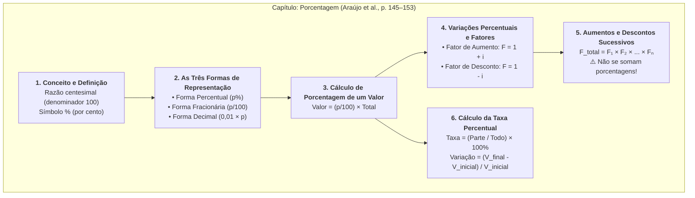
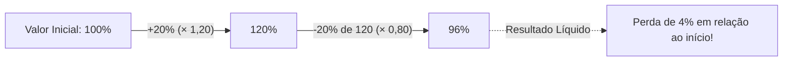

# 📖 Texto-base — Fundamentos de Matemática: Porcentagem

> **Referência:** ARAÚJO, Luciana M. M.; FERRAZ, Mariana S. A.; LOYO, Tiago et al. **Fundamentos de matemática**. Porto Alegre: Grupo A / SAGAH, 2018. (Capítulo: *"Porcentagem"*, p. 145–153).  
> **Link na Minha Biblioteca:** [Plataforma Minha Biblioteca (Página 144/145)](https://app.minhabiblioteca.com.br/reader/books/9788595027701/pageid/144)  
> **Disciplina:** Matemática Básica (`MMB002-EC-2026S2B2-T001`) — Semana 3  
> **Tema:** Equivalências e estratégias: modalidades de cálculo — Razão centesimal, cálculo de porcentagens, fatores multiplicativos, aumentos e descontos sucessivos  

---

## 🗺️ Mapa Conceitual do Capítulo



---

## 📌 1. Origem, Significado e Definição de Porcentagem

A palavra **porcentagem** (ou percentagem) provém do latim *per centum*, que significa literalmente "por cento" ou "a cada cem". 

Historicamente, o comércio romano já empregava cálculos de centésimos em cobranças de tributos e taxas de leilão. Com a expansão do comércio na Idade Média e Moderna, a expressão italiana *per cento* foi progressivamente abreviada em manuscritos mercantis até a consagração do símbolo **`%`**.

### 1.1. Definição Algébrica
Uma porcentagem é uma **razão centesimal**, isto é, uma razão cujo consequente (denominador) é igual a **$100$**:

$$p\% = \frac{p}{100}$$

Ao expressar que uma taxa é de $p\%$, estabelece-se que de cada conjunto de $100$ unidades do todo, consideram-se $p$ unidades.

---

## 📌 2. As Três Formas Equivalentes de Representação

De acordo com o texto de Araújo et al. (p. 146–147), toda informação percentual pode transitar de forma equivalente entre **três linguagens matemáticas fundamentais**:

```mermaid
flowchart LR
    A["Forma Percentual<br><b>p%</b>"] <-->|"÷ 100" / "× 100%"| B["Forma Decimal<br><b>i = p / 100</b>"]
    A <-->|"p / 100"| C["Forma Fracionária<br><b>p / 100 (irredutível)</b>"]
    B <-->|"Fração decimal"| C
```

| Forma Percentual ($p\%$) | Forma Fracionária ($\frac{p}{100}$) | Fração Irredutível | Forma Decimal ($i$) | Leitura / Significado Prático |
| :---: | :---: | :---: | :---: | :--- |
| $1\%$ | $\frac{1}{100}$ | $\frac{1}{100}$ | $0,01$ | Uma parte em cem |
| $5\%$ | $\frac{5}{100}$ | $\frac{1}{20}$ | $0,05$ | Uma parte em vinte |
| $10\%$ | $\frac{10}{100}$ | $\frac{1}{10}$ | $0,10$ | Um décimo do todo |
| $20\%$ | $\frac{20}{100}$ | $\frac{1}{5}$ | $0,20$ | Um quinto do todo |
| $25\%$ | $\frac{25}{100}$ | $\frac{1}{4}$ | $0,25$ | A quarta parte (um quarto) |
| $50\%$ | $\frac{50}{100}$ | $\frac{1}{2}$ | $0,50$ | A metade exata |
| $75\%$ | $\frac{75}{100}$ | $\frac{3}{4}$ | $0,75$ | Três quartos |
| $100\%$ | $\frac{100}{100}$ | $1$ | $1,00$ | A totalidade (o todo inteiro) |
| $120\%$ | $\frac{120}{100}$ | $\frac{6}{5}$ | $1,20$ | O todo mais um quinto |

> [!TIP]
> **Dica Operacional de Cálculo Mental:**  
> Converter a porcentagem em sua fração irredutível reduz consideravelmente o tempo de cálculo:
> * Calcular $50\%$ de $x \iff \text{dividir } x \text{ por } 2$.
> * Calcular $25\%$ de $x \iff \text{dividir } x \text{ por } 4$.
> * Calcular $20\%$ de $x \iff \text{dividir } x \text{ por } 5$.
> * Calcular $10\%$ de $x \iff \text{dividir } x \text{ por } 10$ (ou deslocar a vírgula 1 casa à esquerda).

---

## 📌 3. Como Calcular a Porcentagem de um Valor

Para calcular uma porcentagem $p\%$ sobre uma quantia base $V$, basta multiplicar a quantia pela taxa na forma fracionária ou decimal:

$$\text{Parte} = \frac{p}{100} \times V = i \times V$$

### Exemplos do Texto:
1. **Calcular $15\%$ de $\text{R\$} 280,00$:**
   $$\text{Valor} = 0,15 \times 280 = \frac{15}{100} \times 280 = \frac{4.200}{100} = \mathbf{\text{R\$} 42,00}$$

2. **Calcular $0,5\%$ de $\text{R\$} 4.000,00$:**
   * Atenção à forma decimal: $0,5\% = \frac{0,5}{100} = 0,005$.
   $$\text{Valor} = 0,005 \times 4.000 = \mathbf{\text{R\$} 20,00}$$

3. **Calcular $125\%$ de $80$:**
   * Porcentagens maiores que $100\%$ indicam um resultado estritamente superior ao valor base inicial.
   $$\text{Valor} = 1,25 \times 80 = \frac{5}{4} \times 80 = 5 \times 20 = \mathbf{100}$$

---

## 📌 4. Variações Percentuais: Fatores de Aumento e Desconto

O capítulo de Araújo et al. enfatiza o uso do **fator multiplicativo** ($F$), dispensando a necessidade de montar regras de três separadas para encontrar o valor final.

Seja $V_0$ o valor inicial e $i = \frac{p}{100}$ a taxa percentual unitária:

### 4.1. Fator de Aumento (Acréscimo)
Ao acrescentar $p\%$ a um valor inicial:

$$V_{\text{final}} = V_0 + (i \cdot V_0) = V_0 \cdot (1 + i)$$

$$\mathbf{F_{\text{aumento}} = 1 + i}$$

* **Exemplo:** Uma mercadoria de $\text{R\$} 450,00$ sofre um reajuste de $8\%$:
  * $i = 0,08 \implies F = 1 + 0,08 = 1,08$
  * $V_{\text{final}} = 450 \times 1,08 = \mathbf{\text{R\$} 486,00}$

### 4.2. Fator de Desconto (Decréscimo)
Ao subtrair $p\%$ de um valor inicial:

$$V_{\text{final}} = V_0 - (i \cdot V_0) = V_0 \cdot (1 - i)$$

$$\mathbf{F_{\text{desconto}} = 1 - i}$$

* **Exemplo:** Um produto de $\text{R\$} 320,00$ com desconto à vista de $15\%$:
  * $i = 0,15 \implies F = 1 - 0,15 = 0,85$
  * $V_{\text{final}} = 320 \times 0,85 = \mathbf{\text{R\$} 272,00}$

---

## 📌 5. Aumentos e Descontos Sucessivos

Um dos pontos mais críticos do texto-base (p. 149–151) é o estudo das variações sucessivas.

> [!CAUTION]
> **Princípio Fundamental:**  
> Porcentagens sucessivas **NUNCA devem ser somadas ou subtraídas diretamente**, pois cada nova porcentagem incide sobre uma base numérica modificada pela operação precedente.

### 5.1. Regra do Produto dos Fatores
Se um valor passa por sucessivas variações com taxas $i_1, i_2, \dots, i_n$, o fator multiplicativo total acumulado é o **produto dos fatores individuais**:

$$F_{\text{acumulado}} = F_1 \times F_2 \times \cdots \times F_n$$

A variação percentual total líquida é dada por:

$$i_{\text{total}} = F_{\text{acumulado}} - 1$$

---

### 5.2. Casos Clássicos Analisados no Texto

#### 🔹 Caso 1: Dois aumentos sucessivos de $10\%$
* $F_1 = 1 + 0,10 = 1,10$
* $F_2 = 1 + 0,10 = 1,10$
* $F_{\text{total}} = 1,10 \times 1,10 = 1,21$
* Taxa acumulada: $1,21 - 1 = +0,21 \implies \mathbf{+21\%}$ *(e não $+20\%$).*

#### 🔹 Caso 2: Dois descontos sucessivos de $10\%$
* $F_1 = 1 - 0,10 = 0,90$
* $F_2 = 1 - 0,10 = 0,90$
* $F_{\text{total}} = 0,90 \times 0,90 = 0,81$
* Taxa acumulada: $0,81 - 1 = -0,19 \implies \mathbf{-19\%}$ de desconto *(e não $-20\%$).*

#### 🔹 Caso 3: Aumento de $20\%$ seguido de desconto de $20\%$
* $F_1 = 1 + 0,20 = 1,20$
* $F_2 = 1 - 0,20 = 0,80$
* $F_{\text{total}} = 1,20 \times 0,80 = 0,96$
* Taxa acumulada: $0,96 - 1 = -0,04 \implies \mathbf{-4\%}$ *(Prejuízo de $4\%$ em relação ao preço inicial).*



---

## 📌 6. Determinação da Taxa Percentual e Variação Relativa

Frequentemente, o problema prático consiste em determinar qual foi a taxa percentual aplicada a partir dos valores inicial e final.

### 6.1. Qual a porcentagem que a parte representa do todo?
$$\text{Taxa } (\%) = \left( \frac{\text{Parte}}{\text{Todo}} \right) \times 100\%$$

* **Exemplo:** Em uma turma de 40 alunos de Engenharia, 14 já concluíram o curso técnico. Qual é essa porcentagem?
  $$\text{Taxa} = \frac{14}{40} \times 100\% = \frac{7}{20} \times 100\% = 7 \times 5\% = \mathbf{35\%}$$

### 6.2. Taxa de Variação Relativa ($\Delta\%$)
A taxa de variação entre um instante inicial $V_0$ e um instante final $V_f$:

$$\Delta\% = \left( \frac{V_f - V_0}{V_0} \right) \times 100\% = \left( \frac{V_f}{V_0} - 1 \right) \times 100\%$$

* **Exemplo:** O consumo de memória RAM de uma aplicação subiu de $250\text{ MB}$ para $310\text{ MB}$. Qual foi o aumento percentual?
  $$\Delta\% = \frac{310 - 250}{250} \times 100\% = \frac{60}{250} \times 100\% = \frac{6}{25} \times 100\% = 6 \times 4\% = \mathbf{+24\%}$$

---

## 📌 7. Recuperação da Base Inicial (Cálculo Reverso)

Quando se conhece o valor final $V_f$ resultante de uma variação percentual de taxa $i$, o valor inicial $V_0$ é obtido pela operação inversa da multiplicação pelo fator:

$$V_f = V_0 \cdot F \implies \mathbf{V_0 = \frac{V_f}{F}}$$

#### Exemplo Prático:
*Um funcionário recebeu seu salário reajustado em $12\%$, passando a ganhar $\text{R\$} 3.920,00$. Qual era o salário antes do reajuste?*

* **Fator de aumento:** $F = 1 + 0,12 = 1,12$
* **Cálculo da base original:**
  $$V_0 = \frac{3.920}{1,12} = \frac{3.920 \times 100}{112} = \mathbf{\text{R\$} 3.500,00}$$
* *(Verificação: $3.500 \times 0,12 = 420 \implies 3.500 + 420 = 3.920$)*.

---

## 📌 8. Síntese do Capítulo para Revisão Rápida

1. Porcentagem é uma fração centesimal ($p\% = \frac{p}{100}$).
2. Sempre podemos trabalhar diretamente com o decimal ($i = \frac{p}{100}$).
3. Aumentos usam fator $(1 + i)$; descontos usam fator $(1 - i)$.
4. Variações sucessivas multiplicam os fatores: $F_1 \times F_2 \times \cdots \times F_n$.
5. Para voltar ao valor de origem, divide-se pelo fator ($V_0 = \frac{V_f}{F}$).
