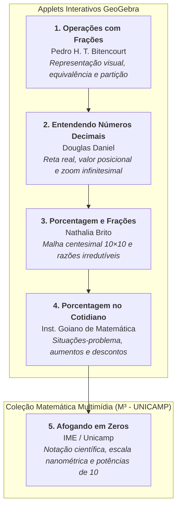
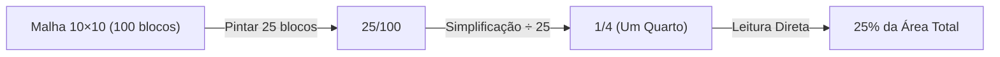

# 🌐 Material-base: Recursos Interativos (GeoGebra & M³ Unicamp)

> **Disciplina:** Matemática Básica (`MMB002-EC-2026S2B2-T001`) — Semana 3  
> **Tema:** Equivalências e estratégias: modalidades de cálculo (Frações, Decimais, Porcentagens e Notação Científica)  
> **Composição:** 4 Applets Interativos GeoGebra + 1 Recurso Multimídia M³ (IME/Unicamp)  

---

## 🗺️ Visão Integrada dos Recursos Interativos da Semana

---

## 🔹 Recurso 1: Operações com Frações (GeoGebra)

* **Autor:** Pedro Henrique da Trindade Bitencourt  
* **Link de Acesso:** [GeoGebra — Operações com Frações](https://www.geogebra.org/m/cb8scta4)  
* **Objetivo Pedagógico:** Explorar a geometria e a representação visual das operações fracionárias fundamentais.

### 1.1. Fundamentação Conceitual e Visual
O applet utiliza modelos de **barras retangulares particionadas** e **setores circulares** para desmistificar as regras mecânicas da aritmética fracionária:

1. **A Unidade e a Partição:**  
   A unidade é dividida em $b$ partes iguais congruentes. O numerador $a$ preenche $a$ dessas partes, definindo a fração $\frac{a}{b}$.
2. **Frações Equivalentes por Subdivisão:**  
   Ao deslizar os controles de escala, cada subdivisão pode ser novamente fatiada por um fator $k$, mostrando geometricamente por que:
   $$\frac{a}{b} = \frac{a \cdot k}{b \cdot k}$$
   A área sombreada permanece rigorosamente a mesma, embora descrita com um número maior de partes menores.
3. **Adição e Subtração com Denominadores Distintos:**  
   * Barras com denominadores diferentes (ex: $\frac{1}{2}$ e $\frac{1}{3}$) não podem ser somadas diretamente porque suas partes têm larguras diferentes.
   * O applet sobrepõe uma grade comum baseada no $\text{MMC}(2, 3) = 6$, subdividindo $\frac{1}{2}$ em $\frac{3}{6}$ e $\frac{1}{3}$ em $\frac{2}{6}$.
   * Agora com subdivisões de mesmo tamanho, a soma se torna imediata: $\frac{3 + 2}{6} = \frac{5}{6}$.
4. **Multiplicação como Interseção de Áreas:**  
   Ao multiplicar $\frac{a}{b} \times \frac{c}{d}$, o applet posiciona uma fração na horizontal e outra na vertical em um quadrado unitário, gerando uma malha com $b \times d$ retângulos menores, dos quais $a \times c$ correspondem à área de sobreposição.

---

## 🔹 Recurso 2: Entendendo Números Decimais (GeoGebra)

* **Autor:** Douglas Daniel  
* **Link de Acesso:** [GeoGebra — Entendendo Números Decimais](https://www.geogebra.org/m/wukttfzq)  
* **Objetivo Pedagógico:** Visualizar números decimais como pontos precisos na reta numérica contínua.

### 2.1. Princípios Demonstrados no Applet
1. **O Valor Posicional e a Decomposição Decimal:**  
   Cada casa após a vírgula corresponde a uma partição de ordem $10^{-k}$:
   $$N = d_0 + \frac{d_1}{10^1} + \frac{d_2}{10^2} + \frac{d_3}{10^3} + \cdots$$
2. **A Experiência do "Zoom Infinitesimal" na Reta Real:**  
   * Entre $0$ e $1$, a reta é dividida em $10$ décimos ($0,1; 0,2; \dots; 0,9$).
   * Dando zoom no intervalo $[0,3; 0,4]$, o applet revela $10$ centésimos ($0,31; 0,32; \dots; 0,39$).
   * Dando zoom no intervalo $[0,37; 0,38]$, surgem $10$ milésimos ($0,371; 0,372; \dots; 0,379$).
3. **Ordenação e Densidade:**  
   O recurso comprova visualmente a propriedade da **densidade dos números racionais**: entre quaisquer dois números decimais, por mais próximos que estejam, sempre existe uma infinidade de outros números decimais.

---

## 🔹 Recurso 3: Porcentagem e Frações, o que têm em comum? (GeoGebra)

* **Autora:** Nathalia Brito  
* **Link de Acesso:** [GeoGebra — Porcentagem e Frações](https://www.geogebra.org/m/y4pcuph9)  
* **Objetivo Pedagógico:** Construir o elo intuitivo e visual entre a porcentagem e as frações ordinárias simplificadas.

### 3.1. A Malha Centesimal ($10 \times 10$)
O aplicativo exibe uma malha quadrada padrão dividida em exatamente **$100$ quadradinhos unitários**:

### 3.2. Relações Visuais Chave no Applet

| Área Colorida (Quadradinhos) | Razão Centesimal | Fração Irredutível | Percentual Equivalente |
| :---: | :---: | :---: | :---: |
| $10$ de $100$ | $\frac{10}{100}$ | $\frac{1}{10}$ | $10\%$ |
| $20$ de $100$ | $\frac{20}{100}$ | $\frac{1}{5}$ | $20\%$ |
| $25$ de $100$ | $\frac{25}{100}$ | $\frac{1}{4}$ | $25\%$ |
| $50$ de $100$ | $\frac{50}{100}$ | $\frac{1}{2}$ | $50\%$ |
| $75$ de $100$ | $\frac{75}{100}$ | $\frac{3}{4}$ | $75\%$ |
| $100$ de $100$ | $\frac{100}{100}$ | $1$ | $100\%$ |

O estudante percebe concretamente que dizer "$25\%$ de um valor" é rigorosamente idêntico a "tomar a quarta parte ($\frac{1}{4}$) do valor".

---

## 🔹 Recurso 4: Porcentagem (Instituto Goiano de Matemática - GeoGebra)

* **Autor:** Instituto Goiano de Matemática (IGM)  
* **Link de Acesso:** [GeoGebra — Porcentagem (IGM)](https://www.geogebra.org/m/p8mfnm6c)  
* **Objetivo Pedagógico:** Explorar situações-problema interativas e a interpretação de gráficos percentuais.

### 4.1. Funcionalidades do Applet
1. **Simulador de Descontos e Acréscimos Comerciais:**  
   Permite manipular barras deslizantes para definir o preço de etiqueta e o percentual de desconto ou juros, calculando dinamicamente:
   * O valor absoluto do desconto/acréscimo ($\Delta V = i \times V_0$).
   * O preço final a pagar ($V_f = V_0 \cdot (1 \pm i)$).
2. **Gráfico de Setores ("Pizza"):**  
   Mostra como o ângulo central $\theta$ de cada setor de uma circunferência de $360^\circ$ é diretamente proporcional à porcentagem:
   $$\theta = \left( \frac{p}{100} \right) \times 360^\circ$$
   * $25\% \iff 90^\circ$
   * $50\% \iff 180^\circ$
   * $75\% \iff 270^\circ$

---

## 🔹 Recurso 5: Afogando em Zeros (M³ — IME / UNICAMP)

* **Instituição:** Universidade Estadual de Campinas (UNICAMP) — Instituto de Matemática, Estatística e Computação Científica (IME)  
* **Coleção:** Matemática Multimídia (M³) — Série: *Matemática na Escola*  
* **Link de Acesso:** [Portal M³ — Recurso 1045](https://m3.ime.unicamp.br/recursos/1045)  
* **Objetivo Pedagógico:** Demonstrar a necessidade prática da notação científica e das potências de 10 para lidar com escalas extremas (microscópicas e astronômicas) sem erros operacionais.

### 5.1. Sinopse e Enredo do Recurso
O vídeo narra a história de **Alana**, uma jovem roteirista que está escrevendo uma narrativa de ficção científica. Na história, o protagonista sofre uma redução fantástica de tamanho até dimensões moleculares e subatômicas.

Ao tentar redigir o roteiro, Alana entra em desespero ("afogando-se em zeros") diante de sequências intermináveis de casas decimais:
$$0,000000001\text{ metro}$$

O próprio personagem de ficção intervém e apresenta a ela a solução elegante concebida pela matemática e pela ciência: a **Notação Científica**.

### 5.2. Conceitos Matemáticos Formalizados no Recurso
1. **A Forma Padronizada:**  
   $$N = a \times 10^b \quad (1 \leq |a| < 10, \; b \in \mathbb{Z})$$
2. **Simplificação de Números Minúsculos:**  
   * $1\text{ nanômetro} = 0,000000001\text{ m} = \mathbf{1 \times 10^{-9}\text{ m}}$.
   * Raio de um átomo: $\approx 0,0000000001\text{ m} = \mathbf{1 \times 10^{-10}\text{ m}}$ ($1\text{ Ångström}$).
3. **Simplificação de Números Astronômicos:**  
   * Distância percorrida pela luz em um ano (Ano-luz):  
     $$9.460.000.000.000\text{ km} = \mathbf{9,46 \times 10^{12}\text{ km}}$$
4. **Vantagens Operacionais para a Computação e Engenharia:**  
   * **Prevenção de Erros de Digitação:** Em telas de terminal e cálculos manuscritos, contar dezenas de zeros leva inevitavelmente ao erro humano.
   * **Álgebra Simples de Expoentes:** Multiplicar duas grandezas minúsculas torna-se uma simples adição de expoentes inteiros:
     $$(2 \times 10^{-6}) \times (3 \times 10^{-4}) = 6 \times 10^{-6 + (-4)} = \mathbf{6 \times 10^{-10}}$$
   * **Ordens de Magnitude:** Permite comparar imediatamente qual grandeza domina um determinado fenômeno físico ou algorítmico.

---

## 📌 Síntese dos Recursos para Estudo e Fixação

| Recurso | Plataforma | Foco Principal | Conexão Prática |
| :--- | :---: | :--- | :--- |
| **Operações com Frações** | GeoGebra | Partição visual, MMC e equivalência | Aritmética racional exata |
| **Entendendo Números Decimais** | GeoGebra | Reta numérica e zoom infinitesimal | Representação contínua e precisão |
| **Porcentagem e Frações** | GeoGebra | Malha centesimal 10×10 | Conversão de taxas em frações |
| **Porcentagem (IGM)** | GeoGebra | Descontos, acréscimos e gráfico de pizza | Engenharia econômica e comércio |
| **Afogando em Zeros** | M³ Unicamp | Notação científica e potências de 10 | Escalas nanométricas e astronômicas |
