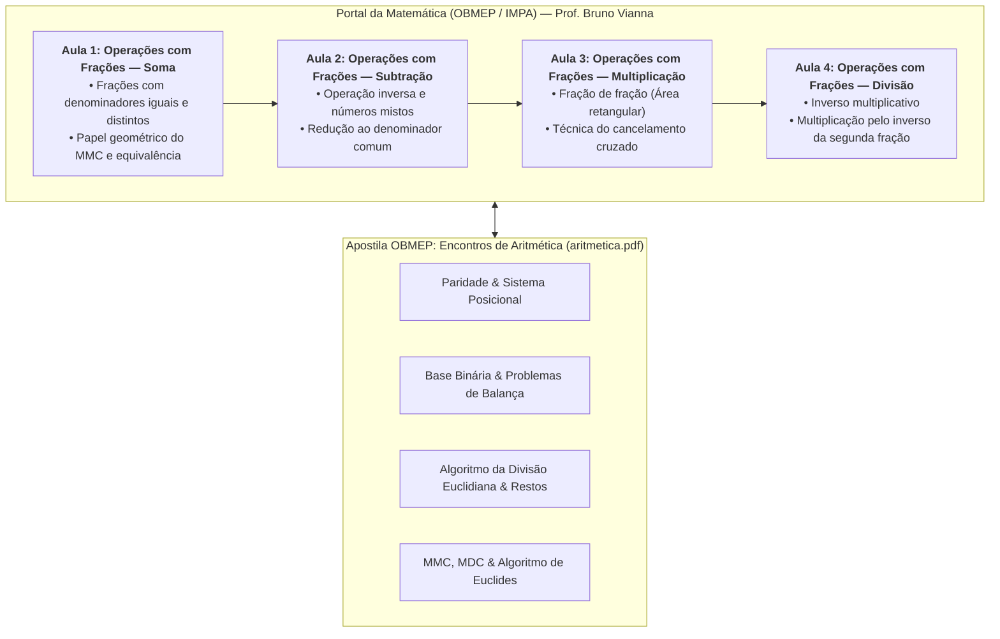

# 🔍 Aprofundando o Tema — Semana 3 (MMB002)

> **Disciplina:** Matemática Básica (`MMB002-EC-2026S2B2-T001`) — Semana 3  
> **Tema:** Equivalências e estratégias: modalidades de cálculo  
> **Conteúdo Principal:** Série de 4 Videoaulas do **Portal da Matemática (OBMEP / IMPA)** — Prof. Bruno Vianna  
> **Material de Apoio Complementar:** Apostila *Encontros de Aritmética* ([`aritmetica.pdf`](file:///home/henrique/Modelos/Univesp/2026S2B2/MMB002-Matematica-Basica/Semana-3/aritmetica.pdf)) — Luciana Cadar & Francisco Dutenhefner (IMPA)  

---

## 🗺️ Mapa Integrado de Aprofundamento

---

## 🎥 Videoaula 1: Operações com Frações — Adição (Soma)

* **Docente:** Prof. Bruno Vianna (Portal da Matemática — OBMEP / IMPA)  
* **Link da Aula:** [YouTube (8j2IXOiDh7U)](https://www.youtube.com/watch?v=8j2IXOiDh7U)  
* **Duração:** ~10 minutos  

### 1.1. Fundamentação Teórica
A adição de frações representa a união de partes fracionárias de um mesmo todo. 

1. **Caso Homogêneo (Denominadores Iguais):**  
   Como as partes têm o mesmo tamanho, somam-se diretamente as quantidades consideradas:
   $$\frac{a}{c} + \frac{b}{c} = \frac{a + b}{c}$$
2. **Caso Heterogêneo (Denominadores Distintos):**  
   Não se podem somar partes de tamanhos desiguais. É imperativo convertê-las previamente em frações equivalentes que possuam um denominador comum.
   * O menor denominador comum eficiente é o **Mínimo Múltiplo Comum (MMC)** dos denominadores:
     $$\frac{a}{b} + \frac{c}{d} = \frac{\frac{M}{b} \cdot a + \frac{M}{d} \cdot c}{M}, \quad \text{onde } M = \text{MMC}(b, d)$$

### 1.2. Exemplo Típico da Aula
Calcular $\frac{2}{3} + \frac{1}{4}$:
* $\text{MMC}(3, 4) = 12$
* Frações equivalentes: $\frac{2 \times 4}{3 \times 4} = \frac{8}{12}$ e $\frac{1 \times 3}{4 \times 3} = \frac{3}{12}$
* Soma:
  $$\frac{8}{12} + \frac{3}{12} = \mathbf{\frac{11}{12}}$$

---

## 🎥 Videoaula 2: Operações com Frações — Subtração

* **Docente:** Prof. Bruno Vianna (Portal da Matemática — OBMEP / IMPA)  
* **Link da Aula:** [YouTube (OGhzT-sHRj0)](https://www.youtube.com/watch?v=OGhzT-sHRj0)  
* **Duração:** ~9 minutos  

### 2.1. Fundamentação Teórica
A subtração de frações é a operação inversa da adição, medindo a diferença ou o que resta de uma quantidade após a retirada de uma parte:

$$\frac{a}{c} - \frac{b}{c} = \frac{a - b}{c}$$

### 2.2. Subtração Envolvendo Inteiros e Números Mistos
Quando a operação envolve números inteiros, expressa-se o inteiro como uma fração de mesmo denominador:
$$k - \frac{a}{b} = \frac{k \cdot b}{b} - \frac{a}{b} = \frac{k \cdot b - a}{b}$$

* **Exemplo:** $1 - \frac{3}{7} = \frac{7}{7} - \frac{3}{7} = \mathbf{\frac{4}{7}}$.

### 2.3. Exemplo Heterogêneo da Aula
Calcular $\frac{5}{6} - \frac{3}{8}$:
* $\text{MMC}(6, 8) = 24$
* $24 \div 6 = 4 \implies 4 \times 5 = 20 \implies \frac{20}{24}$
* $24 \div 8 = 3 \implies 3 \times 3 = 9 \implies \frac{9}{24}$
* Subtração:
  $$\frac{20 - 9}{24} = \mathbf{\frac{11}{24}}$$

---

## 🎥 Videoaula 3: Operações com Frações — Multiplicação

* **Docente:** Prof. Bruno Vianna (Portal da Matemática — OBMEP / IMPA)  
* **Link da Aula:** [YouTube (kJlDFhg4ZBQ)](https://www.youtube.com/watch?v=kJlDFhg4ZBQ)  
* **Duração:** ~11 minutos  

### 3.1. O Significado de Multiplicar Frações
Multiplicar uma fração $\frac{a}{b}$ por $\frac{c}{d}$ equivale a calcular **uma fração de outra fração** ($\frac{a}{b}$ de $\frac{c}{d}$):

$$\frac{a}{b} \times \frac{c}{d} = \frac{a \times c}{b \times d}$$

Geometricamente, se dividirmos a base de um retângulo unitário em $b$ partes e a altura em $d$ partes, a área hachurada de $a$ partes por $c$ partes corresponde a $\frac{a \cdot c}{b \cdot d}$ da área total.

### 3.2. A Técnica Fundamental do Cancelamento Cruzado
O professor Bruno Vianna demonstra a enorme vantagem de simplificar fatores comuns entre numeradores e denominadores **antes** de efetuar os produtos:

$$\frac{15}{28} \times \frac{14}{25} = \frac{\cancel{15}^3}{\cancel{28}^2} \times \frac{\cancel{14}^1}{\cancel{25}^5} = \frac{3 \times 1}{2 \times 5} = \mathbf{\frac{3}{10}}$$
*(Evita ter que multiplicar $15 \times 14 = 210$ e $28 \times 25 = 700$ para depois simplificar).*

---

## 🎥 Videoaula 4: Operações com Frações — Divisão

* **Docente:** Prof. Bruno Vianna (Portal da Matemática — OBMEP / IMPA)  
* **Link da Aula:** [YouTube (xJeIS-nY1U4)](https://www.youtube.com/watch?v=xJeIS-nY1U4)  
* **Duração:** ~12 minutos  

### 4.1. O Princípio do Inverso Multiplicativo
O inverso multiplicativo de um número racional não nulo $\frac{c}{d}$ é $\frac{d}{c}$, pois o produto entre eles é o elemento neutro da multiplicação:
$$\frac{c}{d} \times \frac{d}{c} = 1$$

### 4.2. Por que "conserva a primeira e multiplica pelo inverso da segunda"?
A regra tradicional não é mágica, mas uma propriedade algébrica rigorosa. Representando a divisão como uma fração complexa:

$$\frac{\frac{a}{b}}{\frac{c}{d}}$$

Multiplicando o numerador e o denominador da fração maior pelo inverso do denominador ($\frac{d}{c}$):

$$\frac{\frac{a}{b} \times \frac{d}{c}}{\frac{c}{d} \times \frac{d}{c}} = \frac{\frac{a}{b} \times \frac{d}{c}}{1} = \mathbf{\frac{a}{b} \times \frac{d}{c}}$$

### 4.3. Exemplo Prático Resolvido
Calcular $\frac{7}{10} \div \frac{14}{15}$:
$$\frac{7}{10} \times \frac{15}{14} = \frac{\cancel{7}^1}{\cancel{10}^2} \times \frac{\cancel{15}^3}{\cancel{14}^2} = \frac{1 \times 3}{2 \times 2} = \mathbf{\frac{3}{4}}$$

---

## 📚 Conexão com a Apostila OBMEP: [`aritmetica.pdf`](file:///home/henrique/Modelos/Univesp/2026S2B2/MMB002-Matematica-Basica/Semana-3/aritmetica.pdf)

A apostila oficial da OBMEP presente nesta pasta (*Encontros de Aritmética*, Cadar & Dutenhefner, IMPA, 2015, 121 páginas) aprofunda os pilares fundamentais da aritmética:
* **Encontro 1 (p. 1–26):** Paridade, sistema posicional decimal e potências na base binária (pesagens com balanças e adivinhações por cartelas binárias).
* **Encontro 2 (p. 27–62):** Divisão Euclidiana ($a = bq + r$), fenômenos periódicos, aritmética modular dos restos e critérios de divisibilidade.
* **Encontro 3 (p. 63–90):** Conceitos de MDC e MMC, problemas contextualizados de engrenagens e encontros periódicos, cálculo por fatoração simultânea.
* **Encontro 4 (p. 91–111):** Algoritmo de Euclides para o MDC por subtrações e divisões sucessivas, acelerando cálculos sem necessidade de fatoração completa:
  $$\text{MDC}(a, b) = \text{MDC}(a, r), \quad \text{onde } r = b \pmod a$$
  E a relação fundamental:
  $$\text{MDC}(a, b) \times \text{MMC}(a, b) = a \times b$$
