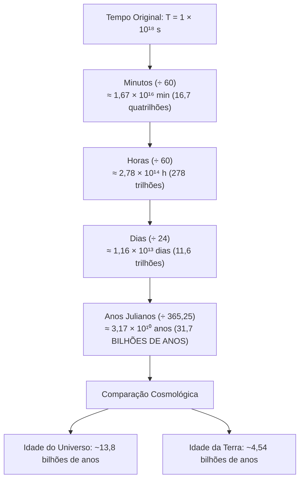

# 💬 Fórum Temático — Semana 3 (MMB002)

> **Disciplina:** Matemática Básica (`MMB002-EC-2026S2B2-T001`)  
> **Tema da Semana 3:** Equivalências e estratégias: modalidades de cálculo  
> **Objeto de Discussão:** Desafio da Semana — O Relógio Atômico e a Notação Científica (Halliday, Resnick & Walker)  

---

## 💡 O Desafio da Semana: O Relógio Atômico e a Notação Científica

### 📄 Enunciado Oficial do Desafio
> *"Os relógios atômicos são tão estáveis que, em princípio, dois relógios de césio (relógio atômico baseado na diferença de energia entre dois estados do núcleo de césio-133) teriam que funcionar por 6.000 anos para que a diferença entre suas leituras fosse maior que 1s. Mesmo assim, essa precisão não é nada em comparação com a dos relógios que estão sendo desenvolvidos atualmente, que pode chegar a uma parte em $10^{18}$, ou seja, $1\text{ s}$ em $1 \times 10^{18}\text{ s}$."*  
> — **HALLIDAY, D.; RESNICK, R.; WALKER, J.** *Fundamentos de Física*. 8. ed., v. 2. Rio de Janeiro: LTC, 2008. p. 7.
> 
> **Questões Propostas:**
> 1. O texto apresenta uma quantidade de tempo expressa em notação científica: **$T = 1 \times 10^{18}\text{ s}$**.
> 2. Essa quantidade representa muito ou pouco tempo?
> 3. Converta essa grandeza para unidades do cotidiano: **minutos, horas, dias e anos**.

---

## 🧮 Resolução Analítica e Conversão de Unidades

### 1. Fatores de Conversão Padronizados
* $1\text{ min} = 60\text{ s} = 6,0 \times 10^1\text{ s}$
* $1\text{ h} = 3.600\text{ s} = 3,6 \times 10^3\text{ s}$
* $1\text{ dia} = 86.400\text{ s} = 8,64 \times 10^4\text{ s}$
* $1\text{ ano juliano médio} = 365,25\text{ dias} = 31.557.600\text{ s} \approx 3,15576 \times 10^7\text{ s}$

---

### 2. Conversões Passo a Passo
1. **Minutos:**  
   $$T_{\text{min}} = \frac{1 \times 10^{18}}{60} \approx \mathbf{1,67 \times 10^{16}\text{ minutos}}$$
2. **Horas:**  
   $$T_{\text{h}} = \frac{1 \times 10^{18}}{3.600} \approx \mathbf{2,78 \times 10^{14}\text{ horas}}$$
3. **Dias:**  
   $$T_{\text{dias}} = \frac{1 \times 10^{18}}{86.400} \approx \mathbf{1,16 \times 10^{13}\text{ dias}}$$
4. **Anos Julianos:**  
   $$T_{\text{anos}} = \frac{1 \times 10^{18}}{3,15576 \times 10^7} \approx \mathbf{3,17 \times 10^{10}\text{ anos}} \quad \text{(31,7 bilhões de anos)}$$

---

### 3. Conclusão e Dimensão Cosmológica
* Idade estimada do Universo: $\approx 13,8\text{ bilhões de anos}$ ($1,38 \times 10^{10}\text{ anos}$).
* Razão:
  $$\frac{3,17 \times 10^{10}}{1,38 \times 10^{10}} \approx \mathbf{2,30}$$

> [!IMPORTANT]
> A quantidade $1 \times 10^{18}\text{ s}$ é **colossalmente gigantesca**. O relógio atômico de rede óptica atrasaria ou adiantaria apenas 1 segundo se funcionasse continuamente por **mais que o dobro de todo o tempo decorrido desde o Big Bang**!

---

## 💬 Enunciado Oficial do Fórum Temático (AVA)

> *"Você viu no Desafio desta semana um contexto que envolvia os relógios atômicos. Você saberia apresentar um outro exemplo da realidade em que o uso da notação científica seja conveniente?"*

---

## 📝 Modelos Prontos de Postagem para o AVA

Abaixo estão opções completas de contribuição para o fórum da disciplina:

---

### 📌 Opção 1 (Recomendada — Foco em Engenharia de Computação e Microeletrônica)

> **Título:** A Notação Científica na Microeletrônica: Da Escala Nanométrica dos Transistores ao Ciclo de Clock dos Processadores
>
> Olá, professora Rúbia, mediadores e colegas de turma!
>
> O Desafio da Semana nos apresentou uma grandeza astronômica com expoente positivo ($1 \times 10^{18}\text{ s}$ no relógio atômico). No entanto, um exemplo igualmente fascinante da nossa realidade — no extremo oposto das grandezas microscópicas — ocorre na **Arquitetura de Computadores e Microeletrônica**.
>
> Em nossos computadores e smartphones, os processadores modernos possuem bilhões de transistores gravados em escalas de **nanômetros**:
>
> 1. **Dimensão física dos transistores:**
>    * Um processo de litografia moderno de $3\text{ nm}$ equivale a:
>      $$3\text{ nm} = 3 \times 10^{-9}\text{ m} = 0,000000003\text{ m}$$
>
> 2. **Período de clock de um processador:**
>    * Um processador operando com frequência de $4\text{ GHz}$ ($4 \times 10^9\text{ ciclos/segundo}$) executa cada ciclo elementar em um intervalo de tempo $T$:
>      $$T = \frac{1}{f} = \frac{1}{4 \times 10^9\text{ s}^{-1}} = 0,25 \times 10^{-9}\text{ s} = \mathbf{2,5 \times 10^{-10}\text{ s}} \quad (0,25\text{ nanossegundos})$$
>    * Em notação decimal comum, teríamos que escrever $0,00000000025\text{ segundos}$.
>
> 3. **Carga elementar do elétron:**
>    * O fluxo de corrente nesses circuitos é governado pela carga de cada elétron:
>      $$e \approx 1,602 \times 10^{-19}\text{ C}$$
>
> **Por que a notação científica é indispensável aqui?**  
> Tentar projetar circuitos lógicos, calcular capacitâncias parasitas e tempos de propagação de sinal utilizando a representação decimal clássica geraria um risco imenso de erros causados pela simples omissão ou acréscimo acidental de um zero ("afogando em zeros", como vimos no material da Unicamp!). A notação científica compacta a informação, simplifica operações de multiplicação e divisão pelas propriedades de potências ($10^a \cdot 10^b = 10^{a+b}$) e viabiliza toda a engenharia de semicondutores moderna.
>
> Um abraço e bons estudos a todos!

### 📌 Opção 2 (Física Nuclear: Decaimento Radioativo, Meia-Vida e Datação Geológica)

> **Título:** A Notação Científica no Decaimento Radioativo: Das Frações de Segundo aos Bilhões de Anos de Meia-Vida
>
> Olá, professora Rúbia, mediadores e colegas de turma!
>
> Um exemplo extraordinário da conveniência da notação científica na realidade da física e da geologia é o **decaimento radioativo de elementos atômicos** e a determinação de sua **meia-vida** ($t_{1/2}$) — o tempo necessário para que metade dos núcleos instáveis de uma amostra se desintegre.
>
> Os isótopos radioativos apresentam meias-vidas com ordens de grandeza que variam drasticamente:
>
> 1. **Datação de rochas e meteoritos (idades astronômicas):**
>    * O **Urânio-238** ($^{238}\text{U}$) possui uma meia-vida de cerca de **$4,47 \times 10^9\text{ anos}$** ($4.470.000.000\text{ anos}$), sendo fundamental para determinar que a idade da Terra é de aproximadamente $4,54 \times 10^9\text{ anos}$.
> 
> 2. **Datação arqueológica de fósseis orgânicos:**
>    * O **Carbono-14** ($^{14}\text{C}$) possui meia-vida de **$5,73 \times 10^3\text{ anos}$** ($5.730\text{ anos}$), permitindo datar artefatos históricos com precisão.
>
> 3. **Medicina nuclear e diagnóstico:**
>    * O **Tecnécio-99m** ($^{99\text{m}}\text{Tc}$), amplamente usado em cintilografias, tem meia-vida de apenas $6\text{ horas} \approx \mathbf{2,16 \times 10^4\text{ s}}$.
>
> 4. **Isótopos superpesados instáveis:**
>    * Elementos sintetizados em aceleradores de partículas decaem em frações mínimas de tempo, como o **Polônio-214** ($^{214}\text{Po}$), com meia-vida de **$1,64 \times 10^{-4}\text{ s}$** ($0,000164\text{ s}$).
>
> **Por que a notação científica é fundamental no decaimento?**  
> Na equação de desintegração radioativa $N(t) = N_0 \cdot e^{-\lambda t}$, o número inicial de átomos em apenas 1 grama de uma substância é da ordem de $10^{21}$ a $10^{23}$ átomos (devido à constante de Avogadro, $6,022 \times 10^{23}$). Após sucessivos decaimentos, medimos frações minúsculas da amostra remanescente. Manipular números na casa dos bilhões ($10^9$) e décimos de milésimos de segundo ($10^{-4}$) em uma mesma formulação só é viável, prático e livre de erros graças à notação científica e às leis de potências de base 10.
>
> Bons estudos a todos!

#### ⚡ Versão Resumida da Opção 2 (Texto Puro / Formatado para o editor do AVA sem LaTeX):

> **Título:** A Notação Científica no Decaimento Radioativo e Meia-Vida dos Elementos
>
> Olá, professora Rúbia, mediadores e colegas de turma!
>
> Um exemplo prático e essencial da notação científica na realidade é o estudo do **decaimento radioativo** e da **meia-vida (t½)** dos elementos atômicos. 
>
> A notação científica é indispensável aqui porque as escalas temporais variam drasticamente entre os isótopos:
> * **Datação Geológica (Planeta Terra):** O Urânio-238 (U-238) tem meia-vida de cerca de 4,47 × 10⁹ anos (~4,47 bilhões de anos), permitindo datar rochas e estimar a própria idade da Terra.
> * **Datação Arqueológica (Fósseis e Artefatos):** O Carbono-14 (C-14) possui meia-vida de 5,73 × 10³ anos (5.730 anos), fundamental para a datação precisa de materiais orgânicos históricos.
> * **Física Nuclear e Elementos Instáveis:** Certos núcleos pesados decaem em frações mínimas de tempo, como o Polônio-214 (Po-214), cuja meia-vida é de apenas 1,64 × 10⁻⁴ segundos (0,000164 s).
>
> **Por que a notação científica é fundamental?**  
> Operar com grandezas que vão de bilhões de anos (10⁹) até décimos de milésimos de segundo (10⁻⁴) em um mesmo cálculo seria inviável na forma decimal comum. A notação científica compacta os valores, elimina o risco de erros na contagem de zeros e viabiliza operações diretas usando as propriedades de potências de base 10.
>
> Bons estudos a todos!

---

### 📌 Opção 3 (Foco em Telecomunicações e Exploração Espacial)

> **Título:** A Notação Científica na Comunicação com Sondas Espaciais Interplanetárias
>
> Olá a todos!
>
> Um exemplo muito claro e prático do cotidiano da ciência onde a notação científica é vital está nas **telecomunicações espaciais**.
>
> Ao nos comunicarmos com sondas em outros planetas, lidamos com distâncias imensas:
> * A distância média da Terra ao Sol é de aproximadamente **$1,496 \times 10^8\text{ km}$** ($1,496 \times 10^{11}\text{ m}$).
> * A velocidade de propagação das ondas de rádio (velocidade da luz) é de cerca de **$3,0 \times 10^8\text{ m/s}$**.
>
> Para calcular o tempo que um comando enviado da Terra leva para chegar ao robô *Perseverance* em Marte (quando Marte está a cerca de $2,25 \times 10^{11}\text{ m}$ da Terra), fazemos uma divisão direta com as potências de base 10:
> $$t = \frac{\Delta s}{v} = \frac{2,25 \times 10^{11}\text{ m}}{3,0 \times 10^8\text{ m/s}} = \left(\frac{2,25}{3,0}\right) \times 10^{11-8} = 0,75 \times 10^3 = \mathbf{7,5 \times 10^2\text{ s}} = 750\text{ s} \quad (\approx 12,5\text{ minutos})$$
>
> Sem a notação científica, operar com números cheios de zeros como $225.000.000.000\text{ m}$ e $300.000.000\text{ m/s}$ tornaria os cálculos manuais ou de programação propensos a falhas críticas de precisão e transbordo (overflow).

---

### 📌 Opção 4 (Modelo Conciso e Direto — Medicina / Farmacologia)

> **Título:** O Uso da Notação Científica na Medicina e Farmacologia
>
> Olá, professora e colegas!
>
> Além dos relógios atômicos e da física quântica, um contexto prático muito próximo de nós é a **microbiologia e farmacologia**.
>
> Na dosagem de medicamentos e na contagem de microrganismos:
> * A massa de certas moléculas ativas ou hormônios em exames de sangue é expressa na ordem de picogramas ($1\text{ pg} = 1 \times 10^{-12}\text{ g}$).
> * A concentração de vírus em uma amostra (carga viral) pode variar rapidamente de menos de $2 \times 10^1\text{ cópias/mL}$ até valores superiores a $1 \times 10^7\text{ cópias/mL}$.
>
> O uso da notação científica permite aos profissionais de saúde comparar ordens de grandeza imediatas (apenas observando o expoente) e dosar medicamentos sem riscos de confusão entre miligramas ($10^{-3}\text{ g}$), microgramas ($10^{-6}\text{ g}$) e nanogramas ($10^{-9}\text{ g}$).

---

### 📌 Opção 4: Modelo de Réplica para Colegas do Fórum

> Olá, [Nome do Colega]!
>
> Excelente exemplo! Concordo totalmente com a sua colocação.  
> O ponto crucial da notação científica é justamente nos permitir enxergar imediatamente a **ordem de grandeza** do fenômeno através do expoente da base 10, poupando o cérebro de contar dígitos e permitindo que as quatro operações básicas sejam realizadas com propriedades elementares de potências.  
> Parabéns pela clareza na exposição!
