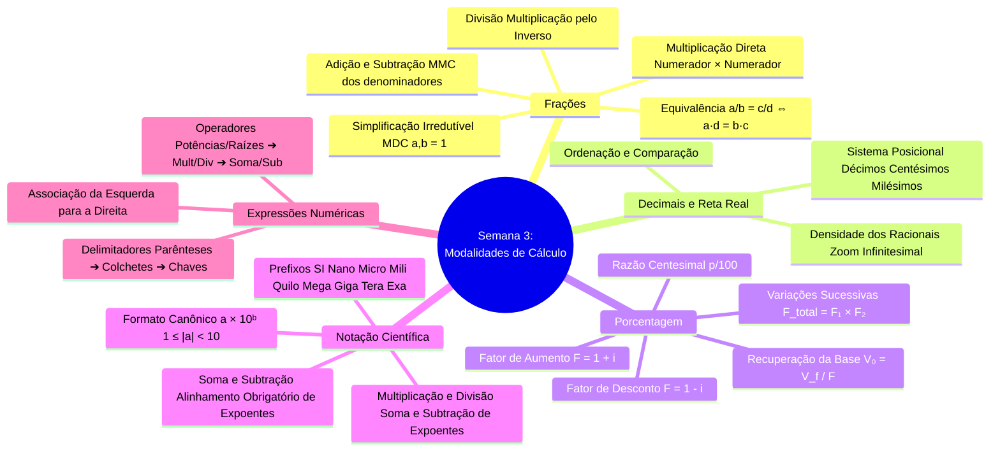

# 📑 Em Síntese — Resumo Executivo da Semana 3 (MMB002)

> **Disciplina:** Matemática Básica (`MMB002-EC-2026S2B2-T001`)  
> **Tema da Semana 3:** Equivalências e estratégias: modalidades de cálculo  
> **Docente Responsável:** Profª Dra. Rúbia Barcelos Amaral  
> **Período:** 12/10/2026 a 25/10/2026  
> **Desempenho na Avaliação:** 🏆 **10,0 / 10,0 (100% de aproveitamento)**  

---

## 🗺️ Mapa Mental Integrado da Semana 3

---

## 📊 1. Quadro de Equivalências Canônicas

| Forma Fracionária Irredutível | Razão Centesimal | Forma Decimal ($i$) | Forma Percentual ($p\%$) |
| :---: | :---: | :---: | :---: |
| $\frac{1}{10}$ | $\frac{10}{100}$ | $0,10$ | $10\%$ |
| $\frac{1}{5}$ | $\frac{20}{100}$ | $0,20$ | $20\%$ |
| $\frac{1}{4}$ | $\frac{25}{100}$ | $0,25$ | $25\%$ |
| $\frac{3}{8}$ | $\frac{37,5}{100}$ | $0,375$ | $37,5\%$ |
| $\frac{1}{2}$ | $\frac{50}{100}$ | $0,50$ | $50\%$ |
| $\frac{3}{5}$ | $\frac{60}{100}$ | $0,60$ | $60\%$ |
| $\frac{3}{4}$ | $\frac{75}{100}$ | $0,75$ | $75\%$ |
| $1$ | $\frac{100}{100}$ | $1,00$ | $100\%$ |

---

## ⚙️ 2. Fórmulas e Regras Operatórias Essenciais

### 2.1. Aritmética de Frações
* **Adição/Subtração:** $\frac{a}{b} \pm \frac{c}{d} = \frac{\frac{M}{b}a \pm \frac{M}{d}c}{M}$, com $M = \text{MMC}(b, d)$.
* **Multiplicação:** $\frac{a}{b} \times \frac{c}{d} = \frac{a \cdot c}{b \cdot d}$.
* **Divisão:** $\frac{a}{b} \div \frac{c}{d} = \frac{a}{b} \times \frac{d}{c} = \frac{a \cdot d}{b \cdot c}$.

### 2.2. Porcentagem e Fatores Multiplicativos
* **Acréscimo:** $V_f = V_0 \cdot (1 + i)$.
* **Desconto:** $V_f = V_0 \cdot (1 - i)$.
* **Sucessivos:** $F_{\text{total}} = F_1 \times F_2 \times \cdots \times F_n$ *(taxas não se somam diretamente!)*.
* **Recuperação de Base:** $V_0 = \frac{V_f}{F}$.

### 2.3. Notação Científica
* **Forma:** $N = a \times 10^b \quad (1 \leq |a| < 10, \; b \in \mathbb{Z})$.
* **Produto:** $(a_1 \times 10^{b_1}) \times (a_2 \times 10^{b_2}) = (a_1 \cdot a_2) \times 10^{b_1 + b_2}$.
* **Quociente:** $\frac{a_1 \times 10^{b_1}}{a_2 \times 10^{b_2}} = \left(\frac{a_1}{a_2}\right) \times 10^{b_1 - b_2}$.
* **Adição/Subtração:** Exige alinhamento prévio ao mesmo expoente.

### 2.4. Expressões Numéricas
* **Delimitadores:** `( )` $\to$ `[ ]` $\to$ `{ }`.
* **Operadores:** Potências/Raízes $\to$ Multiplicações/Divisões $\to$ Adições/Subtrações (da esquerda para a direita).

---

## 🔮 Conexão com a Semana 4: O que vem a seguir?

Na **Semana 4**, construiremos sobre a base de frações e equivalências para dominar:
* **Razão e Proporção:** Definição formal, constantes de proporcionalidade, grandezas direta e inversamente proporcionais.
* **Regra de Três Simples e Composta:** Aplicação algorítmica para resolução de problemas de engenharia e modelagem.
* **Linguagem Matemática e Escalas:** Conversão geométrica e interpretação de plantas e mapas.
