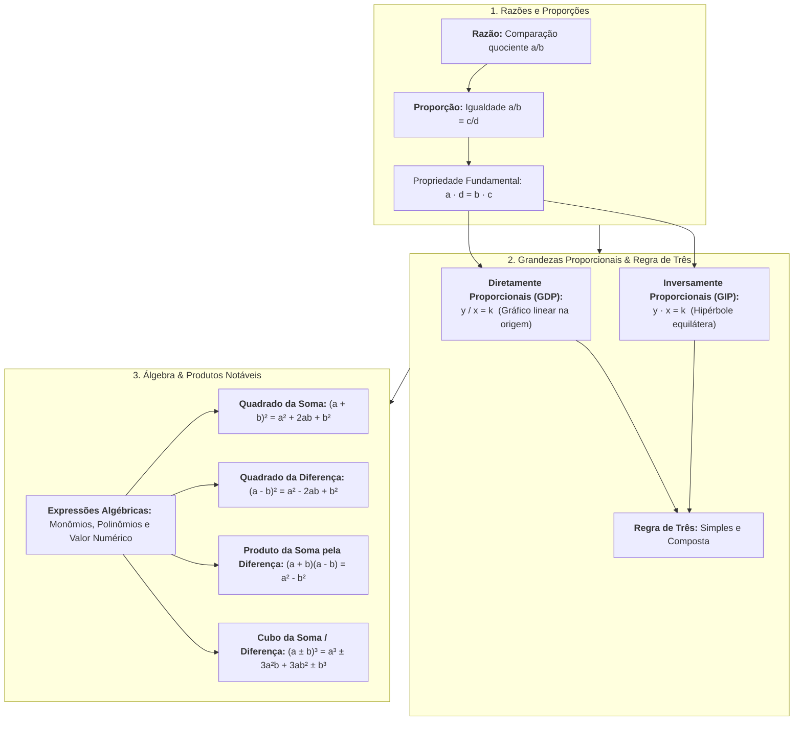

# 📌 Semana 4 — Início & Apresentação da Semana

> **Disciplina:** Matemática Básica (`MMB002-EC-2026S2B2-T001`)  
> **Tema da Semana 4:** Proporcionalidade, Representação e Linguagem Matemática  
> **Docente Responsável:** Profª Dra. Rúbia Barcelos Amaral  
> **Período:** 19/10/2026 a 01/11/2026  
> **Status:** 🟢 **Documentação Oficial e Resolução do Desafio**  

---

## 👩‍🏫 Mensagem da Professora & Contextualização

Olá, estudante!

Nesta semana, exploraremos conceitos fundamentais que são a base para uma compreensão sólida da matemática. A **proporcionalidade** é uma ideia central em muitos aspectos da vida cotidiana e das ciências, e entender como as quantidades se relacionam entre si é essencial para resolver uma variedade de problemas.

Além disso, exploraremos as **expressões algébricas**, que são ferramentas poderosas para descrever padrões e relações matemáticas de forma geral. Tratando-se de cálculos algébricos, estudaremos também os **produtos notáveis**, que são algumas expressões representadas por produtos de expressões algébricas, que aparecem com muita frequência quando estamos lidando com conceitos matemáticos.

Ao final desta semana, você estará mais confiante em suas habilidades matemáticas e pronto(a) para enfrentar desafios mais complexos.

Vamos lá?!

---

## 🗺️ Mapa Conceitual da Semana 4

---

## 🎯 Objetivos de Aprendizagem

Ao final desta semana, você deverá ser capaz de:

* [ ] **Compreender** os conceitos de razão, proporção e propriedades fundamentais.
* [ ] **Aplicar** conceitos de razão e proporção na resolução de problemas práticos e contextualizados (taxas, escalas, velocidade e densidade).
* [ ] **Identificar e calcular** grandezas diretamente e inversamente proporcionais por meio da regra de três simples e composta.
* [ ] **Compreender** o significado estrutural de expressões algébricas, coeficientes, partes literais e valor numérico.
* [ ] **Dominar e aplicar** os principais produtos notáveis e fatorações algébricas para simplificação de modelos matemáticos.

---

## 💡 Desafio da Semana: O Aumento da Expectativa de Vida

### 📌 Enunciado Oficial (Adaptado: ENEM 2020)
> *Historicamente, é comum observarmos que a expectativa de vida do brasileiro tem aumentado.*  
> 
> *Pesquisas recentes indicam que a expectativa de vida do brasileiro subiu de **74,6 anos**, em 2012, para **74,9 anos**, em 2015. A melhoria do sistema de saúde, o aumento da renda familiar, a mudança de hábitos alimentares, a prática de exercícios físicos, dentre outros, são possíveis fatores para esse aumento.*  
> 
> *Para representar o aumento da expectativa de vida do brasileiro, converteu-se esse aumento para a quantidade de dias. Considere que, para essa conversão, o número de dias em cada mês foi fixado em **30**.*  
> 
> *A partir dessas informações:*  
> *1. Que cálculo correspondeu à conversão?*  
> *2. Que outros fatores você aponta que contribuíram para esse aumento?*  
> 
> *Discuta sobre esse tema no Fórum Temático desta semana!*

---

### 🧮 Resolução Matemática Passo a Passo

#### 1. Cálculo da Variação em Anos ($\Delta E$)
A variação da expectativa de vida entre os anos de 2012 e 2015 foi de:
$$\Delta E = E_{2015} - E_{2012} = 74,9 - 74,6 = 0,3 \text{ ano}$$

#### 2. Modelagem da Taxa de Conversão Temporal
O enunciado padroniza as constantes de calendário comercial:
* $1 \text{ mês} = 30 \text{ dias}$
* Como $1 \text{ ano} = 12 \text{ meses}$, a quantidade de dias por ano convencional é:
  $$1 \text{ ano} = 12 \times 30 = 360 \text{ dias}$$

#### 3. Expressão do Cálculo de Conversão
Podemos expressar o cálculo que correspondeu à conversão por três vias equivalentes:

* **Método 1 (Multiplicação Direta pela Taxa de Dias do Ano):**
  $$\text{Dias} = \Delta E \times 360 = 0,3 \times 360 = 108 \text{ dias}$$

* **Método 2 (Passagem por Meses):**
  $$\text{Meses} = 0,3 \times 12 = 3,6 \text{ meses}$$
  $$\text{Dias} = 3,6 \times 30 = 108 \text{ dias}$$

* **Método 3 (Decomposição Fracionária):**
  $$\Delta E = \frac{3}{10} \text{ de ano} \implies \text{Dias} = \frac{3}{10} \times (12 \times 30) = \frac{3}{10} \times 360 = 3 \times 36 = 108 \text{ dias}$$

* **Decomposição em Meses e Dias Inteiros:**
  $$3,6 \text{ meses} = 3 \text{ meses inteiros} + 0,6 \text{ mês}$$
  * $3 \text{ meses} = 3 \times 30 = 90 \text{ dias}$
  * $0,6 \text{ mês} = 0,6 \times 30 = 18 \text{ dias}$
  * Total: $90 + 18 = 108 \text{ dias}$

$$\boxed{\text{O aumento correspondeu a exatamente } 108 \text{ dias (ou } 3 \text{ meses e } 18 \text{ dias)}}.$$

---

### 🏥 Fatores Determinantes para o Aumento da Longevidade

Além dos fatores citados no enunciado (saúde, renda, alimentação e atividade física), destacam-se:

1. **Saneamento Básico e Universalização da Água Tratada:** Redução drástica da mortalidade infantil e de doenças de veiculação hídrica gastrointestinais.
2. **Programas de Vacinação em Massa (PNI):** Erradicação e controle de epidemias infecciosas entre crianças e idosos (gripe, pneumonia, sarampo).
3. **Avanços da Engenharia Biomédica e Diagnóstico Computadorizado:** Equipamentos modernos de tomografia computadorizada, ressonância magnética e exames laboratoriais automatizados que detectam patologias cardiovasculares e oncológicas em estágios iniciais curáveis.
4. **Legislação Trabalhista e Segurança Ocupacional:** Redução de acidentes fatais em ambientes industriais e na construção civil por meio de normas regulamentadoras (NRs).
5. **Tecnologia da Informação e Telemedicina:** Democratização do acesso a orientações médicas e prontuários eletrônicos interligados.

---

## 🧭 Roteiro e Orientação de Estudos da Semana 4

1. 🎥 **Videoaulas 13 e 14:** Razão e Proporção, comparação entre grandezas homogêneas e heterogêneas, escalas e densidades.
2. 🎬 **Vídeo-base:** *"A história de Mussaraf"* (resolução lúdica e dedutiva de problemas de proporção).
3. 🎥 **Videoaula 15:** Grandezas Proporcionais (grandezas diretamente proporcionais e inversamente proporcionais).
4. 🎥 **Videoaula 16:** Regra de Três (algoritmo prático de setas para grandezas simples e compostas).
5. 📖 **Texto-Base 1:** *Manual compacto de matemática* (teoria de razão, proporção e problemas).
6. 📖 **Texto-Base 2 & Vídeo-base:** Expressões Algébricas (monômios, termos semelhantes e valor numérico).
7. 🎬 **Vídeo-base:** Produtos Notáveis (quadrado da soma/diferença, produto da soma pela diferença, cubos notáveis).
