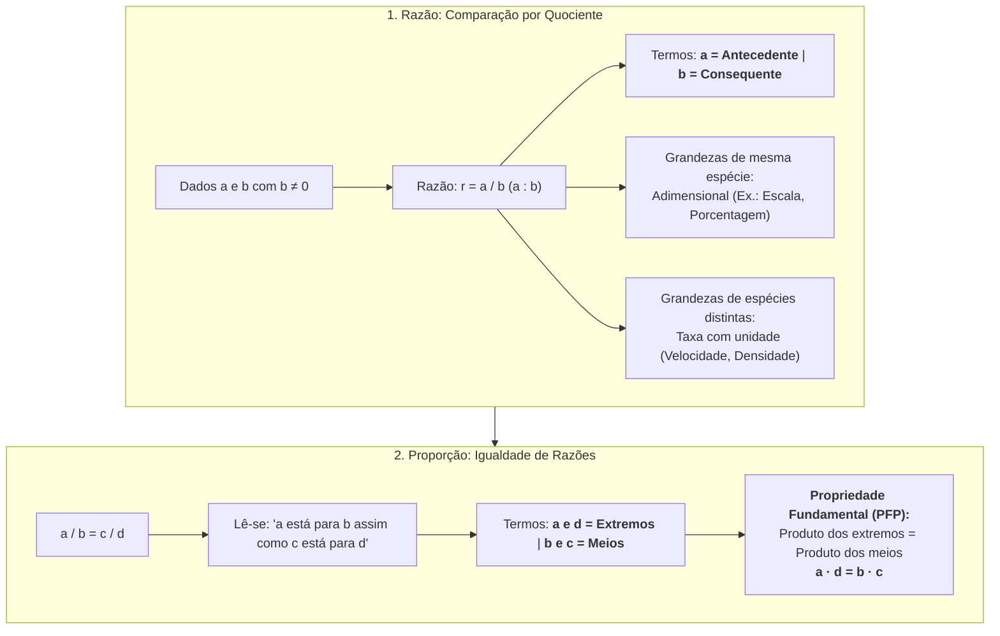
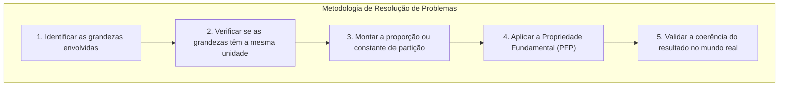
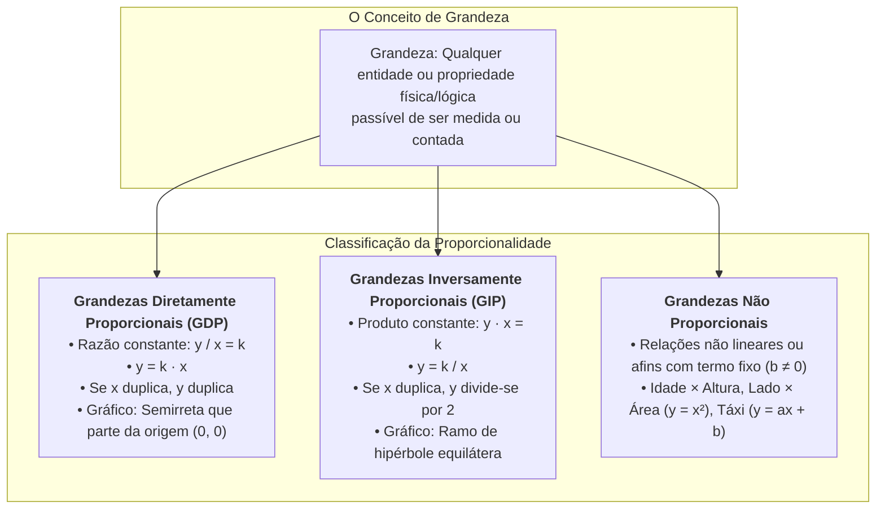
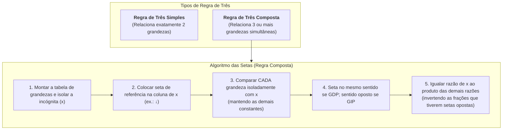

# 🎥 Videoaulas da Semana 4 — Proporcionalidade e Álgebra

> **Disciplina:** Matemática Básica (`MMB002-EC-2026S2B2-T001`)  
> **Tema da Semana 4:** Proporcionalidade, Representação e Linguagem Matemática  
> **Docente Responsável:** Profª Dra. Rúbia Barcelos Amaral  
> **Período:** 19/10/2026 a 01/11/2026  

---

## 🧭 Índice das Videoaulas da Semana

| Videoaula | Título | Foco Temático Principal | Link |
| :---: | :--- | :--- | :---: |
| **Videoaula 13** | Razão e proporção | Definição de razão (antecedente/consequente), taxas especiais e Propriedade Fundamental das Proporções | [Assistir no YouTube](https://www.youtube.com/watch?v=YjPyFHUMxRc) |
| **Videoaula 14** | Razão e proporção: exercícios | Resolução detalhada de exercícios práticos (escalas cartográficas, partilhas direta e inversamente proporcionais e misturas) | [Assistir no YouTube](https://www.youtube.com/watch?v=kRzHKilMZ8o&t=803s) |
| **Videoaula 15** | Grandezas proporcionais | Definição de grandezas, GDP ($y = kx$), GIP ($y \cdot x = k$), análise gráfica e diferenciação de grandezas não proporcionais | [Assistir no YouTube](https://www.youtube.com/watch?v=7j5YxgX-wxE&t=1086s) |
| **Videoaula 16** | Regra de três | Regra de três simples (direta/inversa) e composta (algoritmo prático de setas), com **nota de errata oficial (8 dias)** | [Assistir no YouTube](https://www.youtube.com/watch?v=7_gtJPblld4&t=1083s) |

---

## 🎬 Videoaula 13 — Razão e Proporção

* **Docente:** Profª Dra. Rúbia Barcelos Amaral  
* **Link Oficial:** [YouTube UNIVESP](https://www.youtube.com/watch?v=YjPyFHUMxRc)  
* **Sinopse Oficial:** *Nesta videoaula, a professora Rúbia Barcelos Amaral apresentará o conceito de razão, que é uma comparação entre duas grandezas. Também o conceito de proporção é abordado, que é a igualdade entre duas razões.*

---

### 🔹 1. O Conceito Matemático de Razão

A palavra **razão** provém do latim *ratio*, que significa cálculo, medida ou relação. Em matemática:

> **Definição Formal:** Dados dois números reais $a$ e $b$, com $b \neq 0$, a **razão** entre $a$ e $b$ (nessa ordem) é o quociente da divisão de $a$ por $b$:
> $$\text{Razão} = \frac{a}{b} \quad \text{ou} \quad a : b$$
> * O numerador $a$ denomina-se **antecedente**.
> * O denominador $b$ denomina-se **consequente**.

#### 💡 Comparação por Diferença versus Comparação por Quociente:
* **Comparação Aditiva (Diferença):** Avalia "quanto uma grandeza tem a mais que a outra" ($a - b$).  
  *Exemplo:* Um servidor A possui 64 GB de RAM e um servidor B tem 16 GB. O servidor A tem $64 - 16 = 48\text{ GB}$ a mais.
* **Comparação Multiplicativa (Razão):** Avalia "quantas vezes uma grandeza cabe ou é múltipla da outra" ($a / b$).  
  *Exemplo:* $\frac{64}{16} = 4$. O servidor A possui **4 vezes** a capacidade de memória do servidor B.

---

### 🔹 2. Razões Especiais e Taxas com Grandezas Distintas

Quando comparamos grandezas de mesma natureza (com a mesma unidade de medida), a razão é um **número puro (adimensional)**:
* **Escala Cartográfica:** $E = \frac{\text{medida no desenho}}{\text{medida real}}$ (ex.: $1:100.000$ significa que $1\text{ cm}$ no mapa representa $100.000\text{ cm} = 1\text{ km}$ no terreno real).
* **Taxa Percentual:** Razão cujo consequente é $100$ ($\frac{p}{100}$).

Quando comparamos grandezas de naturezas físicas distintas, a razão gera uma **taxa ou grandeza derivada**:

1. **Velocidade Média ($v_m$):**
   $$v_m = \frac{\Delta s}{\Delta t} \quad \left[\frac{\text{km}}{\text{h}} \text{ ou } \frac{\text{m}}{\text{s}}\right]$$
2. **Densidade Demográfica ($D$):**
   $$D = \frac{\text{Número de Habitantes}}{\text{Área Territorial}} \quad \left[\frac{\text{hab}}{\text{km}^2}\right]$$
3. **Densidade Absoluta / Massa Específica ($\rho$):**
   $$\rho = \frac{\text{Massa}}{\text{Volume}} \quad \left[\frac{\text{g}}{\text{cm}^3} \text{ ou } \frac{\text{kg}}{\text{m}^3}\right]$$
4. **Consumo de Combustível ($C$):**
   $$C = \frac{\text{Distância Percorrida}}{\text{Volume de Combustível}} \quad \left[\frac{\text{km}}{\text{L}}\right]$$

---

### 🔹 3. O Conceito de Proporção

> **Definição Formal:** Uma **proporção** é a sentença matemática que expressa a igualdade entre duas razões:
> $$\frac{a}{b} = \frac{c}{d} \quad \text{ou} \quad a : b = c : d$$
> com $b \neq 0$ e $d \neq 0$.  
> Lê-se: *"a está para b assim como c está para d"*.

#### Nomenclatura dos Termos:
Na proporção $\frac{a}{b} = \frac{c}{d}$:
* $a$ e $d$ são chamados de **extremos** (o primeiro antecedente e o último consequente);
* $b$ e $c$ são chamados de **meios** (o primeiro consequente e o segundo antecedente).

---

### 🔹 4. A Propriedade Fundamental das Proporções (PFP)

A ferramenta algébrica central para resolução de problemas de proporcionalidade é a **Propriedade Fundamental das Proporções**:

$$\boxed{\frac{a}{b} = \frac{c}{d} \iff a \cdot d = b \cdot c}$$

> *"Em toda proporção, o produto dos extremos é igual ao produto dos meios."*

#### 🧮 Demonstração Algébrica:
Multiplicando ambos os membros da igualdade $\frac{a}{b} = \frac{c}{d}$ pelo produto dos denominadores $(b \cdot d)$:
$$(b \cdot d) \cdot \frac{a}{b} = (b \cdot d) \cdot \frac{c}{d} \implies a \cdot d = b \cdot c \quad \blacksquare$$

#### Exemplo Prático da Aula:
Determinar o valor de $x$ na proporção $\frac{x}{12} = \frac{5}{4}$:
$$4 \cdot x = 12 \cdot 5 \implies 4x = 60 \implies x = \frac{60}{4} = 15$$

---

### 🔹 5. Propriedades Operatórias Derivadas

A partir da PFP, decorrem propriedades essenciais para simplificação e partição de grandezas:

1. **Soma dos Antecedentes e Consequentes:**
   $$\frac{a}{b} = \frac{c}{d} = \frac{a + c}{b + d} = \frac{a - c}{b - d} \quad (b + d \neq 0)$$
2. **Composição e Decomposição das Razões:**
   $$\frac{a + b}{b} = \frac{c + d}{d} \quad \text{e} \quad \frac{a - b}{b} = \frac{c - d}{d}$$
   $$\frac{a + b}{a - b} = \frac{c + d}{c - d}$$

---

### 💻 6. Aplicações Práticas na Engenharia de Computação

1. **Aspect Ratio de Monitores e Telas de Vídeo:**  
   A proporção entre a largura e a altura de um display define o *aspect ratio*:
   * Padrão Widescreen tradicional: $16:9 \implies \frac{1920}{1080} = \frac{16}{9}$;
   * Padrão Ultrawide: $21:9 \implies \frac{2560}{1080} = \frac{21}{9}$ (ou $3440 \times 1440$);
   * Monitores clássicos: $4:3 \implies \frac{1024}{768} = \frac{4}{3}$.
2. **Redimensionamento de Imagens e Redes Convolucionais:**  
   Ao aplicar algoritmos de visão computacional (redes neurais convolucionais), tensores de imagens médicas ou fotografias precisam ser reescalados preservando o *aspect ratio* para não distorcer características morfológicas de tumores ou lesões.
3. **Taxa de Transferência em Redes (*Throughput*):**  
   Razão entre o volume de bits transferidos e o tempo decorrido:
   $$R = \frac{\text{Bytes} \times 8}{\Delta t} \quad [\text{bps, Mbps, Gbps}]$$
   Crucial para dimensionar largura de banda em computação em nuvem e streaming de dados.

---

## 🎬 Videoaula 14 — Razão e Proporção: Exercícios

* **Docente:** Profª Dra. Rúbia Barcelos Amaral  
* **Link Oficial:** [YouTube UNIVESP](https://www.youtube.com/watch?v=kRzHKilMZ8o&t=803s)  
* **Sinopse Oficial:** *Nesta videoaula, a professora Rúbia Barcelos Amaral trará a resolução de exercícios para aplicar os conceitos de razão e proporção.*

---

### 🔹 1. Exercício 1: Escalas Cartográficas e Arquitetura

A escala ($E$) é uma razão que relaciona uma medida de comprimento no desenho ($d$) com a medida de comprimento real correspondente ($D$):

$$E = \frac{d}{D}$$

> [!IMPORTANT]
> **Homogeneidade de Unidades:** Tanto $d$ quanto $D$ devem estar rigorosamente na **mesma unidade de medida** (geralmente centímetros) para que a escala seja expressa na forma adimensional $1 : M$.

#### 📌 Enunciado do Problema:
Um mapa topográfico foi desenhado na escala $1 : 250.000$. Dois polos tecnológicos encontram-se separados por uma distância de $6,4\text{ cm}$ no mapa. Qual é a distância real em linha reta entre esses polos, expressa em quilômetros?

#### 🧮 Resolução Passo a Passo:
1. **Identificação dos dados:**
   $$E = \frac{1}{250.000}, \quad d = 6,4\text{ cm}, \quad D = ?$$
2. **Aplicação da definição de escala:**
   $$\frac{1}{250.000} = \frac{6,4}{D}$$
3. **Aplicação da Propriedade Fundamental das Proporções (PFP):**
   $$1 \cdot D = 6,4 \cdot 250.000$$
   $$D = 1.600.000\text{ cm}$$
4. **Conversão de unidades ($\text{cm} \to \text{m} \to \text{km}$):**
   * De centímetro para metro: divide-se por $100$ ($1\text{ m} = 100\text{ cm}$):
     $$1.600.000\text{ cm} = 16.000\text{ m}$$
   * De metro para quilômetro: divide-se por $1.000$ ($1\text{ km} = 1.000\text{ m}$):
     $$16.000\text{ m} = \mathbf{16\text{ km}}$$

$$\boxed{D = 16\text{ km}}$$

---

### 🔹 2. Exercício 2: Divisão em Partes Diretamente Proporcionais

Na partilha diretamente proporcional, o quociente entre cada cota e o seu respectivo peso de participação é constante.

#### 📌 Enunciado do Problema:
Três programadores fundaram uma empresa de desenvolvimento de software e investiram capitais iniciais de **R$ 3.000,00**, **R$ 5.000,00** e **R$ 7.000,00**, respectivamente. No primeiro ano fiscal, a empresa obteve um lucro líquido de **R$ 45.000,00**. Sabendo que o contrato social estipula que a divisão dos lucros deve ser feita de forma **diretamente proporcional** ao investimento inicial de cada sócio, determine a quantia recebida por cada um.

#### 🧮 Resolução Passo a Passo:
Sejam $x, y, z$ as quantias recebidas pelos sócios 1, 2 e 3:
$$\frac{x}{3000} = \frac{y}{5000} = \frac{z}{7000}$$

Podemos simplificar os fatores de milhares para os pesos proporcionais $3, 5, 7$:
$$\frac{x}{3} = \frac{y}{5} = \frac{z}{7} = k$$

Pela propriedade da soma das razões proporcionais:
$$k = \frac{x + y + z}{3 + 5 + 7} = \frac{45.000}{15} = 3.000$$

A constante de proporcionalidade é $k = 3.000$. Calculando a cota de cada sócio:
* **Sócio 1:** $x = 3 \cdot k = 3 \cdot 3.000 = \mathbf{R\$\,9.000,00}$
* **Sócio 2:** $y = 5 \cdot k = 5 \cdot 3.000 = \mathbf{R\$\,15.000,00}$
* **Sócio 3:** $z = 7 \cdot k = 7 \cdot 3.000 = \mathbf{R\$\,21.000,00}$

#### 🔍 Verificação de Consistência (Prova Real):
$$9.000 + 15.000 + 21.000 = 45.000\text{ (Exato!)}$$

---

### 🔹 3. Exercício 3: Divisão em Partes Inversamente Proporcionais

Dividir uma quantidade em partes **inversamente proporcionais** a números dados equivale a dividi-la em partes **diretamente proporcionais aos inversos** desses números.

#### 📌 Enunciado do Problema:
Uma equipe de testes de software dispõe de uma bonificação especial de **R$ 6.200,00** para premiar dois analistas de qualidade de acordo com o menor número de falhas não detectadas em seus módulos. O analista A cometeu **2 falhas**, enquanto o analista B cometeu **3 falhas**. Divida a bonificação em partes **inversamente proporcionais** ao número de falhas.

#### 🧮 Resolução Passo a Passo:
Sejam $A$ e $B$ os valores recebidos por cada analista:
$$A \cdot 2 = B \cdot 3 = k \iff \frac{A}{1/2} = \frac{B}{1/3} = k$$

Aplicando a soma dos termos:
$$k = \frac{A + B}{\frac{1}{2} + \frac{1}{3}} = \frac{6.200}{\frac{3 + 2}{6}} = \frac{6.200}{\frac{5}{6}} = 6.200 \cdot \frac{6}{5} = 1.240 \cdot 6 = 7.440$$

Calculando os valores individuais:
* **Analista A (2 falhas):** $A = \frac{k}{2} = \frac{7.440}{2} = \mathbf{R\$\,3.720,00}$
* **Analista B (3 falhas):** $B = \frac{k}{3} = \frac{7.440}{3} = \mathbf{R\$\,2.480,00}$

$$\boxed{A = \text{R\$\,3.720,00} \quad \text{e} \quad B = \text{R\$\,2.480,00}}$$

> [!NOTE]
> Como esperado em grandezas inversamente proporcionais, o analista A (que cometeu menos falhas) recebeu uma parcela maior da bonificação.

---

### 🔹 4. Exercício 4: Misturas e Concentração de Ligas

#### 📌 Enunciado do Problema:
Uma liga metálica de solda para placas de circuito impresso (PCB) é composta pela fusão de estanho e chumbo na proporção mássica de **$3 : 2$**. Se um laboratório necessita fundir **$40\text{ kg}$** dessa solda, qual é a massa exata de estanho e de chumbo necessária?

#### 🧮 Resolução Passo a Passo:
1. A razão entre estanho ($E$) e chumbo ($C$) é $\frac{E}{C} = \frac{3}{2}$.
2. A soma das massas é $E + C = 40\text{ kg}$.
3. Pela propriedade das proporções:
   $$\frac{E}{3} = \frac{C}{2} = \frac{E + C}{3 + 2} = \frac{40}{5} = 8\text{ kg}$$
4. Multiplicando cada peso pela constante de partição:
   * Massa de Estanho: $E = 3 \cdot 8 = \mathbf{24\text{ kg}}$
   * Massa de Chumbo: $C = 2 \cdot 8 = \mathbf{16\text{ kg}}$

---

### 💻 5. Aplicações Práticas na Engenharia de Computação
* **Viewport Mapping em Computação Gráfica:** A conversão de Normalized Device Coordinates (NDC, com intervalo $[-1, 1]$) para as coordenadas de tela em pixels ($[0, \text{Width}] \times [0, \text{Height}]$) utiliza interpolação linear com base em escalas de razão e proporção direta.
* **Weighted Round-Robin (WRR):** Algoritmo de balanceamento de carga de microsserviços onde as requisições de entrada são roteadas para servidores de alta ou baixa capacidade na proporção direta dos seus pesos de processamento atribuídos.

---

## 🎬 Videoaula 15 — Grandezas Proporcionais

* **Docente:** Profª Dra. Rúbia Barcelos Amaral  
* **Link Oficial:** [YouTube UNIVESP](https://www.youtube.com/watch?v=7j5YxgX-wxE&t=1086s)  
* **Sinopse Oficial:** *Nesta videoaula, a professora Rúbia Barcelos Amaral abordará as grandezas proporcionais, tanto diretamente proporcionais quanto inversamente proporcionais, explorados a partir dos conceitos de razão e proporção.*

---

### 🔹 1. Definição Formal de Grandeza
Em matemática e física, **grandeza** é tudo aquilo que pode ser medido (tempo, velocidade, temperatura, massa, comprimento, corrente elétrica) ou contado (número de pessoas, pacotes transmitidos, instruções executadas).

---

### 🔹 2. Grandezas Diretamente Proporcionais (GDP)

> **Definição Matemática Formal:** Duas grandezas $x$ e $y$ dizem-se **diretamente proporcionais** quando a razão entre quaisquer pares de valores correspondentes se mantém constante:
> $$\frac{y_1}{x_1} = \frac{y_2}{x_2} = \dots = \frac{y_n}{x_n} = k \quad (k \neq 0)$$
> Em termos funcionais:
> $$y(x) = k \cdot x$$
> onde $k$ denomina-se **constante de proporcionalidade direta**.

#### 📐 Propriedades Operatórias das GDP:
1. Se multiplicamos uma grandeza por um escalar positivo $\lambda$ ($\lambda > 0$), a outra fica multiplicada pelo mesmo fator $\lambda$:
   $$y(\lambda x) = k \cdot (\lambda x) = \lambda \cdot (kx) = \lambda \cdot y(x)$$
2. **Representação Gráfica:** No plano cartesiano $(x, y)$, o gráfico de grandezas diretamente proporcionais é obrigatoriamente uma **semirreta (ou reta) linear que passa pela origem $(0, 0)$**. A inclinação da reta corresponde numericamente à constante $k$.

---

### 🔹 3. Grandezas Inversamente Proporcionais (GIP)

> **Definição Matemática Formal:** Duas grandezas $x$ e $y$ dizem-se **inversamente proporcionais** quando o produto entre pares de valores correspondentes for constante:
> $$x_1 \cdot y_1 = x_2 \cdot y_2 = \dots = x_n \cdot y_n = k \quad (k \neq 0)$$
> Em termos funcionais:
> $$y(x) = \frac{k}{x}$$
> onde $k$ denomina-se **constante de proporcionalidade inversa**.

#### 📐 Propriedades Operatórias das GIP:
1. Se multiplicamos uma grandeza por $\lambda$ ($\lambda > 0$), a outra fica dividida por $\lambda$:
   $$y(\lambda x) = \frac{k}{\lambda x} = \frac{1}{\lambda} \cdot \left(\frac{k}{x}\right) = \frac{y(x)}{\lambda}$$
2. **Representação Gráfica:** O gráfico no primeiro quadrante é um **ramo de hipérbole equilátera**. Quando $x \to 0^+$, temos $y \to \infty$; e quando $x \to \infty$, temos $y \to 0$ (assíntotas sobre os eixos coordenados).

---

### 🔹 4. Quadro Comparativo: GDP versus GIP

| Critério | Grandezas Diretamente Proporcionais (GDP) | Grandezas Inversamente Proporcionais (GIP) |
| :--- | :--- | :--- |
| **Condição Algébrica** | $\frac{y}{x} = k \iff y = kx$ | $y \cdot x = k \iff y = \frac{k}{x}$ |
| **Comportamento** | Variam no mesmo sentido multiplicativo (ao dobrar uma, a outra dobra) | Variam em sentido multiplicativo oposto (ao dobrar uma, a outra cai pela metade) |
| **Gráfico Cartesiano** | Reta linear passando pela origem $(0, 0)$ | Ramo de hipérbole equilátera com assíntotas nos eixos |
| **Exemplo Clássico 1** | Distância percorrida e tempo a velocidade constante ($d = v \cdot t$) | Velocidade e tempo para percorrer distância fixa ($v \cdot t = d$) |
| **Exemplo Clássico 2** | Quantidade de itens comprados e custo total | Número de operários de mesma eficiência e dias para concluir obra |
| **Exemplo em Computação** | Operações executadas e tempo em algoritmo $O(n)$ | Período de ciclo ($T$) e frequência de clock ($f$): $T = 1/f$ |

---

### ⚠️ 5. Cuidado com Falsas Proporcionalidades (Grandezas Não Proporcionais)

A professora destaca que **nem toda relação crescente ou decrescente é de proporcionalidade**. Três contraexemplos fundamentais:

1. **Idade e Altura:** Uma criança aos 5 anos tem cerca de $1,05\text{ m}$. Aos 20 anos, sua idade quadruplicou, mas sua altura não será $4,20\text{ m}$. Não existe razão constante.
2. **Lado e Área de um Quadrado:** Se o lado do quadrado dobra de $2\text{ cm}$ para $4\text{ cm}$, sua área passa de $4\text{ cm}^2$ para $16\text{ cm}^2$ (quadruplica!). Trata-se de uma relação quadrática ($A = L^2$), não diretamente proporcional.
3. **Função Afim com Termo Independente ($y = ax + b$ com $b \neq 0$):**  
   Na corrida de táxi com bandeirada de R$ 5,00 mais R$ 2,00 por km:
   * Para $1\text{ km}$: $C(1) = 5 + 2 \cdot 1 = \text{R\$\,7,00}$ (Razão: $7/1 = 7$)
   * Para $2\text{ km}$: $C(2) = 5 + 2 \cdot 2 = \text{R\$\,9,00}$ (Razão: $9/2 = 4,5$)  
   Embora o custo cresça com os quilômetros, a razão **não é constante**, logo **não há proporcionalidade direta**.

---

### 💻 6. Aplicações Práticas na Engenharia de Computação
* **Clock de Processadores:** A frequência $f$ (em Hertz) e o tempo de ciclo de máquina $T$ (em segundos) são inversamente proporcionais: $T = \frac{1}{f}$. Um núcleo a $5\text{ GHz}$ realiza cada ciclo em $\frac{1}{5 \times 10^9} = 0,20\text{ ns}$.
* **Transferência de Arquivos:** Para um arquivo de tamanho fixo $S$, o tempo de download $t$ e a largura de banda disponível $B$ são inversamente proporcionais: $t = \frac{S}{B}$.
* **Complexidade Assintótica de Algoritmos:** A classe de complexidade linear $\mathcal{O}(n)$ expressa tempo de CPU diretamente proporcional ao volume de dados de entrada $n$.

---

## 🎬 Videoaula 16 — Regra de Três

* **Docente:** Profª Dra. Rúbia Barcelos Amaral  
* **Link Oficial:** [YouTube UNIVESP](https://www.youtube.com/watch?v=7_gtJPblld4&t=1083s)  
* **Sinopse Oficial:** *Nesta videoaula, a professora Rúbia Barcelos Amaral apresenta a regra de três como uma potente ferramenta utilizada para descobrir um valor desconhecido, que segue a mesma razão de outros já conhecidos. De modo simples, um quarto valor pode ser descoberto a partir de outros três conhecidos, daí o nome da regra. São exploradas a regra de três simples e a regra de três composta.*

> [!IMPORTANT]
> **🚨 NOTA DE ERRATA OFICIAL (Minuto 10:14 da Videoaula 16):**  
> No minuto **10:14**, durante a conclusão verbal do exercício de regra de três composta, a professora afirma:  
> *"Quer dizer que eu vou gastar apenas 9 dias"*.  
> **Correção Rigorosa:** O valor matematicamente correto é **8 dias**, exatamente como consta expressamente calculado e exibido no **slide 5** da videoaula ($x = 8$). A dedução analítica detalhada a seguir confirma o resultado exato de 8 dias.

---

### 🔹 1. O que é a Regra de Três?
A regra de três é um processo prático de dedução matemática que permite determinar uma quantidade desconhecida (incógnita $x$) a partir de grandezas proporcionais previamente correlacionadas.
* Quando envolve **duas grandezas**, denomina-se **regra de três simples** (três valores conhecidos geram o quarto).
* Quando envolve **três ou mais grandezas**, denomina-se **regra de três composta**.

---

### 🔹 2. Regra de Três Simples

#### Caso 1: Grandezas Diretamente Proporcionais (GDP)
* **Problema:** Um data center consome $15\text{ kWh}$ de energia a cada $3\text{ horas}$ de operação sob carga nominal estável. Quantos kWh consumirá em um período contínuo de $24\text{ horas}$?
* **Análise:** Mais horas de operação $\implies$ Mais energia consumida (Direta: setas no mesmo sentido $\downarrow$ e $\downarrow$).
* **Montagem da Proporção:**
  $$\frac{15}{x} = \frac{3}{24} \implies 3 \cdot x = 15 \cdot 24 \implies 3x = 360 \implies x = \mathbf{120\text{ kWh}}$$

#### Caso 2: Grandezas Inversamente Proporcionais (GIP)
* **Problema:** Uma conexão de backup transfere um lote de arquivos em $6\text{ horas}$ utilizando uma taxa média de $50\text{ Mbps}$. Se a largura de banda alocada for ampliada para $150\text{ Mbps}$, em quanto tempo o mesmo lote será transferido?
* **Análise:** Maior largura de banda $\implies$ Menor tempo de transferência (Inversa: setas em sentidos contrários $\downarrow$ e $\uparrow$).
* **Montagem da Proporção (inverte-se a razão da grandeza inversa):**
  $$\frac{6}{x} = \frac{150}{50} = 3 \implies 3x = 6 \implies x = \mathbf{2\text{ horas}}$$

---

### 🔹 3. Regra de Três Composta — O Algoritmo Geral das Setas

Para evitar erros conceituais na regra de três composta, adota-se o **Método Analítico das Setas**:

1. **Montar a tabela:** Alocar cada grandeza em uma coluna e as situações correspondentes nas linhas.
2. **Definir a referência da incógnita:** Insere-se uma seta na coluna que contém a incógnita $x$ (por convenção, orientada para baixo $\downarrow$).
3. **Análise individual:** Compara-se a grandeza da incógnita com **cada uma das demais grandezas isoladamente**, assumindo que todas as outras grandezas permaneçam fixas.
   * Se a grandeza for **diretamente proporcional** à incógnita $\implies$ seta no mesmo sentido ($\downarrow$).
   * Se for **inversamente proporcional** $\implies$ seta em sentido oposto ($\uparrow$).
4. **Estruturação da Equação Algébrica:**
   * A razão que contém a incógnita fica isolada em um lado da igualdade.
   * No outro lado, escreve-se o **produto de todas as outras razões**.
   * Para as grandezas cujas setas têm sentido oposto à da incógnita, **inverte-se a fração**.
5. **Resolução e Simplificação:** Simplificam-se fatores comuns antes de efetuar multiplicações de grandes números.

---

### 🔹 4. Resolução Analítica do Exercício da Aula (Demonstração da Errata)

#### 📌 Enunciado da Aula (Slide 5):
> *"Se 6 operários, trabalhando 8 horas por dia, constroem 400 metros de um muro em 12 dias, quantos dias levarão 9 operários, trabalhando 6 horas por dia, para construir 300 metros do mesmo muro?"*

#### 1. Montagem da Tabela de Dados:
| Operários | Horas por Dia (h/d) | Comprimento (m) | Dias de Trabalho ($x$) |
| :---: | :---: | :---: | :---: |
| 6 | 8 | 400 | 12 |
| 9 | 6 | 300 | $x$ |

#### 2. Análise de Proporcionalidade em Relação à Grandeza "Dias":
* **Fixando a incógnita:** Dias ($\downarrow$).
* **Operários $\times$ Dias:** Com mais operários trabalhando, serão necessários **menos dias** para terminar a obra.  
  $\implies$ **Inversamente proporcional** (Seta $\uparrow$).
* **Horas por Dia $\times$ Dias:** Trabalhando mais horas a cada dia, serão necessários **menos dias** de trabalho.  
  $\implies$ **Inversamente proporcional** (Seta $\uparrow$).
* **Comprimento (m) $\times$ Dias:** Para construir uma extensão maior de muro, serão necessários **mais dias**.  
  $\implies$ **Diretamente proporcional** (Seta $\downarrow$).

#### 3. Montagem da Equação:
A razão da incógnita $\frac{12}{x}$ é igual ao produto das razões das demais grandezas (invertendo as grandezas inversas):

$$\frac{12}{x} = \underbrace{\frac{9}{6}}_{\text{Operários (Invertido)}} \times \underbrace{\frac{6}{8}}_{\text{Horas/dia (Invertido)}} \times \underbrace{\frac{400}{300}}_{\text{Metros (Mantido)}}$$

#### 4. Resolução e Simplificação Algébrica:
Cancelando o fator comum $6$ no numerador e denominador:
$$\frac{12}{x} = \frac{9}{8} \times \frac{400}{300}$$

Simplificando a fração $\frac{400}{300} = \frac{4}{3}$:
$$\frac{12}{x} = \frac{9}{8} \times \frac{4}{3}$$

Simplificando $\frac{9}{3} = 3$ e $\frac{4}{8} = \frac{1}{2}$:
$$\frac{12}{x} = 3 \times \frac{1}{2} = \frac{3}{2}$$

Multiplicando cruzado (Propriedade Fundamental das Proporções):
$$3 \cdot x = 12 \cdot 2$$
$$3x = 24$$
$$x = \frac{24}{3} = \mathbf{8}$$

$$\boxed{x = 8\text{ dias}}$$

> [!TIP]
> **Confirmação da Errata:**  
> O cálculo algébrico resulta com precisão absoluta em **8 dias** (resultado impresso no slide 5 da apresentação). A fala oral aos 10:14 da gravação ("9 dias") foi um lapso momentâneo de pronúncia superado pelo desenvolvimento formal da lousa.

---

### 💻 5. Aplicações Práticas na Engenharia de Computação
* **Dimensionamento de Clusters e Autoscaling:**  
  Dimensionar a quantidade de nós de computação ($N$), horas de processamento ($H$) e volume de dados ($V$ em TB) em clusters Apache Spark ou Kubernetes.
* **Processamento Concorrente e Threads:**  
  Cálculo do throughput em pipelines de compressão de vídeo e renderização:
  $$\frac{\text{Tempo}}{t_x} = \frac{\text{Frames}_1}{\text{Frames}_2} \times \frac{\text{Cores}_2}{\text{Cores}_1}$$
* **Sistemas Embarcados e Ciclos de Bateria:**  
  Dimensionamento da autonomia de sensores IoT com base na corrente consumida em repouso (*sleep mode*), corrente de transmissão e frequência de telemetria.

