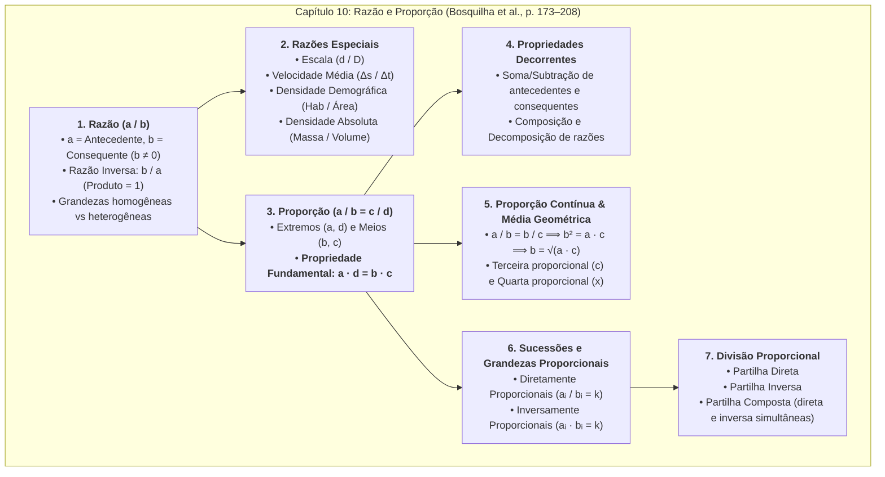
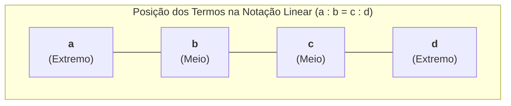
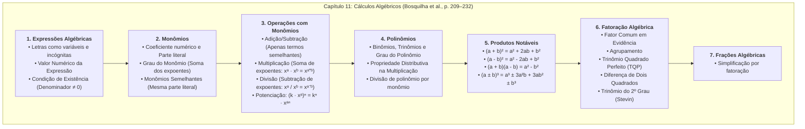
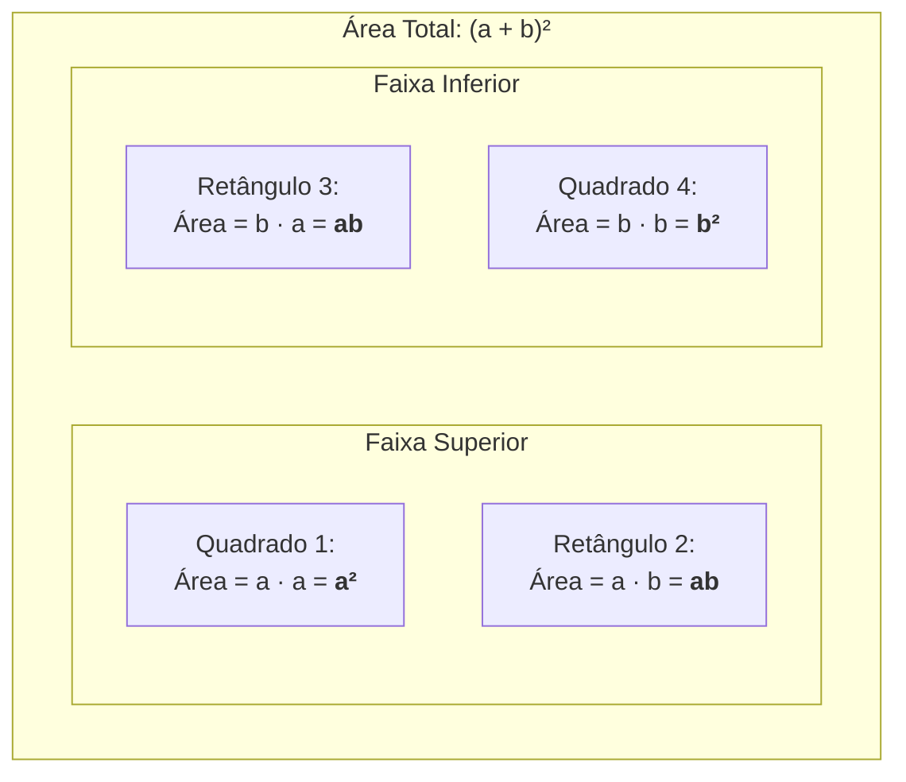

# 📖 Textos-base — Manual Compacto de Matemática (Capítulos 10 e 11)

> **Referência 1:** BOSQUILHA, Alessandra; AMARAL, João Tomás do; MIRANDA, Mônica. **Manual compacto de matemática: ensino fundamental**. São Paulo: Rideel. (Capítulo 10: *"Razão e proporção"*, p. 173–208). [Plataforma BVirtual (Pág. 173)](https://leitor.bvirtual.com.br/reader/182305/pdf/173)  
> **Referência 2:** BOSQUILHA, Alessandra; AMARAL, João Tomás do; MIRANDA, Mônica. **Manual compacto de matemática: ensino fundamental**. São Paulo: Rideel. (Capítulo 11: *"Cálculos algébricos"*, p. 209–232). [Plataforma BVirtual (Pág. 209)](https://leitor.bvirtual.com.br/reader/182305/pdf/209)  
> **Disciplina:** Matemática Básica (`MMB002-EC-2026S2B2-T001`) — Semana 4  
> **Tema:** Proporcionalidade, representação e linguagem matemática — Razão, proporção, partilhas proporcionais, expressões algébricas, monômios, polinômios, produtos notáveis e fatoração  

---

# 📚 PARTE I: Capítulo 10 — Razão e Proporção (p. 173–208)

## 🗺️ Mapa Conceitual do Capítulo 10

---

## 📌 1. O Conceito Matemático de Razão

A palavra **razão** provém do vocábulo latino *ratio*, que carrega o significado de cálculo, relação comparativa, proporção ou avaliação de medidas.

### 1.1. Definição Formal
Dados dois números reais $a$ e $b$, com $b \neq 0$, denomina-se **razão** entre $a$ e $b$ (nessa ordem estrita) o quociente exato da divisão de $a$ por $b$:

$$\text{Razão} = \frac{a}{b} \quad \text{ou} \quad a : b$$

* O termo superior $a$ denomina-se **antecedente** (o que vem antes ou no numerador).
* O termo inferior $b$ denomina-se **consequente** (o que vem depois ou no denominador).

> [!CAUTION]
> **A Ordem dos Termos é Crucial:**  
> A razão de $a$ para $b$ ($\frac{a}{b}$) é matematicamente distinta da razão de $b$ para $a$ ($\frac{b}{a}$), a menos que $a = b \neq 0$.  
> *Exemplo:* Em uma equipe de 4 desenvolvedores backend e 8 frontend, a razão de backend para frontend é $\frac{4}{8} = \frac{1}{2} = 0,5$. Já a razão de frontend para backend é $\frac{8}{4} = 2$.

### 1.2. Razão Inversa
Denomina-se **razão inversa** de uma razão dada $\frac{a}{b}$ (com $a \neq 0$ e $b \neq 0$) a razão $\frac{b}{a}$.

* **Propriedade Fundamental das Razões Inversas:**  
  O produto de duas razões inversas é sempre identicamente igual à unidade:
  $$\frac{a}{b} \times \frac{b}{a} = \frac{a \cdot b}{b \cdot a} = 1$$

---

## 📌 2. Razões de Grandezas Homogêneas versus Heterogêneas

O texto de Bosquilha et al. estabelece uma distinção rigorosa quanto à natureza dimensional das grandezas comparadas:

### 2.1. Grandezas de Mesma Espécie (Homogêneas)
Quando os números comparados possuem a mesma unidade física de medida, a razão resulta em um **número puro (adimensional)**:
* **Escala ($E$):** Razão entre uma distância gráfica linear ($d$) medida sobre um mapa ou planta e a distância linear real correspondente ($D$):
  $$E = \frac{d}{D}$$
  *Exemplo:* Uma escala $1 : 50.000$ expressa que cada $1\text{ cm}$ no mapa representa $50.000\text{ cm} = 500\text{ m} = 0,5\text{ km}$ no terreno real.
* **Taxa Percentual:** Razão centesimal onde o consequente é fixado em $100$: $\frac{p}{100}$.

### 2.2. Grandezas de Espécies Diferentes (Heterogêneas)
Quando comparamos grandezas de naturezas físicas distintas, a razão estabelece uma **taxa** com uma nova unidade composta (unidade derivada):
1. **Velocidade Média ($v_m$):** Razão entre a distância percorrida ($\Delta s$) e o intervalo de tempo decorrido ($\Delta t$):
   $$v_m = \frac{\Delta s}{\Delta t} \quad \left[\frac{\text{km}}{\text{h}} \text{ ou } \frac{\text{m}}{\text{s}}\right]$$
2. **Densidade Demográfica ($D$):** Razão entre a população absoluta e a superfície territorial:
   $$D = \frac{P}{A} \quad \left[\frac{\text{habitantes}}{\text{km}^2}\right]$$
3. **Densidade Absoluta / Massa Específica ($\rho$):** Razão entre a massa de uma substância e o volume ocupado:
   $$\rho = \frac{m}{V} \quad \left[\frac{\text{g}}{\text{cm}^3} \text{ ou } \frac{\text{kg}}{\text{m}^3}\right]$$
4. **Consumo Médio ($C$):** Razão entre a distância percorrida e a quantidade de combustível consumido:
   $$C = \frac{\text{Distância}}{\text{Volume}} \quad \left[\frac{\text{km}}{\text{L}}\right]$$

---

## 📌 3. O Conceito e a Estrutura da Proporção

> **Definição Formal:** Uma **proporção** é a sentença matemática que expressa a **igualdade entre duas ou mais razões equivalentes**:
> $$\frac{a}{b} = \frac{c}{d} \quad \text{ou} \quad a : b = c : d$$
> com $b \neq 0$ e $d \neq 0$.  
> Lê-se: *"a está para b assim como c está para d"*.

### 3.1. Classificação dos Termos
Na proporção $\frac{a}{b} = \frac{c}{d}$:
* $a$ e $d$ são denominados **extremos** (o primeiro termo antecedente e o último consequente);
* $b$ e $c$ são denominados **meios** (o primeiro consequente e o segundo antecedente).

### 3.2. A Propriedade Fundamental das Proporções (PFP)

Em qualquer proporção, **o produto dos extremos é estritamente igual ao produto dos meios**:

$$\boxed{\frac{a}{b} = \frac{c}{d} \iff a \cdot d = b \cdot c}$$

#### 🧮 Demonstração Algébrica Formal:
Considere a igualdade $\frac{a}{b} = \frac{c}{d}$ com $b, d \neq 0$.  
Multiplicando ambos os membros pelo produto não nulo $(b \cdot d)$:
$$(b \cdot d) \cdot \frac{a}{b} = (b \cdot d) \cdot \frac{c}{d}$$
Simplificando o fator $b$ à esquerda e o fator $d$ à direita:
$$a \cdot d = b \cdot c \quad \blacksquare$$

#### Aplicação — Quarta Proporcional:
Denomina-se **quarta proporcional** aos números $a, b \text{ e } c$ o quarto número $x$ que completa a proporção $\frac{a}{b} = \frac{c}{x}$:
$$a \cdot x = b \cdot c \implies x = \frac{b \cdot c}{a}$$

*Exemplo:* Determinar a quarta proporcional dos números $5, 12 \text{ e } 15$:
$$\frac{5}{12} = \frac{15}{x} \implies 5x = 12 \times 15 \implies 5x = 180 \implies x = \frac{180}{5} = \mathbf{36}$$

---

## 📌 4. Propriedades Decorrentes das Proporções

A partir da PFP, o texto de Bosquilha et al. (p. 182–188) deduz propriedades algébricas fundamentais para simplificação de sistemas lineares e partição de grandezas:

### 4.1. Soma e Subtração dos Antecedentes e Consequentes
Em toda proporção, a soma (ou diferença) dos antecedentes está para a soma (ou diferença) dos consequentes assim como qualquer antecedente está para o seu respectivo consequente:

$$\frac{a}{b} = \frac{c}{d} = \frac{a + c}{b + d} = \frac{a - c}{b - d} \quad (b + d \neq 0, \; b - d \neq 0)$$

#### Generalização para $n$ Razões Iguais (Série de Razões):
Se $\frac{a_1}{b_1} = \frac{a_2}{b_2} = \dots = \frac{a_n}{b_n} = k$, então:
$$\frac{a_1 + a_2 + \dots + a_n}{b_1 + b_2 + \dots + b_n} = k$$

### 4.2. Composição e Decomposição das Razões
1. A soma dos termos da primeira razão está para o seu antecedente (ou consequente) assim como a soma dos termos da segunda razão está para o seu antecedente (ou consequente):
   $$\frac{a + b}{b} = \frac{c + d}{d} \quad \text{e} \quad \frac{a + b}{a} = \frac{c + d}{c}$$
2. De modo análogo, para as diferenças:
   $$\frac{a - b}{b} = \frac{c - d}{d} \quad \text{e} \quad \frac{a - b}{a} = \frac{c - d}{c}$$
3. Razão entre soma e diferença de termos:
   $$\frac{a + b}{a - b} = \frac{c + d}{c - d}$$

---

## 📌 5. Proporção Contínua e Média Geométrica

Uma proporção diz-se **contínua** quando os seus termos médios são estritamente iguais:

$$\frac{a}{b} = \frac{b}{c}$$

Nesse contexto:
* O termo repetido $b$ denomina-se **média proporcional** (ou **média geométrica**) entre os extremos $a$ e $c$.
* O termo $c$ denomina-se **terceira proporcional** aos números $a$ e $b$.

### 5.1. Cálculo da Média Geométrica
Aplicando a PFP:
$$b \cdot b = a \cdot c \implies b^2 = a \cdot c \implies b = \sqrt{a \cdot c}$$

> [!TIP]
> **Exemplo Prático:**  
> Determinar a média proporcional entre $4$ e $36$:
> $$\frac{4}{b} = \frac{b}{36} \implies b^2 = 4 \times 36 = 144 \implies b = \sqrt{144} = \mathbf{12}$$
> A proporção contínua é: $\frac{4}{12} = \frac{12}{36} = \frac{1}{3}$.

---

## 📌 6. Sucessões e Números Proporcionais

### 6.1. Números Diretamente Proporcionais
Duas sucessões de números não nulos $(a_1, a_2, \dots, a_n)$ e $(b_1, b_2, \dots, b_n)$ dizem-se **diretamente proporcionais** quando as razões entre cada elemento da primeira sucessão e o correspondente da segunda forem todas iguais a uma constante não nula $k$:

$$\frac{a_1}{b_1} = \frac{a_2}{b_2} = \dots = \frac{a_n}{b_n} = k$$

* Constante $k$: **Fator de proporcionalidade direta**.
* Cada termo da primeira sucessão é obtido multiplicando o correspondente da segunda por $k$: $a_i = k \cdot b_i$.

### 6.2. Números Inversamente Proporcionais
Duas sucessões $(a_1, a_2, \dots, a_n)$ e $(b_1, b_2, \dots, b_n)$ dizem-se **inversamente proporcionais** quando os produtos entre os termos correspondentes forem constantes:

$$a_1 \cdot b_1 = a_2 \cdot b_2 = \dots = a_n \cdot b_n = k$$

* Dividir por uma sucessão inversamente proporcional a $(b_1, b_2, \dots, b_n)$ equivale a dividir diretamente proporcional aos inversos $\left(\frac{1}{b_1}, \frac{1}{b_2}, \dots, \frac{1}{b_n}\right)$:
  $$\frac{a_1}{\frac{1}{b_1}} = \frac{a_2}{\frac{1}{b_2}} = \dots = \frac{a_n}{\frac{1}{b_n}} = k$$

---

## 📌 7. Divisão Proporcional (Partilha de Grandezas)

Um dos tópicos de maior relevância prática do Capítulo 10 é a resolução algébrica de partilhas proporcionais em finanças, engenharia e ciências.

### 7.1. Divisão em Partes Diretamente Proporcionais
Deseja-se repartir uma quantia total $S$ em partes $x, y, z$ diretamente proporcionais a números $p_1, p_2, p_3$.

1. Monta-se a série de razões iguais:
   $$\frac{x}{p_1} = \frac{y}{p_2} = \frac{z}{p_3} = k$$
2. Aplica-se a propriedade da soma das razões:
   $$k = \frac{x + y + z}{p_1 + p_2 + p_3} = \frac{S}{\sum p_i}$$
3. Obtêm-se os valores individuais multiplicando o fator $k$ por cada peso:
   $$x = p_1 \cdot k, \quad y = p_2 \cdot k, \quad z = p_3 \cdot k$$

### 7.2. Divisão em Partes Inversamente Proporcionais
Deseja-se repartir uma quantia total $S$ em partes $x, y, z$ inversamente proporcionais a números $q_1, q_2, q_3$.

1. Substituem-se os pesos pelos seus respectivos inversos:
   $$\frac{x}{\frac{1}{q_1}} = \frac{y}{\frac{1}{q_2}} = \frac{z}{\frac{1}{q_3}} = k$$
2. Determina-se a constante $k$:
   $$k = \frac{S}{\frac{1}{q_1} + \frac{1}{q_2} + \frac{1}{q_3}}$$
3. Obtêm-se as partes:
   $$x = \frac{k}{q_1}, \quad y = \frac{k}{q_2}, \quad z = \frac{k}{q_3}$$

### 7.3. Divisão em Partes Direta e Inversamente Proporcionais Simultâneas (Partilha Composta)
Se uma grandeza deve ser dividida em partes diretamente proporcionais a $a, b, c$ e inversamente proporcionais a $x, y, z$, basta dividi-la em partes **diretamente proporcionais aos produtos** de cada termo direto pelo inverso do correspondente termo inverso:

$$\text{Pesos combinados:} \quad \frac{a}{x}, \quad \frac{b}{y}, \quad \frac{c}{z}$$

---

## 💻 8. Conexões com a Engenharia de Computação

| Conceito Matemático do Capítulo 10 | Aplicação Prática em Engenharia de Computação |
| :--- | :--- |
| **Razão Adimensional & Escalas ($E = d/D$)** | **Normalização de Dados e Scalers em Machine Learning:** MinMaxScaler redimensiona atributos para a faixa $[0, 1]$ via $\frac{x - x_{\min}}{x_{\max} - x_{\min}}$. |
| **Média Geométrica ($\sqrt{a \cdot c}$)** | **Métricas de Desempenho e Benchmarking (SPEC CPU):** A média geométrica de tempos de execução de programas sintetiza o desempenho relativo de processadores sem distorções de escala causadas pela média aritmética. |
| **Divisão Diretamente Proporcional** | **Completely Fair Scheduler (CFS) do Linux Kernel:** O tempo de CPU concedido a cada thread é diretamente proporcional ao seu *nice weight* ($vruntime$). |
| **Divisão Inversamente Proporcional** | **Balanceamento de Carga por Menor Latência (*Least Response Time*):** Servidores com menor tempo de resposta recebem proporcionalmente mais conexões HTTP. |
| **Propriedade Fundamental das Proporções** | **Interpolação Linear e Computação Gráfica (Bresenham / Shader):** Mapeamento de triângulos 3D em malhas poligonais e rasterização em buffers de vídeo. |

---

## 📝 Questões Conceituais Extraídas do Capítulo (com Gabarito Analítico)

### ❓ Questão 1
Três sócios formam uma empresa de tecnologia. O primeiro entrou com R$ 10.000,00 e permaneceu 12 meses; o segundo entrou com R$ 15.000,00 e permaneceu 8 meses; o terceiro entrou com R$ 20.000,00 e permaneceu 6 meses. O lucro apurado foi de R$ 72.000,00. Qual a parcela de cada sócio?
* **Resolução:** Trata-se de uma partilha diretamente proporcional ao produto do capital pelo tempo de permanência:
  * Sócio 1: $10 \times 12 = 120$
  * Sócio 2: $15 \times 8 = 120$
  * Sócio 3: $20 \times 6 = 120$
  * Soma dos pesos: $120 + 120 + 120 = 360$.
  * Constante: $k = \frac{72.000}{360} = 200$.
  * Como os pesos combinados foram idênticos ($120$), cada sócio recebe:
    $$120 \times 200 = \mathbf{R\$\,24.000,00}$$

### ❓ Questão 2
Determine a terceira proporcional entre os números $8$ e $12$.
* **Resolução:** Por definição de terceira proporcional em proporção contínua:
  $$\frac{8}{12} = \frac{12}{x} \implies 8x = 12 \times 12 = 144 \implies x = \frac{144}{8} = \mathbf{18}$$

---

# 📚 PARTE II: Capítulo 11 — Cálculos Algébricos (p. 209–232)

> **Referência:** BOSQUILHA, Alessandra; AMARAL, João Tomás do; MIRANDA, Mônica. **Manual compacto de matemática: ensino fundamental**. São Paulo: Rideel. (Capítulo 11: *"Cálculos algébricos"*, p. 209–232).  
> **Link na Biblioteca Virtual:** [Plataforma BVirtual (Página 209)](https://leitor.bvirtual.com.br/reader/182305/pdf/209)  

---

## 🗺️ Mapa Conceitual do Capítulo 11

---

## 📌 1. Linguagem Algébrica e Expressões Algébricas

A transição da **Aritmética** para a **Álgebra** representa um dos saltos intelectuais mais importantes do pensamento matemático: a capacidade de generalizar propriedades, enunciar leis universais e manipular grandezas desconhecidas por meio de símbolos literais (letras).

### 1.1. Definição Formal de Expressão Algébrica
Denomina-se **expressão algébrica** (ou expressão literal) qualquer expressão matemática formada por números, letras (variáveis ou incógnitas) e sinais de operações aritméticas (adição, subtração, multiplicação, divisão, potenciação e radiciação).

* **Exemplos:**
  * $3x + 5$
  * $2a^2b - 7ab^2 + 10$
  * $\frac{4x^2 - 1}{2x + 1}$

### 1.2. Valor Numérico de uma Expressão Algébrica
O **valor numérico** de uma expressão algébrica é o resultado obtido quando se substituem todas as variáveis por valores numéricos reais específicos e realizam-se todas as operações indicadas, respeitando a ordem de precedência das operações:

1. Radiciações e Potenciações;
2. Multiplicações e Divisões (na ordem em que aparecem);
3. Adições e Subtrações (na ordem em que aparecem);
* Respeitando o aninhamento: Parênteses `()`, Colchetes `[]` e Chaves `{}`.

#### 🧮 Exemplo do Texto (Bosquilha et al., p. 211):
Calcular o valor numérico da expressão $E = 2x^3 - 3xy + y^2$ para $x = -2$ e $y = 3$:
$$E = 2(-2)^3 - 3(-2)(3) + (3)^2$$
$$E = 2(-8) - 3(-6) + 9$$
$$E = -16 + 18 + 9 = \mathbf{11}$$

> [!CAUTION]
> **Condição de Existência em Expressões Fracionárias:**  
> Se a expressão algébrica contiver variáveis no denominador (fração algébrica), os valores que anulam o denominador não pertencem ao domínio de validade da expressão.  
> *Exemplo:* Em $\frac{x + 4}{x - 3}$, a expressão só é válida para $\mathbb{R} \setminus \{3\}$, pois a divisão por zero é indefinida.

---

## 📌 2. Monômios: Estrutura, Grau e Termos Semelhantes

### 2.1. Definição e Partes de um Monômio
Um **monômio** (ou termo algébrico) é uma expressão algébrica constituída apenas por uma multiplicação de números reais e variáveis com expoentes inteiros não negativos:

$$\underbrace{-5}_{\text{Coeficiente Numérico}} \times \underbrace{x^3 y^2 z}_{\text{Parte Literal}}$$

* **Coeficiente Numérico:** O fator numérico real que multiplica as variáveis. Se nenhum número estiver explícito, o coeficiente é $+1$ (ex.: $x^2 = 1 \cdot x^2$) ou $-1$ (ex.: $-xy = -1 \cdot xy$).
* **Parte Literal:** O produto de todas as variáveis com seus respectivos expoentes inteiros.
* **Monômio Nulo:** Aquele cujo coeficiente numérico é igual a zero ($0 \cdot x^2 y = 0$).

### 2.2. Grau de um Monômio
* **Grau Absoluto:** É a **soma de todos os expoentes** das variáveis que compõem a parte literal do monômio não nulo:
  * $7x^4 \implies \text{Grau } 4$;
  * $-3x^2 y^3 z \implies \text{Grau } 2 + 3 + 1 = 6$;
  * $15$ (constante pura) $\implies 15x^0 \implies \text{Grau } 0$.
* **Grau Relativo:** É o expoente de uma variável específica:
  * No monômio $8x^3 y^5$, o grau relativo a $x$ é $3$, e em relação a $y$ é $5$.

### 2.3. Monômios Semelhantes (Termos Semelhantes)
Dois ou mais monômios são denominados **semelhantes** quando possuem **exatamente a mesma parte literal** (mesmas variáveis elevadas aos mesmos expoentes):
* $4x^2 y$ e $-9x^2 y$ são **semelhantes**.
* $5a^3 b^2$ e $5a^2 b^3$ **NÃO são semelhantes** (os expoentes das variáveis estão invertidos).

---

## 📌 3. Operações Fundamentais com Monômios

### 3.1. Adição e Subtração de Monômios
A adição e a subtração **só podem ser efetuadas entre monômios semelhantes**. Conserva-se a parte literal comum e operam-se algebricamente os coeficientes numéricos:

$$a \cdot X + b \cdot X = (a + b) \cdot X$$

* *Exemplo:* $7x^2 y - 12x^2 y + 2x^2 y = (7 - 12 + 2)x^2 y = \mathbf{-3x^2 y}$.
* Se os monômios não forem semelhantes, a operação fica apenas indicada na forma de um polinômio: $3x + 4y$.

### 3.2. Multiplicação de Monômios
Multiplicam-se os coeficientes numéricos entre si e multiplicam-se as variáveis literais aplicando a propriedade fundamental da potenciação ($x^m \cdot x^n = x^{m+n}$):

$$(a \cdot x^m) \cdot (b \cdot x^n) = (a \cdot b) \cdot x^{m+n}$$

* *Exemplo:*
  $$(-4x^3 y^2) \cdot (3x^2 y^4 z) = [(-4) \cdot 3] \cdot (x^{3+2}) \cdot (y^{2+4}) \cdot z = \mathbf{-12x^5 y^6 z}$$

### 3.3. Divisão de Monômios
Dividem-se os coeficientes numéricos entre si e subtraem-se os expoentes das variáveis iguais ($x^m \div x^n = x^{m-n}$ com $x \neq 0$):

$$(a \cdot x^m) \div (b \cdot x^n) = \left(\frac{a}{b}\right) \cdot x^{m-n} \quad (b \neq 0)$$

* *Exemplo:*
  $$(24a^5 b^3 c) \div (-6a^2 b) = \left(\frac{24}{-6}\right) \cdot a^{5-2} \cdot b^{3-1} \cdot c = \mathbf{-4a^3 b^2 c}$$

### 3.4. Potenciação de Monômios
Eleva-se o coeficiente numérico à potência indicada e multiplicam-se os expoentes de cada variável pelo expoente da potência ($(x^m)^n = x^{m \cdot n}$):

$$(a \cdot x^m y^p)^n = a^n \cdot x^{m \cdot n} \cdot y^{p \cdot n}$$

* *Exemplo:*
  $$(-2x^3 y^4)^3 = (-2)^3 \cdot x^{3 \cdot 3} \cdot y^{4 \cdot 3} = \mathbf{-8x^9 y^{12}}$$

---

## 📌 4. Polinômios: Classificação e Operações

> **Definição Formal:** Um **polinômio** é qualquer expressão algébrica formada pela adição ou subtração de dois ou mais monômios não semelhantes:
> * **Binômio:** Polinômio de exatamente dois termos (ex.: $2x + 3y$);
> * **Trinômio:** Polinômio de exatamente três termos (ex.: $ax^2 + bx + c$);
> * **Polinômio:** Termo geral para qualquer quantidade de termos.

### 4.1. Grau de um Polinômio
O grau de um polinômio reduzido (após somar todos os termos semelhantes) é determinado pelo **termo de maior grau**:
* $P(x) = 5x^4 - 2x^3 + 7x - 1 \implies \text{Grau } 4$.
* Em polinômios de várias variáveis, avalia-se a soma dos expoentes de cada termo:
  $Q(x, y) = 3x^2 y^3 - 8x^4 y + 2 \implies \text{Grau } 5$ (pois $3x^2 y^3$ tem grau $2+3=5$ e $-8x^4 y$ tem grau $4+1=5$).

### 4.2. Operações com Polinômios

#### 1. Adição e Subtração:
Agrupam-se e reduzem-se os termos semelhantes, prestando atenção à troca de sinais provocada pelo sinal negativo que precede parênteses:
$$(4x^2 - 3x + 5) - (2x^2 + 5x - 7) = 4x^2 - 3x + 5 - 2x^2 - 5x + 7 = \mathbf{2x^2 - 8x + 12}$$

#### 2. Multiplicação de Polinômios (Propriedade Distributiva):
Multiplica-se cada termo do primeiro polinômio por todos os termos do segundo polinômio:
$$(2x - 3)(x^2 + 4x - 5) = 2x(x^2 + 4x - 5) - 3(x^2 + 4x - 5)$$
$$= (2x^3 + 8x^2 - 10x) - (3x^2 + 12x - 15)$$
$$= 2x^3 + (8x^2 - 3x^2) + (-10x - 12x) + 15$$
$$= \mathbf{2x^3 + 5x^2 - 22x + 15}$$

#### 3. Divisão de Polinômio por Monômio:
Divide-se cada termo individual do polinômio pelo monômio divisor:
$$\frac{12x^4 - 8x^3 + 4x^2}{4x^2} = \frac{12x^4}{4x^2} - \frac{8x^3}{4x^2} + \frac{4x^2}{4x^2} = \mathbf{3x^2 - 2x + 1}$$

---

## 📌 5. Produtos Notáveis (Fórmulas Canônicas & Geometria)

Determinados produtos algébricos ocorrem com tamanha regularidade na matemática que suas formas expandidas são padronizadas como **produtos notáveis**. O livro de Bosquilha et al. (p. 219–224) destaca os cinco casos essenciais:

| Caso | Denominação | Fórmula Algébrica | Regra Prática em Palavras |
| :---: | :--- | :--- | :--- |
| **1º** | **Quadrado da Soma** | $(a + b)^2 = a^2 + 2ab + b^2$ | Quadrado do 1º, mais duas vezes o produto do 1º pelo 2º, mais o quadrado do 2º. |
| **2º** | **Quadrado da Diferença** | $(a - b)^2 = a^2 - 2ab + b^2$ | Quadrado do 1º, menos duas vezes o produto do 1º pelo 2º, mais o quadrado do 2º. |
| **3º** | **Produto da Soma pela Diferença** | $(a + b)(a - b) = a^2 - b^2$ | O quadrado do primeiro termo menos o quadrado do segundo termo. |
| **4º** | **Cubo da Soma** | $(a + b)^3 = a^3 + 3a^2b + 3ab^2 + b^3$ | Cubo do 1º, mais 3 vezes o quadrado do 1º pelo 2º, mais 3 vezes o 1º pelo quadrado do 2º, mais cubo do 2º. |
| **5º** | **Cubo da Diferença** | $(a - b)^3 = a^3 - 3a^2b + 3ab^2 - b^3$ | Cubo do 1º, menos 3 vezes o quadrado do 1º pelo 2º, mais 3 vezes o 1º pelo quadrado do 2º, menos cubo do 2º. |

### 5.1. Interpretação Geométrica do Quadrado da Soma
A identidade $(a + b)^2 = a^2 + 2ab + b^2$ corresponde à partição da área de um quadrado de lado total $(a + b)$:

Somando as 4 regiões internas:
$$\text{Área Total} = a^2 + ab + ab + b^2 = a^2 + 2ab + b^2$$

### 5.2. Exemplos de Aplicação com Coeficientes e Expoentes:
1. $(3x + 2y)^2 = (3x)^2 + 2(3x)(2y) + (2y)^2 = \mathbf{9x^2 + 12xy + 4y^2}$
2. $(2a^2 - 5)^2 = (2a^2)^2 - 2(2a^2)(5) + (5)^2 = \mathbf{4a^4 - 20a^2 + 25}$
3. $(4x^3 + 7)(4x^3 - 7) = (4x^3)^2 - (7)^2 = \mathbf{16x^6 - 49}$
4. $(x + 2)^3 = x^3 + 3(x^2)(2) + 3(x)(2^2) + 2^3 = \mathbf{x^3 + 6x^2 + 12x + 8}$

---

## 📌 6. Métodos Clássicos de Fatoração Algébrica

Fatorar uma expressão algébrica significa transformá-la de uma soma/diferença de termos para um **produto equivalente de fatores irredutíveis**. O capítulo detalha 5 técnicas fundamentais:

### 1º Caso: Fator Comum em Evidência
Aplica-se quando todos os termos do polinômio compartilham um fator comum (MDC dos coeficientes numéricos e potências de menor expoente das variáveis comuns):
$$ax + ay = a(x + y)$$
* *Exemplo:* $12x^3 y^2 - 18x^2 y^3 + 6x^2 y = \mathbf{6x^2 y(2xy - 3y^2 + 1)}$

### 2º Caso: Fatoração por Agrupamento
Aplica-se a polinômios com 4 ou mais termos que não possuem um fator comum a todos, mas que podem ser agrupados em pares com fatores comuns parciais:
$$ax + ay + bx + by = a(x + y) + b(x + y) = \mathbf{(x + y)(a + b)}$$
* *Exemplo:* $2x^3 - 3x^2 + 4x - 6 = x^2(2x - 3) + 2(2x - 3) = \mathbf{(2x - 3)(x^2 + 2)}$

### 3º Caso: Trinômio Quadrado Perfeito (TQP)
Reconhecimento da forma expandida dos produtos notáveis:
$$a^2 + 2ab + b^2 = (a + b)^2 \quad \text{e} \quad a^2 - 2ab + b^2 = (a - b)^2$$
* *Critério de Reconhecimento:*
  1. O primeiro termo é um quadrado perfeito ($\sqrt{a^2} = a$);
  2. O último termo é um quadrado perfeito ($\sqrt{b^2} = b$);
  3. O termo central é o dobro do produto das raízes ($2 \cdot a \cdot b$).
* *Exemplo:* $9x^2 - 24xy + 16y^2$:
  * $\sqrt{9x^2} = 3x$; $\sqrt{16y^2} = 4y$; termo central: $2 \cdot (3x) \cdot (4y) = 24xy$ (Confere!).
  * Resultado: $\mathbf{(3x - 4y)^2}$.

### 4º Caso: Diferença de Dois Quadrados
$$a^2 - b^2 = (a + b)(a - b)$$
* *Exemplo:* $25x^4 - 49y^2 = (\sqrt{25x^4} + \sqrt{49y^2})(\sqrt{25x^4} - \sqrt{49y^2}) = \mathbf{(5x^2 + 7y)(5x^2 - 7y)}$

### 5º Caso: Trinômio do 2º Grau (Método de Stevin / Soma e Produto)
Para trinômios mônicos da forma $x^2 + Sx + P$:
$$x^2 + Sx + P = (x + p)(x + q) \quad \text{onde } \begin{cases} S = p + q \\ P = p \cdot q \end{cases}$$
* *Exemplo:* Fatorar $x^2 - 7x + 10$:
  * Precisamos de dois números $p$ e $q$ cuja soma seja $-7$ e cujo produto seja $+10$.
  * Os números são $-2$ e $-5$ (pois $(-2) + (-5) = -7$ e $(-2) \cdot (-5) = 10$).
  * Fatoração: $\mathbf{(x - 2)(x - 5)}$.

---

## 📌 7. Frações Algébricas e Simplificação

Uma **fração algébrica** é o quociente entre dois polinômios $\frac{P(x)}{Q(x)}$ onde o denominador $Q(x)$ contém variáveis e é não nulo.

### 7.1. Regra Fundamental de Simplificação
Para simplificar uma fração algébrica, **fatoram-se o numerador e o denominador** e cancelam-se os fatores multiplicativos comuns:

$$\frac{x^2 - 16}{x^2 - 8x + 16} = \frac{(x - 4)(x + 4)}{(x - 4)^2} = \mathbf{\frac{x + 4}{x - 4}} \quad (x \neq 4)$$

> [!WARNING]
> **Erro Algébrico Frequente:**  
> **JAMAIS** cancele parcelas de uma adição ou subtração! O cancelamento só é algebricamente lícito entre **fatores multiplicativos**.  
> $\frac{x + 4}{x + 2} \neq \frac{4}{2} = 2$. Essa expressão já é irredutível.

---

## 💻 8. Conexões com a Engenharia de Computação (Capítulo 11)

| Tópico Algébrico do Capítulo 11 | Aplicação Direta na Engenharia de Computação |
| :--- | :--- |
| **Árvore de Expressão Sintática (AST)** | Compiladores decompõem expressões como $2x^3 - 3xy + y^2$ em árvores sintáticas para avaliar precedência e gerar código binário assembly otimizado. |
| **Método de Horner para Polinômios** | Algoritmo numérico que reescreve $P(x) = a_n x^n + \dots + a_0$ como $(\dots((a_n x + a_{n-1})x + \dots)x + a_0$. Reduz o custo computacional de $\mathcal{O}(n^2)$ multiplicações para $\mathcal{O}(n)$, sendo o padrão em bibliotecas como NumPy e SciPy. |
| **Aritmética de Polinômios em Corpos de Galois** | O algoritmo criptográfico AES (Rijndael) opera sobre bytes vistos como polinômios no corpo finito $\text{GF}(2^8)$ com redução por polinômio irredutível $m(x) = x^8 + x^4 + x^3 + x + 1$. |
| **Curvas de Bézier em Gráficos e Jogos** | Modelagem de fontes vetoriais (TrueType/OpenType) e animação 3D baseada em polinômios de Bernstein de grau cúbico: $B(t) = (1-t)^3 P_0 + 3(1-t)^2 t P_1 + 3(1-t)t^2 P_2 + t^3 P_3$. |

---

## 📝 Questões Resolvidas do Capítulo 11 (com Gabarito Analítico)

### ❓ Questão 1
Simplifique ao máximo a fração algébrica $F = \frac{2x^2 - 18}{4x^2 + 24x + 36}$, determinando a sua condição de existência.

* **Resolução:**
  1. Fatorando o numerador:
     $$2x^2 - 18 = 2(x^2 - 9) = 2(x + 3)(x - 3)$$
  2. Fatorando o denominador:
     $$4x^2 + 24x + 36 = 4(x^2 + 6x + 9) = 4(x + 3)^2$$
  3. Substituindo e simplificando:
     $$F = \frac{2(x + 3)(x - 3)}{4(x + 3)^2} = \frac{1 \cdot (x - 3)}{2(x + 3)} = \mathbf{\frac{x - 3}{2(x + 3)}}$$
  4. Condição de existência: O denominador original não pode ser zero:
     $4(x + 3)^2 \neq 0 \implies x + 3 \neq 0 \implies \mathbf{x \neq -3}$.

### ❓ Questão 2
Se $x + \frac{1}{x} = 5$, determine o valor numérico exato de $x^2 + \frac{1}{x^2}$.

* **Resolução:**
  Elevando ambos os membros da igualdade ao quadrado:
  $$\left(x + \frac{1}{x}\right)^2 = 5^2$$
  Aplicando o produto notável do quadrado da soma:
  $$x^2 + 2 \cdot x \cdot \frac{1}{x} + \left(\frac{1}{x}\right)^2 = 25$$
  Como $x \cdot \frac{1}{x} = 1$:
  $$x^2 + 2 + \frac{1}{x^2} = 25$$
  Subtraindo 2 de ambos os lados:
  $$x^2 + \frac{1}{x^2} = 25 - 2 = \mathbf{23}$$

