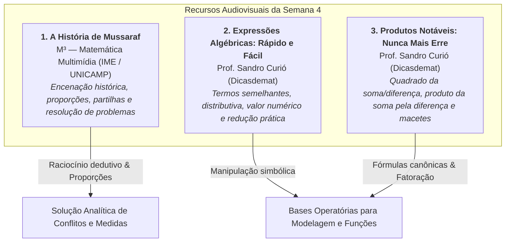
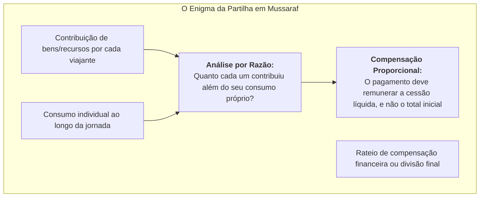
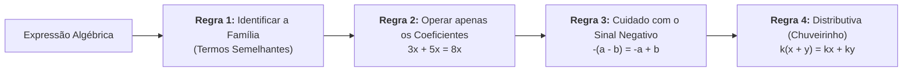
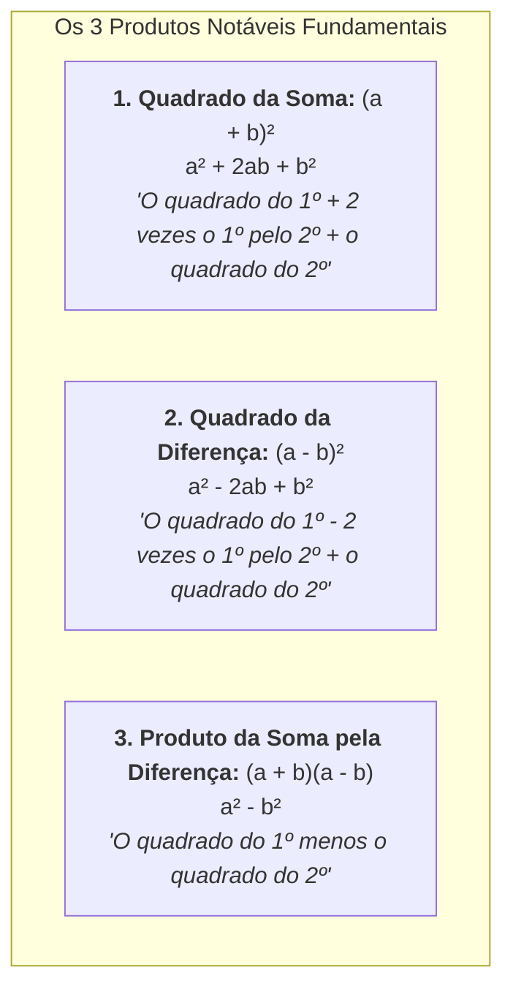

# 🌐 Material-base: Vídeos Didáticos (M³ Unicamp & Sandro Curió)

> **Disciplina:** Matemática Básica (`MMB002-EC-2026S2B2-T001`) — Semana 4  
> **Tema:** Proporcionalidade, representação e linguagem matemática  
> **Composição:** 3 Vídeos-base com contextualização histórica, álgebra prática e produtos notáveis  

---

## 🗺️ Visão Integrada dos Materiais-base da Semana

---

## 🎬 1. Vídeo-base: A História de Mussaraf (M³ Matemática Multimídia — Unicamp)

* **Produção:** Coleção M³ — Matemática Multimídia (IME / UNICAMP e Ministério da Educação)  
* **Link Oficial:** [YouTube (M3 Unicamp)](https://www.youtube.com/watch?v=EANe0OJlw8c&t=520s)  
* **Sinopse Oficial:** *Este vídeo traz uma encenação histórica que aborda uma situação-problema com proporções.*  
* **Duração Focal:** Destaque a partir de 08:40 (520s) com o desfecho da resolução do enigma.

---

### 1.1. Contextualização e Narrativa Histórica
A dramatização é ambientada no contexto das rotas comerciais do Oriente Médio antigo, onde mercadores e viajantes enfrentavam frequentes dilemas de repartição de custos, provisões de água, alimentos e animais de carga.

O personagem **Mussaraf** defronta-se com uma situação-problema típica de **partilha proporcional**: indivíduos com aportes e consumos diferentes precisam dividir os bens ou os custos de uma jornada de forma justa, evitando que uns sejam explorados pelo consumo alheio.

---

### 1.2. O Modelo Matemático da Partilha Justa
O cerne matemático demonstrado na encenação desconstrói a armadilha do **senso comum aditivo**:

> [!CAUTION]
> **A Falácia da Partilha Ingênua:**  
> Dividir uma compensação financeira simplesmente na razão dos recursos que cada pessoa trouxe no início da viagem é um erro conceitual grave, pois desconsidera o que a própria pessoa **consumiu** do seu próprio recurso.

#### Formalização Matemática:
Sejam dois viajantes $A$ e $B$ que compartilham seus suprimentos com um terceiro viajante $C$ que não trouxe mantimentos:
* O viajante $A$ entra com $m_A$ unidades de mantimento;
* O viajante $B$ entra com $m_B$ unidades de mantimento;
* O total de mantimento disponível é $M = m_A + m_B$;
* Os três compartilham igualmente o suprimento, de modo que a cota de consumo de cada um é:
  $$c = \frac{M}{3} = \frac{m_A + m_B}{3}$$

A contribuição **líquida cedida** ao viajante $C$ por cada um é:
$$\Delta m_A = m_A - c = m_A - \frac{m_A + m_B}{3} = \frac{2m_A - m_B}{3}$$
$$\Delta m_B = m_B - c = m_B - \frac{m_A + m_B}{3} = \frac{2m_B - m_A}{3}$$

Se o viajante $C$ paga uma quantia total $V$ em moedas de ouro pelo que consumiu, a recompensa de $A$ e $B$ deve ser dividida em **partes diretamente proporcionais às suas cessões líquidas**:
$$\frac{V_A}{\Delta m_A} = \frac{V_B}{\Delta m_B} = \frac{V}{\Delta m_A + \Delta m_B} = \frac{V}{c}$$

$$\boxed{V_A = V \cdot \frac{2m_A - m_B}{m_A + m_B} \quad \text{e} \quad V_B = V \cdot \frac{2m_B - m_A}{m_A + m_B}}$$

Essa formulação espelha o clássico problema dos 8 pães de Beremiz Samir em *O Homem que Calculava* (de Malba Tahan), reforçando a necessidade do rigor algébrico para que a justiça distributiva seja alcançada.

---

## 🎬 2. Vídeo-base: Expressões Algébricas — Rápido e Fácil (Prof. Sandro Curió)

* **Docente / Criador:** Prof. Sandro Curió (Canal *Dicasdemat*)  
* **Link Oficial:** [YouTube (Sandro Curió)](https://www.youtube.com/watch?v=8NNA-8rimNs)  
* **Sinopse Oficial:** *Neste vídeo-base, você poderá complementar seu estudo sobre expressões algébricas a partir de alguns exercícios.*  
* **Objetivo Pedagógico:** Apresentar técnicas ágeis de cálculo mental, redução de termos semelhantes, aplicação da propriedade distributiva e determinação do valor numérico.

---

### 2.1. Princípios Operatórios Enfatizados pelo Prof. Sandro Curió

O vídeo adota uma abordagem direta e prática focada em eliminar os principais vícios de linguagem que geram erros em provas e cálculos de engenharia:

---

### 2.2. Resoluções Passo a Passo dos Exercícios do Vídeo

#### 📌 Exercício 1: Redução de Termos Semelhantes
Simplificar a expressão:
$$E_1 = 4x + 7y - 2x + 3y - 5$$

* **Passo 1 (Agrupamento por famílias de letras):**
  $$E_1 = (4x - 2x) + (7y + 3y) - 5$$
* **Passo 2 (Operações com os coeficientes numéricos):**
  * Família de $x$: $4 - 2 = 2 \implies 2x$
  * Família de $y$: $7 + 3 = 10 \implies 10y$
  * Termo independente: $-5$
* **Resultado:**
  $$\mathbf{E_1 = 2x + 10y - 5}$$

> [!NOTE]
> Como $x$, $y$ e a constante $-5$ não são termos semelhantes, a expressão para aqui. Não se pode somar $2x$ com $10y$.

---

#### 📌 Exercício 2: Aplicação da Propriedade Distributiva com Regra de Sinais
Desenvolver e simplificar a expressão:
$$E_2 = 3(2x - 5) - 4(x - 3)$$

* **Passo 1 (Multiplicar o primeiro parêntese por $+3$):**
  $$3 \cdot 2x - 3 \cdot 5 = 6x - 15$$
* **Passo 2 (Multiplicar o segundo parêntese por $-4$ — Atenção aos sinais!):**
  $$(-4) \cdot x = -4x$$
  $$(-4) \cdot (-3) = +12$$
* **Passo 3 (Juntar todos os termos):**
  $$E_2 = 6x - 15 - 4x + 12$$
* **Passo 4 (Reduzir termos semelhantes):**
  $$E_2 = (6x - 4x) + (-15 + 12) = \mathbf{2x - 3}$$

---

#### 📌 Exercício 3: Determinação do Valor Numérico
Calcular o valor numérico da expressão $E_3 = 3x^2 - 2xy + y^2$ para $x = -2$ e $y = -1$:

* **Substituição entre parênteses para blindar a regra de sinais:**
  $$E_3 = 3(-2)^2 - 2(-2)(-1) + (-1)^2$$
* **Executar primeiro as potenciações:**
  * $(-2)^2 = +4$
  * $(-1)^2 = +1$
  $$E_3 = 3(4) - 2(-2)(-1) + 1$$
* **Executar as multiplicações:**
  * $3 \times 4 = 12$
  * $-2 \times (-2) \times (-1) = -4$
* **Efetuar a soma algébrica final:**
  $$E_3 = 12 - 4 + 1 = \mathbf{9}$$

---

---

## 🎬 3. Vídeo-base: Produtos Notáveis — Nunca Mais Erre (Prof. Sandro Curió)

* **Docente / Criador:** Prof. Sandro Curió (Canal *Dicasdemat*)  
* **Link Oficial:** [YouTube (Sandro Curió)](https://www.youtube.com/watch?v=UECy1XbL6w8&t=695s)  
* **Sinopse Oficial:** *Neste vídeo-base, você poderá complementar seu estudo sobre produtos notáveis a partir de alguns exercícios.*  
* **Duração Focal:** Destaque a partir de 11:35 (695s) com os desafios finais de fixação e macetes.

---

### 3.1. O "Alerta Vermelho" de Sandro Curió: O Erro Mais Comum da Álgebra

> [!CAUTION]
> **🚨 JAMAIS Cometa Esse Erro Fatal:**  
> $$(a + b)^2 \neq a^2 + b^2 \quad \text{e} \quad (a - b)^2 \neq a^2 - b^2$$
> O estudante que simplesmente "distribui" o expoente 2 sobre as parcelas ignora a existência do **termo misto** ($2ab$, o dobro do produto do primeiro pelo segundo).

---

### 3.2. Os Três Casos Canônicos e a Mnemônica de Sandro Curió

---

### 3.3. Exercícios Resolvidos Passo a Passo do Vídeo

#### 📌 Caso 1: Quadrado da Soma $(a + b)^2 = a^2 + 2ab + b^2$

1. **Exemplo Básico:** $(x + 5)^2$
   * Primeiro termo: $a = x \implies a^2 = x^2$
   * Duplo produto: $2 \cdot a \cdot b = 2 \cdot x \cdot 5 = 10x$
   * Segundo termo: $b = 5 \implies b^2 = 5^2 = 25$
   $$\mathbf{(x + 5)^2 = x^2 + 10x + 25}$$

2. **Exemplo com Coeficiente no 1º Termo:** $(2x + 3)^2$
   * *Atenção ao parêntese no 1º termo:* $(2x)^2 = 4x^2$ (não $2x^2$!)
   * Duplo produto: $2 \cdot (2x) \cdot (3) = 12x$
   * Quadrado do 2º: $3^2 = 9$
   $$\mathbf{(2x + 3)^2 = 4x^2 + 12x + 9}$$

3. **Exemplo com Duas Variáveis e Expoentes:** $(3x^2 + 4y)^2$
   * Primeiro termo: $(3x^2)^2 = 9x^4$
   * Duplo produto: $2 \cdot (3x^2) \cdot (4y) = 24x^2y$
   * Segundo termo: $(4y)^2 = 16y^2$
   $$\mathbf{(3x^2 + 4y)^2 = 9x^4 + 24x^2y + 16y^2}$$

---

#### 📌 Caso 2: Quadrado da Diferença $(a - b)^2 = a^2 - 2ab + b^2$

> [!TIP]
> **Dica Mnemônica do Curió:**  
> A única diferença em relação ao caso 1 é o sinal de **menos** antes do dobro do produto. O termo $b^2$ continua sempre **positivo** pois $(-b)^2 = +b^2$.

1. **Exemplo 1:** $(x - 7)^2$
   $$x^2 - 2(x)(7) + 7^2 = \mathbf{x^2 - 14x + 49}$$

2. **Exemplo 2:** $(3x - 2)^2$
   $$(3x)^2 - 2(3x)(2) + 2^2 = \mathbf{9x^2 - 12x + 4}$$

3. **Exemplo 3 (com coeficientes e potências):** $(5a^3 - 2b)^2$
   $$(5a^3)^2 - 2(5a^3)(2b) + (2b)^2 = \mathbf{25a^6 - 20a^3b + 4b^2}$$

---

#### 📌 Caso 3: Produto da Soma pela Diferença $(a + b)(a - b) = a^2 - b^2$

Demonstração distributiva do cancelamento dos termos simétricos:
$$(a + b)(a - b) = a^2 - ab + ba - b^2 = a^2 - b^2$$

1. **Exemplo Polinomial:** $(x + 4)(x - 4)$
   $$x^2 - 4^2 = \mathbf{x^2 - 16}$$

2. **Exemplo com Coeficiente:** $(3x + 5)(3x - 5)$
   $$(3x)^2 - 5^2 = \mathbf{9x^2 - 25}$$

3. **Aplicação em Racionalização de Radicais:** $(\sqrt{7} + \sqrt{3})(\sqrt{7} - \sqrt{3})$
   $$(\sqrt{7})^2 - (\sqrt{3})^2 = 7 - 3 = \mathbf{4}$$

4. **Macete de Cálculo Mental Aritmético:**  
   Calcular mentalmente $103 \times 97$:
   $$103 \times 97 = (100 + 3)(100 - 3) = 100^2 - 3^2 = 10.000 - 9 = \mathbf{9.991}$$

---

## 💻 4. Aplicações Práticas na Engenharia de Computação

| Recurso do Material-base | Conexão Direta com a Computação |
| :--- | :--- |
| **A História de Mussaraf (Rateio Proporcional Líquido)** | **Algoritmos de Consenso e Prova de Participação (PoS):** Cálculo proporcional de taxas e recompensas de blocos em redes distribuídas (Ethereum/Cardano), deduzindo o custo de validação operacional antes da partição do rendimento líquido. |
| **Propriedade Distributiva e Simplificação Algébrica** | **Compiladores e Árvores de Sintaxe Abstrata (AST):** Otimizador de código (*Optimizer Pass*) aplica regras distributivas e eliminação de subexpressões comuns (*Common Subexpression Elimination - CSE*) para reduzir instruções de máquina no processador. |
| **Substituição e Valor Numérico** | **Engines de Avaliação de Expressões e DSLs:** Interpretadores de fórmulas e linguagens de script (ex.: Python `eval`, planilhas Excel/Google Sheets, parseadores JSON/AST) compilando expressões matemáticas dinâmicas em tempo de execução. |
| **Produtos Notáveis (Diferença de Quadrados e TQP)** | **Otimização de Distância Euclidiana em Machine Learning & Jogos:** Em algoritmos k-NN e gráficos 3D, comparar distâncias quadráticas $(x_2 - x_1)^2 + (y_2 - y_1)^2$ evita chamadas caras de $\text{sqrt}()$, economizando ciclos preciosos de GPU/CPU. |

