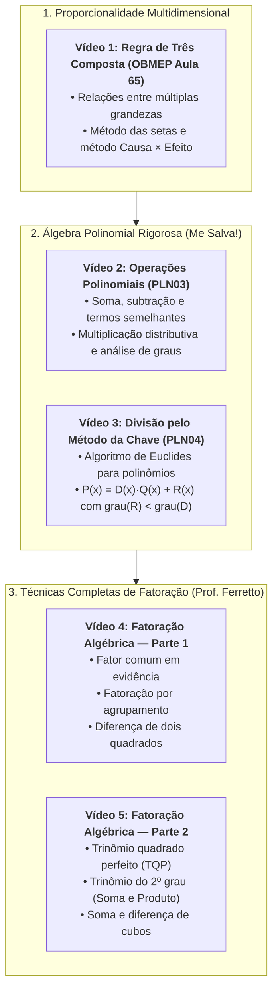

# 🔍 Aprofundando o Tema — Semana 4 (MMB002)

> **Disciplina:** Matemática Básica (`MMB002-EC-2026S2B2-T001`) — Semana 4  
> **Tema da Semana:** Proporcionalidade, Representação e Linguagem Matemática  
> **Conteúdo Principal:** Série de 5 Videoaulas Avançadas de Especialistas (Portal da Matemática OBMEP, Me Salva! e Professor Ferretto)  
> **Objetivo:** Dominar a modelagem de regras de três compostas, álgebra polinomial (operações e método da chave) e técnicas completas de fatoração algébrica.  

---

## 🗺️ Mapa Integrado de Aprofundamento

---

## 🎥 Vídeo 1: Método de Solução de Problemas para Regra de 3 Composta — Aula 65

* **Canal / Instituição:** [Portal da Matemática OBMEP / IMPA](https://www.youtube.com/@portalmatematicaobmep)  
* **Link da Aula:** [YouTube (n1HnHH8cRyI)](https://www.youtube.com/watch?v=n1HnHH8cRyI)  
* **Tópico:** Algoritmos de resolução para problemas envolvendo três ou mais grandezas proporcionais.

### 1.1. Fundamentação Teórica
A **Regra de Três Composta** é uma generalização da regra de três simples utilizada para relacionar três ou mais grandezas interdependentes (diretamente ou inversamente proporcionais entre si).

Para resolver com segurança e sem ambiguidades conceituais, o método canônico adotado pelo Portal da Matemática baseia-se na **fixação da grandeza que contém a incógnita**:

1. **Montagem da Tabela:** Organiza-se uma coluna para cada grandeza participante, dispondo os valores da situação inicial na primeira linha e os valores da nova situação na segunda linha;
2. **Identificação da Proporcionalidade:** Compara-se cada grandeza individualmente com a grandeza que contém a incógnita $x$, imaginando todas as demais grandezas temporariamente fixas/constantes:
   * **Diretamente Proporcional (GDP):** Se o aumento da grandeza provoca aumento na incógnita, a seta tem o **mesmo sentido** da seta da incógnita.
   * **Inversamente Proporcional (GIP):** Se o aumento da grandeza provoca redução na incógnita, a seta tem o **sentido oposto**.
3. **Equação Fundamental:** Isola-se a razão da coluna da incógnita no primeiro membro da igualdade e iguala-se ao produto das razões de todas as outras grandezas, invertendo as frações que possuírem sentido contrário:
   $$\frac{x_1}{x_2} = \left(\frac{A_1}{A_2}\right)^{\pm 1} \times \left(\frac{B_1}{B_2}\right)^{\pm 1} \times \left(\frac{C_1}{C_2}\right)^{\pm 1}$$

### 1.2. Exemplo Canônico Passo a Passo
> *Problema:* Em uma fábrica têxtil, $12$ costureiras, trabalhando $8\text{ horas/dia}$, produzem $360$ camisas em $6\text{ dias}$. Quantas camisas serão produzidas por $15$ costureiras, trabalhando $6\text{ horas/dia}$, durante $8\text{ dias}$?

* **Estruturação das Grandezas:**
  | Costureiras | Horas/Dia | Dias | Camisas ($x$) |
  | :---: | :---: | :---: | :---: |
  | $12$ | $8$ | $6$ | $360$ |
  | $15$ | $6$ | $8$ | $x$ |

* **Análise em relação à grandeza "Camisas" (seta para baixo):**
  * Costureiras $\to$ Camisas: Mais costureiras produzem mais camisas (**Direta** $\downarrow$).
  * Horas/Dia $\to$ Camisas: Mais horas de trabalho geram mais camisas (**Direta** $\downarrow$).
  * Dias $\to$ Camisas: Mais dias de trabalho geram mais camisas (**Direta** $\downarrow$).

* **Montagem Algébrica e Simplificação Cruzada:**
  $$\frac{360}{x} = \frac{12}{15} \times \frac{8}{6} \times \frac{6}{8}$$
  Cancelando fatores idênticos imediatamente ($\frac{8}{6} \times \frac{6}{8} = 1$):
  $$\frac{360}{x} = \frac{12}{15} = \frac{4}{5}$$
  $$4x = 360 \times 5 \implies x = \frac{1800}{4} = \mathbf{450\text{ camisas}}$$

---

## 🎥 Vídeo 2: Me Salva! PLN03 — Operações com Polinômios (Soma, Subtração e Multiplicação)

* **Canal:** [Me Salva! ENEM](https://www.youtube.com/@mesalva)  
* **Link da Aula:** [YouTube (Nzl7ElN-30M)](https://www.youtube.com/watch?v=Nzl7ElN-30M)  
* **Tópico:** Adição, subtração por redução de semelhantes e produto polinomial por propriedade distributiva.

### 2.1. Termos Semelhantes e Adição/Subtração
Dois monômios são ditos **termos semelhantes** quando compartilham rigorosamente a mesma parte literal (mesmas variáveis elevadas aos mesmos expoentes).

* **Adição:** Agrupam-se e somam-se apenas os coeficientes numéricos dos termos semelhantes:
  $$(5x^3 - 2x^2 + 4) + (3x^3 + 7x^2 - x) = (5+3)x^3 + (-2+7)x^2 - x + 4 = \mathbf{8x^3 + 5x^2 - x + 4}$$
* **Subtração:** A operação $P(x) - Q(x)$ exige a **inversão estrita de todos os sinais** dos monômios que compõem o subtraendo $Q(x)$:
  $$(4x^2 - 3x + 1) - (2x^2 - 5x - 6) = 4x^2 - 3x + 1 - 2x^2 + 5x + 6 = \mathbf{2x^2 + 2x + 7}$$

### 2.2. Multiplicação de Polinômios e Propriedade dos Graus
A multiplicação aplica a **propriedade distributiva** de cada monômio do primeiro fator sobre todos os monômios do segundo fator, somando os expoentes das potências de mesma base ($x^m \cdot x^n = x^{m+n}$):

$$\text{grau}(P \cdot Q) = \text{grau}(P) + \text{grau}(Q)$$

* **Exemplo:**
  $$(2x - 3)(x^2 + 4x - 5) = 2x(x^2 + 4x - 5) - 3(x^2 + 4x - 5)$$
  $$= (2x^3 + 8x^2 - 10x) - (3x^2 + 12x - 15) = \mathbf{2x^3 + 5x^2 - 22x + 15}$$

---

## 🎥 Vídeo 3: Me Salva! PLN04 — Divisão de Polinômios pelo Método da Chave

* **Canal:** [Me Salva! ENEM](https://www.youtube.com/@mesalva)  
* **Link da Aula:** [YouTube (1w3AAcLwuOE)](https://www.youtube.com/watch?v=1w3AAcLwuOE)  
* **Tópico:** Divisão euclidiana de polinômios, algoritmo da chave e condições do resto.

### 3.1. Teorema da Divisão Euclidiana para Polinômios
Dados dois polinômios $P(x)$ (dividendo) e $D(x)$ (divisor com $D(x) \neq 0$), existem únicos polinômios $Q(x)$ (quociente) e $R(x)$ (resto) tais que:

$$P(x) = D(x) \cdot Q(x) + R(x)$$

Sob a condição de parada obrigatória:
$$\text{grau}(R) < \text{grau}(D) \quad \text{ou} \quad R(x) \equiv 0$$
Quando $R(x) \equiv 0$, diz-se que $P(x)$ é **divisível** por $D(x)$.

### 3.2. Algoritmo Passo a Passo do Método da Chave
1. **Ordenação e Preenchimento:** Ordenam-se dividendo e divisor em ordem decrescente de expoentes. Se houver potências ausentes, preenche-se com coeficiente zero ($0x^k$);
2. **Divisão dos Líderes:** Divide-se o termo de maior grau do dividendo pelo termo de maior grau do divisor; o resultado é o primeiro termo do quociente;
3. **Multiplicação e Subtração:** Multiplica-se esse novo termo por todos os termos do divisor, **inverte-se o sinal** de cada termo resultante e soma-se abaixo do dividendo (anulando o termo líder);
4. **Descida de Termos e Repetição:** Baixa-se o próximo termo e repete-se o processo até que o grau do resto seja estritamente inferior ao grau do divisor.

### 3.3. Exemplo Resolvido
Dividir $P(x) = 2x^3 - 3x^2 + x - 5$ por $D(x) = x - 2$:

$$\begin{array}{r|l}
2x^3 - 3x^2 + x - 5 & x - 2 \\ \cline{2-2}
-(2x^3 - 4x^2)\phantom{-5} & 2x^2 + x + 3 \quad (\text{Quociente } Q) \\ \cline{1-1}
x^2 + x - 5 & \\
-(x^2 - 2x)\phantom{5} & \\ \cline{1-1}
3x - 5 & \\
-(3x - 6) & \\ \cline{1-1}
\mathbf{1} & \quad (\text{Resto } R)
\end{array}$$

* **Verificação:** $(x - 2)(2x^2 + x + 3) + 1 = (2x^3 + x^2 + 3x - 4x^2 - 2x - 6) + 1 = 2x^3 - 3x^2 + x - 5$. (Correto!)

---

## 🎥 Vídeo 4: Matemática Básica — Aula 21: Fatoração de Expressões Algébricas (Parte 1)

* **Docente:** [Professor Ferretto](https://www.youtube.com/@professorferretto)  
* **Link da Aula:** [YouTube (gpLUtjncoSo)](https://www.youtube.com/watch?v=gpLUtjncoSo)  
* **Tópico:** Fundamentos da fatoração, Fator Comum em Evidência, Agrupamento e Diferença de Dois Quadrados.

### 4.1. O que é Fatorar?
Fatorar uma expressão algébrica significa transformá-la de uma forma de **soma ou subtração de termos** em um **produto de fatores irredutíveis**. Isso é vital para simplificar frações algébricas e resolver equações polinomiais.

---

### 4.2. Caso 1: Fator Comum em Evidência
Utilizado quando existe um fator numérico e/ou literal que se repete em **todos** os termos da expressão:
1. O fator numérico em evidência é o **MDC** dos coeficientes;
2. As variáveis em evidência são aquelas comuns a todos os termos, elevadas ao **menor expoente**.

* **Exemplos do Prof. Ferretto:**
  * $6x^3 + 9x^2$: $\text{MDC}(6, 9) = 3$ e menor expoente de $x$ é $x^2 \implies \mathbf{3x^2(2x + 3)}$.
  * $12a^4b^3 - 18a^3b^4 + 6a^2b^2$: $\text{MDC}(12, 18, 6) = 6$, termos $a^2b^2 \implies \mathbf{6a^2b^2(2a^2b - 3ab^2 + 1)}$.

---

### 4.3. Caso 2: Fatoração por Agrupamento
Aplicado a polinômios que não possuem fator comum em todos os termos simultaneamente, mas que possuem uma quantidade par de termos (geralmente $4$ ou $6$ termos) que podem ser agrupados em blocos com fatores comuns parciais:

$$ax + ay + bx + by = a(x + y) + b(x + y) = \mathbf{(x + y)(a + b)}$$

* **Exemplo Prático:**
  Fatorar $x^3 - 2x^2 + 5x - 10$:
  * Agrupando os dois primeiros termos: $x^2(x - 2)$
  * Agrupando os dois últimos termos: $+5(x - 2)$
  * Colocando o binômio comum $(x - 2)$ em evidência:
    $$\mathbf{(x - 2)(x^2 + 5)}$$

---

### 4.4. Caso 3: Diferença de Dois Quadrados
Sempre que tivermos a subtração entre dois termos que são quadrados perfeitos, fatora-se no produto da soma pela diferença de suas raízes quadradas:

$$a^2 - b^2 = \mathbf{(a + b)(a - b)}$$

* **Exemplos Práticos:**
  * $x^2 - 25 = (x + 5)(x - 5)$
  * $49y^2 - 16 = (7y + 4)(7y - 4)$
  * $x^4 - 81 = (x^2 + 9)(x^2 - 9) = \mathbf{(x^2 + 9)(x + 3)(x - 3)}$ *(fatoração sucessiva)*

---

## 🎥 Vídeo 5: Matemática Básica — Aula 21: Fatoração de Expressões Algébricas (Parte 2)

* **Docente:** [Professor Ferretto](https://www.youtube.com/@professorferretto)  
* **Link da Aula:** [YouTube (HQpjjix_aeE)](https://www.youtube.com/watch?v=HQpjjix_aeE)  
* **Tópico:** Trinômio Quadrado Perfeito, Trinômio do 2º Grau por Soma e Produto, Soma/Diferença de Cubos e Simplificação.

---

### 5.1. Caso 4: Trinômio do Quadrado Perfeito (TQP)
É o caminho inverso da expansão do quadrado da soma ou da diferença:

$$a^2 + 2ab + b^2 = \mathbf{(a + b)^2}$$
$$a^2 - 2ab + b^2 = \mathbf{(a - b)^2}$$

* **Teste Prático de Validação do Prof. Ferretto:**
  1. Extraia a raiz quadrada dos termos extremos: $\sqrt{a^2} = a$ e $\sqrt{b^2} = b$;
  2. Multiplique o dobro do produto das raízes: $2 \cdot a \cdot b$;
  3. Se o resultado coincidir com o termo central do trinômio, trata-se de um TQP!
* **Exemplo:** $9x^2 - 30x + 25$:
  * $\sqrt{9x^2} = 3x$ e $\sqrt{25} = 5$
  * Dobro do produto: $2 \cdot (3x) \cdot (5) = 30x$ (confere com o termo central!)
  * Como o termo central é negativo: $\mathbf{(3x - 5)^2}$.

---

### 5.2. Caso 5: Trinômio do 2º Grau por Soma e Produto ($x^2 + Sx + P$)
Quando o trinômio da forma $x^2 + Bx + C$ não é quadrado perfeito, procuram-se dois números reais $m$ e $n$ tais que:
$$\begin{cases}
m + n = B \quad (\text{Soma}) \\
m \cdot n = C \quad (\text{Produto})
\end{cases} \implies x^2 + Bx + C = \mathbf{(x + m)(x + n)}$$

* **Exemplo:** $x^2 - 7x + 10$:
  * Soma $= -7$ e Produto $= +10$
  * Números: $-2$ e $-5$ (pois $(-2) + (-5) = -7$ e $(-2) \cdot (-5) = 10$)
  * Forma fatorada: $\mathbf{(x - 2)(x - 5)}$.

---

### 5.3. Caso 6: Soma e Diferença de Dois Cubos
Identidades fundamentais para fatoração cúbica:

$$a^3 + b^3 = \mathbf{(a + b)(a^2 - ab + b^2)}$$
$$a^3 - b^3 = \mathbf{(a - b)(a^2 + ab + b^2)}$$

* **Exemplos Práticos:**
  * $x^3 - 8 = x^3 - 2^3 = \mathbf{(x - 2)(x^2 + 2x + 4)}$
  * $27y^3 + 1 = (3y)^3 + 1^3 = \mathbf{(3y + 1)(9y^2 - 3y + 1)}$

---

### 5.4. Aplicação Síntese: Simplificação de Frações Algébricas
Fatorar o numerador e o denominador permite cancelar binômios idênticos, acelerando a simplificação:

$$\frac{x^2 - 9}{x^2 - 5x + 6} = \frac{(x + 3)\cancel{(x - 2)}}{\cancel{(x - 2)}(x - 3)} = \mathbf{\frac{x + 3}{x - 3}} \quad (x \neq 2, x \neq 3)$$

---

## 💻 Conexões com a Engenharia de Computação

1. **Aritmética Polinomial em Criptografia (RSA e Curvas Elípticas):**  
   A divisão euclidiana de polinômios pelo método da chave com coeficientes em corpos finitos ($\mathbb{Z}_p[x]$) é a base matemática dos códigos corretores de erros (como os códigos *Reed-Solomon* usados em QR Codes e discos ópticos) e da criptografia pós-quântica baseada em reticulados (*Lattice-based cryptography*).
2. **Resolução de Sistemas Lineares em Modelagem Estrutural:**  
   Regras de três compostas representam as primeiras aproximações de sistemas de equações simultâneas de taxas de produção e fluxo de dados em redes computacionais.
3. **Redução de Complexidade em Algoritmos Numéricos:**  
   A fatoração algébrica substitui somas e divisões custosas por produtos fatorados pré-computados, minimizando o erro de ponto flutuante (*floating point round-off error*) em simulações numéricas.
