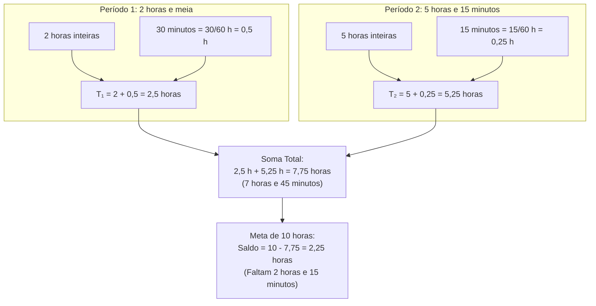

# 💬 Fórum Temático — Semana 4 (MMB002)

> **Disciplina:** Matemática Básica (`MMB002-EC-2026S2B2-T001`)  
> **Tema da Semana 4:** Proporcionalidade, Representação e Linguagem Matemática  
> **Docente Responsável:** Profª Dra. Rúbia Barcelos Amaral  
> **Período de Participação:** 19/10/2026 a 01/11/2026  
> **Status:** 🟢 **Resoluções e Modelos Prontos para Postagem no AVA**  

---

## 📌 Enunciados Oficiais do Fórum Temático

### 1. Provocação Central da Professora no AVA
> *No desafio da semana, foi necessário realizar a conversão dos anos em dias.*  
> 
> *Você sabe fazer a conversão de dias em horas? Por exemplo, você tem que cumprir, por mês, **10 horas de voluntariado** no seu trabalho. Em um dia você fez **duas horas e meia**, e em outro dia **5 horas e 15 minutos**. Como transformar esses períodos em horas para somar?*

---

### 2. Contexto de Origem: O Desafio da Semana (Expectativa de Vida)
> *Pesquisas recentes indicam que a expectativa de vida do brasileiro subiu de 74,6 anos (2012) para 74,9 anos (2015). A conversão dessa diferença temporal para dias com meses de 30 dias resultou em:*
> $$\Delta E = 74,9 - 74,6 = 0,3\text{ ano} \implies 0,3 \times (12 \times 30) = 0,3 \times 360 = \mathbf{108\text{ dias}}$$

---

## 🧮 Resolução Analítica do Problema do Voluntariado

---

### 1. Como Fazer a Conversão Geral de Dias em Horas?
Como $1\text{ dia} = 24\text{ horas}$, a conversão de uma quantidade qualquer de dias $D$ para horas $H$ se dá por multiplicação direta pela taxa unitária:
$$H = D \times 24\text{ h/dia}$$

* **Exemplo 1:** $3\text{ dias} = 3 \times 24 = 72\text{ horas}$.
* **Exemplo 2:** $0,25\text{ dia} = 0,25 \times 24 = 6\text{ horas}$.
* **Exemplo 3 (Desafio da Longevidade):** Os $108\text{ dias}$ equivalem a $108 \times 24 = 2.592\text{ horas}$.

---

### 2. A Armadilha do Sistema Sexagesimal vs. Sistema Decimal
> ⚠️ **Alerta de Ouro da Matemática:**  
> O tempo mede-se no **sistema sexagesimal (base 60)**, enquanto nossa notação de números com vírgula utiliza o **sistema decimal (base 10)**.  
> * Um erro extremamente comum é escrever "2 horas e meia" como $2,30\text{ h}$ e "5 horas e 15 minutos" como $5,15\text{ h}$, somando $2,30 + 5,15 = 7,45\text{ h}$.  
> * Na verdade, $0,45\text{ hora}$ decimal corresponde a $0,45 \times 60 = 27\text{ minutos}$ (e não a 45 minutos!).  
> * A conversão correta exige expressar os minutos como **frações de hora divididas por 60**.

---

### 3. Três Métodos Equivalentes para Transformar e Somar

#### 🔹 Método 1: Conversão para Forma Decimal (Recomendado)
* **Dia 1 (2 horas e meia):**  
  $$30\text{ min} = \frac{30}{60}\text{ h} = 0,5\text{ h} \implies T_1 = 2 + 0,5 = \mathbf{2,5\text{ horas}}$$
* **Dia 2 (5 horas e 15 minutos):**  
  $$15\text{ min} = \frac{15}{60}\text{ h} = \frac{1}{4}\text{ h} = 0,25\text{ h} \implies T_2 = 5 + 0,25 = \mathbf{5,25\text{ horas}}$$
* **Soma dos períodos cumpridos:**  
  $$T_{\text{total}} = 2,5\text{ h} + 5,25\text{ h} = \mathbf{7,75\text{ horas}}$$
* **Reconversão para horas e minutos:**  
  $$7,75\text{ h} = 7\text{ h} + (0,75 \times 60)\text{ min} = \mathbf{7\text{ horas e } 45\text{ minutos}}$$

---

#### 🔹 Método 2: Operação Direta em Unidades Sexagesimais (Horas e Minutos)
Somam-se as partes inteiras e as partes fracionárias separadamente:
$$\begin{aligned}
\text{Horas:} \quad & 2\text{ h} + 5\text{ h} = 7\text{ horas} \\
\text{Minutos:} \quad & 30\text{ min} + 15\text{ min} = 45\text{ minutos} \\
\text{Total:} \quad & \mathbf{7\text{ horas e } 45\text{ minutos}}
\end{aligned}$$
Como $45\text{ min} < 60\text{ min}$, não há necessidade de transporte para a casa das horas.  
Em seguida, converte-se para horas dividindo o total de minutos por 60:
$$T = 7 + \frac{45}{60} = 7 + \frac{3}{4} = 7 + 0,75 = \mathbf{7,75\text{ horas}}$$

---

#### 🔹 Método 3: Forma Fracionária com MMC
$$\begin{aligned}
T_1 &= 2\frac{1}{2} = \frac{5}{2}\text{ h} = \frac{10}{4}\text{ h} \\
T_2 &= 5\frac{1}{4} = \frac{21}{4}\text{ h} \\
T_{\text{total}} &= \frac{10}{4} + \frac{21}{4} = \frac{31}{4}\text{ h} = 7\frac{3}{4}\text{ h} = \mathbf{7,75\text{ horas}}
\end{aligned}$$

---

### 4. Saldo Restante para Cumprir a Meta de 10 Horas
Para atingir o compromisso mensal estipulado no trabalho:
$$\text{Horas Restantes} = 10\text{ h} - 7,75\text{ h} = \mathbf{2,25\text{ horas}}$$
Convertendo $0,25\text{ h}$ em minutos ($0,25 \times 60 = 15\text{ min}$):
$$\mathbf{\text{Faltam cumprir exatamente } 2\text{ horas e } 15\text{ minutos}}.$$

---

## 📝 Modelos Prontos para Postagem no AVA

### 🌟 Modelo 1: Resposta Completa e Didática (Recomendada)

> **Assunto:** Conversão de Unidades Temporais: Dias em Horas e Soma dos Períodos de Voluntariado
>
> Olá, professora Rúbia, tutores e colegas!
> 
> A relação entre as unidades temporais é um excelente exemplo de proporcionalidade direta e mudança de bases numéricas:
> 
> **1. Conversão de Dias em Horas:**  
> Como a razão unitária é de $24\text{ horas/dia}$, para converter qualquer quantidade de dias ($D$) em horas ($H$), basta multiplicar por 24:  
> $$H = D \times 24$$  
> Por exemplo, os $108\text{ dias}$ obtidos no Desafio da Longevidade equivalem a $108 \times 24 = 2.592\text{ horas}$. Já meio dia de trabalho corresponde a $0,5 \times 24 = 12\text{ horas}$.
> 
> **2. Como transformar os períodos de voluntariado em horas para somar:**  
> O ponto crucial aqui é evitar a confusão comum entre o **sistema sexagesimal (base 60)** e o **sistema decimal (base 10)**. Não podemos somar $2,30 + 5,15$, pois 30 minutos não são 0,30 hora!  
> Para converter os minutos em fração decimal de hora, dividimos os minutos por 60:
> * **Dia 1 (duas horas e meia):**  
>   $30\text{ min} = \frac{30}{60}\text{ h} = 0,5\text{ h} \implies T_1 = 2 + 0,5 = \mathbf{2,5\text{ horas}}$.
> * **Dia 2 (5 horas e 15 minutos):**  
>   $15\text{ min} = \frac{15}{60}\text{ h} = 0,25\text{ h} \implies T_2 = 5 + 0,25 = \mathbf{5,25\text{ horas}}$.
> 
> **3. Soma dos períodos:**  
> $$T_{\text{total}} = 2,5\text{ h} + 5,25\text{ h} = \mathbf{7,75\text{ horas}}$$  
> Como $0,75\text{ h} = 0,75 \times 60 = 45\text{ minutos}$, o voluntário já cumpriu **7 horas e 45 minutos**.
> 
> **4. Saldo para a meta de 10 horas:**  
> Para atingir as 10 horas mensais:  
> $$10 - 7,75 = 2,25\text{ horas}$$  
> Como $0,25 \times 60 = 15\text{ minutos}$, faltam cumprir **2 horas e 15 minutos**.
> 
> Um abraço e ótimos estudos a todos!

---

### ⚡ Modelo 2: Resposta Direta e Objetiva

> **Assunto:** Solução do Fórum: Conversão e Soma de Horas de Voluntariado
> 
> Olá a todos!
> 
> **1. Dias em horas:**  
> Multiplica-se o número de dias por 24 ($1\text{ dia} = 24\text{ h}$).
> 
> **2. Transformação dos períodos para somar:**  
> Para somar em horas, convertemos os minutos dividindo-os por 60:  
> * Duas horas e meia: $2\text{ h} + \frac{30}{60}\text{ h} = 2 + 0,5 = \mathbf{2,5\text{ h}}$.  
> * 5 horas e 15 minutos: $5\text{ h} + \frac{15}{60}\text{ h} = 5 + 0,25 = \mathbf{5,25\text{ h}}$.  
> 
> **3. Total e saldo:**  
> * Soma: $2,5 + 5,25 = \mathbf{7,75\text{ horas}}$ (ou $7\text{ h } 45\text{ min}$).  
> * Meta: $10 - 7,75 = \mathbf{2,25\text{ horas}}$ restantes (ou seja, faltam $2\text{ horas e } 15\text{ minutos}$).
> 
> Boa semana a todos!

---

### 🤝 Modelo 3: Réplica Construtiva a Colega

> Olá, colega!
> 
> Excelente sua explicação! Destacar que $15\text{ minutos} = 0,25\text{ hora}$ e $30\text{ minutos} = 0,5\text{ hora}$ é fundamental, pois muitas pessoas caem no engano de somar $2,30 + 5,15 = 7,45$, sem perceber que 0,45 hora decimal são apenas 27 minutos ($0,45 \times 60$), e não 45 minutos.
> 
> Sua abordagem mostra com muita clareza a importância de converter a parte dos minutos para frações com denominador 60 antes de operar na notação decimal.
> 
> Parabéns pela contribuição!
