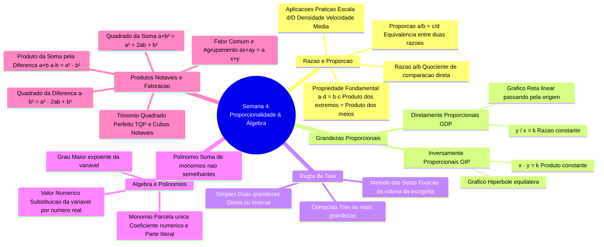

# 📑 Em Síntese — Resumo Executivo da Semana 4 (MMB002)

> **Disciplina:** Matemática Básica (`MMB002-EC-2026S2B2-T001`)  
> **Tema da Semana 4:** Proporcionalidade, Representação e Linguagem Matemática  
> **Docente Responsável:** Profª Dra. Rúbia Barcelos Amaral  
> **Período de Realização:** 19/10/2026 a 01/11/2026  
> **Desempenho Oficial na Avaliação:** 🏆 **Nota 10,0 / 10,0 (100% de aproveitamento)** — 8/8 questões corretas  

---

## 👩‍🏫 Mensagem Oficial de Fechamento do AVA

> *Começamos o estudo dessa semana focando nos conceitos de **razão e proporção**. São noções matemáticas muito presentes no nosso cotidiano, e muitas vezes as usamos sem perceber. A partir delas são apresentadas as **grandezas proporcionais**, tanto diretamente quanto inversamente.*  
> 
> *Além disso, desenvolvemos o estudo das **expressões algébricas** e verificamos técnicas de resolução para situações envolvendo os **produtos notáveis**, esses estudos serão indispensáveis para as próximas semanas da disciplina.*  
> 
> *Parabéns! Você chegou ao fim do conteúdo desta semana.*  
> 
> *Agora, você está preparado(a) para avançar em seus estudos, por isso, na próxima semana estudaremos **equações**.*  
> 
> *Até lá!*

---

## 🗺️ Mapa Mental Integrado da Semana 4

---

## 📊 1. Quadro Comparativo: Grandezas Diretamente vs. Inversamente Proporcionais

| Critério | Grandezas Diretamente Proporcionais (GDP) | Grandezas Inversamente Proporcionais (GIP) |
| :--- | :--- | :--- |
| **Definição Operatória** | O quociente (razão) entre as grandezas permanece constante | O produto entre as grandezas correspondentes permanece constante |
| **Equação Algébrica** | $\frac{y}{x} = k \iff y = k \cdot x$ | $x \cdot y = k \iff y = \frac{k}{x}$ |
| **Comportamento Mútuo** | Se uma grandeza é multiplicada por $\lambda$, a outra também é multiplicada por $\lambda$ | Se uma grandeza é multiplicada por $\lambda$, a outra é dividida por $\lambda$ |
| **Comportamento Gráfico** | Reta no plano cartesiano que intercepta a origem $(0,0)$ | Ramo de hipérbole equilátera assintótica aos eixos coordenados |
| **Exemplo Físico/Técnico** | Distância percorrida com velocidade constante ($d = v \cdot t$) | Tempo de percurso para distância fixa ($t = \frac{d}{v}$) |
| **Exemplo Computacional** | Consumo de memória linear com $N$ nós alocados ($M \propto N$) | Tempo de processamento distribuído com $P$ processadores ideais ($T \propto \frac{1}{P}$) |

---

## ⚙️ 2. Formulário de Bolso: Produtos Notáveis & Fatoração Algébrica

### 🔹 Identidades Notáveis Clássicas
1. **Quadrado da Soma:**
   $$(a + b)^2 = a^2 + 2ab + b^2$$
   > ⚠️ **Atenção:** Jamais esqueça o termo do duplo produto central ($2ab$). $(a + b)^2 \neq a^2 + b^2$.

2. **Quadrado da Diferença:**
   $$(a - b)^2 = a^2 - 2ab + b^2$$
   > O termo $-2ab$ possui sinal negativo, enquanto o último termo $+b^2$ é estritamente positivo.

3. **Produto da Soma pela Diferença:**
   $$(a + b)(a - b) = a^2 - b^2$$
   > Essencial para racionalização de denominadores com radicais e simplificação rápida de frações algébricas.

4. **Cubo da Soma e da Diferença:**
   $$(a + b)^3 = a^3 + 3a^2b + 3ab^2 + b^3$$
   $$(a - b)^3 = a^3 - 3a^2b + 3ab^2 - b^3$$

---

### 🔹 Técnicas Canônicas de Fatoração Algébrica
* **Fator Comum em Evidência:**
  $$ax + ay = a(x + y)$$
* **Agrupamento (4 ou 6 termos):**
  $$ax + bx + ay + by = x(a + b) + y(a + b) = (a + b)(x + y)$$
* **Diferença de Dois Quadrados:**
  $$a^2 - b^2 = (a + b)(a - b)$$
* **Trinômio Quadrado Perfeito (TQP):**
  $$a^2 \pm 2ab + b^2 = (a \pm b)^2$$
* **Trinômio do 2º Grau por Soma e Produto:**
  $$x^2 + (m+n)x + m \cdot n = (x + m)(x + n)$$
* **Soma e Diferença de Cubos:**
  $$a^3 \pm b^3 = (a \pm b)(a^2 \mp ab + b^2)$$

---

## 💻 3. Aplicações em Engenharia de Computação & Finanças Quantitativas

1. **Otimização de Distância Euclidiana em Machine Learning:**  
   No algoritmo dos $k$-Vizinhos Mais Próximos ($k$-NN) e agrupamento $k$-Means, a comparação de proximidade calcula $(x_2 - x_1)^2 + (y_2 - y_1)^2$. Como a função raiz quadrada ($\sqrt{\cdot}$) é monotonicamente crescente, ordena-se diretamente pela soma quadrática simplificada por produtos notáveis, eliminando milhares de chamadas computacionalmente onerosas a `sqrt()`.
2. **Taxas e Escalas em Computação Gráfica:**  
   Matrizes de projeção perspectiva e conversão de coordenadas de mundo para coordenadas de tela (*Viewport*) utilizam proporções diretas estritas para manter o aspecto de imagem (*Aspect Ratio*).
3. **Escalabilidade Assintótica e Análise de Algoritmos:**  
   O conceito de grandezas diretamente e inversamente proporcionais fundamenta a notação assintótica $O(N)$ (linear), $O(N^2)$ (quadrática) e a Lei de Amdahl para aceleração de sistemas com processamento paralelo distribuído.

---

## ✅ Autoavaliação de Metas e Competências da Semana 4

Verifique o atingimento das metas e competências oficiais estabelecidas no AVA:

* [x] **Compreendi os conceitos de razão e proporcionalidade:**  
  Identificação de razões homogêneas (adimensionais) e heterogêneas (velocidade, densidade e escala); propriedade fundamental das proporções ($a \cdot d = b \cdot c$) e distinção analítica entre Grandezas Diretamente Proporcionais (razão constante) e Inversamente Proporcionais (produto constante).
* [x] **Apliquei conceitos de razão e proporção:**  
  Resolução de regras de três simples e compostas (algoritmo de fixação da grandeza com a incógnita e cancelamento cruzado); modelagem da conversão temporal comercial do Desafio da Expectativa de Vida ($0,3 \times 360 = 108\text{ dias}$) e conversão sexagesimal de horas de voluntariado no Fórum Temático.
* [x] **Compreendi o que são as expressões algébricas e quais os seus produtos notáveis:**  
  Estruturação de termos algébricos, distinção entre coeficientes numéricos e partes literais, determinação do grau em polinômios e domínio das identidades notáveis do quadrado da soma/diferença, produto da soma pela diferença e cubos.
* [x] **Apliquei os conceitos de expressões algébricas e produtos notáveis:**  
  Multiplicação distributiva de polinômios com análise de termos líderes e termos independentes na avaliação (10,0/10,0); expansão de áreas quadradas $(2x + 3)^2 = 4x^2 + 12x + 9$; divisão euclidiana pelo método da chave e técnicas de fatoração completa para simplificação de modelos algébricos.

---

## 🔮 Conexão com a Semana 5: O que vem a seguir?

Na **Semana 5**, avançaremos para o estudo sistemático de **Equações**:
* **Equações do 1º Grau:** Princípio de equivalência, isolamento de incógnitas e modelagem de problemas reais;
* **Equações do 2º Grau:** Fórmula resolutiva de Bhaskara, discriminante ($\Delta$), relações de Girard (Soma e Produto) e interpretação geométrica de parábolas;
* **Sistemas de Equações:** Métodos da substituição, adição e interpretação matricial na engenharia.
