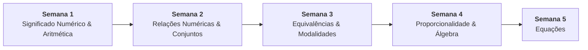

# 📚 Semana 4 — Proporcionalidade, Representação e Linguagem Matemática

> **Disciplina:** Matemática Básica (`MMB002-EC-2026S2B2-T001`)  
> **Curso:** Bacharelado em Engenharia de Computação — Univesp  
> **Docente Responsável:** Profª Dra. Rúbia Barcelos Amaral  
> **Período:** 19/10/2026 a 01/11/2026  
> **Status:** 🟢 **Concluído**  

---

## 📁 Estrutura de Arquivos da Semana 4

| Arquivo | Descrição | Status |
| :--- | :--- | :---: |
| [**`0-Inicio.md`**](file:///home/henrique/Modelos/Univesp/2026S2B2/MMB002-Matematica-Basica/Semana-4/0-Inicio.md) | Contextualização, objetivos pedagógicos, roteiro oficial e **resolução analítica do Desafio da Expectativa de Vida** | 🟢 Pronto |
| [**`1-Videoaulas.md`**](file:///home/henrique/Modelos/Univesp/2026S2B2/MMB002-Matematica-Basica/Semana-4/1-Videoaulas.md) | Sínteses estruturadas das **Videoaulas 13 a 16** (Razão, Proporção, Grandezas Proporcionais, Regra de Três e Errata) | 🟢 Pronto |
| [**`2-Texto-base-Manual-Compacto-Matematica.md`**](file:///home/henrique/Modelos/Univesp/2026S2B2/MMB002-Matematica-Basica/Semana-4/2-Texto-base-Manual-Compacto-Matematica.md) | Síntese do livro *Manual Compacto de Matemática* (Bosquilha et al.): Cap. 10 (*Razão e Proporção*, p. 173–208) e Cap. 11 (*Cálculos Algébricos*, p. 209–232) | 🟢 Pronto |
| [**`3-Material-base.md`**](file:///home/henrique/Modelos/Univesp/2026S2B2/MMB002-Matematica-Basica/Semana-4/3-Material-base.md) | Vídeos-base: "A história de Mussaraf" (M³ Unicamp), "Expressões algébricas" e "Produtos notáveis" (Sandro Curió) | 🟢 Pronto |
| [**`4-Aprofundando-o-tema.md`**](file:///home/henrique/Modelos/Univesp/2026S2B2/MMB002-Matematica-Basica/Semana-4/4-Aprofundando-o-tema.md) | Síntese de 5 videoaulas avançadas: Regra de Três Composta (OBMEP Aula 65), Operações e Divisão Polinomial pelo Método da Chave (Me Salva! PLN03/PLN04) e Fatoração Algébrica Completa (Prof. Ferretto Partes 1 e 2) | 🟢 Pronto |
| [**`5-Atividade-avaliativa.md`**](file:///home/henrique/Modelos/Univesp/2026S2B2/MMB002-Matematica-Basica/Semana-4/5-Atividade-avaliativa.md) | Resolução analítica passo a passo de todas as 8 questões avaliativas com validação e **gabarito oficial (10,0 / 10,0)** | 🟢 Pronto |
| [**`6-Forum-tematico.md`**](file:///home/henrique/Modelos/Univesp/2026S2B2/MMB002-Matematica-Basica/Semana-4/6-Forum-tematico.md) | Enunciado, discussão sobre fatores de longevidade, modelagem matemática (108 dias) e modelos de postagem para o AVA | 🟢 Pronto |
| [**`7-Em-sintese.md`**](file:///home/henrique/Modelos/Univesp/2026S2B2/MMB002-Matematica-Basica/Semana-4/7-Em-sintese.md) | Resumo executivo, formulário de bolso de produtos notáveis, quadro comparativo GDP/GIP e conexões computacionais | 🟢 Pronto |
| [**`desafio_expectativa_vida_s4.cpp`**](file:///home/henrique/Modelos/Univesp/2026S2B2/MMB002-Matematica-Basica/Semana-4/desafio_expectativa_vida_s4.cpp) | Programa em C++ com a modelagem do cálculo de conversão temporal do Desafio da Longevidade | 🟢 Pronto |
| [**`resolucao_questoes_s4.cpp`**](file:///home/henrique/Modelos/Univesp/2026S2B2/MMB002-Matematica-Basica/Semana-4/resolucao_questoes_s4.cpp) | Validador computacional em C++ das 8 questões avaliativas da Semana 4 com asserções | 🟢 Pronto |

---

## 🧭 Relação com as Demais Semanas

