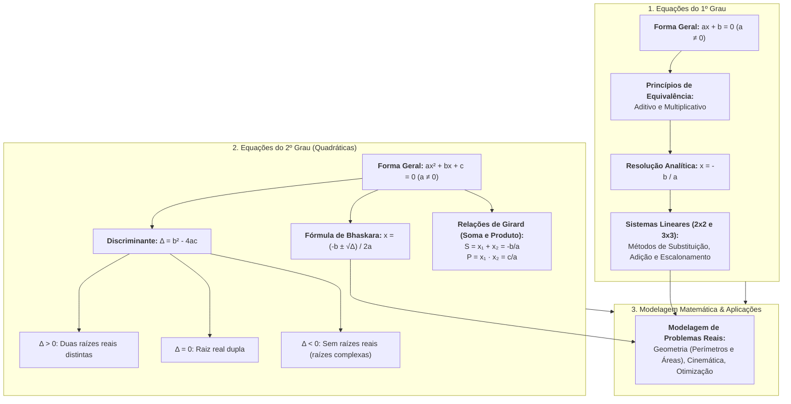

# 📌 Semana 5 — Início & Apresentação da Semana

> **Disciplina:** Matemática Básica (`MMB002-EC-2026S2B2-T001`)  
> **Tema da Semana 5:** Equações (1º e 2º Grau)  
> **Docente Responsável:** Profª Dra. Rúbia Barcelos Amaral  
> **Período:** 26/10/2026 a 08/11/2026  
> **Status:** 🟢 **Documentação Oficial e Resolução do Desafio**  

---

## 👩‍🏫 Mensagem da Professora & Contextualização

Olá, estudante!

Imagino que se lembre do estudo de equações de 1° e 2° grau que teve no ensino básico, pois bem, elas serão nosso foco de estudo nesta semana.

As **equações de 1º e 2º grau** são ferramentas poderosas para resolver uma variedade de problemas, desde questões simples do dia a dia até problemas mais complexos encontrados em campos como engenharia, física, economia e muitos outros. Durante esta semana de estudo, mergulharemos fundo na compreensão desses tipos de equações, explorando suas propriedades, métodos de resolução e aplicações práticas.

Vamos começar!

---

## 🗺️ Mapa Conceitual da Semana 5

---

## 🎯 Objetivos de Aprendizagem

Ao final desta semana, você deverá ser capaz de:

* [ ] **Compreender, identificar e solucionar** equações de primeiro e segundo grau.
* [ ] **Aplicar** técnicas de fatoração, fórmula resolutiva (Bhaskara) e propriedades de soma e produto na determinação de raízes.
* [ ] **Modelar matematicamente** problemas geométricos e cotidianos por meio de sistemas de equações lineares e quadráticas.
* [ ] **Interpretar criticamente** o significado físico e geométrico das raízes encontradas.

---

## 💡 Desafio da Semana: O Comprimento da Ponte

### 📌 Enunciado Oficial
> *Suponha que queiramos descobrir o comprimento da ponte apresentada na imagem abaixo:*
>
> *Sabemos que a ponte da imagem liga uma pista retangular maior a uma pista retangular menor interna à primeira, sendo que um rio passa entre elas. Ainda, sabemos que a distância entre os retângulos é sempre igual em todos os lados. Para completar, sabe-se que para dar uma volta em cada pista passando pela ponte são necessários **5.320 passos** de uma pessoa que tem como medida do passo **0,75 m**. Para dar **2 voltas na pista maior e uma volta na pista menor**, passando pela ponte, são necessários **8.120 passos** da mesma pessoa.*
>
> *Figura de formato retangular. Na figura há uma área vermelha retangular de comprimento $X + 2L$ e largura $Y + 2L$. Dentro da área vermelha há uma área azul de largura $L$.*  
> *(Fonte: Adaptação criada a partir do material “Contagem de passos”, de M³ Unicamp)*
>
> *A partir das informações apresentadas e da imagem acima, podemos concluir que o tamanho da ponte corresponde a...?*
>
> *Discuta sobre esse tema no Fórum Temático desta semana!*

---

### 🧮 Resolução Matemática Passo a Passo

#### 1. Definição das Variáveis e Geometria do Problema
Consideremos as dimensões e parâmetros da pista retangular e do rio:
* $x$: comprimento do retângulo interno (pista menor).
* $y$: largura do retângulo interno (pista menor).
* $L$: largura constante do rio (distância uniforme entre as pistas em todos os quatro lados).
* Comprimento da ponte: como a ponte atravessa o rio ligando perpendicularmente a pista externa à interna, seu comprimento é exatamente igual à largura do rio, ou seja, **$L$**.
* Medida do passo da pessoa: $p = 0,75\text{ m} = \frac{3}{4}\text{ m}$.

#### 2. Relação entre os Perímetros das Pistas
* **Perímetro da Pista Menor ($P_2$):**
  $$P_2 = 2x + 2y$$

* **Perímetro da Pista Maior ($P_1$):**
  Como a distância $L$ existe em ambas as extremidades do comprimento e da largura:
  $$\text{Comprimento externo} = x + 2L$$
  $$\text{Largura externa} = y + 2L$$
  $$P_1 = 2(x + 2L) + 2(y + 2L) = 2x + 4L + 2y + 4L = (2x + 2y) + 8L$$
  
  Substituindo $P_2 = 2x + 2y$, obtemos a **Equação Geométrica Fundamental (I)**:
  $$P_1 = P_2 + 8L \quad \text{--- (Equação I)}$$

---

#### 3. Formulação do Sistema Linear de Equações (em Passos)
O trajeto consiste em percorrer as pistas e atravessar a ponte (comprimento $L$):

1. **Cenário 1:** Uma volta na pista maior ($P_1$) + uma volta na pista menor ($P_2$) + travessia da ponte ($L$) totalizam **5.320 passos**:
   $$P_1 + P_2 + L = 5.320 \quad \text{--- (Equação II)}$$

2. **Cenário 2:** Duas voltas na pista maior ($2P_1$) + uma volta na pista menor ($P_2$) + travessia da ponte ($L$) totalizam **8.120 passos**:
   $$2P_1 + P_2 + L = 8.120 \quad \text{--- (Equação III)}$$

Montamos o sistema linear:
$$\begin{cases} 
P_1 = P_2 + 8L & \text{(I)} \\ 
P_1 + P_2 + L = 5.320 & \text{(II)} \\ 
2P_1 + P_2 + L = 8.120 & \text{(III)} 
\end{cases}$$

---

#### 4. Resolução Algébrica do Sistema

* **Passo 1: Eliminação de $(P_2 + L)$ subtraindo a Equação (II) da Equação (III):**
  $$(2P_1 + P_2 + L) - (P_1 + P_2 + L) = 8.120 - 5.320$$
  $$\mathbf{P_1 = 2.800 \text{ passos}}$$

* **Passo 2: Determinação da expressão combinada $(P_2 + L)$ usando a Equação (II):**
  Substituindo $P_1 = 2.800$ em (II):
  $$2.800 + P_2 + L = 5.320$$
  $$P_2 + L = 5.320 - 2.800$$
  $$\mathbf{P_2 + L = 2.520 \text{ passos}}$$

* **Passo 3: Determinação de $L$ através da Equação (I):**
  Reescrevemos a Equação (I) agrupando os termos conhecidos:
  $$P_1 = P_2 + 8L = (P_2 + L) + 7L$$
  
  Substituindo $P_1 = 2.800$ e $(P_2 + L) = 2.520$:
  $$2.800 = 2.520 + 7L$$
  $$7L = 2.800 - 2.520$$
  $$7L = 280$$
  $$L = \frac{280}{7}$$
  $$\mathbf{L = 40 \text{ passos}}$$

---

#### 5. Conversão para Unidades do Sistema Internacional (Metros)
Dado que a medida do passo é $p = 0,75\text{ m}$:
$$\text{Comprimento da Ponte} = L \times p = 40 \text{ passos} \times 0,75 \text{ m/passo}$$
$$L = 40 \times \frac{3}{4} = 10 \times 3 = \mathbf{30 \text{ metros}}$$

#### 6. Verificação Completa e Consistência das Dimensões
Podemos também calcular as dimensões métricas completas do percurso:
* $P_1 (\text{pista maior}) = 2.800 \times 0,75\text{ m} = \mathbf{2.100 \text{ metros}}$.
* $P_2 (\text{pista menor}) = (2.520 - L) \times 0,75\text{ m} = (2.520 - 40) \times 0,75 = 2.480 \times 0,75 = \mathbf{1.860 \text{ metros}}$.
* Diferença de perímetros: $P_1 - P_2 = 2.100 - 1.860 = 240\text{ m}$.
* Como $8L = 8 \times 30 = 240\text{ m}$, a relação geométrica $P_1 - P_2 = 8L$ é satisfeita com exatidão!
* Validação do Cenário 1: $2.100 + 1.860 + 30 = 3.990\text{ m} \div 0,75 = 5.320\text{ passos}$ (OK).
* Validação do Cenário 2: $2(2.100) + 1.860 + 30 = 4.200 + 1.890 = 6.090\text{ m} \div 0,75 = 8.120\text{ passos}$ (OK).

$$\boxed{\text{O comprimento da ponte é exatamente igual a } 30\text{ metros (correspondente a } 40\text{ passos)}}.$$

---

## 🧭 Roteiro e Orientação de Estudos da Semana 5

1. 🎬 **Vídeo-base:** *"Equação do 1º grau: teoria e interpretação"* — interpretação, equacionamento e técnicas práticas de resolução com exercícios aplicados.
2. 📖 **Texto-base 1:** *Fundamentos de matemática* (Araujo et al.) — definição formal de equação do 1º grau, identificação de termos e modelagem contextualizada.
3. 🎬 **Vídeo-base:** *"Equação do 2º grau: Bhaskara e soma e produto (Parte 1)"* — resolução de equações quadráticas por fórmula resolutiva de Bhaskara e determinação de raízes reais.
4. 🎬 **Vídeo-base:** *"Equação do 2º grau: Bhaskara e soma e produto (Parte 2)"* — métodos práticos complementares via Relações de Girard (soma e produto das raízes).
5. 📖 **Texto-base 2:** *Manual compacto de matemática* (Bosquilha et al.) — consolidação teórica, propriedades do discriminante ($\Delta$) e resolução de equações do 2º grau completas e incompletas.
6. 🎬 **Vídeo-base:** *"Esse tal de Bhaskara"* (M³ Unicamp) — resgate histórico da álgebra clássica, origens dos métodos quadráticos e aplicações práticas contemporâneas.
