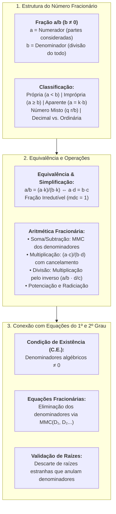

# 📖 Texto-base: Manual Compacto de Matemática — Os Números Fracionários (Capítulo 5)

> **Referência Oficial:** BOSQUILHA, Alessandra; AMARAL, João Tomás do; MIRANDA, Mônica. **Manual compacto de matemática: ensino fundamental**. São Paulo: Rideel. (Capítulo 5: *"Os números fracionários"*, p. 74–108).  
> **Link na Biblioteca Virtual da Univesp:** [Plataforma BVirtual (Pág. 74)](https://leitor.bvirtual.com.br/reader/182305/pdf/74)  
> **Disciplina:** Matemática Básica (`MMB002-EC-2026S2B2-T001`) — Semana 5  
> **Tema:** Números fracionários, operações aritméticas fundamentais, MMC e aplicação direta na resolução de equações fracionárias do 1º e 2º grau  

---

## 🗺️ Mapa Conceitual do Capítulo 5 & Aplicação em Equações



---

## 📌 1. Conceito e Classificação dos Números Fracionários

### 1.1. Definição Formal
Uma **fração** representa uma ou mais partes de uma unidade que foi dividida em partes iguais:

$$\frac{a}{b} \quad (a \in \mathbb{Z}, \; b \in \mathbb{Z}^*)$$

* **Numerador ($a$):** Número de partes tomadas do todo.
* **Denominador ($b$):** Número total de partes iguais em que o todo foi repartido ($b \neq 0$).

### 1.2. Classificação Geral das Frações

| Categoria | Definição | Exemplo |
| :--- | :--- | :---: |
| **Própria** | O numerador é menor que o denominador ($a < b$). Representa valor $< 1$. | $\frac{3}{7}, \; \frac{5}{8}$ |
| **Imprópria** | O numerador é maior ou igual ao denominador ($a \geq b$). Representa valor $\geq 1$. | $\frac{9}{4}, \; \frac{7}{5}$ |
| **Aparente** | O numerador é múltiplo exato do denominador. Representa um número inteiro. | $\frac{12}{3} = 4, \; \frac{15}{5} = 3$ |
| **Número Misto** | Composto por uma parte inteira e uma fração própria. | $2 \frac{1}{4} = 2 + \frac{1}{4} = \frac{9}{4}$ |
| **Decimal** | O denominador é uma potência de base 10 ($10, 100, 1.000\dots$). | $\frac{7}{10} = 0,7, \; \frac{23}{100} = 0,23$ |
| **Ordinária** | Qualquer fração cujo denominador não seja potência de 10. | $\frac{2}{3}, \; \frac{5}{11}$ |

---

## ⚖️ 2. Frações Equivalentes, Simplificação e Comparação

### 2.1. Princípio Fundamental da Equivalência
Multiplicando ou dividindo o numerador e o denominador de uma fração por um mesmo número natural diferente de zero, obtém-se uma **fração equivalente**:

$$\frac{a}{b} = \frac{a \cdot k}{b \cdot k} \quad (k \neq 0)$$

* **Propriedade Fundamental:** Duas frações $\frac{a}{b}$ e $\frac{c}{d}$ são equivalentes se, e somente se, o produto cruzado for idêntico:
  $$\frac{a}{b} = \frac{c}{d} \iff a \cdot d = b \cdot c$$

### 2.2. Fração Irredutível
Uma fração $\frac{a}{b}$ é dita **irredutível** quando $\text{MDC}(a, b) = 1$, isto é, seus termos são primos entre si. Para tornar uma fração irredutível, divide-se numerador e denominador pelo seu MDC.

### 2.3. Comparação e Redução ao Mesmo Denominador
Para comparar duas frações com denominadores distintos, reduz-se ambas ao mesmo denominador por meio do **Mínimo Múltiplo Comum (MMC)** dos denominadores:
* Exemplo: Comparar $\frac{3}{4}$ e $\frac{5}{7}$.
* $\text{MMC}(4, 7) = 28$.
* $\frac{3}{4} = \frac{21}{28}$ e $\frac{5}{7} = \frac{20}{28}$.
* Como $21 > 20$, segue que $\frac{3}{4} > \frac{5}{7}$.

---

## ⚙️ 3. Aritmética Fracionária e Operações

### 3.1. Adição e Subtração
* **Mesmo Denominador:** Opera-se os numeradores e conserva-se o denominador comum:
  $$\frac{a}{m} \pm \frac{b}{m} = \frac{a \pm b}{m}$$
* **Denominadores Distintos:** Encontra-se o MMC dos denominadores, divide-se o MMC pelo denominador original de cada fração e multiplica-se o resultado pelo respectivo numerador:
  $$\frac{a}{b} \pm \frac{c}{d} = \frac{a \cdot \frac{M}{b} \pm c \cdot \frac{M}{d}}{M}, \quad \text{onde } M = \text{MMC}(b, d)$$

### 3.2. Multiplicação
Multiplicam-se os numeradores entre si e os denominadores entre si, aplicando cancelamento prévio sempre que possível:
$$\frac{a}{b} \times \frac{c}{d} = \frac{a \cdot c}{b \cdot d}$$

### 3.3. Divisão
Multiplica-se a primeira fração pelo **inverso** da segunda:
$$\frac{a}{b} \div \frac{c}{d} = \frac{a}{b} \times \frac{d}{c} = \frac{a \cdot d}{b \cdot c} \quad (b, c, d \neq 0)$$

### 3.4. Potenciação e Radiciação
$$\left(\frac{a}{b}\right)^n = \frac{a^n}{b^n}, \qquad \sqrt[n]{\frac{a}{b}} = \frac{\sqrt[n]{a}}{\sqrt[n]{b}} \quad (b \neq 0)$$

---

## 🎯 4. Aplicação Direta: Equações Fracionárias (1º e 2º Grau)

O estudo rigoroso dos números fracionários é o pré-requisito técnico para a resolução de **equações fracionárias** (equações nas quais a incógnita figura no denominador).

### 4.1. Condição de Existência (C.E.)
> [!IMPORTANT]
> Antes de qualquer manipulação algébrica, deve-se determinar os valores que **anulam** qualquer um dos denominadores. Tais valores são estritamente excluídos do conjunto solução:
> $$\text{Denominador}(x) \neq 0$$

### 4.2. Eliminação de Denominadores via MMC Algébrico
Multiplica-se toda a equação pelo $\text{MMC}$ dos denominadores algébricos para convertê-la em uma equação polinomial padrão.

---

### 4.3. Exemplo Resolvido 1: Equação Fracionária do 1º Grau
$$\frac{2x - 1}{x - 3} = 3$$

1. **Condição de Existência:**
   $$x - 3 \neq 0 \implies \mathbf{x \neq 3} \quad (\text{C.E.})$$

2. **Resolução por Produto Cruzado:**
   $$2x - 1 = 3(x - 3)$$
   $$2x - 1 = 3x - 9$$
   $$2x - 3x = -9 + 1$$
   $$-x = -8 \implies \mathbf{x = 8}$$

3. **Validação:** Como $8 \neq 3$, a solução é válida:
   $$\mathbf{S = \{8\}}$$

---

### 4.4. Exemplo Resolvido 2: Equação Fracionária redutível ao 2º Grau
$$\frac{6}{x} + \frac{x}{x + 1} = 2$$

1. **Condições de Existência:**
   $$x \neq 0 \quad \text{e} \quad x + 1 \neq 0 \implies \mathbf{x \neq 0 \text{ e } x \neq -1}$$

2. **Determinação do MMC dos Denominadores:**
   $$\text{MMC} = x(x + 1)$$

3. **Multiplicação de todos os termos pelo MMC:**
   $$x(x + 1) \cdot \frac{6}{x} + x(x + 1) \cdot \frac{x}{x + 1} = x(x + 1) \cdot 2$$
   $$6(x + 1) + x^2 = 2x(x + 1)$$
   $$6x + 6 + x^2 = 2x^2 + 2x$$

4. **Redução à Forma Canônica do 2º Grau:**
   $$x^2 + 6x + 6 - 2x^2 - 2x = 0$$
   $$-x^2 + 4x + 6 = 0 \iff \mathbf{x^2 - 4x - 6 = 0}$$

5. **Aplicação da Fórmula de Bhaskara:**
   * $a = 1, b = -4, c = -6$.
   * $\Delta = (-4)^2 - 4(1)(-6) = 16 + 24 = 40$.
   * Como $\Delta > 0$, temos duas raízes reais distintas:
     $$x = \frac{-(-4) \pm \sqrt{40}}{2(1)} = \frac{4 \pm 2\sqrt{10}}{2} = \mathbf{2 \pm \sqrt{10}}$$

6. **Validação com a C.E.:**
   Ambas as raízes ($2 + \sqrt{10} \approx 5,16$ e $2 - \sqrt{10} \approx -1,16$) são distintas de $0$ e $-1$.
   $$\mathbf{S = \{2 - \sqrt{10}, \; 2 + \sqrt{10}\}}$$

---

## 💻 5. Conexão Computacional: Tipo Abstrato de Dados `Fracao` em C++

Para evitar erros cumulativos de arredondamento em cálculos de engenharia e modelagem analítica, números fracionários são modelados computacionalmente como tipos exatos através do $\text{MDC}$ (`std::gcd` da biblioteca `<numeric>`):

```cpp
#include <iostream>
#include <numeric>

class Fracao {
private:
    long long num;
    long long den;

    void simplificar() {
        if (den < 0) { num = -num; den = -den; }
        long long g = std::gcd(std::abs(num), den);
        if (g > 1) { num /= g; den /= g; }
    }

public:
    Fracao(long long n = 0, long long d = 1) : num(n), den(d) {
        if (den == 0) throw std::invalid_argument("Denominador nulo!");
        simplificar();
    }

    Fracao operator+(const Fracao& o) const {
        long long d_comum = std::lcm(den, o.den);
        return Fracao(num * (d_comum / den) + o.num * (d_comum / o.den), d_comum);
    }

    Fracao operator-(const Fracao& o) const {
        long long d_comum = std::lcm(den, o.den);
        return Fracao(num * (d_comum / den) - o.num * (d_comum / o.den), d_comum);
    }

    Fracao operator*(const Fracao& o) const {
        return Fracao(num * o.num, den * o.den);
    }

    Fracao operator/(const Fracao& o) const {
        return Fracao(num * o.den, den * o.num);
    }

    void imprimir() const {
        if (den == 1) std::cout << num;
        else std::cout << num << "/" << den;
    }
};
```
