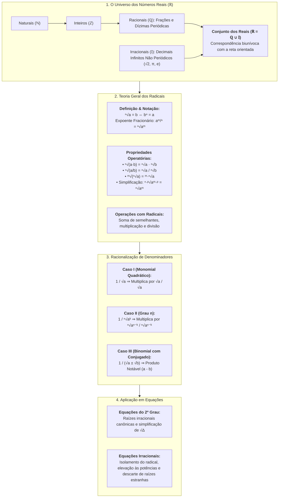

# 📖 Texto-base: Manual Compacto de Matemática — O Conjunto dos Números Reais e Radicais (Capítulo 14)

> **Referência Oficial:** BOSQUILHA, Alessandra; AMARAL, João Tomás do; MIRANDA, Mônica. **Manual compacto de matemática: ensino fundamental**. São Paulo: Rideel. (Capítulo 14: *"O conjunto dos números reais"*, p. 270–296).  
> **Link na Biblioteca Virtual da Univesp:** [Plataforma BVirtual (Pág. 270)](https://leitor.bvirtual.com.br/reader/182305/pdf/270)  
> **Disciplina:** Matemática Básica (`MMB002-EC-2026S2B2-T001`) — Semana 5  
> **Tema:** Números irracionais, conjunto dos reais ($\mathbb{R}$), potenciação fracionária, propriedades de radicais, operações, racionalização de denominadores e resolução de equações irracionais e quadráticas  

---

## 🗺️ Mapa Conceitual do Capítulo 14 & Conexão com Equações



---

## 📌 1. O Conjunto dos Números Reais ($\mathbb{R}$)

O conjunto dos números reais resulta da união disjunta entre o conjunto dos números racionais ($\mathbb{Q}$) e o conjunto dos números irracionais ($\mathbb{I}$):

$$\mathbb{R} = \mathbb{Q} \cup \mathbb{I}, \quad \text{onde } \mathbb{Q} \cap \mathbb{I} = \emptyset$$

### 1.1. Hierarquia dos Conjuntos Numéricos
* **Números Naturais ($\mathbb{N}$):** $\mathbb{N} = \{0, 1, 2, 3, \dots\}$
* **Números Inteiros ($\mathbb{Z}$):** $\mathbb{Z} = \{\dots, -3, -2, -1, 0, 1, 2, 3, \dots\}$
* **Números Racionais ($\mathbb{Q}$):** Todo número que pode ser expresso como a razão de dois inteiros $\frac{a}{b}$ com $b \neq 0$. Compreende decimais exatos e dízimas periódicas.
* **Números Irracionais ($\mathbb{I}$):** Números cuja representação decimal é infinita e **não periódica**.
  * Raízes inexatas: $\sqrt{2} \approx 1,4142\dots$, $\sqrt{3} \approx 1,7320\dots$, $\sqrt{5} \approx 2,2360\dots$
  * Constantes transcendentais: $\pi \approx 3,14159\dots$, $e \approx 2,71828\dots$ (base dos logaritmos naturais), $\phi \approx 1,61803\dots$ (razão áurea).

### 1.2. A Reta Real e a Completude
A cada número real corresponde um, e apenas um, ponto na reta graduada (reta real), e a cada ponto da reta corresponde um único número real. Essa correspondência biunívoca preenche todos os "vazios" deixados pelos números racionais.

---

## 📐 2. Radicais: Definição, Existência e Expoentes Fracionários

### 2.1. Definição Formal
Sendo $a \in \mathbb{R}$ e $n \in \mathbb{N}^*$ com $n \geq 2$:

$$\sqrt[n]{a} = b \iff b^n = a$$

* **$\sqrt{\quad}$:** Sinal do radical.
* **$n$:** Índice do radical.
* **$a$:** Radicando.
* **$b$:** Raiz enésima.

> [!IMPORTANT]
> **Condições de Existência em $\mathbb{R}$:**
> 1. Se o índice $n$ for **ímpar**, a raiz $\sqrt[n]{a}$ sempre existe e é única para todo $a \in \mathbb{R}$. Ela preserva o sinal do radicando (ex: $\sqrt[3]{-8} = -2$, pois $(-2)^3 = -8$).
> 2. Se o índice $n$ for **par**, a raiz $\sqrt[n]{a}$ só existe no corpo dos reais se **$a \geq 0$**. Não existe raiz real de número negativo com índice par ($\sqrt{-4} \notin \mathbb{R}$). Por convenção, $\sqrt[n]{a} \geq 0$ representa a raiz aritmética não negativa.

### 2.2. O Teorema da Potenciação Fracionária
Toda radiciação pode ser escrita de forma unificada sob a forma de uma potência com expoente racional:

$$a^{\frac{m}{n}} = \sqrt[n]{a^m} \quad (a > 0, \; m \in \mathbb{Z}, \; n \in \mathbb{N}_{\geq 2})$$

Essa equivalência permite transpor todas as regras clássicas de potenciação diretamente para as operações com radicais:
* $a^{\frac{m}{n}} \cdot a^{\frac{p}{q}} = a^{\frac{m}{n} + \frac{p}{q}}$
* $(a^{\frac{m}{n}})^p = a^{\frac{m \cdot p}{n}}$
* $a^{-\frac{m}{n}} = \frac{1}{a^{\frac{m}{n}}} = \frac{1}{\sqrt[n]{a^m}}$

---

## ⚙️ 3. Propriedades Fundamentais dos Radicais

Para $a, b \in \mathbb{R}_+$ e índices válidos:

| Propriedade | Expressão Algébrica | Exemplo Prático |
| :--- | :---: | :---: |
| **P1. Simplificação de Índices** | $\sqrt[n \cdot p]{a^{m \cdot p}} = \sqrt[n]{a^m}$ | $\sqrt[6]{x^4} = \sqrt[3]{x^2}$ (divide por 2) |
| **P2. Produto de Radicais** | $\sqrt[n]{a \cdot b} = \sqrt[n]{a} \cdot \sqrt[n]{b}$ | $\sqrt{72} = \sqrt{36 \cdot 2} = 6\sqrt{2}$ |
| **P3. Quociente de Radicais** | $\sqrt[n]{\frac{a}{b}} = \frac{\sqrt[n]{a}}{\sqrt[n]{b}}$ | $\sqrt{\frac{25}{16}} = \frac{\sqrt{25}}{\sqrt{16}} = \frac{5}{4}$ |
| **P4. Potência de um Radical** | $\left(\sqrt[n]{a}\right)^m = \sqrt[n]{a^m}$ | $(\sqrt[3]{2})^5 = \sqrt[3]{2^5} = \sqrt[3]{32} = 2\sqrt[3]{4}$ |
| **P5. Raiz de Raiz** | $\sqrt[m]{\sqrt[n]{a}} = \sqrt[m \cdot n]{a}$ | $\sqrt[3]{\sqrt{64}} = \sqrt[6]{64} = 2$ |

---

## ✂️ 4. Operações e Técnicas de Manipulação com Radicais

### 4.1. Extração e Introdução de Fatores no Radicando
* **Extração:** Fatora-se o radicando em potências com expoente múltiplo do índice:
  $$\sqrt{180} = \sqrt{2^2 \cdot 3^2 \cdot 5} = 2 \cdot 3 \cdot \sqrt{5} = \mathbf{6\sqrt{5}}$$
* **Introdução:** Eleva-se o fator externo ao expoente igual ao índice do radical:
  $$3\sqrt[3]{2} = \sqrt[3]{3^3 \cdot 2} = \sqrt[3]{27 \cdot 2} = \mathbf{\sqrt[3]{54}}$$

### 4.2. Adição e Subtração de Radicais Semelhantes
Dois radicais são **semelhantes** quando possuem o mesmo índice e o mesmo radicando. Operam-se apenas os coeficientes externos:
$$5\sqrt{3} + 2\sqrt{27} - \sqrt{48}$$
* $\sqrt{27} = \sqrt{9 \cdot 3} = 3\sqrt{3}$
* $\sqrt{48} = \sqrt{16 \cdot 3} = 4\sqrt{3}$
* Expressão equivalente: $5\sqrt{3} + 2(3\sqrt{3}) - 4\sqrt{3} = (5 + 6 - 4)\sqrt{3} = \mathbf{7\sqrt{3}}$

### 4.3. Multiplicação e Divisão com Índices Diferentes
Quando os radicais possuem índices distintos, reduz-se os índices ao $\text{MMC}$:
$$\sqrt{2} \cdot \sqrt[3]{5}$$
* $\text{MMC}(2, 3) = 6$.
* $\sqrt{2} = \sqrt[2 \cdot 3]{2^3} = \sqrt[6]{8}$
* $\sqrt[3]{5} = \sqrt[3 \cdot 2]{5^2} = \sqrt[6]{25}$
* Produto: $\sqrt[6]{8} \cdot \sqrt[6]{25} = \sqrt[6]{8 \cdot 25} = \mathbf{\sqrt[6]{200}}$

---

## 🔄 5. Racionalização de Denominadores

Racionalizar uma fração consiste em transformar uma expressão cujo denominador contém radicais em outra equivalente cujo denominador seja um número racional, eliminando raízes do divisor.

### Caso I: Denominador com Raiz Quadrada Simples ($\frac{k}{\sqrt{a}}$)
Multiplica-se numerador e denominador pelo fator racionalizante $\sqrt{a}$:
$$\frac{6}{\sqrt{3}} = \frac{6 \cdot \sqrt{3}}{\sqrt{3} \cdot \sqrt{3}} = \frac{6\sqrt{3}}{3} = \mathbf{2\sqrt{3}}$$

### Caso II: Denominador com Raiz de Índice Genérico ($\frac{k}{\sqrt[n]{a^m}}$, com $m < n$)
Multiplica-se por $\sqrt[n]{a^{n-m}}$, para que no denominador resulte $\sqrt[n]{a^m \cdot a^{n-m}} = \sqrt[n]{a^n} = a$:
$$\frac{5}{\sqrt[7]{2^3}} = \frac{5 \cdot \sqrt[7]{2^{7-3}}}{\sqrt[7]{2^3} \cdot \sqrt[7]{2^4}} = \frac{5\sqrt[7]{2^4}}{\sqrt[7]{2^7}} = \mathbf{\frac{5\sqrt[7]{16}}{2}}$$

### Caso III: Denominador Binomial com Raízes Quadradas ($\frac{k}{\sqrt{a} \pm \sqrt{b}}$)
Multiplica-se pelo **conjugado**, aproveitando o produto notável da soma pela diferença: $(x + y)(x - y) = x^2 - y^2$:
$$\frac{4}{\sqrt{5} - 1} = \frac{4(\sqrt{5} + 1)}{(\sqrt{5} - 1)(\sqrt{5} + 1)} = \frac{4(\sqrt{5} + 1)}{(\sqrt{5})^2 - 1^2} = \frac{4(\sqrt{5} + 1)}{5 - 1} = \frac{4(\sqrt{5} + 1)}{4} = \mathbf{\sqrt{5} + 1}$$

$$\frac{\sqrt{3}}{\sqrt{7} + \sqrt{2}} = \frac{\sqrt{3}(\sqrt{7} - \sqrt{2})}{(\sqrt{7} + \sqrt{2})(\sqrt{7} - \sqrt{2})} = \frac{\sqrt{21} - \sqrt{6}}{7 - 2} = \mathbf{\frac{\sqrt{21} - \sqrt{6}}{5}}$$

---

## 🎯 6. Aplicação Direta em Equações (Quadráticas e Irracionais)

### 6.1. Simplificação Canônica de Raízes Quadráticas
Ao resolver equações do 2º grau cujas raízes envolvem radicais, o domínio da simplificação de radicais evita respostas brutas e imprecisas:
$$2x^2 - 8x + 2 = 0 \implies x^2 - 4x + 1 = 0$$
* $\Delta = (-4)^2 - 4(1)(1) = 16 - 4 = 12$.
* Raízes:
  $$x = \frac{-(-4) \pm \sqrt{12}}{2(1)} = \frac{4 \pm \sqrt{4 \cdot 3}}{2} = \frac{4 \pm 2\sqrt{3}}{2} = \mathbf{2 \pm \sqrt{3}}$$

### 6.2. Resolução de Equações Irracionais
Uma **equação irracional** é aquela em que a incógnita se encontra sob o sinal de um radical:
$$\sqrt{2x + 3} = x$$

#### Roteiro Obrigatório de Resolução:
1. **Isolar o radical** em um dos membros.
2. **Elevar ambos os membros** à potência correspondente ao índice do radical.
3. **Resolver a equação algébrica** resultante (1º ou 2º grau).
4. **VERIFICAÇÃO OBRIGATÓRIA (Descarte de Raízes Estranhas):** Como a operação de elevar ao quadrado pode introduzir soluções não equivalentes na equação original, cada candidato deve ser testado.

#### Resolução do Exemplo:
$$\left(\sqrt{2x + 3}\right)^2 = x^2 \implies 2x + 3 = x^2$$
$$x^2 - 2x - 3 = 0$$
* Por soma e produto: $S = 2, P = -3 \implies x_1 = 3, \; x_2 = -1$.
* **Teste dos Candidatos:**
  * Para $x = 3$: $\sqrt{2(3) + 3} = \sqrt{9} = 3 = x$ $\implies$ **Válido!**
  * Para $x = -1$: $\sqrt{2(-1) + 3} = \sqrt{1} = 1 \neq -1$ $\implies$ **Raiz estranha, descartada!**
* **Conjunto Solução:**
  $$\mathbf{S = \{3\}}$$

---

## 💻 7. Conexão Computacional em C++: Simplificador Exato de Radicais

Em sistemas de álgebra computacional (CAS) e motores de simulação matemática, números com radicais devem ser manipulados simbolicamente na forma canônica $k\sqrt{r}$ para preservar a exatidão analítica:

```cpp
#include <iostream>
#include <cmath>
#include <cassert>

// Simplifica sqrt(n) para a forma k * sqrt(resto)
struct RadicalSimplificado {
    long long k;     // Coeficiente externo
    long long resto; // Radicando irredutível
};

RadicalSimplificado simplificar_raiz_quadrada(long long n) {
    if (n < 0) throw std::invalid_argument("Radicando negativo em R!");
    if (n == 0) return {0, 0};
    
    long long k = 1;
    long long resto = n;

    // Fatoração por divisores primos
    for (long long d = 2; d * d <= resto; ++d) {
        while (resto % (d * d) == 0) {
            k *= d;
            resto /= (d * d);
        }
    }
    return {k, resto};
}

int main() {
    // Exemplo: sqrt(72) = 6 * sqrt(2)
    auto r1 = simplificar_raiz_quadrada(72);
    assert(r1.k == 6 && r1.resto == 2);

    // Exemplo: sqrt(180) = 6 * sqrt(5)
    auto r2 = simplificar_raiz_quadrada(180);
    assert(r2.k == 6 && r2.resto == 5);

    // Exemplo: sqrt(12) = 2 * sqrt(3) (utilizado nas raízes de Bhaskara)
    auto r3 = simplificar_raiz_quadrada(12);
    assert(r3.k == 2 && r3.resto == 3);

    std::cout << "Validacao de simplificacao de radicais concluida com sucesso!\n";
    return 0;
}
```
