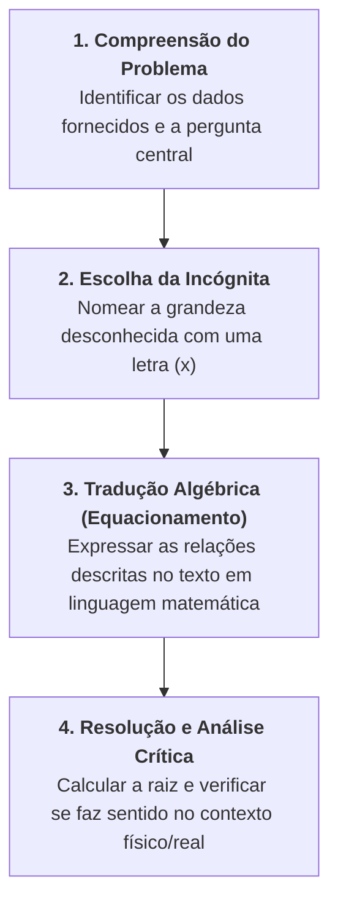

# 📖 Texto-base: Fundamentos de Matemática — Equação do Primeiro Grau (p. 41–54)

> **Referência Oficial:** ARAUJO, Luciana Maria Margoti; FERRAZ, Mariana Sacrini Ayres; LOYO, Tiago; STEFANI, Rafael; PARENTI, Tatiana Marques da Silva. **Fundamentos de matemática**. Porto Alegre: Grupo A / SAGAH, 2018. (Capítulo: *"Equação do primeiro grau"*, p. 41–54).  
> **Link na Minha Biblioteca:** [Plataforma Minha Biblioteca (Página 40/41)](https://app.minhabiblioteca.com.br/reader/books/9788595027701/pageid/40)  
> **Disciplina:** Matemática Básica (`MMB002-EC-2026S2B2-T001`) — Semana 5  
> **Tema:** Equações polinomiais do 1º grau — Conceito de igualdade, incógnita, conjunto universo e verdade, princípios aditivo e multiplicativo, classificação e modelagem matemática de problemas contextualizados  

---

## 🗺️ Mapa Conceitual do Capítulo (Araujo et al., p. 41–54)

```mermaid
flowchart TD
    subgraph BlocoConceitos ["1. Fundamentos da Equação"]
        SENT["<b>Sentenças Matemáticas:</b><br>• Fechadas: 3 + 4 = 7 (V ou F definida)<br>• Abertas: 2x + 1 = 9 (Depende da variável)"]
        EQ["<b>Definição de Equação:</b><br>Sentença matemática aberta com sinal de igualdade (=)"]
        TERMOS["<b>Anatomia:</b><br>• 1º Membro (lado esquerdo) e 2º Membro (lado direito)<br>• Termos literais (ax) e Termos constantes (b)"]
    end

    subgraph BlocoResolucao ["2. Princípios Algébricos de Equivalência"]
        UNIV["<b>Conjunto Universo (U) & Conjunto Verdade (S):</b><br>Valores admissíveis vs. Raízes que validam a igualdade"]
        ADIT["<b>Princípio Aditivo:</b><br>A = B ⇔ A ± c = B ± c"]
        MULT["<b>Princípio Multiplicativo:</b><br>A = B ⇔ A · c = B · c  (c ≠ 0)"]
        ALGOR["<b>Roteiro de Resolução:</b><br>1. Distributiva (eliminar parênteses)<br>2. MMC (eliminar denominadores)<br>3. Agrupamento de termos semelhantes<br>4. Isolamento da incógnita x = -b / a"]
    end

    subgraph BlocoClassificacao ["3. Classificação e Análise de Soluções"]
        DET["<b>Possível e Determinada:</b><br>a ≠ 0 ⇒ Raiz única S = {-b/a}"]
        INDET["<b>Possível e Indeterminada (Identidade):</b><br>a = 0 e b = 0 (0x = 0) ⇒ Infinitas soluções (S = U)"]
        IMP["<b>Impossível:</b><br>a = 0 e b ≠ 0 (0x = -b) ⇒ Nenhuma solução (S = ∅)"]
    end

    subgraph BlocoAplicacoes ["4. Modelagem Matemática de Problemas"]
        MOD["<b>Etapas de Resolução de Problemas:</b><br>1. Leitura e identificação da incógnita<br>2. Tradução de texto para equação algébrica<br>3. Resolução da equação<br>4. Interpretação e validação do resultado no contexto"]
    end

    BlocoConceitos --> BlocoResolucao --> BlocoClassificacao --> BlocoAplicacoes
```



---

## 📌 1. Conceito de Equação, Incógnita e Sentenças Matemáticas

De acordo com Araujo et al. (p. 41–43), a linguagem matemática expressa relações por meio de **sentenças**:

### 1.1. Sentenças Fechadas vs. Sentenças Abertas
* **Sentenças Fechadas:** Afirmações completas que não contêm elementos desconhecidos e podem ser categorizadas imediatamente como verdadeiras ($V$) ou falsas ($F$).
  * Exemplo 1: $7 + 5 = 12$ (Sentença fechada verdadeira).
  * Exemplo 2: $3 \times 4 = 15$ (Sentença fechada falsa).
* **Sentenças Abertas:** Sentenças que possuem pelo menos uma variável ou elemento desconhecido. Seu valor de verdade só pode ser determinado quando se atribui um número específico a essa variável.
  * Exemplo: $2x + 3 = 11$.

### 1.2. Definição Formal de Equação
> Uma **equação** é toda sentença matemática aberta expressa por uma **relação de igualdade** ($=$) entre duas expressões algébricas, na qual figura pelo menos uma letra que representa um valor desconhecido, denominada **incógnita**.

### 1.3. Anatomia Estrutural da Equação
Toda equação divide-se em duas regiões delimitadas pelo símbolo de igualdade:
$$\underbrace{3x - 5}_{\text{1º Membro}} = \underbrace{x + 7}_{\text{2º Membro}}$$

* **1º Membro:** Tudo o que está à esquerda do sinal de igual.
* **2º Membro:** Tudo o que está à direita do sinal de igual.
* **Termos:** As parcelas aditivas que compõem cada membro ($3x$, $-5$, $x$, $+7$).

---

## ⚖️ 2. Conjunto Universo, Conjunto Solução e Princípios de Equivalência

### 2.1. Conjunto Universo ($U$) e Conjunto Solução/Verdade ($S$ ou $V$)
* **Conjunto Universo ($U$):** É o conjunto de todos os valores que a incógnita pode potencialmente assumir. Na ausência de menção explícita, assume-se $U = \mathbb{R}$.
* **Raiz da Equação:** É o número pertencente a $U$ que, ao substituir a incógnita, transforma a sentença aberta em uma sentença fechada verdadeira.
* **Conjunto Solução ($S$):** O conjunto formado por todas as raízes da equação ($S \subseteq U$).

> **Exemplo Clássico:** Seja a equação $2x = 5$.
> * Se $U = \mathbb{N}$, a equação não possui solução natural: $S = \emptyset$.
> * Se $U = \mathbb{Q}$ ou $\mathbb{R}$, a raiz é $x = \frac{5}{2} = 2,5$: $S = \left\{\frac{5}{2}\right\}$.

---

### 2.2. Equações Equivalentes e os Princípios Operatórios
Duas equações são **equivalentes** quando possuem exatamente o mesmo conjunto solução em um mesmo conjunto universo. Para transformar uma equação complexa em uma equivalente mais simples, aplicam-se dois princípios estruturais:

#### 1. Princípio Aditivo da Igualdade
> Adicionando-se ou subtraindo-se um mesmo número ou expressão matemática a ambos os membros de uma equação, obtém-se uma equação equivalente.
> $$A = B \iff A + c = B + c \quad (\forall c)$$

* **Regra Prática da Transposição:** Qualquer termo pode ser transferido de um membro para o outro, desde que tenha sua operação invertida (adição vira subtração e vice-versa).

#### 2. Princípio Multiplicativo da Igualdade
> Multiplicando-se ou dividindo-se ambos os membros de uma equação por um mesmo número **diferente de zero**, obtém-se uma equação equivalente.
> $$A = B \iff A \cdot c = B \cdot c \quad (\forall c \neq 0)$$

* **Regra Prática:** Um termo multiplicador não nulo de todo um membro pode ser transferido para o outro membro na forma de divisão.

---

## 📐 3. Forma Geral e Classificação das Equações do 1º Grau

### 3.1. A Forma Reduzida Canônica
Toda equação do 1º grau com uma incógnita pode ser reduzida, mediante operações de equivalência, à forma:

$$\mathbf{ax + b = 0} \quad \text{ou} \quad \mathbf{ax = -b}$$

Onde $a$ e $b$ são coeficientes numéricos reais fixos e $x$ é a incógnita.

### 3.2. Classificação Completa do Sistema Solução

Araujo et al. (p. 45–47) detalham rigorosamente os três comportamentos possíveis de uma equação linear:

| Condição dos Coeficientes | Forma Resultante | Classificação | Conjunto Solução ($S$) |
| :---: | :---: | :---: | :---: |
| **$a \neq 0$** | $x = -\frac{b}{a}$ | **Equação Possível e Determinada** | $S = \left\{-\frac{b}{a}\right\}$ (Raiz única) |
| **$a = 0$ e $b = 0$** | $0x = 0$ | **Equação Possível e Indeterminada (Identidade)** | $S = U$ (Infinitas soluções) |
| **$a = 0$ e $b \neq 0$** | $0x = -b$ | **Equação Impossível** | $S = \emptyset$ (Nenhuma solução real) |

---

## 🛠️ 4. Roteiro Prático de Resolução Passo a Passo

Para resolver com segurança qualquer equação polinomial do 1º grau, segue-se o algoritmo canônico:

1. **Eliminar Parênteses, Colchetes ou Chaves:** Aplicar a propriedade distributiva da multiplicação em relação à adição/subtração, com especial atenção às regras de sinais:
   $$-(ax + b) = -ax - b$$
2. **Eliminar Denominadores Fracionários:** Se houver frações, calcula-se o $\text{MMC}$ de todos os denominadores e multiplica-se cada termo de ambos os membros por esse valor.
3. **Isolar os Termos com Incógnita:** Reunir todos os termos que contêm $x$ no primeiro membro e todos os termos independentes (constantes) no segundo membro.
4. **Reduzir Termos Semelhantes:** Efetuar a soma algébrica dos coeficientes em cada membro, obtendo $ax = c$.
5. **Isolar a Incógnita:** Dividir ambos os membros pelo coeficiente $a$ ($a \neq 0$), obtendo $x = \frac{c}{a}$.
6. **Verificar a Raiz:** Substituir o valor obtido na equação original para confirmar a validade da igualdade.

---

### Exemplo Analítico Resolvido
Resolver a equação em $\mathbb{R}$:
$$3(x - 2) - \frac{2x - 1}{4} = \frac{x + 3}{2} - 1$$

* **Passo 1: Propriedade distributiva:**
  $$3x - 6 - \frac{2x - 1}{4} = \frac{x + 3}{2} - 1$$

* **Passo 2: Eliminação de denominadores:**
  Denominadores: $4, 2 \implies \text{MMC}(4, 2) = 4$.  
  Multiplica-se toda a equação por $4$:
  $$4 \cdot (3x) - 4 \cdot 6 - 4 \cdot \left(\frac{2x - 1}{4}\right) = 4 \cdot \left(\frac{x + 3}{2}\right) - 4 \cdot 1$$
  $$12x - 24 - (2x - 1) = 2(x + 3) - 4$$
  $$12x - 24 - 2x + 1 = 2x + 6 - 4$$

* **Passo 3: Redução em cada membro:**
  $$10x - 23 = 2x + 2$$

* **Passo 4: Transposição e isolamento:**
  $$10x - 2x = 2 + 23$$
  $$8x = 25 \implies \mathbf{x = \frac{25}{8} = 3,125}$$
  $$\mathbf{S = \left\{\frac{25}{8}\right\}}$$

---

## 🏢 5. Modelagem Matemática de Problemas Contextualizados (Araujo et al., p. 48–53)

A modelagem de problemas reais é a competência mais exigida na engenharia. Araujo et al. estruturam a resolução em **quatro etapas metodológicas indispensáveis**:



### Problema Contextualizado 1: Custos e Ponto de Equilíbrio Corporativo
> *Uma microempresa de componentes eletrônicos possui um custo fixo operacional de R$ 3.500,00 por mês, mais um custo de produção variável de R$ 15,00 por placa fabricada. Cada placa é comercializada por R$ 40,00. Quantas placas a empresa precisa produzir e vender mensalmente para atingir o ponto de equilíbrio (lucro zero)?*

* **1. Incógnita:** Seja $q$ o número de placas produzidas e vendidas no mês.
* **2. Modelagem de Funções:**
  * Custo Total: $C(q) = 3.500 + 15q$
  * Receita Total: $R(q) = 40q$
  * Ponto de Equilíbrio: $\text{Receita} = \text{Custo}$
* **3. Equação:**
  $$40q = 3.500 + 15q$$
  $$40q - 15q = 3.500$$
  $$25q = 3.500 \implies q = \frac{3.500}{25} = \mathbf{140 \text{ placas}}$$
* **4. Conclusão:** A empresa precisa fabricar exatamente **140 placas** para cobrir integralmente seus custos operacionais.

---

### Problema Contextualizado 2: Geometria e Perímetros de Terrenos
> *Um lote retangular destinado à instalação de um datacenter possui um perímetro total de 180 metros. Sabe-se que o comprimento desse lote excede em 10 metros o triplo de sua largura. Quais são as dimensões lineares desse lote?*

* **1. Incógnita:** Seja $x$ a largura do terreno em metros.
* **2. Relações:**
  * Largura: $x$
  * Comprimento: $3x + 10$
* **3. Equação do Perímetro:**
  $$2 \cdot (\text{Comprimento}) + 2 \cdot (\text{Largura}) = 180$$
  $$2(3x + 10) + 2x = 180$$
  $$6x + 20 + 2x = 180$$
  $$8x + 20 = 180$$
  $$8x = 160 \implies \mathbf{x = 20 \text{ metros (largura)}}$$
* **4. Cálculo do Comprimento:**
  $$\text{Comprimento} = 3(20) + 10 = 60 + 10 = \mathbf{70 \text{ metros}}$$
* **5. Verificação:** $2(70) + 2(20) = 140 + 40 = 180\text{ m}$ (Perfeito!).

---

## 💻 6. Conexão com Algoritmos em Ciência da Computação

Na ciência da computação, a resolução de problemas lineares modelados por equações do 1º grau é a base da computação gráfica (interpolação linear), balanceamento de cargas em redes e algoritmos de otimização linear:

```cpp
#include <iostream>
#include <iomanip>

// Simulação do Ponto de Equilíbrio Operacional
struct ModeloCustos {
    double custo_fixo;
    double custo_variavel_unitario;
    double preco_venda_unitario;

    double calcular_ponto_equilibrio() const {
        double margem_contribuicao = preco_venda_unitario - custo_variavel_unitario;
        if (margem_contribuicao <= 0) {
            std::cerr << "Erro: Margem de contribuicao negativa ou nula!\n";
            return -1.0;
        }
        return custo_fixo / margem_contribuicao;
    }
};

int main() {
    ModeloCustos datacenter{3500.0, 15.0, 40.0};
    double q_equilibrio = datacenter.calcular_ponto_equilibrio();

    std::cout << std::fixed << std::setprecision(2);
    std::cout << "Ponto de Equilibrio: " << q_equilibrio << " unidades\n";
    return 0;
}
```
