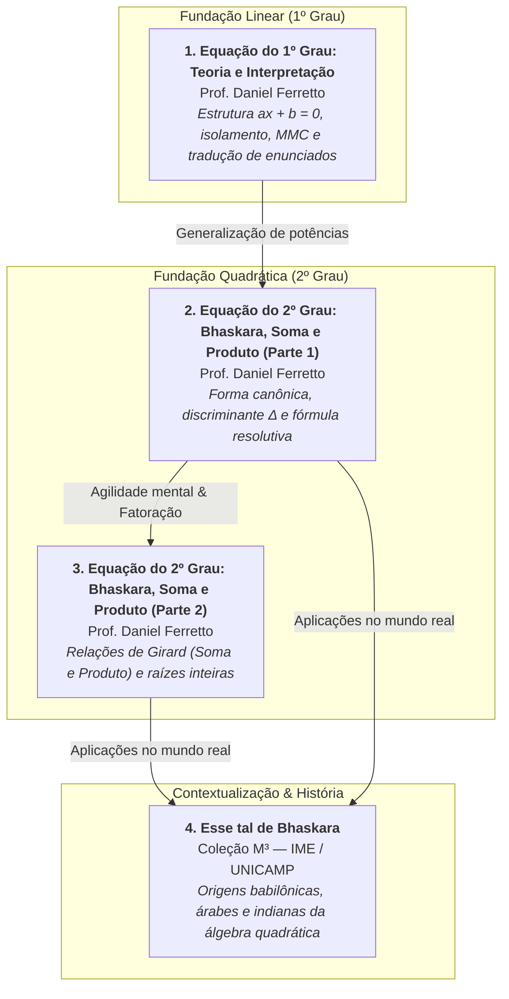
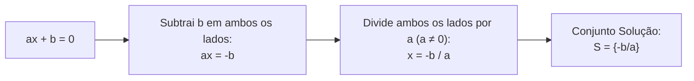
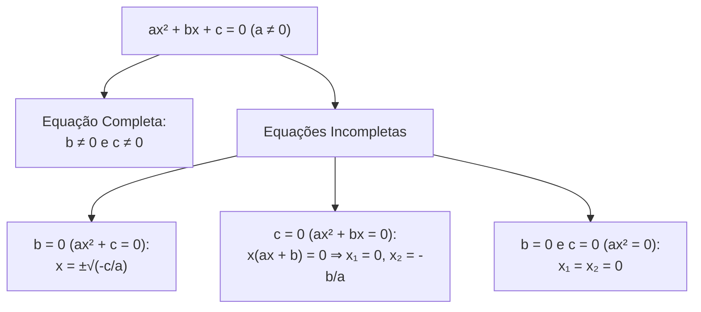
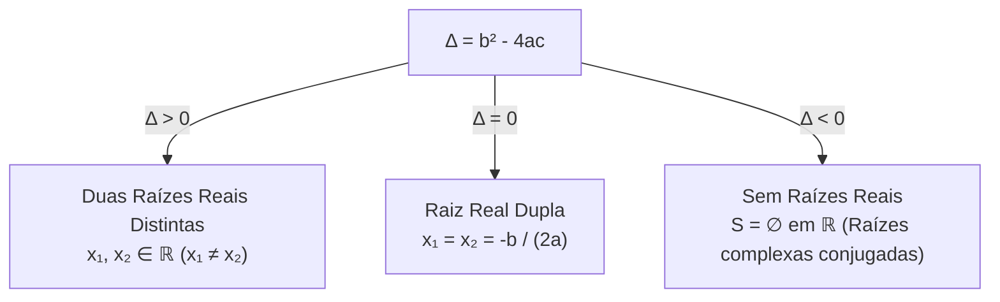
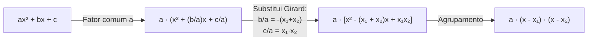
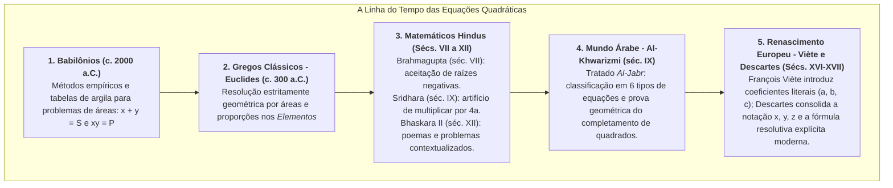
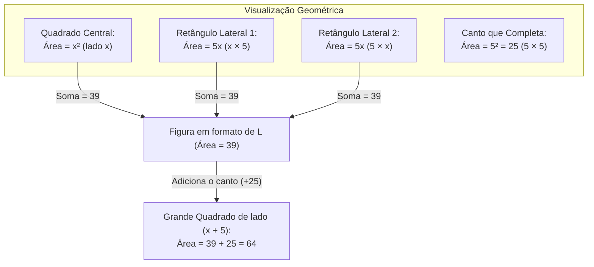

# 🌐 Vídeos-base: Equações de 1º e 2º Grau

> **Disciplina:** Matemática Básica (`MMB002-EC-2026S2B2-T001`) — Semana 5  
> **Tema:** Equações de 1º e 2º Grau (Teoria, Interpretação, Métodos Resolutivos e Aplicações)  
> **Status:** 🟢 **Concluído (4 vídeos integrados)**  

---

## 🗺️ Visão Integrada dos Vídeos-base da Semana 5



---

## 🎬 1. Vídeo-base: Equação do 1º Grau: Teoria e Interpretação (Prof. Daniel Ferretto)

* **Canal / Docente:** Professor Ferretto (*Matemática Básica — Aula 14*)  
* **Link Oficial:** [YouTube (Tu08PYjt-2Q)](https://www.youtube.com/watch?v=Tu08PYjt-2Q)  
* **Sinopse Oficial (AVA):** *Neste vídeo-base, você encontrará, por meio de exercícios, o caminho para interpretar, equacionar e resolver uma equação do 1º grau.*  
* **Tema Principal:** Fundamentos algébricos da equação do 1º grau, axiomas de equivalência e tradução sistemática de problemas em linguagem natural para modelos matemáticos.

---

### 1.1. Fundamentação Teórica e Estrutura Algébrica

Uma **equação polinomial do 1º grau** na incógnita $x$ é qualquer sentença aberta redutível à forma canônica:

$$ax + b = 0 \quad \text{com } a, b \in \mathbb{R} \text{ e } a \neq 0$$

* **$x$ (Incógnita):** Representa o valor desconhecido, cujo expoente máximo na forma reduzida é $1$.
* **$a$ (Coeficiente Angular / Principal):** Multiplicador da incógnita. Se $a = 0$, a expressão deixa de ser de 1º grau:
  * Caso $a = 0$ e $b = 0 \implies 0x = 0$ (Identidade ou equação indeterminada: infinitas soluções, $S = \mathbb{R}$).
  * Caso $a = 0$ e $b \neq 0 \implies 0x = -b$ (Equação impossível: nenhuma solução real, $S = \emptyset$).
* **$b$ (Termo Independente):** Constante real aditiva.
* **Raiz / Solução Única:** O único valor real que satisfaz a igualdade:
  $$x = -\frac{b}{a}$$



---

### 1.2. Princípios de Equivalência (A Balança Algébrica)

Toda resolução de equação fundamenta-se nas propriedades de corpo dos números reais ($\mathbb{R}$):

1. **Princípio Aditivo:** Adicionar ou subtrair uma mesma quantidade em ambos os membros preserva o conjunto verdade:
   $$A = B \iff A + c = B + c \quad (\forall c \in \mathbb{R})$$
   *(Justificativa formal do popular "passar para o outro lado trocando o sinal").*

2. **Princípio Multiplicativo:** Multiplicar ou dividir ambos os membros por um número real **não nulo** preserva a equivalência:
   $$A = B \iff A \cdot c = B \cdot c \quad (\forall c \in \mathbb{R}^*)$$
   *(Justificativa formal do "passar dividindo o que está multiplicando").*

---

### 1.3. O "Dicionário" de Tradução: Linguagem Natural $\to$ Linguagem Algébrica

O aspecto mais enfatizado pelo Prof. Ferretto é que as provas do ENEM, vestibulares e problemas de engenharia exigem a capacidade de traduzir termos corriqueiros em operadores matemáticos formais:

| Expressão em Linguagem Natural | Expressão Algébrica Correspondente |
| :--- | :---: |
| "Um número qualquer" | $x$ |
| "O dobro de um número" | $2x$ |
| "O triplo de um número adicionado a 5" | $3x + 5$ |
| "A metade de um número subtraída de 7" | $\frac{x}{2} - 7$ |
| "A terça parte de um número" | $\frac{x}{3}$ |
| "Dois terços de uma quantia" | $\frac{2}{3}x$ |
| "O sucessor de um número inteiro" | $x + 1$ |
| "A soma de três inteiros consecutivos" | $x + (x + 1) + (x + 2) = 3x + 3$ |
| "Dois números cuja soma é 100" | $x$ e $(100 - x)$ |
| "A razão entre dois números é 3 para 5" | $\frac{x}{y} = \frac{3}{5} \implies y = \frac{5}{3}x$ |
| "Exceder em $k$ unidades" | $A - B = k \iff A = B + k$ |

---

### 1.4. Resolução de Equações Fracionárias e Uso do MMC

Quando a equação possui coeficientes fracionários ou frações algébricas com denominadores numéricos:
$$\frac{x + 1}{2} - \frac{2x - 3}{3} = \frac{5}{6}$$

* **Passo 1:** Calcula-se o $\text{MMC}(2, 3, 6) = 6$.
* **Passo 2:** Multiplicam-se ambos os lados pelo MMC para eliminar os denominadores (Princípio Multiplicativo):
  $$6 \cdot \left(\frac{x + 1}{2}\right) - 6 \cdot \left(\frac{2x - 3}{3}\right) = 6 \cdot \left(\frac{5}{6}\right)$$
  $$3(x + 1) - 2(2x - 3) = 5$$
* **Passo 3:** Aplica-se a propriedade distributiva, atentando rigorosamente para o sinal negativo antes do parêntese:
  $$3x + 3 - 4x + 6 = 5$$
  $$-x + 9 = 5 \implies -x = 5 - 9 = -4 \implies \mathbf{x = 4}$$
* **Verificação (Prova Real):**
  $$\frac{4 + 1}{2} - \frac{2(4) - 3}{3} = \frac{5}{2} - \frac{5}{3} = \frac{15 - 10}{6} = \frac{5}{6} \quad (\text{Verdadeiro!})$$

---

### 1.5. Modelagem de Problema Contextualizado Típico

> **Problema Exemplo:**  
> *Em uma empresa de tecnologia, a folha de pagamento de dois desenvolvedores totaliza R$ 14.000,00. O salário do desenvolvedor sênior excede em R$ 2.000,00 o dobro do salário do desenvolvedor júnior. Qual o salário de cada um?*

* **Modelagem:**
  * Seja $x$ o salário do desenvolvedor júnior.
  * O salário do sênior é: $S = 2x + 2.000$.
  * A soma dos salários:
    $$x + (2x + 2.000) = 14.000$$
    $$3x + 2.000 = 14.000$$
    $$3x = 12.000 \implies x = 4.000$$
* **Conclusão:**
  * Desenvolvedor Júnior: **R$ 4.000,00**
  * Desenvolvedor Sênior: $2(4.000) + 2.000 = \mathbf{\text{R\$ }} 10.000,00$.

---

### 1.6. Conexões Computacionais & Algoritmos

Em programação (C++, Python), a resolução de equações lineares de 1º grau envolve cuidados essenciais de engenharia de software:

```cpp
#include <iostream>
#include <stdexcept>

// Resolve a equação ax + b = 0
double resolver_grau_1(double a, double b) {
    const double EPSILON = 1e-9;
    if (std::abs(a) < EPSILON) {
        if (std::abs(b) < EPSILON) {
            throw std::runtime_error("Identidade: Infinitas solucoes (0x + 0 = 0)");
        } else {
            throw std::runtime_error("Impossivel: Nenhuma solucao (0x + b = 0)");
        }
    }
    return -b / a;
}
```
* **Atenção à precisão numérica:** Comparações com zero em ponto flutuante (`float`/`double`) devem sempre utilizar uma tolerância $\epsilon$ (`EPSILON`).

---

## 🎬 2. Vídeo-base: Equação do 2º grau: Bhaskara e soma e produto (Parte 1) | Professor Ferretto

* **Canal / Docente:** Professor Ferretto (*Matemática Básica — Aula 16*)  
* **Link Oficial:** [YouTube (toAaUBwitFE)](https://www.youtube.com/watch?v=toAaUBwitFE)  
* **Sinopse Oficial (AVA):** *Nesta primeira parte do vídeo, você aprenderá a como resolver equações do 2º grau usando a fórmula de Bhaskara.*  
* **Tema Principal:** Estrutura geral da equação polinomial do 2º grau, dedução analítica pelo completamento de quadrados, discriminante ($\Delta$), fórmula resolutiva e introdução às relações de Girard (soma e produto).

---

### 2.1. Definição Formal e Estrutura Algébrica
Uma equação polinomial do 2º grau na incógnita real $x$ é qualquer sentença redutível à forma canônica:

$$ax^2 + bx + c = 0 \quad (a, b, c \in \mathbb{R}, \; a \neq 0)$$

* **$a$ (Coeficiente Quadrático):** Multiplicador de $x^2$. A condição $a \neq 0$ é mandatória para preservar o grau 2.
* **$b$ (Coeficiente Linear):** Multiplicador do termo de 1º grau $x$.
* **$c$ (Termo Independente):** Constante aditiva real.



---

### 2.2. Dedução Analítica da Fórmula Resolutiva (Completamento de Quadrados)

A fórmula comumente atribuída no Brasil a Bhaskara II fundamenta-se historicamente no método geométrico-algébrico de completamento de quadrados de Muhammad ibn Musa al-Khwarizmi:

1. Partimos da forma geral:
   $$ax^2 + bx + c = 0$$

2. Multiplicamos todos os termos por $4a$ (para facilitar a formação do trinômio quadrado perfeito):
   $$4a^2x^2 + 4abx + 4ac = 0$$

3. Isolamos a constante $4ac$ no segundo membro:
   $$(2ax)^2 + 2 \cdot (2ax) \cdot b = -4ac$$

4. Adicionamos $b^2$ a ambos os membros para completar o quadrado perfeito à esquerda:
   $$(2ax)^2 + 2 \cdot (2ax) \cdot b + b^2 = b^2 - 4ac$$
   $$(2ax + b)^2 = b^2 - 4ac$$

5. Definindo o **Discriminante** $\Delta = b^2 - 4ac$:
   $$2ax + b = \pm\sqrt{\Delta}$$
   $$2ax = -b \pm \sqrt{\Delta}$$
   $$\mathbf{x = \frac{-b \pm \sqrt{\Delta}}{2a}}$$

---

### 2.3. Estudo do Discriminante ($\Delta$) e Natureza das Raízes

O discriminante $\Delta = b^2 - 4ac$ revela a quantidade e a natureza das raízes reais no conjunto $\mathbb{R}$:

| Valor de $\Delta$ | Raízes em $\mathbb{R}$ | Interpretação Geométrica (Gráfico da Parábola) |
| :---: | :---: | :--- |
| **$\Delta > 0$** | Duas raízes reais distintas ($x_1 \neq x_2$) | A parábola intercepta o eixo $x$ em **dois pontos distintos**. |
| **$\Delta = 0$** | Duas raízes reais iguais / Raiz dupla ($x_1 = x_2 = -\frac{b}{2a}$) | A parábola é **tangente** ao eixo $x$ (intercepta em apenas um ponto, o vértice). |
| **$\Delta < 0$** | **Nenhuma raiz real** ($S = \emptyset$ em $\mathbb{R}$) | A parábola **não intercepta** o eixo $x$ (fica totalmente acima ou abaixo). |



---

### 2.4. Introdução ao Método de Soma e Produto (Relações de Girard)

Dadas as raízes $x_1 = \frac{-b + \sqrt{\Delta}}{2a}$ e $x_2 = \frac{-b - \sqrt{\Delta}}{2a}$:

* **Soma das Raízes ($S$):**
  $$S = x_1 + x_2 = \frac{-b + \sqrt{\Delta} - b - \sqrt{\Delta}}{2a} = \frac{-2b}{2a} = \mathbf{-\frac{b}{a}}$$

* **Produto das Raízes ($P$):**
  $$P = x_1 \cdot x_2 = \frac{(-b)^2 - (\sqrt{\Delta})^2}{4a^2} = \frac{b^2 - (b^2 - 4ac)}{4a^2} = \frac{4ac}{4a^2} = \mathbf{\frac{c}{a}}$$

Para equações mônicas ($a = 1$), a equação reduz-se a:
$$x^2 - Sx + P = 0$$

#### Roteiro Prático de Aplicação Mental:
1. Começar sempre pelo **Produto ($P$)**: listar pares de números inteiros cujo produto resulte em $P$.
2. Testar qual desses pares satisfaz a **Soma ($S$)**.
3. Se os números não forem inteiros fáceis ou $\Delta$ não for um quadrado perfeito, recorrer imediatamente à fórmula de Bhaskara.

---

### 2.5. Exemplos Resolvidos Passo a Passo

#### Exemplo 1: Equação com Raízes Inteiras ($a = 1$)
$$x^2 - 7x + 10 = 0$$
* Coeficientes: $a = 1, b = -7, c = 10$.
* **Por Soma e Produto:**
  * $S = -\frac{-7}{1} = 7$
  * $P = \frac{10}{1} = 10$
  * Pares cujo produto é 10: $(1, 10)$ e $(2, 5)$.
  * Soma $2 + 5 = 7 \implies \mathbf{x_1 = 2, \; x_2 = 5}$.
  * Conjunto Solução: $S = \{2, 5\}$.

#### Exemplo 2: Equação com $a \neq 1$ e Raiz Dupla ($\Delta = 0$)
$$4x^2 - 12x + 9 = 0$$
* Coeficientes: $a = 4, b = -12, c = 9$.
* Discriminante:
  $$\Delta = (-12)^2 - 4(4)(9) = 144 - 144 = 0$$
* Como $\Delta = 0$, há raiz real dupla:
  $$x = \frac{-(-12) \pm 0}{2(4)} = \frac{12}{8} = \mathbf{\frac{3}{2} = 1,5}$$
* Fatoração: $4\left(x - \frac{3}{2}\right)^2 = (2x - 3)^2 = 0$.

---

### 2.6. Modelagem Computacional Robusta em C++

Um algoritmo robusto para resolução de equações do 2º grau deve tratar os casos degenerados ($a \approx 0$) e classificar o discriminante com precisão:

```cpp
#include <iostream>
#include <cmath>
#include <utility>

struct SolucaoQuadrada {
    int num_raizes_reais;
    double x1;
    double x2;
};

SolucaoQuadrada resolver_grau_2(double a, double b, double c) {
    const double EPS = 1e-9;
    if (std::abs(a) < EPS) {
        // Reduz a grau 1: bx + c = 0
        if (std::abs(b) < EPS) return {0, 0, 0};
        return {1, -c / b, -c / b};
    }

    double delta = b * b - 4 * a * c;
    if (delta > EPS) {
        double sqrt_d = std::sqrt(delta);
        return {2, (-b + sqrt_d) / (2 * a), (-b - sqrt_d) / (2 * a)};
    } else if (std::abs(delta) <= EPS) {
        return {1, -b / (2 * a), -b / (2 * a)};
    } else {
        return {0, 0, 0}; // Nenhuma raiz real
    }
}
```

---

## 🎬 3. Vídeo-base: Equação do 2º grau: Bhaskara e soma e produto (Parte 2) | Professor Ferretto

* **Canal / Docente:** Professor Ferretto (*Matemática Básica — Aula 17*)  
* **Link Oficial:** [YouTube (qYQllsg8ka8)](https://www.youtube.com/watch?v=qYQllsg8ka8)  
* **Sinopse Oficial (AVA):** *Nesta segunda parte do vídeo, você aprenderá outro método para achar as raízes de uma equação do 2º grau.*  
* **Tema Principal:** Aprofundamento do método de soma e produto quando $a \neq 1$, forma fatorada do trinômio do 2º grau ($a(x - x_1)(x - x_2)$), manipulação algébrica das relações de Girard e resolução de problemas clássicos.

---

### 3.1. O Método de Soma e Produto Avançado (Quando $a \neq 1$)

Quando o coeficiente quadrático $a \neq 1$, o método direto de soma e produto pode envolver frações ($S = -b/a$, $P = c/a$). O Prof. Ferretto ensina duas técnicas ágeis para superar esse obstáculo:

#### Técnica 1: Mudança de Variável por Multiplicação por $a$
Dada a equação $ax^2 + bx + c = 0$:
1. Multiplicamos toda a equação por $a$:
   $$a^2x^2 + abx + ac = 0 \iff (ax)^2 + b(ax) + ac = 0$$
2. Fazemos a substituição de variável $y = ax$:
   $$y^2 + by + (a \cdot c) = 0$$
3. Agora temos uma equação mônica na variável $y$!
   * Soma de $y$: $S_y = -b$
   * Produto de $y$: $P_y = a \cdot c$
4. Encontrados os valores $y_1$ e $y_2$, recuperamos $x$:
   $$x_1 = \frac{y_1}{a}, \quad x_2 = \frac{y_2}{a}$$

> **Exemplo Aplicado:** Resolver $2x^2 - 7x + 3 = 0$.
> * $a = 2, b = -7, c = 3$.
> * Produto ajustado: $P_y = a \cdot c = 2 \cdot 3 = 6$.
> * Soma ajustada: $S_y = -b = 7$.
> * Dois números cujo produto é 6 e soma é 7: **$y_1 = 1$ e $y_2 = 6$**.
> * Dividindo por $a = 2$:
>   $$x_1 = \frac{1}{2}, \quad x_2 = \frac{6}{2} = 3$$
> * Conjunto Solução: $S = \left\{\frac{1}{2}, 3\right\}$.

---

### 3.2. Forma Fatorada do Trinômio do 2º Grau

Sejam $x_1$ e $x_2$ as raízes reais de $ax^2 + bx + c = 0$. O polinômio quadrático pode ser decomposto no produto de dois fatores lineares:

$$\mathbf{ax^2 + bx + c = a(x - x_1)(x - x_2)}$$



#### Aplicação Crucial: Simplificação de Frações Algébricas
Simplificar a expressão racional:
$$E = \frac{2x^2 - 7x + 3}{x - 3}$$
* Como as raízes de $2x^2 - 7x + 3$ são $3$ e $\frac{1}{2}$:
  $$2x^2 - 7x + 3 = 2(x - 3)\left(x - \frac{1}{2}\right) = (x - 3)(2x - 1)$$
* Substituindo na fração (para $x \neq 3$):
  $$E = \frac{(x - 3)(2x - 1)}{x - 3} = \mathbf{2x - 1}$$

---

### 3.3. Aplicações Algébricas das Relações de Girard sem Conhecer as Raízes

Problemas recorrentes em concursos e exames de engenharia exigem determinar valores de expressões simétricas das raízes **sem resolver a equação**:

Dada $ax^2 + bx + c = 0$ com raízes $x_1$ e $x_2$, sabemos que $S = x_1 + x_2 = -\frac{b}{a}$ e $P = x_1 \cdot x_2 = \frac{c}{a}$.

| Expressão Desejada | Identidade Algébrica / Fatoração | Valor em Função de $a, b, c$ |
| :--- | :--- | :---: |
| **Soma dos Inversos:** $\frac{1}{x_1} + \frac{1}{x_2}$ | $\frac{x_1 + x_2}{x_1 x_2} = \frac{S}{P}$ | $\frac{-b/a}{c/a} = \mathbf{-\frac{b}{c}}$ |
| **Soma dos Quadrados:** $x_1^2 + x_2^2$ | $(x_1 + x_2)^2 - 2x_1 x_2 = S^2 - 2P$ | $\left(-\frac{b}{a}\right)^2 - 2\frac{c}{a} = \mathbf{\frac{b^2 - 2ac}{a^2}}$ |
| **Diferença dos Quadrados:** $x_1^2 - x_2^2$ | $(x_1 + x_2)(x_1 - x_2) = S \cdot (\pm\sqrt{\Delta}/a)$ | $\mathbf{\mp\frac{b\sqrt{\Delta}}{a^2}}$ |
| **Soma dos Cubos:** $x_1^3 + x_2^3$ | $(x_1 + x_2)[(x_1 + x_2)^2 - 3x_1 x_2] = S(S^2 - 3P)$ | $\mathbf{-\frac{b(b^2 - 3ac)}{a^3}}$ |

---

### 3.4. Resumo Comparativo: Bhaskara vs. Soma e Produto

| Critério | Fórmula de Bhaskara | Método de Soma e Produto |
| :--- | :--- | :--- |
| **Universalidade** | Funciona para qualquer equação com raízes reais ou complexas. | Mais rápido para raízes inteiras ou racionais simples. |
| **Velocidade** | Mais demorado (cálculo de $\Delta$, raiz quadrada e divisões). | Quase instantâneo (cálculo mental em segundos). |
| **Raízes Irracionais** | Excelente e direto (preserva radicais como $3 \pm \sqrt{5}$). | Difícil de visualizar mentalmente. |
| **Fatoração** | Requer calcular as raízes antes de montar os fatores. | Fornece os fatores $(x - x_1)(x - x_2)$ de imediato. |

---

## 🎬 4. Vídeo-base: Esse tal de Bhaskara (Coleção M³ — IME / UNICAMP)

* **Produção:** Coleção M³ — Matemática Multimídia (IME / UNICAMP e Ministério da Educação)  
* **Série:** Matemática na Escola  
* **Link Oficial:** [YouTube (dw6wD5bP5vw)](https://www.youtube.com/watch?v=dw6wD5bP5vw)  
* **Sinopse Oficial (AVA):** *Nesse vídeo-base, você verá o contexto histórico e apreenderá aplicações práticas da equação quadrática.*  
* **Tema Principal:** Evolução histórica da resolução de equações quadráticas, desmistificação da denominação "Fórmula de Bhaskara", método geométrico de completar quadrados e aplicações em engenharia e ciências.

---

### 4.1. O Mito Histórico da "Fórmula de Bhaskara"

No Brasil, a fórmula resolutiva da equação do 2º grau é tradicionalmente batizada de **"Fórmula de Bhaskara"**. Entretanto, essa denominação é praticamente uma exclusividade da literatura didática brasileira:

* Nos livros e universidades de língua inglesa, ela é denominada simplesmente de ***Quadratic Formula***.
* Na França e na maioria dos países europeus, é referida como ***Formule de résolution de l'équation du second degré***.
* **Bhaskara Akaria (Bhaskara II, 1114–1185 d.C.)**: Notável astrônomo e matemático hindu, autor das clássicas obras *Siddhanta Siromani*, *Lilavati* e *Bijaganita*. Bhaskara conhecia e formulava métodos poéticos para a resolução de equações quadráticas, mas **não criou a fórmula simbólica moderna**, que sequer existia em sua época devido à ausência de notação literal para coeficientes.



---

### 4.2. O Método Geométrico de Completamento de Quadrados (Al-Khwarizmi)

O cerne didático explorado no recurso do M³ é a visualização física do completamento de quadrados. Consideremos a equação histórica:
$$x^2 + 10x = 39$$

1. **Construção Geométrica:**
   * Desenhamos um quadrado central de lado $x$, cuja área é $x^2$.
   * A parcela $10x$ é dividida em dois retângulos iguais de dimensões $x \times 5$, anexados às laterais adjacentes do quadrado central.
   * A figura formada tem área:
     $$\text{Área}(L) = x^2 + 5x + 5x = x^2 + 10x$$

2. **Completando o Quadrado:**
   * Observa-se que no canto superior direito falta um pequeno quadrado de lado $5$ para formar um quadrado perfeito maior de lado $(x + 5)$.
   * A área dessa peça que falta é $5^2 = 25$.



3. **Cálculo da Solução:**
   $$(x + 5)^2 = 39 + 25 = 64$$
   $$x + 5 = \sqrt{64} = 8$$
   $$x = 8 - 5 = \mathbf{3}$$
   *(Verificação: $3^2 + 10(3) = 9 + 30 = 39$, Perfeito!)*

> [!NOTE]
> Na antiguidade, a raiz negativa $x + 5 = -8 \implies x = -13$ era descartada porque medidas de comprimento e áreas físicas não podem assumir grandezas geométricas negativas. Somente séculos mais tarde, com o desenvolvimento da álgebra simbólica formal, as raízes negativas e complexas foram plenamente aceitas.

---

### 4.3. Aplicações Práticas Contemporâneas da Equação do 2º Grau

O vídeo ilustra como o formalismo quadrático é a espinha dorsal de inúmeros modelos nas ciências exatas e engenharia:

1. **Cinemática e Física Mecânica:**
   A equação horária do movimento retilíneo uniformemente variado (MRUV):
   $$s(t) = s_0 + v_0 t + \frac{1}{2}a t^2$$
   Determinar o instante em que um projétil atinge o solo ($s(t) = 0$) recai exatamente na resolução de uma equação do 2º grau na variável temporal $t$.

2. **Problemas de Otimização e Máximos/Mínimos:**
   Encontrar as dimensões de um terreno ou recipiente que maximizem a área delimitada sob um perímetro fixo (vértice da parábola):
   $$x_v = -\frac{b}{2a}, \quad y_v = -\frac{\Delta}{4a}$$

3. **Circuitos Elétricos (RLC) e Computação:**
   A equação característica de circuitos osciladores de segunda ordem:
   $$L \frac{d^2 i}{dt^2} + R \frac{di}{dt} + \frac{1}{C} i = 0 \implies L r^2 + R r + \frac{1}{C} = 0$$
   A classificação das respostas (superamortecida, criticamente amortecida ou subamortecida) depende estritamente do sinal de $\Delta = R^2 - 4L/C$.

