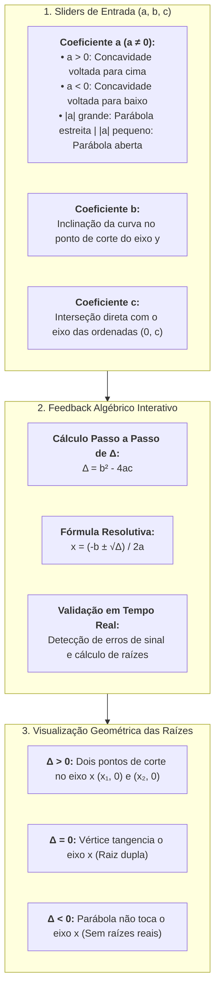
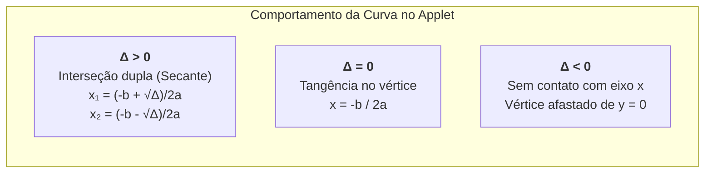

# 🔬 Aprofundando o Tema: Equação do 2º Grau no GeoGebra (Jorge Cássio)

> **Material de Apoio Oficial:** CÁSSIO, Jorge; FERRI, Orlando Eduardo. **Equação do 2º grau usando Bhaskara com ajuda e feedbacks**. Plataforma GeoGebra.  
> **Links de Acesso Interativo:** [GeoGebra (guyp48at)](https://www.geogebra.org/m/guyp48at) | [GeoGebra (frmkf3a4)](https://www.geogebra.org/m/frmkf3a4)  
> **Disciplina:** Matemática Básica (`MMB002-EC-2026S2B2-T001`) — Semana 5  
> **Tema:** Exploração visual, paramétrica e interativa da fórmula de Bhaskara, discriminante ($\Delta$), raízes e comportamento geométrico da parábola  
> **Status:** 🟢 **Concluído**  

---

## 🗺️ Mapa Conceitual da Exploração Interativa no GeoGebra



---

## 📌 1. Sobre o Recurso Interativo do Professor Jorge Cássio

O applet interativo desenvolvido pelo Prof. **Jorge Cássio** no **GeoGebra** é uma ferramenta didática desenhada para construir a ponte cognitiva entre a **álgebra simbólica** e a **geometria analítica**:

* **Público-alvo:** Estudantes de ciências exatas e engenharias no ciclo básico.
* **Objetivo Pedagógico:** Permitir a experimentação ativa, onde o estudante manipula os parâmetros da equação e observa simultaneamente as alterações no cálculo do discriminante ($\Delta$), na fórmula de Bhaskara e na posição da curva no plano cartesiano.
* **Recurso Diferencial (Feedbacks Imediatos):** O applet contém campos interativos em que o aluno insere os coeficientes, o valor de $\Delta$ e as etapas da fórmula de Bhaskara, recebendo confirmações visuais e diagnósticos de erro em tempo real.

---

## ⚙️ 2. A Dinâmica dos Coeficientes e o Comportamento da Parábola

Ao manipular os controles deslizantes (*sliders*) do GeoGebra para a função $f(x) = ax^2 + bx + c$, observam-se as seguintes propriedades geométricas essenciais:

### 2.1. O Papel do Coeficiente $a$ (Abertura e Concavidade)
* **Condição de existência:** $a \neq 0$. Se $a \to 0$, a curvatura desaparece e a parábola degenera em uma reta ($y = bx + c$).
* **Sinal de $a$:**
  * $a > 0$: A parábola possui concavidade para cima ($\cup$), admitindo um ponto de **mínimo global** no vértice.
  * $a < 0$: A parábola possui concavidade para baixo ($\cap$), admitindo um ponto de **máximo global** no vértice.
* **Módulo $|a|$:** Quanto maior $|a|$, mais "fechada" é a parábola (maior a taxa de variação da inclinação).

### 2.2. O Papel do Coeficiente $b$ (Deslocamento e Inclinação na Origem)
* O coeficiente $b$ representa a derivada da função na origem ($f'(0) = b$), ou seja, a inclinação da reta tangente à parábola no ponto onde ela cruza o eixo $y$:
  * $b > 0$: A curva intercepta o eixo $y$ em sentido **crescente** (subindo).
  * $b < 0$: A curva intercepta o eixo $y$ em sentido **decrescente** (descendo).
  * $b = 0$: O vértice da parábola está exatamente sobre o eixo $y$ ($x_v = 0$).

### 2.3. O Papel do Coeficiente $c$ (Translação Vertical)
* O termo independente determina o ponto exato de interseção com o eixo das ordenadas: o ponto **$(0, c)$**.
* Alterar $c$ translada a parábola rigidamente para cima ($c > 0$) ou para baixo ($c < 0$) sem alterar sua forma geométrica.

---

## 📐 3. Interpretação Geométrica do Discriminante ($\Delta$) no GeoGebra

O discriminante $\Delta = b^2 - 4ac$ funciona como um "sensor geométrico" de interseção:

| Valor de $\Delta$ | Relação com o Eixo $x$ | Número de Raízes Reais | Aspecto no GeoGebra |
| :---: | :---: | :---: | :--- |
| **$\Delta > 0$** | **Secante** | Duas raízes reais distintas ($x_1 \neq x_2$) | A curva cruza o eixo $x$ em dois pontos bem definidos. |
| **$\Delta = 0$** | **Tangente** | Uma raiz real dupla ($x_1 = x_2$) | O vértice da parábola encosta exatamente sobre o eixo $x$. |
| **$\Delta < 0$** | **Disjunta** | Nenhuma raiz real ($S = \emptyset$) | A curva "flutua", ficando totalmente contida no semiplano superior ($a > 0$) ou inferior ($a < 0$). |



---

## 💻 4. Conexões Computacionais: Renderização Paramétrica de Parábolas em C++

Em computação gráfica, motores de jogos e softwares como o GeoGebra, a curva de uma equação do 2º grau é amostrada por meio de pontos discretizados calculados ao longo de um intervalo $[x_{\min}, x_{\max}]$:

```cpp
#include <iostream>
#include <vector>
#include <cmath>
#include <iomanip>

struct Ponto2D {
    double x;
    double y;
};

// Gera os pontos amostrados da parábola y = ax² + bx + c
std::vector<Ponto2D> amostrar_parabola(double a, double b, double c, 
                                      double x_min, double x_max, int passos) {
    std::vector<Ponto2D> pontos;
    double dx = (x_max - x_min) / passos;
    for (int i = 0; i <= passos; ++i) {
        double x = x_min + i * dx;
        double y = a * x * x + b * x + c;
        pontos.push_back({x, y});
    }
    return pontos;
}

// Determina as propriedades críticas da parábola
void analisar_geometria_quadratica(double a, double b, double c) {
    std::cout << std::fixed << std::setprecision(2);
    std::cout << "--- ANALISE DA EQUACAO: " << a << "x² + (" << b << ")x + (" << c << ") = 0 ---\n";
    
    double xv = -b / (2 * a);
    double yv = -(b * b - 4 * a * c) / (4 * a);
    double delta = b * b - 4 * a * c;

    std::cout << "1. Vertice da Curva: V(" << xv << ", " << yv << ")\n";
    std::cout << "2. Concavidade: " << (a > 0 ? "Para cima (Minimo)" : "Para baixo (Maximo)") << "\n";
    std::cout << "3. Discriminante Delta: " << delta << "\n";
    
    if (delta > 0) {
        double x1 = (-b + std::sqrt(delta)) / (2 * a);
        double x2 = (-b - std::sqrt(delta)) / (2 * a);
        std::cout << "4. Intersecoes com eixo x (Raizes reais): x1 = " << x1 << ", x2 = " << x2 << "\n";
    } else if (std::abs(delta) < 1e-9) {
        std::cout << "4. Tangencia com eixo x (Raiz dupla): x = " << xv << "\n";
    } else {
        std::cout << "4. Sem intersecao com o eixo x (Raizes imaginarias)\n";
    }
}

int main() {
    // Exemplo: x² - 4x - 5 = 0 (Questão 5 da atividade)
    analisar_geometria_quadratica(1.0, -4.0, -5.0);
    return 0;
}
```
