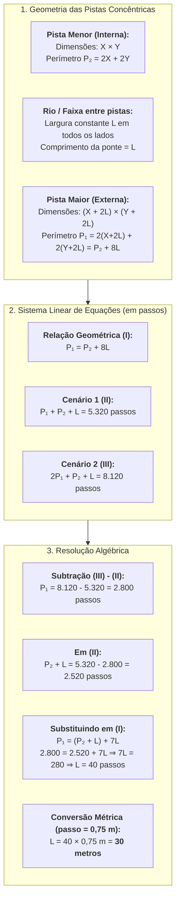

# 💬 Fórum Temático — Semana 5 (MMB002)

> **Disciplina:** Matemática Básica (`MMB002-EC-2026S2B2-T001`)  
> **Tema da Semana 5:** Equações e Sistemas Lineares — Problema da Ponte  
> **Docente Responsável:** Profª Dra. Rúbia Barcelos Amaral  
> **Período de Participação:** 26/10/2026 a 08/11/2026  
> **Status:** 🟢 **Resolução Analítica e Modelos Prontos para Postagem no AVA**  

---

## 📌 Enunciado Oficial do Fórum Temático

> **Fórum Temático: Problema da ponte**
>
> *Suponha que queiramos descobrir o comprimento da ponte apresentada na imagem abaixo:*  
> *Figura de formato retangular. Na figura há uma área vermelha retangular de comprimento $X + 2L$ e largura $Y + 2L$. Dentro da área vermelha há uma área azul de largura $L$.*  
> *(Fonte: Adaptação criada a partir do material “Contagem de Passos” \| M³ Unicamp)*  
>
> *Sabemos que a ponte da imagem liga uma pista retangular maior a uma pista retangular menor interna à primeira, sendo que um rio passa entre elas. Ainda, sabemos que a distância entre os retângulos é sempre igual em todos os lados. Para completar, sabe-se que para dar uma volta em cada pista passando-se pela ponte são necessários **5.320 passos** de uma pessoa que tem como medida do passo **0,75 m**. Para dar **2 voltas na pista maior e uma volta na pista menor**, passando-se pela ponte, são necessários **8.120 passos** da mesma pessoa.*
>
> *A partir das informações apresentadas e da imagem acima, podemos concluir que o tamanho da ponte corresponde a...?*
>
> *Discuta sobre esse tema no Fórum Temático desta semana!*

---

## 🗺️ Mapa da Modelagem Matemática do Problema

---

## 🧮 Resolução Analítica Passo a Passo

### 1. Definição das Variáveis
* $X$: comprimento da pista interna (retângulo menor).
* $Y$: largura da pista interna (retângulo menor).
* $L$: largura constante do rio (distância uniforme entre as pistas). Como a ponte atravessa perpendicularmente o rio, **o comprimento da ponte é igual a $L$**.
* $P_1$: perímetro da pista maior (em passos).
* $P_2$: perímetro da pista menor (em passos).
* $p = 0,75\text{ m}$: tamanho do passo.

---

### 2. Relação Geométrica Fundamental entre os Perímetros
A pista externa tem dimensões aumentadas em $L$ em cada uma das duas extremidades:
* Comprimento externo: $X + 2L$
* Largura externa: $Y + 2L$

Calculando os perímetros:
$$P_2 = 2X + 2Y$$
$$P_1 = 2(X + 2L) + 2(Y + 2L) = 2X + 4L + 2Y + 4L = (2X + 2Y) + 8L$$

Logo, independentemente dos valores de $X$ e $Y$:
$$\mathbf{P_1 = P_2 + 8L \quad \text{--- (Equação I)}}$$

---

### 3. Montagem do Sistema Linear
Traduzindo as caminhadas descritas em passos:
* **Cenário 1 (1 volta na pista maior + 1 volta na menor + ponte):**
  $$P_1 + P_2 + L = 5.320 \quad \text{--- (Equação II)}$$
* **Cenário 2 (2 voltas na pista maior + 1 volta na menor + ponte):**
  $$2P_1 + P_2 + L = 8.120 \quad \text{--- (Equação III)}$$

---

### 4. Resolução do Sistema

1. **Subtraindo a Equação (II) da Equação (III):**
   $$(2P_1 + P_2 + L) - (P_1 + P_2 + L) = 8.120 - 5.320$$
   $$\mathbf{P_1 = 2.800 \text{ passos}}$$

2. **Substituindo $P_1 = 2.800$ na Equação (II):**
   $$2.800 + P_2 + L = 5.320$$
   $$\mathbf{P_2 + L = 2.520 \text{ passos}}$$

3. **Reescrevendo a Equação Geométrica (I):**
   $$P_1 = P_2 + 8L = (P_2 + L) + 7L$$
   Substituindo os valores encontrados:
   $$2.800 = 2.520 + 7L$$
   $$7L = 2.800 - 2.520$$
   $$7L = 280$$
   $$\mathbf{L = \frac{280}{7} = 40 \text{ passos}}$$

---

### 5. Conversão para Metros
Com o passo medindo $0,75\text{ m}$:
$$\text{Comprimento da Ponte} = L \times 0,75\text{ m} = 40 \times 0,75 = \mathbf{30 \text{ metros}}$$

* **Dimensões complementares:**
  * Pista maior: $P_1 = 2.800 \times 0,75\text{ m} = 2.100\text{ m}$.
  * Pista menor: $P_2 = (2.520 - 40) \times 0,75\text{ m} = 2.480 \times 0,75 = 1.860\text{ m}$.
  * Diferença dos perímetros: $P_1 - P_2 = 2.100 - 1.860 = 240\text{ m} = 8 \times 30\text{ m}$ (Consistência geométrica perfeita).

$$\boxed{\text{O tamanho da ponte corresponde a exatamente } \mathbf{30 \text{ metros}} \text{ (ou } 40 \text{ passos).}}$$

---

## 📝 Modelos de Postagem para o AVA

Abaixo estão disponíveis **três opções de postagem prontas**, em diferentes estilos, para você copiar e publicar no fórum do AVA:

---

### 💡 Opção 1: Modelo Analítico e Formal (Recomendado)
> **Título da Postagem:** Resolução Matemática do Problema da Ponte (M³ Unicamp)
>
> Olá, professora Rúbia, mediadores e colegas!
>
> Para determinar o comprimento da ponte, podemos modelar a situação geometricamente e resolvê-la através de um sistema de equações lineares de primeiro grau.
>
> **1. Relação Geométrica dos Perímetros:**  
> Sejam $X$ e $Y$ o comprimento e a largura da pista menor interna, e $L$ a largura constante do rio (que coincide com o comprimento da ponte que liga as duas pistas).
> As dimensões da pista maior externa são $(X + 2L)$ e $(Y + 2L)$.  
> * Perímetro da pista menor: $P_2 = 2X + 2Y$.  
> * Perímetro da pista maior: $P_1 = 2(X + 2L) + 2(Y + 2L) = (2X + 2Y) + 8L = P_2 + 8L$.  
> Portanto: $P_1 = P_2 + 8L$ (Equação I).
>
> **2. Modelagem em Passos a partir dos Cenários:**  
> * Cenário 1 (1 volta maior + 1 volta menor + ponte):  
>   $P_1 + P_2 + L = 5.320$ passos (Equação II)  
> * Cenário 2 (2 voltas maior + 1 volta menor + ponte):  
>   $2P_1 + P_2 + L = 8.120$ passos (Equação III)  
>
> **3. Resolução Algébrica:**  
> Subtraindo a Equação II da Equação III, isolamos diretamente o perímetro da pista maior:  
> $P_1 = 8.120 - 5.320 = 2.800$ passos.  
>
> Substituindo $P_1 = 2.800$ na Equação II:  
> $2.800 + P_2 + L = 5.320 \implies P_2 + L = 2.520$ passos.  
>
> Agora, agrupamos a Equação I:  
> $P_1 = (P_2 + L) + 7L \implies 2.800 = 2.520 + 7L$  
> $7L = 280 \implies L = 40$ passos.  
>
> **4. Conversão para Metros:**  
> Sabendo que cada passo mede $0,75\text{ m}$:  
> $\text{Comprimento da Ponte} = 40 \times 0,75\text{ m} = \mathbf{30\text{ metros}}$.  
>
> A ponte mede exatamente **30 metros** (ou 40 passos). As pistas medem $2.100\text{ m}$ (pista maior) e $1.860\text{ m}$ (pista menor).
>
> O que acharam dessa estratégia de agrupar $(P_2 + L)$ para encontrar $7L$? Um abraço a todos!

---

### 💡 Opção 2: Modelo Direto, Didático e Objetivo
> **Título da Postagem:** Solução do Desafio da Ponte — Passo a Passo
>
> Olá a todos!
>
> Resolvi o desafio da ponte observando a diferença entre as duas caminhadas:
>
> 1. A única diferença entre dar "1 volta na maior + 1 na menor + ponte" (5.320 passos) e "2 voltas na maior + 1 na menor + ponte" (8.120 passos) é exatamente **uma volta completa na pista maior**.  
> Logo: $\text{Pista Maior} = 8.120 - 5.320 = 2.800\text{ passos}$.
>
> 2. Substituindo na primeira caminhada:  
> $\text{Pista Menor} + \text{Ponte} = 5.320 - 2.800 = 2.520\text{ passos}$.
>
> 3. Pela geometria dos retângulos, como a distância entre as pistas é $L$ nos 4 cantos, a pista maior tem $8L$ a mais de perímetro que a pista menor:  
> $\text{Pista Maior} = \text{Pista Menor} + 8L = (\text{Pista Menor} + L) + 7L$.  
> $2.800 = 2.520 + 7L \implies 7L = 280 \implies L = 40\text{ passos}$.
>
> 4. Como cada passo mede $0,75\text{ m}$:  
> $40 \times 0,75\text{ m} = \mathbf{30\text{ metros}}$.
>
> Conclui-se que o tamanho da ponte é de **30 metros**. Bons estudos!

---

### 💡 Opção 3: Modelo com Foco em Engenharia e Modelagem Computacional
> **Título da Postagem:** Modelagem por Sistemas Lineares e Solução do Desafio da Ponte
>
> Olá, turma e professora Rúbia!
>
> O desafio desta semana ilustra com perfeição a essência da modelagem em engenharia: transformar um problema verbal e geométrico em um sistema linear bem condicionado.
>
> Montando as equações com as incógnitas $P_1$ (perímetro maior), $P_2$ (perímetro menor) e $L$ (comprimento da ponte/largura do rio):
>
> $$\begin{bmatrix} 1 & -1 & -8 \\ 1 & 1 & 1 \\ 2 & 1 & 1 \end{bmatrix} \begin{bmatrix} P_1 \\ P_2 \\ L \end{bmatrix} = \begin{bmatrix} 0 \\ 5320 \\ 8120 \end{bmatrix}$$
>
> Aplicando eliminação direta (subtraindo $L_2$ de $L_3$), obtemos imediatamente $P_1 = 2.800$ passos. Em seguida, a combinação linear entre as linhas revela que $7L = 280 \implies L = 40$ passos.
>
> Multiplicando pela escala métrica da passada ($0,75\text{ m}$):
> $$L = 40 \times 0,75 = \mathbf{30\text{ metros}}$$
>
> Esse exercício reforça como propriedades geométricas invariantes (o acréscimo de $8L$ em retângulos concêntricos com distanciamento constante) viabilizam a resolução determinística sem precisarmos conhecer previamente o comprimento $X$ e a largura $Y$ isoladamente.
>
> Sucesso a todos nos estudos desta semana!
