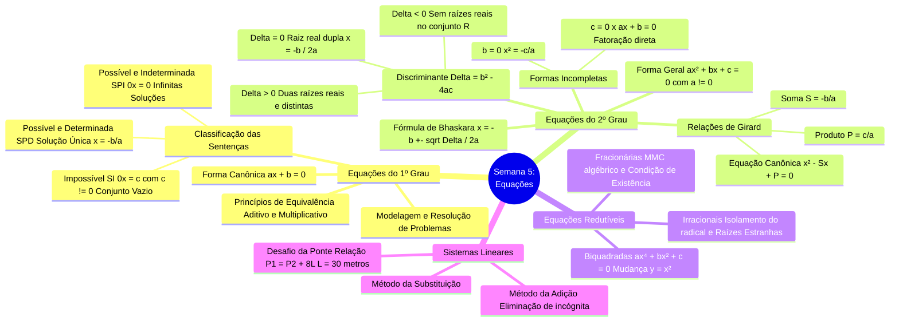

# 📑 Em Síntese — Resumo Executivo da Semana 5 (MMB002)

> **Disciplina:** Matemática Básica (`MMB002-EC-2026S2B2-T001`)  
> **Tema da Semana 5:** Equações do 1º e 2º Grau, Sistemas Lineares e Modelagem Algébrica  
> **Docente Responsável:** Profª Dra. Rúbia Barcelos Amaral  
> **Período de Realização:** 26/10/2026 a 08/11/2026  
> **Desempenho Oficial na Avaliação:** 🏆 **Nota 10,0 / 10,0 (100% de aproveitamento)** — 8/8 questões corretas  

---

## 👩‍🏫 Mensagem Oficial de Fechamento do AVA

> *Essa semana estudamos as **equações do 1º e 2º grau**, vimos exercícios e aplicações práticas. Aprender e dominar esses conceitos fornecerá a base para otimizar e prever comportamentos em diversas situações, tanto na área acadêmica quanto em situações práticas do cotidiano, uma vez que desenvolvem habilidades matemáticas importantes para a resolução de problemas. Além disso, agora podemos avançar para a próxima semana, na qual estudaremos as **funções afim e quadrática**.*  
> 
> *Parabéns! Você chegou ao fim do conteúdo desta semana.*  
> 
> *Na próxima semana, estudaremos **funções do 1º e 2º grau**.*  
> 
> *Até lá!*  
> 
> *Você está preparado para avançar? Faça uma auto-avaliação: você adquiriu todas as competências e habilidades esperadas? Marque os itens que acredita ter alcançado. Se faltar algum, revise o conteúdo da semana.*  
> 
> *Nesta semana, eu:*  
> * ☑ **Compreendi, identifiquei e solucionei equações de primeiro e segundo grau.**  
> * ☑ **Verifiquei aplicações práticas das equações de primeiro e segundo grau.**  

---

## 🗺️ Mapa Mental Integrado da Semana 5

---

## 📊 1. Quadro Comparativo: Famílias de Equações e Métodos de Solução

| Tipo de Equação | Forma Canônica / Estrutura | Condição de Existência ($CE$) | Método Resolutivo Recomendado | Comportamento das Raízes |
| :--- | :--- | :--- | :--- | :--- |
| **1º Grau** | $ax + b = 0$ ($a \neq 0$) | $x \in \mathbb{R}$ | Isolamento algébrico por equivalência | Raiz única $x = -\frac{b}{a}$ |
| **2º Grau Completa** | $ax^2 + bx + c = 0$ | $a \neq 0$ | Bhaskara ou Soma e Produto | $2$ raízes ($\Delta > 0$), $1$ dupla ($\Delta = 0$) ou $0$ reais ($\Delta < 0$) |
| **2º Grau Incompleta em $b$** | $ax^2 + c = 0$ ($b=0$) | $a \neq 0$ | Extração direta da raiz quadrada: $x = \pm\sqrt{-\frac{c}{a}}$ | Raízes simétricas $x_1 = -x_2$ (se $-\frac{c}{a} \ge 0$) |
| **2º Grau Incompleta em $c$** | $ax^2 + bx = 0$ ($c=0$) | $a \neq 0$ | Fatoração por evidência: $x(ax + b) = 0$ | Uma raiz é sempre nula: $x_1 = 0$, $x_2 = -\frac{b}{a}$ |
| **Biquadrada** | $ax^4 + bx^2 + c = 0$ | $a \neq 0$ | Mudança de variável $y = x^2 \implies ay^2 + by + c = 0$ | Até 4 raízes reais: $x = \pm\sqrt{y_1}$ e $x = \pm\sqrt{y_2}$ ($y \ge 0$) |
| **Irracional** | $\sqrt{f(x)} = g(x)$ | $f(x) \ge 0$ e $g(x) \ge 0$ | Isolamento do radical e elevação de ambos os membros ao quadrado | **Obrigatória verificação** de raízes estranhas no conjunto Universo |
| **Fracionária** | $\frac{P(x)}{Q(x)} = 0$ | $Q(x) \neq 0$ | Redução ao mesmo denominador via MMC polinomial | Anular numerador sem zerar denominadores |

---

## ⚙️ 2. Formulário de Bolso: Fórmulas e Relações Fundamentais

### 🔹 1. Equação do Segundo Grau & Fórmula Resolutiva de Bhaskara
Para $ax^2 + bx + c = 0$, com $a, b, c \in \mathbb{R}$ e $a \neq 0$:
$$\Delta = b^2 - 4ac$$
$$x = \frac{-b \pm \sqrt{\Delta}}{2a}$$

* **$\Delta > 0$:** Duas raízes reais distintas ($x_1 \neq x_2$);
* **$\Delta = 0$:** Uma raiz real dupla ($x_1 = x_2 = -\frac{b}{2a}$), ponto de tangência do vértice com o eixo das abscissas;
* **$\Delta < 0$:** Nenhuma raiz real ($S = \emptyset$ em $\mathbb{R}$; raízes complexas conjugadas em $\mathbb{C}$).

---

### 🔹 2. Relações de Girard (Soma e Produto)
Para encontrar as raízes $x_1$ e $x_2$ mentalmente e de forma instantânea:
$$\begin{cases} S = x_1 + x_2 = -\dfrac{b}{a} \\ P = x_1 \cdot x_2 = \dfrac{c}{a} \end{cases}$$

Dividindo a equação canônica por $a$:
$$x^2 - Sx + P = 0$$

* **Forma Fatorada:**
  $$ax^2 + bx + c = a(x - x_1)(x - x_2)$$

---

### 🔹 3. Classificação de Sentenças e Sistemas Lineares
Dada a equação reduzida de primeiro grau $Ax = B$:
1. **$A \neq 0$:** Sentença Aberta Possível e Determinada (**SPD**), $S = \left\{\frac{B}{A}\right\}$.
2. **$A = 0$ e $B = 0$:** Sentença Aberta Possível e Indeterminada (**SPI**) / Identidade, $S = \mathbb{R}$ ($0x = 0$).
3. **$A = 0$ e $B \neq 0$:** Sentença Impossível (**SI**), $S = \emptyset$ ($0x = B$, contradição).

---

## 💻 3. Aplicações em Engenharia de Computação & Modelagem Numérica

1. **Computação Gráfica e Ray Tracing (Teste de Colisão Raio-Esfera):**  
   Na renderização fotorrealista, o teste de interseção entre um raio de luz $\vec{R}(t) = \vec{O} + t\vec{D}$ e uma esfera centrada em $\vec{C}$ com raio $r$ resulta diretamente em uma equação quadrática para o parâmetro escalar $t$:
   $$t^2 \|\vec{D}\|^2 + 2t (\vec{D} \cdot (\vec{O} - \vec{C})) + (\|\vec{O} - \vec{C}\|^2 - r^2) = 0$$
   * Se $\Delta < 0$: O raio não atinge o objeto geométrico (nenhum pixel sombreado);
   * Se $\Delta = 0$: O raio tangencia a esfera exatamente em um ponto ($t = -b / 2a$);
   * Se $\Delta > 0$: O raio entra e sai da esfera; o algoritmo seleciona o menor $t > 0$ correspondente à superfície visível voltada para a câmera.

2. **Cálculo Numérico e Algoritmos de Busca de Raízes:**  
   Em problemas onde equações transcendentais ou polinomiais de alta ordem não possuem solução analítica fechada, utilizam-se métodos iterativos derivados da linearização de equações:
   * **Método de Newton-Raphson:** $x_{k+1} = x_k - \frac{f(x_k)}{f'(x_k)}$, que aproxima sucessivamente a raiz resolvendo uma equação da reta tangente (1º grau) a cada iteração;
   * **Método da Bisseção:** Baseado no Teorema de Bolzano para equações contínuas.

3. **Análise de Complexidade de Algoritmos:**  
   A resolução de laços aninhados e recorrências assintóticas:
   * 1 laço linear: $O(N)$ (comportamento de 1º grau);
   * 2 laços aninhados: $O(N^2)$ (comportamento quadrático, como nos algoritmos de ordenação BubbleSort, InsertionSort e SelectionSort).

4. **Sistemas Lineares e Grafos:**  
   Como modelado no [`desafio_ponte_s5.cpp`](file:///home/henrique/Modelos/Univesp/2026S2B2/MMB002-Matematica-Basica/Semana-5/desafio_ponte_s5.cpp) para o **Problema da Ponte ($L = 30\text{ m}$)**, problemas de malha, fluxo em redes e circuitos elétricos (Leis de Kirchhoff) recaem invariavelmente em sistemas de equações lineares resolvidos matricialmente via Eliminação Gaussiana ou Decomposição LU.

---

## ✅ Autoavaliação de Metas e Competências da Semana 5

Consolidando as metas e competências oficiais especificadas no Ambiente Virtual de Aprendizagem (AVA):

* [x] **Compreendi, identifiquei e solucionei equações de primeiro e segundo grau:**  
  * Domínio completo dos princípios aditivo e multiplicativo de equivalência algébrica;
  * Classificação de equações em possíveis/determinadas ($x = 6$ na Q1 da avaliação), possíveis/indeterminadas e impossíveis;
  * Resolução de equações do 2º grau completas por Bhaskara e aproximações decimais (como na Q3 com $x \approx 4,3$ ou $x \approx 0,69$) e incompletas por fatoração ou isolamento;
  * Aplicação das relações de Girard (Soma e Produto) para cálculo direto e validação rápida de raízes (como na Q4 e Q5);
  * Domínio sobre a natureza das raízes pelo discriminante ($\Delta > 0$, $\Delta = 0$ e $\Delta < 0$) e equações redutíveis (biquadradas e irracionais).
* [x] **Verifiquei aplicações práticas das equações de primeiro e segundo grau:**  
  * Modelagem e resolução de problemas econômicos de ponto de equilíbrio e compras (problema dos chocolates na Q2: $x = \text{R\$} 1,00$);
  * Resolução geométrica e modelagem por sistemas lineares do Problema da Ponte (M³ Unicamp), provando algebricamente a largura do rio $L = 40\text{ passos} = 30\text{ metros}$;
  * Validação formal em código C++ com testes unitários e asserções rigorosas para todo o conjunto de questões avaliativas (10,0 / 10,0) e para o desafio semanal.

---

## 🔮 Conexão com a Semana 6: O que vem a seguir?

Na **Semana 6**, avançaremos para o estudo aprofundado de **Funções**:
* **Conceito Moderno de Função:** Conjuntos de Domínio, Contradomínio e Imagem;
* **Função Afim (1º Grau):** $f(x) = ax + b$, taxa de variação constante (coeficiente angular $a$), intercepto vertical (coeficiente linear $b$), retas no plano e estudo analítico de sinais;
* **Função Quadrática (2º Grau):** $f(x) = ax^2 + bx + c$, parábolas, concavidade, zeros da função, determinação das coordenadas do vértice $(x_v, y_v)$ e problemas práticos de maximização de lucro, alcance balístico e otimização de áreas.

---

## 📚 Documentos da Semana 5 Relacionados
* [**`0-Inicio.md`**](file:///home/henrique/Modelos/Univesp/2026S2B2/MMB002-Matematica-Basica/Semana-5/0-Inicio.md) — Roteiro de estudos, objetivos e modelagem do Desafio da Ponte
* [**`2.1-Texto-base-Manual-Compacto-Fracoes.md`**](file:///home/henrique/Modelos/Univesp/2026S2B2/MMB002-Matematica-Basica/Semana-5/2.1-Texto-base-Manual-Compacto-Fracoes.md) — Síntese de Números Fracionários (Bosquilha et al.)
* [**`2.2-Texto-base-Manual-Compacto-Reais-Radicais.md`**](file:///home/henrique/Modelos/Univesp/2026S2B2/MMB002-Matematica-Basica/Semana-5/2.2-Texto-base-Manual-Compacto-Reais-Radicais.md) — Números Reais, Radicais e Equações Irracionais
* [**`2.3-Texto-base-Fundamentos-de-Matematica-Araujo.md`**](file:///home/henrique/Modelos/Univesp/2026S2B2/MMB002-Matematica-Basica/Semana-5/2.3-Texto-base-Fundamentos-de-Matematica-Araujo.md) — Equação do Primeiro Grau (Araujo et al.)
* [**`3-Videos-base.md`**](file:///home/henrique/Modelos/Univesp/2026S2B2/MMB002-Matematica-Basica/Semana-5/3-Videos-base.md) — Vídeos-base do Prof. Ferretto e M³ Unicamp
* [**`4-Aprofundando-o-tema.md`**](file:///home/henrique/Modelos/Univesp/2026S2B2/MMB002-Matematica-Basica/Semana-5/4-Aprofundando-o-tema.md) — Applet GeoGebra de Bhaskara (Jorge Cássio)
* [**`5-Atividade-avaliativa.md`**](file:///home/henrique/Modelos/Univesp/2026S2B2/MMB002-Matematica-Basica/Semana-5/5-Atividade-avaliativa.md) — Resolução completa com gabarito oficial 10,0 / 10,0
* [**`6-Forum-tematico.md`**](file:///home/henrique/Modelos/Univesp/2026S2B2/MMB002-Matematica-Basica/Semana-5/6-Forum-tematico.md) — Modelagem e propostas prontas de postagem para o AVA
* [**`desafio_ponte_s5.cpp`**](file:///home/henrique/Modelos/Univesp/2026S2B2/MMB002-Matematica-Basica/Semana-5/desafio_ponte_s5.cpp) — Validador C++ do Problema da Ponte
* [**`resolucao_questoes_s5.cpp`**](file:///home/henrique/Modelos/Univesp/2026S2B2/MMB002-Matematica-Basica/Semana-5/resolucao_questoes_s5.cpp) — Validador C++ das 8 questões avaliativas
