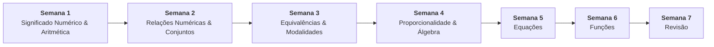

# 📚 Semana 5 — Equações

> **Disciplina:** Matemática Básica (`MMB002-EC-2026S2B2-T001`)  
> **Curso:** Bacharelado em Engenharia de Computação — Univesp  
> **Docente Responsável:** Profª Dra. Rúbia Barcelos Amaral  
> **Período:** 26/10/2026 a 08/11/2026  
> **Status:** 🟢 **Concluído (10,0 / 10,0)**  

---

## 📁 Estrutura de Arquivos da Semana 5

| Arquivo | Descrição | Status |
| :--- | :--- | :---: |
| [**`0-Inicio.md`**](file:///home/henrique/Modelos/Univesp/2026S2B2/MMB002-Matematica-Basica/Semana-5/0-Inicio.md) | Contextualização, objetivos pedagógicos, roteiro oficial e **resolução analítica do Desafio da Ponte (M³ Unicamp)** | 🟢 Pronto |
| [**`2.1-Texto-base-Manual-Compacto-Fracoes.md`**](file:///home/henrique/Modelos/Univesp/2026S2B2/MMB002-Matematica-Basica/Semana-5/2.1-Texto-base-Manual-Compacto-Fracoes.md) | Síntese do Cap. 5 de *Manual Compacto de Matemática* (Bosquilha et al., p. 74–108) e equações fracionárias | 🟢 Pronto |
| [**`2.2-Texto-base-Manual-Compacto-Reais-Radicais.md`**](file:///home/henrique/Modelos/Univesp/2026S2B2/MMB002-Matematica-Basica/Semana-5/2.2-Texto-base-Manual-Compacto-Reais-Radicais.md) | Síntese do Cap. 14 de *Manual Compacto de Matemática* (Bosquilha et al., p. 270–296): Reais, Radicais e Equações Irracionais | 🟢 Pronto |
| [**`2.3-Texto-base-Fundamentos-de-Matematica-Araujo.md`**](file:///home/henrique/Modelos/Univesp/2026S2B2/MMB002-Matematica-Basica/Semana-5/2.3-Texto-base-Fundamentos-de-Matematica-Araujo.md) | Síntese do capítulo de Equação do Primeiro Grau de *Fundamentos de Matemática* (Araujo et al., p. 41–54) | 🟢 Pronto |
| [**`3-Videos-base.md`**](file:///home/henrique/Modelos/Univesp/2026S2B2/MMB002-Matematica-Basica/Semana-5/3-Videos-base.md) | Síntese dos 4 vídeos-base (Ferretto: Equações 1º e 2º Grau / Bhaskara; M³: Esse tal de Bhaskara) | 🟢 Pronto |
| [**`4-Aprofundando-o-tema.md`**](file:///home/henrique/Modelos/Univesp/2026S2B2/MMB002-Matematica-Basica/Semana-5/4-Aprofundando-o-tema.md) | Síntese do applet interativo de Bhaskara e equações quadráticas no GeoGebra (Jorge Cássio) | 🟢 Pronto |
| [**`5-Atividade-avaliativa.md`**](file:///home/henrique/Modelos/Univesp/2026S2B2/MMB002-Matematica-Basica/Semana-5/5-Atividade-avaliativa.md) | Resolução analítica passo a passo de todas as 8 questões avaliativas com validação e **gabarito oficial (10,0 / 10,0)** | 🟢 Pronto |
| [**`6-Forum-tematico.md`**](file:///home/henrique/Modelos/Univesp/2026S2B2/MMB002-Matematica-Basica/Semana-5/6-Forum-tematico.md) | Discussão do fórum, modelagem matemática do desafio e propostas de postagem para o AVA | 🟢 Pronto |
| [**`7-Em-sintese.md`**](file:///home/henrique/Modelos/Univesp/2026S2B2/MMB002-Matematica-Basica/Semana-5/7-Em-sintese.md) | Resumo executivo, formulário de bolso e conexões com algoritmos em Ciência da Computação | 🟢 Pronto |
| [**`desafio_ponte_s5.cpp`**](file:///home/henrique/Modelos/Univesp/2026S2B2/MMB002-Matematica-Basica/Semana-5/desafio_ponte_s5.cpp) | Validador computacional em C++ do sistema linear do Desafio da Ponte com asserções numéricas | 🟢 Pronto |
| [**`resolucao_questoes_s5.cpp`**](file:///home/henrique/Modelos/Univesp/2026S2B2/MMB002-Matematica-Basica/Semana-5/resolucao_questoes_s5.cpp) | Validador computacional em C++ das 8 questões avaliativas da Semana 5 com asserções | 🟢 Pronto |

---

## 🧭 Relação com as Demais Semanas

