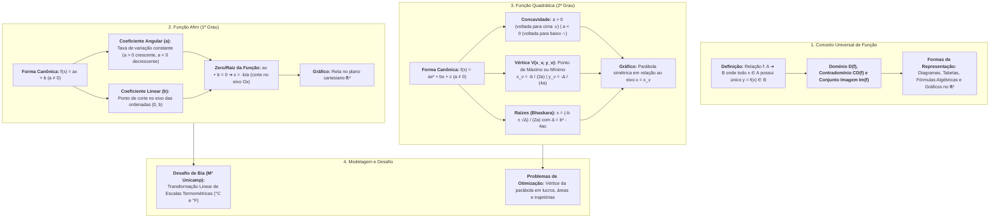
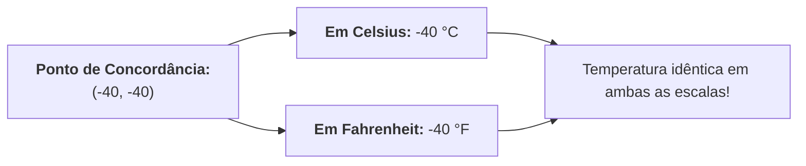

# 📌 Semana 6 — Início & Apresentação da Semana
### Funções: Conceitos, Representações e o Desafio das Escalas de Temperatura

> **Disciplina:** Matemática Básica (`MMB002-EC-2026S2B2-T001`)  
> **Tema da Semana 6:** Funções: Conceitos e Representações (Funções de 1º e 2º Grau)  
> **Docente Responsável:** Profª Dra. Rúbia Barcelos Amaral  
> **Período da Semana 6:** 02/11/2026 a 15/11/2026  
> **Status:** 🟢 **Abertura Oficial, Transcrição e Resolução Analítica do Desafio de Bia**  

---

## 👩‍🏫 Mensagem da Professora & Contextualização

Olá, estudante!

Boas-vindas à sexta semana da disciplina Matemática Básica!

Esta semana será dedicada ao estudo das importantes **funções do 1º e 2º grau**!

Funções são uma parte essencial da matemática e aparecem em várias áreas do conhecimento e aplicações práticas. De forma simplificada, uma função é uma relação entre duas variáveis, e cada valor da variável independente (geralmente representada por $x$) está associado a um único valor da variável dependente (representada por $y$).

Vamos aprender desde a teoria que permeia essas funções, perpassar por exercícios até problemas práticos, uma vez que as funções do 1º e 2º grau têm aplicações em vários contextos do cotidiano de trabalho e vida das pessoas.

Vamos começar!?

---

## 🗺️ Mapa Conceitual da Semana 6



---

## 🎯 Objetivos de Aprendizagem

Ao final desta semana, você deverá ser capaz de:

* [ ] **Entender a definição e os conceitos fundamentais** relacionados às funções de 1º e 2º grau (domínio, imagem, coeficientes e parâmetros).
* [ ] **Analisar e compreender o comportamento dinâmico do gráfico** das funções de 1º grau (retas, inclinações e taxas de crescimento) e de 2º grau (parábolas, concavidade, raízes e pontos extremos).
* [ ] **Plotar e interpretar criticamente no plano cartesiano** o gráfico dessas funções a partir de leis algébricas ou tabelas de dados.
* [ ] **Modelar situações reais e interdisciplinares** por meio de equações e funções afins e quadráticas.

---

## 🧭 Roteiro Oficial de Estudos

1. **Videoaula 17:** Introdução ao conceito de funções, domínio, contradomínio, conjunto imagem e teste da reta vertical.
2. **Videoaula 18:** Função do 1º grau (afim), taxa de variação, coeficientes angular e linear, comportamento e representação gráfica.
3. **Vídeo-base — "Função do 2º grau":** Estudo das funções quadráticas, concavidade, discriminante ($\Delta$), raízes e coordenadas do vértice.
4. **Textos-base:** *Manual Compacto de Matemática* e *Fundamentos de Matemática* (revisão de teoria e exercícios aplicados).
5. **Material-base — "Função de segundo grau":** Simulação e observação interativa das deformações da parábola à medida que os parâmetros $a$, $b$ e $c$ variam.
6. **Vídeo-base — "Funções: analisando o gráfico de funções":** Leitura e interpretação analítica de gráficos no plano cartesiano.

---

## 🎙️ Desafio da Semana: O Problema de Bia e as Escalas de Temperatura

> **Áudio Oficial da Univesp:** [`s6_audio_desafio.mp3`](https://assets.univesp.br/disciplinas/MMB002/audios/s6_audio_desafio.mp3)  
> **Fonte:** Coleção *M³ Matemática Multimídia* — IMECC/Unicamp (Série *Problemas e Soluções*)  
> **Objetivo:** Resolver as duas indagações propostas pela supervisora Cíntia à estudante Bia no Fórum Temático.

---

### 📝 Transcrição Integral do Áudio

*(Locução de abertura: "Este programa faz parte da série Problemas e Soluções, da coleção M³ Matemática Multimídia, e trata de um problema associado a escalas de temperatura.")*

> **Enfermeira Marina:** Oi, Bia! Tudo bom?  
> **Bia:** Oi, enfermeira Marina! Tudo bom, e você?  
> **Enfermeira Marina:** Tudo bem! Então, eu preciso que você guarde esse lote de vacinas no refrigerador, por favor.  
> **Bia:** Ai, Marina, não tem espaço no refrigerador. Preciso ver com a supervisora de manutenção onde podemos colocar essas vacinas. Vou chamá-la.  
> *(Bia faz a ligação)*  
> **Supervisora Cíntia:** Boa tarde, enfermeira Marina! Você me chamou?  
> **Enfermeira Marina:** Chamei sim, supervisora Cíntia. Eu preciso que esse lote de vacinas seja armazenado em um refrigerador.  
> **Supervisora Cíntia:** O nosso refrigerador principal está lotado, mas temos um freezer doado há algum tempo que pode ser usado para guardar as suas vacinas. Acompanhe-me, por favor. Bia, venha também!  
> *(Elas caminham até a sala de manutenção)*  
> **Bia:** Dona Cíntia, eu acho melhor resfriar o interior do freezer primeiro.  
> **Supervisora Cíntia:** Por quê?  
> **Bia:** Porque aqui no termômetro diz que o interior do freezer está com **77 graus**!  
> **Supervisora Cíntia:** Não, impossível! Isso é um freezer, não um forno! Sem falar que estamos na temperatura ambiente. Esse termômetro deve estar quebrado, deixa eu dar uma olhadinha...  
> **Enfermeira Marina:** Nossa, e agora? Se essas vacinas não forem conservadas corretamente, elas vão estragar!  
> **Supervisora Cíntia:** Não se preocupe, enfermeira Marina, eu já identifiquei o problema: é que esse freezer veio dos Estados Unidos, então a escala termométrica dele é em **Fahrenheit**! Sendo assim, creio que a temperatura no interior do freezer esteja normal.  
> **Bia:** Sim! Eu lembro que **77 graus em Fahrenheit correspondem a 25 graus Celsius**! Lembro disso das minhas aulas de física.  
> **Supervisora Cíntia:** Sim, Bia, a conversão entre as duas escalas é uma **função**.  
> **Bia:** Nossa, mas é tão discrepante assim a diferença entre as duas escalas? Não existe um valor em que as duas escalas apresentam a mesma temperatura?  
> **Supervisora Cíntia:** Existe sim! Você sabe, não é, Bia?  
> **Bia:** Eu? Por que eu?  
> **Supervisora Cíntia:** Porque você estuda isso no colegial! Enquanto a enfermeira Marina vai ajeitando as vacinas, eu quero que você **calcule e me fale a resposta** quando ela terminar de guardar as vacinas, tá bom?  
> **Bia:** Mas, dona Cíntia, eu não sei as fórmulas de conversão entre Celsius e Fahrenheit...  
> **Supervisora Cíntia:** Procura na internet que você deve achar, sim. Além disso, **me fala também se o termômetro de mercúrio que a gente usa aguentaria para medir essa temperatura que você achar na resposta!**  
> **Bia:** Entendi, dona Cíntia. Estou vendo que meu tempo livre desta tarde será para resolver esse quebra-cabeça...  
> **Supervisora Cíntia:** Então, enfermeira Marina, acho que o freezer já está na temperatura adequada para as suas vacinas. A Bia vai ficar à sua disposição para qualquer ajuda. Daqui a pouquinho eu volto para cobrar as respostas de você, viu, Bia?  
> **Enfermeira Marina:** Obrigada, supervisora Cíntia!  
> **Bia:** *(suspiro)* Ai, que medo eu tenho da dona Cíntia!  

---

## 🧮 Resolução Matemática Passo a Passo

O desafio proposto pela supervisora Cíntia divide-se em **duas perguntas essenciais**:
1. **Pergunta 1 (Álgebra / Função Afim):** Qual é o valor numérico de temperatura em que a escala Celsius ($^\circ\text{C}$) e a escala Fahrenheit ($^\circ\text{F}$) marcam exatamente o mesmo valor?
2. **Pergunta 2 (Física dos Materiais / Instrumentação):** O termômetro clínico comum de **mercúrio** aguentaria medir essa temperatura?

---

### 🔹 Parte 1: Determinação da Temperatura Comum ($T_C = T_F$)

#### 1. Construção da Lei da Função Afim de Conversão
Sabemos que a relação entre escalas termométricas baseia-se nos pontos fixos da água à pressão de 1 atm:
* **Ponto de Fusão do Gelo:** $0\text{ }^\circ\text{C} \longleftrightarrow 32\text{ }^\circ\text{F}$
* **Ponto de Ebulição da Água:** $100\text{ }^\circ\text{C} \longleftrightarrow 212\text{ }^\circ\text{F}$

Estabelecendo a proporção linear entre os intervalos:
$$\frac{C - 0}{100 - 0} = \frac{F - 32}{212 - 32} \implies \frac{C}{100} = \frac{F - 32}{180}$$

Dividindo ambos os denominadores por 20:
$$\frac{C}{5} = \frac{F - 32}{9}$$

Isolando $F$ como uma **função afim** de $C$ ($f: \mathbb{R} \to \mathbb{R}$):
$$F(C) = \frac{9}{5}C + 32 \quad \text{ou} \quad F(C) = 1{,}8 \cdot C + 32$$

*(Verificação do diálogo: para $C = 25\text{ }^\circ\text{C}$, temos $F = 1{,}8 \cdot 25 + 32 = 45 + 32 = 77\text{ }^\circ\text{F}$, exatamente o valor lido por Bia no termômetro do freezer!)*

---

#### 2. Determinação do Ponto Fixo ($F = C = x$)
Deseja-se encontrar o valor $x$ tal que a temperatura numérica seja idêntica em ambas as escalas, ou seja, o **ponto fixo da função** (intersecção com a bissetriz $y = x$):

$$x = \frac{9}{5}x + 32$$

Multiplicando todos os termos por 5 para eliminar o denominador:
$$5x = 9x + 160$$

Transpondo os termos com $x$:
$$5x - 9x = 160 \implies -4x = 160$$

Dividindo por $-4$:
$$x = \frac{160}{-4} = -40$$

$$\mathbf{-40\text{ }^\circ\text{C} \equiv -40\text{ }^\circ\text{F}}$$

#### 💡 Interpretação Gráfica:
No plano cartesiano onde o eixo das abscissas representa a temperatura em Celsius ($C$) e o eixo das ordenadas representa a temperatura em Fahrenheit ($F$):
* A reta da função de conversão é $r_1: F = 1{,}8C + 32$;
* A reta de igualdade de escalas é $r_2: F = C$;
* O ponto de intersecção das duas retas é exatamente o par ordenado **$(-40, -40)$**.



---

### 🔹 Parte 2: O Termômetro de Mercúrio Aguenta Medir Essa Temperatura?

**Resposta:** **NÃO, o termômetro de mercúrio não aguenta medir essa temperatura!**

#### 🔬 Justificativa Físico-Química:
1. **Ponto de Fusão / Solidificação do Mercúrio ($\text{Hg}$):**  
   O mercúrio elementar passa do estado líquido para o estado sólido a aproximadamente:
   $$T_{\text{fusão}}(\text{Hg}) = -38{,}83\text{ }^\circ\text{C} \quad (\approx -39\text{ }^\circ\text{C})$$

2. **Comportamento a $-40\text{ }^\circ\text{C}$:**  
   Como a temperatura do ponto comum é de **$-40\text{ }^\circ\text{C}$**, ela está **abaixo do ponto de congelamento do mercúrio** ($-40 < -38{,}83$).
   
3. **Consequências Práticas no Instrumento:**  
   * Ao atingir $-38{,}83\text{ }^\circ\text{C}$, o mercúrio dentro do bulbo e capilar de vidro **congela e se solidifica**.
   * Ao congelar, o mercúrio perde a propriedade de dilatação volumétrica linear fluida, tornando impossível qualquer leitura na escala graduada.
   * Além disso, a anomalia de contração/expansão durante a transição de fase pode provocar o rompimento do capilar de vidro do termômetro.

4. **Solução Tecnológica Alternativa:**  
   Para medir temperaturas tão baixas quanto $-40\text{ }^\circ\text{C}$, a equipe hospitalar deve utilizar:
   * **Termômetro de Álcool (Etanol com corante):** O ponto de fusão do etanol é de **$-114\text{ }^\circ\text{C}$**, suportando perfeitamente a faixa de $-40\text{ }^\circ\text{C}$;
   * **Termômetros Digitais (Termopares ou Sensores PT100/NTC):** Que operam por variação de resistência elétrica e operam com precisão em temperaturas criogênicas.

---

## 💻 Validador Computacional em C++23

Criamos um programa em C++ que modela matematicamente as funções de conversão, calcula o ponto de intersecção exato e valida com asserções numéricas as propriedades térmicas do mercúrio:

```cpp
#include <iostream>
#include <iomanip>
#include <cassert>
#include <cmath>

// Função de conversão: Celsius -> Fahrenheit
constexpr double celsius_to_fahrenheit(double c) {
    return (9.0 / 5.0) * c + 32.0;
}

// Função de conversão: Fahrenheit -> Celsius
constexpr double fahrenheit_to_celsius(double f) {
    return (5.0 / 9.0) * (f - 32.0);
}

int main() {
    std::cout << "=== MMB002 - SEMANA 6: DESAFIO DE BIA (ESCALAS DE TEMPERATURA) ===\n\n";

    // 1. Validar a leitura do freezer de Bia (77 F == 25 C)
    double f_freezer = 77.0;
    double c_freezer = fahrenheit_to_celsius(f_freezer);
    std::cout << "[1] Leitura inicial do freezer:\n";
    std::cout << "    " << f_freezer << " deg F = " << c_freezer << " deg C (Temperatura ambiente)\n\n";
    assert(std::abs(c_freezer - 25.0) < 1e-6);

    // 2. Determinar algebricamente o ponto fixo onde C == F
    // x = (9/5)x + 32  =>  -4/5 x = 32  =>  x = -40
    double ponto_comum = -40.0;
    double f_resultado = celsius_to_fahrenheit(ponto_comum);
    double c_resultado = fahrenheit_to_celsius(ponto_comum);

    std::cout << "[2] Calculo da temperatura comum entre Celsius e Fahrenheit:\n";
    std::cout << "    T_C = " << ponto_comum << " deg C -> T_F = " << f_resultado << " deg F\n";
    std::cout << "    T_F = " << ponto_comum << " deg F -> T_C = " << c_resultado << " deg C\n\n";
    assert(std::abs(f_resultado - ponto_comum) < 1e-6);
    assert(std::abs(c_resultado - ponto_comum) < 1e-6);

    // 3. Teste do termômetro de mercúrio
    const double ponto_congelamento_mercurio = -38.83; // deg C
    std::cout << "[3] Analise do termometro de mercurio:\n";
    std::cout << "    Ponto de fusao/congelamento do Mercurio: " << ponto_congelamento_mercurio << " deg C\n";
    std::cout << "    Temperatura a ser medida: " << ponto_comum << " deg C\n";

    if (ponto_comum < ponto_congelamento_mercurio) {
        std::cout << "    RESULTADO: O mercurio CONGELA a " << ponto_congelamento_mercurio 
                  << " deg C!\n    Portanto, o termometro de mercurio NAO aguenta medir -40 deg C.\n";
    }

    std::cout << "\n>>> TODAS AS ASSERCOES MATEMATICAS FORAM VALIDAS COM SUCESSO! <<<\n";
    return 0;
}
```

---

## 📌 Síntese para Postagem no Fórum Temático

A resposta consolidada para a postagem no Fórum Temático da Semana 6 estrutura-se nos seguintes pontos:
1. **A Função Afim de Conversão:** $F(C) = \frac{9}{5}C + 32$, demonstrando a linearidade das escalas;
2. **O Ponto de Igualdade Numérica:** Igualando $F = C = x$, obtém-se algebricamente **$-40\text{ }^\circ\text{C} = -40\text{ }^\circ\text{F}$**;
3. **A Inviabilidade do Termômetro de Mercúrio:** Como o mercúrio se solidifica a **$-38{,}83\text{ }^\circ\text{C}$**, a **$-40\text{ }^\circ\text{C}$** ele já estará congelado, sendo imperativo o uso de termômetro de álcool (etanol, fusão em $-114\text{ }^\circ\text{C}$) ou sensores digitais eletrônicos.
